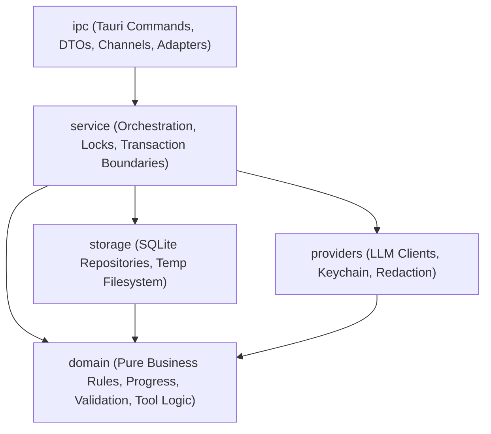
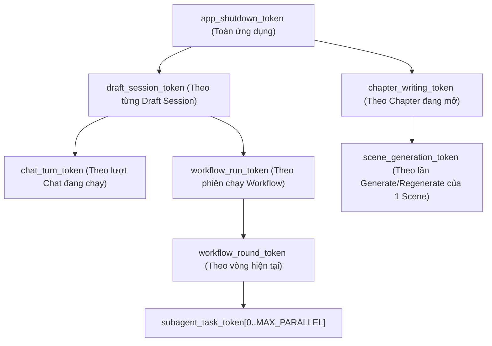

# MERLINK HARNESS — BACKEND CORE SPECIFICATION (`be-core.md`)

> **Phiên bản:** 1.0.3
> **Trạng thái:** Authoritative Backend Architecture & Execution Specification (SF-06 recovery limited by durable evidence; see §14)
> **Ngày ban hành:** 2026-11-07
> **Đối chiếu thẩm quyền (Authoritative SSOTs):**
> - **Nghiệp vụ cốt lõi (Business SSOT):** `docs/business/core.md` (v2.4.5)
> - **Schema cơ sở dữ liệu vật lý (Physical Schema SSOT):** `docs/db.dbml` (đã áp dụng `SF-01`, `SF-02`, `SF-06`, `SF-07`)
> - **Hợp đồng giao diện (Frontend Contract SSOT):** `docs/business/fe-core.md` (v0.3.6)
> - **Danh mục Tool Call:** `docs/business/harness/tools.md`
> - **Kiến trúc ghép Prompt & Vòng lặp ReAct:** `docs/business/prompts/overview.md`

---

## 0. QUY ƯỚC ĐẶC TẢ & PHÂN ĐỊNH THẨM QUYỀN

### 0.1 Từ khóa chuẩn hóa (Normative Keywords)

Tài liệu này sử dụng các từ khóa chuẩn theo RFC 2119 để phân biệt bất biến bắt buộc và lựa chọn triển khai:

- **`MUST` / `MUST NOT` (Bắt buộc):** Bất biến kiến trúc hoặc quy tắc đúng đắn dữ liệu bắt buộc. Vi phạm điều kiện `MUST` làm hỏng tính toàn vẹn nghiệp vụ, an toàn đồng thời hoặc khả năng phục hồi sau sự cố.
- **`SHOULD` / `SHOULD NOT` (Khuyến nghị):** Thực hành kỹ thuật được khuyến nghị mạnh mẽ cho kiến trúc Modular Monolith trên Tauri v2 + Rust + SQLite. Chỉ được chọn hướng khác khi có lý do kỹ thuật rõ ràng và vẫn thỏa mãn mọi điều kiện `MUST`.
- **`MAY` (Tùy chọn):** Tối ưu hóa hoặc cấu trúc phụ trợ tùy chọn (ví dụ: pool kết nối đọc riêng, bộ đệm chỉ mục trong bộ nhớ, gom nhịp token streaming). Không được coi `MAY` là yêu cầu bắt buộc khi nghiệm thu.

### 0.2 Quy tắc phân quyền nguồn sự thật (Authority Hierarchy)

1. **`docs/business/core.md` (v2.4.5)** định nghĩa hành vi nghiệp vụ, quy tắc 7 phase, nguồn gốc dữ liệu (`source`), Cascade Delete (`Q1`), phục hồi Workflow phân đoạn (`Q3`), và hợp đồng Writing Mode (`Q4`, `H1–H3`, `Decision 1B`, `Decision 2A`).
2. **`docs/db.dbml`** định nghĩa cấu trúc bảng, cột, kiểu dữ liệu, enum và index vật lý trong SQLite.
3. **`docs/business/fe-core.md` (v0.3.6)** định nghĩa yêu cầu tương tác giao diện, trạng thái màn hình và bất biến bảo toàn giao diện (`§12.1 UI Preservation Invariant`).
4. **`docs/business/be-core.md` (tài liệu này)** định nghĩa cách thức tầng Backend (Tauri v2 / Rust / SQLite) thực thi các hợp đồng trên một cách chính xác, nguyên tử, an toàn đồng thời và có khả năng phục hồi tất định sau crash.
5. Backend Core `MUST NOT` tự định nghĩa lại quy tắc nghiệp vụ của `core.md` và `MUST NOT` tự ý thêm bảng/cột ngoài `docs/db.dbml`. Mọi điểm lệch phát hiện giữa các tài liệu được ghi nhận tường minh tại mục **Open Technical Issues** ở cuối tài liệu.

---

## §1. Backend Architecture (Kiến trúc tổng thể Backend)

### 1.1 Kiến trúc Modular Monolith trên Tauri v2

Merlink Harness Backend `MUST` được tổ chức theo mô hình **Local-First Modular Monolith** viết bằng **Rust** bên trong tiến trình chính của **Tauri v2** (`src-tauri`). Hệ thống `MUST NOT` tách microservice, `MUST NOT` dùng message broker ngoài, `MUST NOT` dùng framework Event Sourcing hay CQRS phức tạp.

### 1.2 Cấu trúc thư mục và Module Rust (`src-tauri`)

```text
src-tauri/
├── Cargo.toml
├── tauri.conf.json
├── capabilities/
│   └── default.json                 # Tauri v2 least-privilege desktop capabilities
├── migrations/
│   ├── 0001_initial_schema.sql      # DDL chuẩn hóa từ docs/db.dbml (gồm SF-01, SF-02, SF-06, SF-07)
│   └── 0002_seed_reference_data.sql # Seed motifs, genres, style_presets, narrator_configs, prompt_blocks, tools
└── src/
    ├── main.rs                      # Entry point desktop
    ├── lib.rs                       # Tauri Builder::setup, đăng ký AppState & IPC commands
    ├── error.rs                     # AppError, ErrorCode, chuẩn hóa lỗi trả về IPC
    ├── state.rs                     # AppState, DraftRuntimeRegistry, WritingRuntimeRegistry
    ├── ipc/                         # Tầng giao tiếp Typed IPC (Commands + Tauri Channels)
    │   ├── mod.rs
    │   ├── dto.rs                   # Request/Response DTOs (serde + ts-rs)
    │   ├── adapter.rs               # Chuyển đổi snake_case <-> camelCase cho FE Read-Models
    │   ├── chat_commands.rs
    │   ├── draft_commands.rs
    │   ├── workflow_commands.rs
    │   ├── commit_commands.rs
    │   ├── project_commands.rs
    │   ├── character_commands.rs
    │   ├── writing_commands.rs
    │   └── config_commands.rs
    ├── service/                     # Tầng điều phối Use-Case, Transaction & Concurrency
    │   ├── mod.rs
    │   ├── chat_service.rs          # Điều phối lượt chat, ReAct loop, niêm phong version cuối lượt
    │   ├── draft_service.rs         # Quản lý WorkingState, confirm/reject patch, restore, confirm_phase
    │   ├── workflow_service.rs      # Orchestrator Phase 1-2 và Phase 3-6, Completion Receipts (SF-06)
    │   ├── commit_service.rs        # Commit Draft sang bảng quan hệ trong 1 transaction (H2)
    │   ├── writing_service.rs       # Scene Lock (LOCK-01), Generation Stream (SCOPE-01), Save Chapter (SF-02)
    │   ├── project_service.rs       # Truy vấn Project, Arc, Chapter, Character Library
    │   └── recovery_service.rs      # Quy trình khôi phục tất định khi khởi động (Startup Recovery)
    ├── domain/                      # Tầng lõi nghiệp vụ thuần (Pure Rust, KHÔNG chứa I/O, SQLite, HTTP, Tauri)
    │   ├── mod.rs
    │   ├── business_flow.rs         # Cấu trúc BusinessFlowData, FieldValue<T>, ProvenanceSource, _counters
    │   ├── code_allocator.rs        # Thuật toán cấp slug code tất định và bộ đếm theo cha
    │   ├── progress_engine.rs       # Đánh giá 46 Master Attributes & Composite Provenance
    │   ├── cascade_delete.rs        # Ma trận Cascade Delete (Q1) & 9 bước bảo vệ bắt buộc
    │   ├── invariants.rs            # Hàm thuần validate(draft) kiểm tra bất biến cấp thực thể và toàn truyện
    │   ├── workflow_planner.rs      # Hàm thuần plan_outline_runs, split_balanced, plan_phase, context_range
    │   ├── fingerprint.rs           # RFC 8785 JCS Canonical JSON & SHA-256 cho data_hash / scope_fingerprint
    │   ├── word_count.rs            # Bộ đếm từ đa ngôn ngữ (UAX #29 + CJK) cho Writing Mode
    │   └── tools/                   # Định nghĩa chữ ký, schema, caller gate và logic kiểm tra của bộ Tool
    │       ├── mod.rs
    │       ├── registry.rs          # ToolRegistry, ToolMeta (writes_draft_state, allowed_callers)
    │       ├── read_tools.rs        # get_field_null, get_array_element_fields, get_state, lookup_outline...
    │       └── write_tools.rs       # add_*, set_*, delete_* theo từng thực thể
    ├── storage/                     # Tầng truy xuất SQLite & Quản lý File tạm
    │   ├── mod.rs
    │   ├── db.rs                    # Khởi tạo kết nối SQLite, PRAGMAs, Write Lock, Read Pool/Connections
    │   ├── migration.rs             # Quản lý PRAGMA user_version và chạy migration nguyên tử
    │   ├── draft_repo.rs            # Truy vấn draft_sessions, draft_versions, pending_patches
    │   ├── workflow_repo.rs         # Truy vấn workflow_task_receipts (SF-06)
    │   ├── commit_repo.rs           # Ghi hàng loạt thực thể khi commit_draft
    │   ├── writing_repo.rs          # Truy vấn scenes, scene_versions (SF-07), chapter_save_receipts (SF-02)
    │   ├── catalog_repo.rs          # Tra cứu danh mục tĩnh (genres, motifs, style_presets, prompt_blocks...)
    │   └── temp_store.rs            # Quản lý <configured_temp_root>/<draft_session_id>/<phase>/
    └── providers/                   # Tầng kết nối LLM & Bảo mật thông tin xác thực
        ├── mod.rs
        ├── traits.rs                # LlmProvider trait, ChatRequest, StreamEvent
        ├── ollama.rs                # Adapter gọi Ollama API cục bộ
        ├── opencode.rs              # Adapter gọi OpenCode / OpenAI-compatible API
        ├── credentials.rs           # OS Keychain (keyring) + Session-only RAM fallback
        └── redaction.rs             # Bộ lọc che giấu API key / secret trên toàn bộ log và thông báo lỗi
```

### 1.3 Chiều phụ thuộc (Dependency Direction)

Chiều phụ thuộc giữa các module `MUST` tuân thủ nghiêm ngặt quy tắc một chiều từ trên xuống (Directed Acyclic Graph):



- **`domain`:** `MUST` hoàn toàn thuần khiết (pure functions & data structures). `domain` `MUST NOT` phụ thuộc vào `rusqlite`, `tokio::fs`, `reqwest`, hay `tauri`. Mọi hàm như `calculate_progress`, `validate_draft`, `plan_phase`, `evaluate_cascade_delete` đều nhận dữ liệu trong bộ nhớ và trả về kết quả tất định để kiểm thử đơn vị (unit test) đạt tốc độ mili-giây.
- **`storage` và `providers`:** Phụ thuộc vào các kiểu dữ liệu của `domain`, nhưng `MUST NOT` gọi ngược lên `service` hay `ipc`.
- **`service`:** Là nơi duy nhất điều phối khóa đồng thời (`DraftEntry` mutex), mở/đóng giao dịch SQLite (`BEGIN IMMEDIATE`), gọi mạng thông qua `providers`, và áp dụng kết quả từ `domain` xuống `storage`.
- **`ipc`:** Chỉ giải mã tham số đầu vào từ Frontend, xác thực ngữ cảnh người gọi (`CallerContext::UiAction`), gọi hàm tương ứng ở `service`, chuyển đổi kết quả qua `adapter` (nếu cần), và trả về kiểu lỗi đã chuẩn hóa.

### 1.4 Vòng đời ứng dụng Tauri v2 & Quyền sở hữu `AppState`

#### 1.4.1 Khởi tạo (`Builder::setup`)

Khi ứng dụng khởi chạy, hàm `tauri::Builder::default().setup(...)` `MUST` thực hiện tuần tự các bước sau trước khi mở cửa sổ chính cho người dùng tương tác:

1. **Khởi tạo hệ thống ghi nhật ký có bộ lọc bảo mật (`redaction`):** Cài đặt subscriber cho `tracing` kèm lớp lọc tự động xóa mọi chuỗi khớp mẫu khóa API (`sk-*`, `Bearer *`, và các khóa đang nạp trong `CredentialStore`).
2. **Chuẩn bị thư mục dữ liệu ứng dụng:** Xác định thư mục `app_data_dir` chuẩn của hệ điều hành và thư mục làm việc tạm `./merlink-harness/tmp/` với quyền truy cập giới hạn chỉ cho tài khoản người dùng hiện tại (`0700` trên Unix).
3. **Khởi tạo SQLite & Chạy Migration (`storage::db::init`):**
   - Mở kết nối ghi duy nhất và thiết lập các `PRAGMA` bắt buộc (§3.1).
   - Đọc và kiểm tra phiên bản schema qua `PRAGMA user_version` (nguồn sự thật duy nhất theo dõi phiên bản migration), từ chối khởi chạy nếu phiên bản DB cao hơn phiên bản ứng dụng hỗ trợ, tạo bản sao lưu trước khi nâng cấp DB hiện có, và thực thi tuần tự từng migration trong giao dịch nguyên tử `BEGIN IMMEDIATE ... COMMIT` (§3.4).
   - Chạy kiểm tra toàn vẹn vật lý, khóa ngoại và đối soát cấu trúc schema thực tế (`sqlite_master`, `PRAGMA table_info`, `PRAGMA index_list`, `PRAGMA foreign_key_list`) đối với `docs/db.dbml` cùng `SF-01`, `SF-02`, `SF-06`, `SF-07` (§3.5).
4. **Thực thi quy trình Phục hồi sau sự cố (`recovery_service::run_startup_recovery`):**
   - Đưa các `draft_sessions` bị kẹt ở trạng thái `'committing'` về lại `'editing'` (§11.2.1).
   - Đối chiếu `messages.payload_json` với `draft_versions` để đánh dấu các lượt AI bị gián đoạn trước khi kịp niêm phong (§11.2.2).
   - Dọn dẹp các thư mục tạm mồ côi hoặc báo cáo không còn khớp với trạng thái đã niêm phong (§11.2.5).
5. **Khởi tạo và đăng ký `AppState`:** Đưa `AppState` vào `app.manage(app_state)`.

#### 1.4.2 Cấu trúc sở hữu `AppState`

```rust
pub struct AppState {
    pub db: DbManager,
    pub drafts: DraftRuntimeRegistry,
    pub writing: WritingRuntimeRegistry,
    pub providers: ProviderRegistry,
    pub credentials: CredentialManager,
    pub config: Arc<RwLock<RuntimeConfig>>,
    pub app_shutdown_token: CancellationToken,
}
```

- **`DbManager`:** Sở hữu kết nối ghi được tuần tự hóa (`Arc<tokio::sync::Mutex<rusqlite::Connection>>` hoặc kênh gửi tới luồng ghi chuyên biệt) và tập kết nối chỉ đọc (`r2d2` / `deadpool` hoặc các kết nối `SQLITE_OPEN_READ_ONLY`).
- **`DraftRuntimeRegistry`:** Quản lý trạng thái làm việc trong bộ nhớ của từng bản nháp theo `draft_session_id` (`DashMap<Uuid, Arc<DraftRuntimeEntry>>`).
- **`WritingRuntimeRegistry`:** Quản lý các phiên sinh nội dung cảnh đang chạy (`ActiveGenerationStream`) và phạm vi sửa theo request (`EditScope`) của Writing Mode theo `chapter_id`.
- **`CredentialManager`:** Giao diện truy cập OS Keychain và bộ nhớ tạm trong phiên (`SessionKeyStore`).

#### 1.4.3 Đóng ứng dụng an toàn (Graceful Shutdown)

Khi nhận tín hiệu đóng cửa sổ cuối cùng hoặc sự kiện `RunEvent::ExitRequested`:
1. Backend kích hoạt `app_shutdown_token.cancel()`, truyền tín hiệu hủy xuống mọi `turn_cancel_token`, `workflow_cancel_token` và `generation_cancel_token` đang hoạt động.
2. Chờ tối đa `2000ms` để bất kỳ giao dịch SQLite đang mở nào hoàn tất commit hoặc rollback tự nhiên.
3. Thực thi `PRAGMA wal_checkpoint(TRUNCATE);` và `PRAGMA optimize;` trên kết nối ghi trước khi đóng kết nối.

### 1.5 Lan truyền lỗi (Error Propagation)

Backend `MUST` phân tách rõ hai loại lỗi theo đúng `core.md` §1.4.7, §3.8 và `prompts/overview.md`:

1. **Tín hiệu từ chối nghiệp vụ trong Tool Call (`ToolRejection`):**
   - Khi AI gọi tool với tham số sai enum, sai kiểu, `code` không tồn tại, vi phạm bất biến thực thể, hoặc bị chặn xóa do `referenced_entity_in_use`, tool handler `MUST NOT` trả về `Err(ToolInfraError)`.
   - Thay vào đó, handler `MUST` trả về `Ok(ToolExecutionOutput)` mang `"status": "rejected"` kèm mã lỗi có cấu trúc (`error`), giá trị đầu vào (`input`) và danh sách gợi ý (`candidates` nếu có) để vòng lặp ReAct ghi nhận làm `observation` cho AI tự điều chỉnh hoặc tăng `consecutive_rejected_count`.
2. **Lỗi hạ tầng và Lỗi cấp Command IPC (`AppError`):**
   - Các lỗi thực sự ở tầng hệ thống (lỗi ổ cứng/SQLite, hết thời gian chờ khóa `DraftLockTimeout`, lỗi niêm phong `VersionSealFailed`, mất kết nối tới model provider, hoặc lỗi xác thực IPC từ UI) `MUST` được biểu diễn bằng kiểu `AppError` có mã lỗi định danh ổn định:

```rust
#[derive(Debug, Serialize, Deserialize, Clone)]
#[serde(rename_all = "snake_case")]
pub enum ErrorCode {
    DraftBusy,                      // Quá hạn chờ khóa ghi draft (DRAFT_LOCK_TIMEOUT)
    DraftNotEditable,               // Draft đang ở trạng thái committing hoặc committed
    DraftReopenForbidden,           // Mở lại draft khi đã có nội dung cảnh được viết
    PendingPatchesExist,            // Bấm Start/Commit khi còn pending_patches ở trạng thái pending
    ValidationFailed,               // Vi phạm bất biến khi confirm_phase hoặc commit_draft
    CodeCollisionOnCommit,          // Trùng code thực thể với DB khi commit_draft
    VersionSealFailed,              // Niêm phong draft_versions thất bại sau khi đã thử lại 1 lần
    SealKeyPayloadMismatch,         // Trùng seal_key nhưng khác data_hash hoặc metadata (SF-01)
    IdempotencyKeyPayloadMismatch,  // Trùng client_save_id nhưng khác payload_hash (SF-02)
    StaleWorkflowReceipt,           // Biên nhận workflow không khớp fingerprint hiện tại (SF-06)
    SceneLocked,                    // Thao tác viết/Accept/Save chạm cảnh có is_locked == true (LOCK-04/05)
    OutOfEditScope,                 // AI cố sinh nội dung cho cảnh ngoài EditScope (SCOPE-01)
    GenerationInvalidatedByLock,    // Cố Accept một generation đã bị hủy do Lock giữa chừng (Q4.6)
    OccVersionMismatch,             // expected_version_number != MAX(scene_versions.version_number) (Q4.2)
    UnauthorizedCaller,             // AI cố gọi tool dành riêng cho UI/CLI
    EntityNotFound,                 // Không tìm thấy bản ghi theo ID hoặc code
    ProviderUnreachable,            // Không kết nối được Ollama / OpenCode
    ProviderAuthFailed,             // Thiếu hoặc sai API Key
    UnsupportedSchemaVersion,       // Phiên bản PRAGMA user_version của DB cao hơn phiên bản ứng dụng hỗ trợ (§3.4)
    MigrationFailed,                // Lỗi khi chạy migration hoặc đối soát cấu trúc schema lúc khởi động (§3.4, §3.5)
    DatabaseError,                  // Lỗi SQLite nội bộ
    InternalError,                  // Lỗi bất ngờ khác
}

#[derive(Debug, Serialize, Deserialize, Clone)]
#[serde(rename_all = "camelCase")]
pub struct IpcError {
    pub code: ErrorCode,
    pub message: String,
    pub details: Option<serde_json::Value>,
    pub retryable: bool,
}
```

### 1.6 Tổ chức Hệ thống File Cục bộ (Local Filesystem Organization)

Toàn bộ dữ liệu trên đĩa của Merlink Harness `MUST` tuân thủ cấu trúc đường dẫn chuẩn hóa duy nhất sau:

```text
<app_data_dir>/merlink-harness/
├── db/
│   ├── merlink.sqlite3              # File cơ sở dữ liệu SQLite chính (Canonical Database Path)
│   ├── merlink.sqlite3-wal          # Write-Ahead Log sidecar file
│   └── merlink.sqlite3-shm          # Shared-memory index sidecar file cho WAL
├── backups/
│   └── merlink_pre_migration_*.bak  # Bản sao lưu tự động trước khi chạy migration nâng version
└── logs/
    └── backend.log                  # Nhật ký hệ thống (đã qua bộ lọc redaction, xoay vòng theo dung lượng)

./merlink-harness/tmp/               # Hoặc <app_data_dir>/merlink-harness/tmp/ (cấu hình đồng nhất)
└── <draft_session_id>/
    └── <phase>/                     # Chứa các file báo cáo trung gian (Phase 3 thăm dò...)
        └── task_<hash>.md
```

- **Phân định tường minh 5 nhóm đường dẫn hệ thống file (`MUST`):**
  1. **Đường dẫn cơ sở dữ liệu chính (`Canonical Database Path`):** `<app_data_dir>/merlink-harness/db/merlink.sqlite3` là đường dẫn chuẩn duy nhất trên toàn bộ hệ thống (§1.6, §3.4, §9.3). Tuyệt đối không sử dụng đường dẫn cạnh tranh như `data/merlink.db`.
  2. **Các file phụ trợ WAL & SHM (`WAL and SHM Sidecar Files`):** `<app_data_dir>/merlink-harness/db/merlink.sqlite3-wal` và `<app_data_dir>/merlink-harness/db/merlink.sqlite3-shm` do SQLite tự động quản lý trong cùng thư mục `db/` với file cơ sở dữ liệu chính.
  3. **Thư mục sao lưu (`Backup Directory`):** `<app_data_dir>/merlink-harness/backups/merlink_pre_migration_v{current_version}_{timestamp}.bak`, tách biệt hoàn toàn với thư mục `db/`.
  4. **Thư mục file báo cáo workflow tạm thời (`Temporary Workflow Files`):** `<configured_temp_root>/<draft_session_id>/<phase>/task_<hash>.md`, trong đó `<configured_temp_root>` mặc định `./merlink-harness/tmp/`, hoặc `<app_data_dir>/merlink-harness/tmp/` khi cấu hình thống nhất cả đọc/ghi/dọn dẹp; không đổi đường dẫn DB chuẩn.
  5. **Các file nguồn SQL Migration (`Migration SQL Source Files`):** `src-tauri/migrations/0001_initial_schema.sql`, `src-tauri/migrations/0002_seed_reference_data.sql` (nằm trong cây mã nguồn phát triển và được nhúng tĩnh vào binary qua `include_str!` lúc biên dịch).
- **Quy tắc nghiêm ngặt cho thư mục tạm (`core.md` §1.4.2, §3.9):**
  1. Thư mục tạm được cấu hình thống nhất (`./merlink-harness/tmp/` theo core.md, hoặc `<app_data_dir>/merlink-harness/tmp/` khi cấu hình rõ ràng) chỉ được đọc/ghi bởi tầng `storage::temp_store` của Backend thông qua lệnh từ Orchestrator hoặc tool `write_phase_report` / `read_phase_reports`.
  2. Đường dẫn `draft_session_id` và `phase` `MUST` được kiểm tra chặt (chỉ chấp nhận UUID hợp lệ cho `draft_session_id` và số nguyên `1..=6` cho `phase`; tuyệt đối chặn mọi chuỗi chứa `..`, `/` hoặc `\` để chống tấn công Path Traversal).
   3. Khi workflow hoàn tất hoặc bản nháp `committed`, Backend `MUST` dọn `<configured_temp_root>/<draft_session_id>/` theo đúng root đã dùng để đọc/ghi; không dọn nhầm root khác.

---

## §2. Concurrency Model (Mô hình Đồng thời & Quản lý Khóa)

### 2.1 Nguyên tắc Vàng: Không bao giờ giữ Transaction hoặc Khóa DB qua lệnh chờ mạng (`await`)

> **[!IMPORTANT]**
> **Bất biến bắt buộc (`MUST`):** Không một luồng thực thi nào trong Merlink Harness được phép mở giao dịch SQLite (`BEGIN`, `BEGIN IMMEDIATE`, `BEGIN EXCLUSIVE`) hoặc giữ khóa kết nối ghi SQLite (`db_write_lock`) trong khi đang thực hiện lệnh gọi mạng bất đồng bộ (`llm_provider.chat(...).await` hoặc nhận luồng streaming). Mọi giao dịch SQLite `MUST` chỉ thực hiện các thao tác đọc/ghi dữ liệu cục bộ trên đĩa và kết thúc (`COMMIT` hoặc `ROLLBACK`) trong phạm vi vài mili-giây đến vài chục mili-giây.

### 2.2 Tuần tự hóa Ghi trên SQLite (SQLite Write Serialization)

SQLite chỉ cho phép đúng một giao dịch ghi tại một thời điểm trên một file cơ sở dữ liệu. Để loại bỏ hoàn toàn lỗi `SQLITE_BUSY` giữa các luồng Tokio:

- Backend `MUST` duy trì một cổng ghi duy nhất (`WriteHandle`) được bảo vệ bởi một `tokio::sync::Mutex<rusqlite::Connection>` (hoặc một luồng MPSC Writer Actor chuyên biệt).
- Mọi giao dịch ghi `MUST` bắt đầu bằng câu lệnh `BEGIN IMMEDIATE;` ngay khi lấy được quyền truy cập `WriteHandle`. Việc dùng `BEGIN IMMEDIATE` (thay vì `BEGIN DEFERRED` mặc định) bảo đảm SQLite cấp khóa ghi ngay lập tức tại thời điểm mở giao dịch, ngăn chặn triệt để lỗi nâng cấp khóa gây deadlock (`SQLITE_BUSY` giữa chừng khi hai kết nối cùng đọc rồi cùng muốn ghi).
- Các thao tác đọc thuần túy (`SELECT` cho giao diện hoặc tool đọc) `SHOULD` đi qua tập kết nối chỉ đọc (`ReadPool` với cờ `SQLITE_OPEN_READ_ONLY`). Nhờ chế độ `journal_mode = WAL`, các kết nối đọc không bao giờ chặn kết nối ghi và kết nối ghi không bao giờ chặn các kết nối đọc.

### 2.3 Tuần tự hóa Thao tác Đổi Trạng thái theo từng Bản nháp (Per-Draft Mutation Serialization)

Theo `core.md` §3.6 và §3.9, mỗi bản nháp (`draft_session_id`) là một đơn vị sở hữu trạng thái độc lập:

```rust
pub struct DraftRuntimeEntry {
    pub draft_session_id: Uuid,
    /// Khóa tuần tự hóa cấp thao tác nghiệp vụ (Turn / UI Edit / Patch Confirm / Workflow Round / Commit)
    pub operation_lock: tokio::sync::Mutex<DraftOperationGuardState>,
    /// Trạng thái làm việc hiện hành trong bộ nhớ, cho phép đọc snapshot nhanh không cần chờ operation_lock
    pub working_state: std::sync::RwLock<Arc<WorkingState>>,
    /// Token hủy cho thao tác đang giữ operation_lock (nếu có)
    pub active_cancel_token: std::sync::Mutex<Option<CancellationToken>>,
}
```

1. **Khóa thao tác cấp bản nháp (`operation_lock`):**
   - Cùng một thời điểm trên một `draft_session_id`, chỉ **một** trong các tác nhân sau được giữ `operation_lock`:
     - Một lượt hội thoại AI (`run_ai_turn`).
     - Một vòng thực thi của Workflow phân đoạn (`run_workflow_round`).
     - Một thao tác ghi từ người dùng trên UI (`manual_edit`, `confirm_patch`, `reject_patch`, `confirm_all_patches`, `restore_version`, `confirm_phase`).
     - Thao tác chuyển dữ liệu sang bảng quan hệ (`commit_draft`).
   - Khi một tác nhân mới yêu cầu lấy `operation_lock`, nó `MUST` dùng `tokio::time::timeout(Duration::from_secs(draft_lock_timeout), entry.operation_lock.lock())` với `DRAFT_LOCK_TIMEOUT` mặc định là **30 giây** (`core.md` §3.6, §3.9).
   - Nếu hết 30 giây mà chưa lấy được khóa, yêu cầu mới `MUST` thất bại ngay với mã lỗi `ErrorCode::DraftBusy` ("draft đang bận") mà không làm ảnh hưởng tác nhân đang chạy.
   - `DRAFT_LOCK_TIMEOUT` `MUST` chỉ áp dụng cho thời gian **chờ lấy khóa**, tuyệt đối `MUST NOT` áp giới hạn 30 giây cho thời gian **giữ khóa thực thi** của một lượt AI hay một vòng workflow.
2. **Đọc đồng thời không chặn (`Concurrent Reads`):**
   - Khi `operation_lock` đang bị giữ bởi một lượt AI hoặc một vòng workflow, người dùng trên giao diện vẫn được phép xem dữ liệu bản nháp, chuyển tab hoặc mở hộp thoại tiến độ (`core.md` §3.9, `fe-core.md` WF-02).
   - Các lệnh đọc này `MUST NOT` chờ `operation_lock`; chúng chỉ lấy khóa đọc ngắn hạn trên `working_state: std::sync::RwLock<Arc<WorkingState>>` (chỉ tốn vài nano-giây để nhân bản con trỏ `Arc<WorkingState>`) hoặc đọc trực tiếp từ kết nối đọc SQLite.
   - Để tránh nhìn thấy trạng thái dở dang khi một tool call đang sửa giữa chừng, mỗi tool call khi cập nhật `working_state` sẽ thực hiện nguyên tử việc tạo bản sao mới (`Arc::make_mut` / clone-on-write) và hoán đổi con trỏ `Arc` dưới `working_state.write()`.

### 2.4 Đồng thời trong Lượt gọi LLM và Subagent Song song

1. **Trong một lượt Chat thông thường (`Single-Turn ReAct Loop`):**
   - Lượt chat giữ `operation_lock` của `draft_session_id` đó để bảo đảm không có thao tác sửa tay hay lượt chat khác xen vào làm đổi `WorkingState` giữa các vòng `reason -> act -> observe`.
   - Trong khi chờ `llm_provider.chat(...).await`, luồng **không** giữ bất kỳ khóa `working_state.write()` hay khóa `db_write_lock` nào.
   - Khi model trả về danh sách `tool_calls[]`, các tool call trong cùng một phản hồi được thực thi **tuần tự** từng cái một theo đúng thứ tự model phát ra (`prompts/overview.md`).
2. **Trong một vòng Workflow phân đoạn (`Phase 3–6 Parallel Subagents` — `core.md` §3.9 `Q3.5`):**
   - Orchestrator giữ `operation_lock` của `draft_session_id` cho vòng hiện tại.
   - Trong một vòng có tối đa `MAX_PARALLEL` (mặc định `6`) subagent:
     - **Giai đoạn suy luận & gọi mạng (Parallel Compute Phase):** Các subagent chạy song song trên các task Tokio độc lập. Mỗi subagent chỉ nhận một bản chụp bất biến (`Arc<WorkingState>`) của trạng thái đầu vòng cùng phạm vi ngữ cảnh được giao (`assigned_scope`). Các subagent thực hiện gọi LLM song song (`Semaphore` giới hạn ở `MAX_PARALLEL = 6`) và thu thập các đề xuất thay đổi (hoặc chạy ReAct loop trên bản sao cô lập của phạm vi được giao).
     - **Giai đoạn áp dụng thay đổi tất định (Deterministic Mutation Application Phase):** Khi các subagent trong vòng kết thúc, mọi thay đổi ghi vào `WorkingState` dùng chung `MUST` được áp dụng tuần tự theo đúng chỉ số thứ tự task trong kế hoạch vòng (`task_index = 0, 1, ..., k-1`), **tuyệt đối không** áp dụng theo thứ tự trả kết quả mạng ngẫu nhiên (`network completion order`).
     - Mỗi subagent chỉ được phép ghi vào đúng `explicit_write_scope` đã được cấp cho `task_identity` của nó; bất kỳ tool call nào của subagent cố ghi ra ngoài `assigned_scope` của task đó `MUST` bị từ chối với `"status": "rejected"`, `"error": "out_of_task_write_scope"`.
     - Bộ đếm cấp mã định danh (`_counters`) được cập nhật tuần tự trong bước áp dụng tất định này, bảo đảm 100% hai subagent không bao giờ sinh trùng `code` và kết quả `code` hoàn toàn tất định.

### 2.5 Phân cấp Hủy có Kiểm soát (Cooperative Cancellation Hierarchy)

Hệ thống sử dụng cây `tokio_util::sync::CancellationToken` phân cấp rõ ràng:



- **Hủy lượt Chat:** Hủy ngay request HTTP đang chờ tới LLM; nếu đã có tool ghi đạt `applied` trong lượt đó trước thời điểm hủy, hàm ngoài `run_ai_turn` vẫn thực thi bước niêm phong `seal_turn_version` để không làm lệch trạng thái giữa RAM và đĩa (`prompts/overview.md`).
- **Hủy Workflow phân đoạn (`core.md` §3.9):**
  1. Đánh dấu cờ `cancel_requested = true` và kích hoạt `workflow_run_token.cancel()` để dừng việc khởi tạo subagent mới hoặc vòng mới.
  2. **Không** ngắt ngang một tool mutation đang thực thi trong bộ nhớ; chờ bước áp dụng hiện tại hoàn tất.
  3. Nếu vòng hiện tại có các task đã hoàn tất trước thời điểm hủy (hoặc có thay đổi đã đạt `applied`), Backend `MUST` thực thi giao dịch `TX-04` (`seal_workflow_round_tx` — §6.4.5): nếu trạng thái cuối vòng khác với baseline đầu vòng (`net_round_state_changed == true`), niêm phong đúng một version `reason = 'workflow_round'` kèm các biên nhận hoàn tất; nếu các phép ghi `applied` triệt tiêu nhau hoặc ghi giá trị trùng với baseline (`net_round_state_changed == false`), ghi bền vững các biên nhận với `had_mutations = 0, resulting_version_seq = NULL` mà không tạo version giả và không báo lỗi `VersionSealFailed` giả.
  4. Giải phóng `operation_lock` và trả về trạng thái đã hủy có kiểm soát cùng thông tin phục vụ `resume`.
- **Hủy luồng sinh cảnh trong Writing Mode (`core.md` §1.6 `LOCK-04`, `Q4.6`):**
  - Khi người dùng bấm nút **Cancel** hoặc bấm **Lock** trên cảnh đang sinh (`status == streaming`), Backend kích hoạt ngay `scene_generation_token.cancel()`, đóng kết nối stream tới LLM, giữ nguyên văn bản tạm đã gửi tới UI để tham khảo nhưng đánh dấu phiên sinh đó là `cancelled` (hoặc `invalidated_by_lock` với `authorization_valid = false` nếu do Lock).

### 2.6 Thứ tự Lấy Khóa & Phòng chống Deadlock (Lock Acquisition Order & Deadlock Prevention)

Để loại bỏ hoàn toàn nguy cơ deadlock (chu trình chờ khóa vòng tròn), mọi hàm trong Backend `MUST` tuân thủ thứ tự lấy khóa nghiêm ngặt từ ngoài vào trong như sau:

$$\text{Level 1: }\texttt{DraftRuntimeEntry::operation\_lock} \quad \longrightarrow \quad \text{Level 2: }\texttt{DbManager::db\_write\_lock} \quad \longrightarrow \quad \text{Level 3: }\texttt{DraftRuntimeEntry::working\_state (RwLock)}$$

**Các quy tắc cưỡng chế chống Deadlock (`MUST`):**
1. Một luồng đang giữ `db_write_lock` (Level 2) `MUST NOT` bao giờ gọi ngược để yêu cầu lấy `operation_lock` (Level 1).
2. Khóa `working_state` (Level 3) là `std::sync::RwLock` đồng bộ chỉ bọc thao tác đọc/cập nhật con trỏ `Arc<WorkingState>` trong RAM; luồng giữ `working_state` `MUST NOT` thực hiện bất kỳ lệnh `.await` nào và `MUST NOT` gọi vào SQLite khi đang giữ khóa Level 3.
3. Trong Writing Mode (sau khi plan đã commit, không dùng `DraftRuntimeEntry`), thứ tự khóa trên một chương là:
   $$\text{Level W1: }\texttt{ChapterWritingEntry::generation\_mutex} \quad \longrightarrow \quad \text{Level W2: }\texttt{DbManager::db\_write\_lock}$$
   Đặc biệt, khi người dùng bấm `Lock Scene` (`LOCK-01`, `LOCK-04`), handler lấy `generation_mutex` trong tích tắc để phát tín hiệu hủy `scene_generation_token` và gắn cờ `invalidated_by_lock`, nhả `generation_mutex`, rồi mới lấy `db_write_lock` để cập nhật `scenes.is_locked = true` trong SQLite.

### 2.7 Hành vi của Bộ nhớ Đồng thời sau khi Khởi động lại Ứng dụng

Khi ứng dụng tắt (bình thường hoặc do crash) và khởi động lại:
- Toàn bộ các cấu trúc trong RAM (`DraftRuntimeRegistry`, `WritingRuntimeRegistry`, `WorkingState`, `active_cancel_token`, `EditScope`, `SceneGenerationBuffer`) đều được khởi tạo mới rỗng.
- Khi người dùng mở lại một phiên chat hoặc bản nháp (`get_or_load_draft`), `DraftRuntimeRegistry` nạp lại `WorkingState` trực tiếp từ bản ghi `draft_versions` có `seq = draft_sessions.head_version_seq` đã được niêm phong bền vững trong SQLite (`core.md` §3.6). Tuyệt đối không phát lại lịch sử tool call từ `messages.payload_json` để dựng lại `WorkingState`.

---

## §3. SQLite Persistence (Lưu trữ bền vững với SQLite)

### 3.1 Cấu hình Kết nối, WAL Mode, Khóa ngoại & Độ bền (`PRAGMAs`)

Mỗi kết nối SQLite được mở bởi `storage::db::DbManager` `MUST` thực thi ngay lập tức khối lệnh cấu hình sau trước khi phục vụ bất kỳ truy vấn nào:

```sql
PRAGMA journal_mode = WAL;
PRAGMA synchronous = FULL;
PRAGMA foreign_keys = ON;
PRAGMA busy_timeout = 5000;
PRAGMA temp_store = MEMORY;
PRAGMA cache_size = -16000; -- Tùy chọn (SHOULD): ~16MB page cache
```

| PRAGMA | Giá trị bắt buộc | Lý do kỹ thuật & Bất biến bảo vệ |
| :--- | :--- | :--- |
| `journal_mode` | `WAL` (`MUST`) | Cho phép nhiều kết nối đọc chạy song song với một kết nối ghi mà không chặn nhau (`core.md` §3.7, §3.9). |
| `synchronous` | `FULL` (`MUST`) | Bảo đảm sau khi SQLite báo `COMMIT` thành công (đặc biệt cho `draft_versions`, `workflow_task_receipts`, `chapter_save_receipts`, và `commit_draft`), dữ liệu đã được đồng bộ xuống đĩa vật lý (`fsync`), giữ đúng cam kết idempotency qua sự cố mất điện hoặc crash tiến trình. |
| `foreign_keys` | `ON` (`MUST`) | SQLite mặc định tắt kiểm tra khóa ngoại trên mỗi kết nối mới; bật `ON` để cưỡng chế toàn bộ tham chiếu `ref: >` trong `docs/db.dbml`. |
| `busy_timeout` | `5000` (`MUST`) | Hàng rào an toàn thứ hai ở tầng C-library của SQLite (chờ tối đa 5 giây nếu có lock ngắn hạn từ checkpoint). |

### 3.2 Đối chiếu Thẩm quyền Schema (`docs/db.dbml`) và Các Bổ sung Đã Phê duyệt (`SF-01`, `SF-02`, `SF-06`, `SF-07`)

`docs/db.dbml` là nguồn sự thật cấu trúc vật lý. Bốn hạng mục SF-01/02/06/07 tối thiểu đã phê duyệt trong DBML v2.4.5 được giữ; B+ là delta owner-accepted **specification only**, chưa migration/runtime. Schema target hiện có 66 bảng (65 baseline + một round header), không được dựng bootstrap B+ chỉ từ checklist legacy dưới đây:

1. **`SF-01` — Niêm phong Version Idempotent (`draft_versions.seal_key`):**
   - Cột `seal_key VARCHAR NULL` trên bảng `draft_versions` (`docs/db.dbml:1277`) cùng ràng buộc duy nhất `UNIQUE (draft_session_id, seal_key)` (`docs/db.dbml:1290`).
   - Lưu ý SQLite: Trong SQLite, các giá trị `NULL` được coi là khác nhau trong `UNIQUE` index, nhờ đó các bản ghi legacy có `seal_key IS NULL` không xung đột nhau, trong khi mọi bản ghi mới (`seal_key IS NOT NULL`) được cưỡng chế duy nhất tuyệt đối theo từng `draft_session_id`.
2. **`SF-02` — Biên nhận Idempotency Bền vững cho Save Chapter (`chapter_save_receipts`):**
   - Bảng `chapter_save_receipts` (`docs/db.dbml:618-632`) gồm các cột: `id` (UUIDv7 PK), `chapter_id` (`NOT NULL`, FK `chapters.id`), `client_save_id` (`VARCHAR NOT NULL`), `payload_hash` (`VARCHAR NOT NULL`), `response_json` (`TEXT NOT NULL`), `created_at` (`TEXT NULL` theo DBML), cùng `UNIQUE (chapter_id, client_save_id)`.
   - Được ghi trong cùng giao dịch `BEGIN IMMEDIATE` với việc cập nhật `scenes` và chèn `scene_versions`.
3. **`SF-06` — Biên nhận Hoàn tất Bất biến cho Workflow Phân đoạn (`workflow_task_receipts`):**
   - Legacy child columns `workflow_task_receipts` ở `docs/db.dbml:1326–1350` giữ nguyên cùng 4-part UNIQUE; B+ thêm nullable `round_receipt_id`, `task_index`, `evidence_json`, unique `(round_receipt_id,task_index)`, JSON/completeness CHECK và composite FK. Header `workflow_round_receipts` ở `docs/db.dbml:1299–1324` là bảng thứ 66, với identity/key UNIQUE, frozen P, digest và baseline/result FK; `pending_patches.eligibility_json` nullable. Chi tiết DDL §6.4.7 và DBML là target, không phải migration đã áp dụng.
4. **`SF-07` — Ràng buộc Cha Bắt buộc trên Lịch sử Cảnh (`scene_versions.parent_id NOT NULL`):**
   - Cột `parent_id` trên bảng `scene_versions` (`docs/db.dbml:604`) được siết `NOT NULL REFERENCES scenes(id)` cùng `UNIQUE (parent_id, version_number)`.

### 3.3 Phân biệt Tài liệu DBML và Ràng buộc SQLite Thực thi (Executable SQLite Constraints)

Bởi vì cú pháp DBML không biểu diễn trực tiếp câu lệnh `CHECK (...)` của SQL và SQLite không có kiểu `ENUM` hay `UUID` nguyên bản, tầng Migration SQL (`0001_initial_schema.sql`) `MUST` chuyển hóa chính xác các quy ước và ghi chú (`Note`) trong `docs/db.dbml` thành các ràng buộc SQLite thực thi được:

| Khai báo trong `docs/db.dbml` | Biểu diễn vật lý trong SQLite DDL (`0001_initial_schema.sql`) |
| :--- | :--- |
| `id uuid [pk, note: 'UUIDv7']` | `id TEXT PRIMARY KEY NOT NULL CHECK (length(id) = 36)` (chuỗi UUIDv7 chuẩn chữ thường `xxxxxxxx-xxxx-7xxx-xxxx-xxxxxxxxxxxx` để giữ thứ tự từ điển khớp thứ tự thời gian). |
| `timestamp` (`created_at`, `updated_at`, `deleted_at`) | `TEXT` lưu chuỗi ISO-8601 UTC chuẩn hóa tới mili-giây (`YYYY-MM-DDTHH:MM:SS.sssZ`). |
| `json` (`data_json`, `payload_json`, `response_json`, `data`) | `TEXT CHECK (json_valid(<col>))` (sử dụng hàm `json_valid()` tích hợp sẵn của SQLite để chặn mọi chuỗi không phải JSON hợp lệ ngay tại tầng DB). |
| `boolean` (`is_locked`, `is_pov`, `had_mutations`...) | `INTEGER NOT NULL CHECK (<col> IN (0, 1))` (hoặc cho phép `NULL` nếu cột nullable trong DBML). |
| Các kiểu `enum` (`DraftSessionStatus`, `DraftVersionReason`, `SceneSource`...) | `TEXT CHECK (<col> IN (...))` liệt kê chính xác từng giá trị enum trong `docs/db.dbml`. |
| `characters` Note (`docs/db.dbml:679`) | `CHECK (display_name IS NOT NULL OR nickname IS NOT NULL)` |
| `prompt_blocks.heading_level` (`docs/db.dbml:1184`) | `CHECK (heading_level BETWEEN 1 AND 6)` |
| `draft_versions` Note (`docs/db.dbml:1296`) & `SF-01` | Legacy CHECK `((phase = 5 AND subphase IN (1, 2, 3)) OR (phase <> 5 AND subphase IS NULL))` **không chặn phase NULL** do SQLite CHECK chấp nhận UNKNOWN; giữ cột nullable cho legacy, backend cấm NULL cho B+ version mới và recovery kiểm lại. |
| `workflow_task_receipts` Note (`docs/db.dbml:1349`) | Giữ legacy had_mutations/result CHECK; B+ thêm triplet completeness, `task_index>=0`, JSON syntax, composite FK; exact indices/range do backend/recovery kiểm. |
| `pending_patches` Note (`docs/db.dbml:1377`) | Giữ CHECK nguồn/status cũ; `eligibility_json IS NULL OR json_valid(eligibility_json)=1`; tính đủ phụ thuộc do backend kiểm. |

### 3.4 Khởi tạo Cơ sở dữ liệu, Quản lý Phiên bản Schema & Giao thức Thực thi Migration (`PRAGMA user_version`)

1. **Cơ chế theo dõi phiên bản Schema duy nhất (`PRAGMA user_version`):**
   - Để tuân thủ tuyệt đối `docs/db.dbml` (Physical Schema SSOT) và không tự ý đưa thêm bất kỳ bảng metadata nào nằm ngoài Schema SSOT vào cơ sở dữ liệu vật lý, Backend `MUST` sử dụng **`PRAGMA user_version` nguyên bản của SQLite làm cơ chế duy nhất có thẩm quyền (sole authoritative migration-version tracker)** để theo dõi phiên bản schema hiện tại.
   - Backend `MUST NOT` tạo hoặc duy trì bảng `_schema_migrations` hay bất kỳ bảng theo dõi lịch sử migration tùy chỉnh nào không được định nghĩa trong `docs/db.dbml`.
   - Hằng số `MAX_SUPPORTED_SCHEMA_VERSION: u32` trong `storage::migration` định nghĩa phiên bản migration cao nhất mà bản dựng ứng dụng hiện tại hỗ trợ (ví dụ: `0` = DB rỗng vừa tạo file; `1` = `0001_initial_schema.sql`; `2` = `0002_seed_reference_data.sql`).

2. **Giao thức Khởi tạo & Điều phối Migration 7 Bước (`storage::migration::run_migrations`):**
   Khi khởi động ứng dụng (§1.4.1), `DbManager` `MUST` thực thi tuần tự 7 bước sau trên kết nối ghi duy nhất trước khi mở pool kết nối chỉ đọc hoặc nhận bất kỳ lệnh IPC nào:
   - **Bước 1 — Mở kết nối SQLite:** Mở file cơ sở dữ liệu tại đường dẫn chuẩn `<app_data_dir>/merlink-harness/db/merlink.sqlite3` (§1.6) với cờ `SQLITE_OPEN_READ_WRITE | SQLITE_OPEN_CREATE` (các file sidecar `<app_data_dir>/merlink-harness/db/merlink.sqlite3-wal` và `merlink.sqlite3-shm` nằm cùng thư mục `db/`).
   - **Bước 2 — Áp dụng các `PRAGMA` kết nối bắt buộc (§3.1):** Thực thi ngay lập tức `PRAGMA journal_mode = WAL;`, `PRAGMA synchronous = FULL;`, `PRAGMA foreign_keys = ON;`, `PRAGMA busy_timeout = 5000;`, `PRAGMA temp_store = MEMORY;`.
   - **Bước 3 — Đọc `PRAGMA user_version`:** Truy vấn `SELECT user_version FROM pragma_user_version;` để lấy `current_version: u32`.
   - **Bước 4 — Đối chiếu với `MAX_SUPPORTED_SCHEMA_VERSION`:**
     - Nếu `current_version == 0`: cơ sở dữ liệu mới hoàn toàn (chưa khởi tạo schema), cần chạy tuần tự toàn bộ các migration từ `1` đến `MAX_SUPPORTED_SCHEMA_VERSION`.
     - Nếu `0 < current_version < MAX_SUPPORTED_SCHEMA_VERSION`: cơ sở dữ liệu cũ hợp lệ cần nâng cấp tuần tự qua các phiên bản `(current_version + 1)..=MAX_SUPPORTED_SCHEMA_VERSION`.
     - Nếu `current_version == MAX_SUPPORTED_SCHEMA_VERSION`: phiên bản đã khớp, bỏ qua bước chạy migration và chuyển thẳng sang bước Kiểm tra Toàn vẹn & Đối soát Schema (§3.5).
   - **Bước 5 — Từ chối Cơ sở dữ liệu có Phiên bản Mới hơn Ứng dụng Hỗ trợ (`current_version > MAX_SUPPORTED_SCHEMA_VERSION`):**
     - Nếu `current_version > MAX_SUPPORTED_SCHEMA_VERSION` (ví dụ: người dùng mở file DB đã được nâng cấp bởi phiên bản Merlink Harness mới hơn trên một bản dựng ứng dụng cũ hơn): Backend `MUST` từ chối ngay lập tức với lỗi `ErrorCode::UnsupportedSchemaVersion`, đóng kết nối SQLite mà **không thay đổi bất kỳ byte nào** của DB, không hạ cấp (downgrade), và dừng quá trình khởi động ứng dụng.
   - **Bước 6 — Tạo Bản sao lưu Vật lý trước khi Nâng cấp DB Hiện có (`0 < current_version < MAX_SUPPORTED_SCHEMA_VERSION`):**
     - Trước khi thực thi bất kỳ migration nâng cấp nào trên một DB đã có dữ liệu (`current_version > 0`), Backend `MUST` tạo một bản sao lưu vật lý nguyên vẹn sang `<app_data_dir>/merlink-harness/backups/merlink_pre_migration_v{current_version}_{timestamp}.bak` bằng SQLite Online Backup API (`rusqlite::backup::Backup`). Nếu việc tạo bản sao lưu thất bại (ví dụ: hết dung lượng đĩa), Backend `MUST` dừng ngay trước khi chạm vào DB chính.
   - **Bước 7 — Thực thi Tuần tự Từng Migration Nguyên tử:**
     - Thực thi lần lượt từng bước migration `target_version` từ `current_version + 1` đến `MAX_SUPPORTED_SCHEMA_VERSION` theo đúng giao thức giao dịch nguyên tử dưới đây.

3. **Giao dịch Migration Nguyên tử (Atomic Migration Protocol):**
   Mỗi bước migration lên `<target_version>` `MUST` được gói gọn trong một giao dịch `BEGIN IMMEDIATE` duy nhất (tận dụng tính năng Transactional DDL của SQLite):

   ```sql
   BEGIN IMMEDIATE;

   -- Thực thi toàn bộ câu lệnh DDL/DML của bản migration <target_version>.

   PRAGMA user_version = <target_version>;

   COMMIT;
   ```

   - Thay đổi cấu trúc/dữ liệu của bước migration và việc cập nhật `PRAGMA user_version = <target_version>` `MUST` cùng thành công (`COMMIT`) hoặc cùng bị hoàn tác (`ROLLBACK`) như một đơn vị nguyên tử duy nhất.
   - Nếu một đợt nâng cấp gồm nhiều bước (ví dụ từ `v1` lên `v3` qua `v2` và `v3`), mỗi bước `v2` và `v3` là một giao dịch nguyên tử độc lập theo khuôn mẫu trên.

4. **Xử lý Lỗi Migration & Bảo toàn Dữ liệu Người dùng (Failure Handling Invariants):**
   - **Rollback tức thời:** Nếu bất kỳ câu lệnh DDL/DML nào hoặc lệnh cập nhật `PRAGMA user_version` trong một migration gặp lỗi, Backend `MUST` thực thi ngay `ROLLBACK;` cho migration đang chạy.
   - **Không bao giờ tăng `user_version` khi lỗi:** `PRAGMA user_version` `MUST NOT` được tăng lên `<target_version>` nếu migration đó thất bại.
   - **Bảo toàn phiên bản hợp lệ cuối cùng:** Cơ sở dữ liệu luôn giữ nguyên trạng thái đã commit thành công gần nhất (`current_version` ban đầu hoặc bước trung gian đã commit hoàn chỉnh trước bước bị lỗi).
   - **Dừng khởi động an toàn:** Backend `MUST` ghi log lỗi chi tiết, trả về `ErrorCode::MigrationFailed` và dừng hẳn quá trình khởi tạo ứng dụng nếu cơ sở dữ liệu không tương thích hoặc migration thất bại (xem §11.2.8).
   - **Cấm tự ý xóa hoặc tạo lại DB:** Backend `MUST NOT` âm thầm xóa file DB, `DROP` bảng, reset schema hay xóa dữ liệu người dùng để "tự sửa lỗi" khi migration hoặc kiểm tra schema thất bại.

### 3.5 Kiểm tra Toàn vẹn & Đối soát Cấu trúc Schema khi Khởi động (Startup Schema & Integrity Verification)

> **Nguyên tắc cốt lõi:** Giá trị `PRAGMA user_version` chỉ cho biết phiên bản migration đã ghi nhận, **không tự chứng minh** tính toàn vẹn cấu trúc của cơ sở dữ liệu. Một cơ sở dữ liệu được khởi tạo mới hoàn toàn (`0 -> MAX_SUPPORTED_SCHEMA_VERSION`) và một cơ sở dữ liệu cũ được nâng cấp qua nhiều bước (`k -> MAX_SUPPORTED_SCHEMA_VERSION`) `MUST` hội tụ về **cùng một cấu trúc schema vật lý chuẩn duy nhất** khớp với `docs/db.dbml`.

Ngay sau khi Bước 7 của §3.4 hoàn tất và trước khi mở ứng dụng cho người dùng tương tác, hàm `storage::migration::verify_schema_and_integrity(conn)` `MUST` thực thi đầy đủ **6 bước kiểm chứng bắt buộc** sau (nếu bất kỳ bước nào thất bại, dừng khởi động với `ErrorCode::MigrationFailed`):

1. **Kiểm chứng phiên bản Schema hỗ trợ:**
   - Xác nhận `PRAGMA user_version` hiện tại bằng đúng `MAX_SUPPORTED_SCHEMA_VERSION`.
2. **Kiểm chứng toàn vẹn vật lý B-Tree:**
   - Chạy `PRAGMA quick_check(1);` và xác nhận kết quả trả về đúng chuỗi `"ok"`.
3. **Kiểm chứng tập bảng theo phiên bản migration:** 65 bảng baseline trước B+; sau B+ đúng **66** khai báo `Table` của DBML hiện tại, không bảng lạ:
   - Truy vấn `SELECT name, sql FROM sqlite_master WHERE type = 'table' AND name NOT LIKE 'sqlite_%';`.
   - Sau migration B+ tương lai, đối chiếu tập tên với cả 66 khai báo, bao gồm `workflow_round_receipts`; với `user_version` cũ phải dùng manifest schema tương ứng 65 bảng trước migration, không giả target 66 đã chạy.
4. **Kiểm chứng cột, kiểu dữ liệu, `NOT NULL`, `SF-01`, `SF-02`, `SF-06`, `SF-07` và ràng buộc `CHECK`:**
   - Với từng bảng trong 66 bảng target B+, chạy `PRAGMA table_info(<table>);` để xác minh đầy đủ tên cột, kiểu lưu trữ (`TEXT`, `INTEGER`, `REAL`), cờ `notnull`, và khóa chính (`pk`).
   - Kiểm chứng tường minh sự hiện diện và cấu trúc chuẩn của 4 bổ sung schema phê duyệt (`SF-01`, `SF-02`, `SF-06`, `SF-07`):
     - **`SF-01` (`draft_versions`):** Tồn tại cột `seal_key TEXT` (nullable) và ràng buộc `CHECK ((phase = 5 AND subphase IN (1, 2, 3)) OR (phase <> 5 AND subphase IS NULL))`.
     - **`SF-02` (`chapter_save_receipts`):** Tồn tại bảng `chapter_save_receipts` với đầy đủ các cột `id`, `chapter_id`, `client_save_id`, `payload_hash`, `response_json`, `created_at` (`created_at` nullable theo DBML; các cột bắt buộc còn lại NOT NULL).
     - **`SF-06 B+` (target):** `workflow_round_receipts` với 15 cột tại DBML:1300–1315; child giữ 11 cột legacy và thêm 3 nullable `round_receipt_id`, `task_index`, `evidence_json` (DBML:1326–1350), old had_mutations CHECK + new completeness/JSON/range CHECK, composite refs DBML:1353–1355; `pending_patches.eligibility_json` nullable (DBML:1368). Không coi header là bảng đã có trước migration.
     - **`SF-07` (`scene_versions`):** Cột `scene_versions.parent_id` có cờ `notnull = 1` (`NOT NULL`).
   - Đối chiếu constraint/index/FK từ `sqlite_master.sql` hoặc PRAGMA metadata (không so byte SQL chỉ sau chuẩn hóa whitespace, vì SQLite tương đương có thể khác cú pháp) để xác nhận toàn bộ các ràng buộc `CHECK` thực thi của §3.3 có mặt đầy đủ, đảm bảo DB nâng cấp từ phiên bản cũ và DB tạo mới có cấu trúc bảng và `CHECK` constraints giống hệt nhau.
5. **Kiểm chứng các Index bắt buộc (bao gồm `UNIQUE` Index):**
   - Chạy `PRAGMA index_list(<table>);` và `PRAGMA index_info(<index_name>);` để xác nhận mọi index định nghĩa trong `docs/db.dbml` đều tồn tại, bao gồm:
     - Unique index trên `draft_versions(draft_session_id, seal_key)` (`docs/db.dbml:1290`, `SF-01`; trong SQLite các giá trị `seal_key IS NULL` không xung đột nhau).
     - Unique index trên `chapter_save_receipts(chapter_id, client_save_id)` (`docs/db.dbml:627`, `SF-02`).
     - Unique index legacy `workflow_task_receipts(draft_session_id, workflow_run_id, plan_generation, task_identity)` (DBML:1343) cùng B+ `UNIQUE(round_receipt_id,task_index)` (DBML:1344); header UNIQUE identity/key/composite child parent key (DBML:1318–1320).
     - Unique index trên `scene_versions(parent_id, version_number)` và index trên `scene_versions(parent_id)` (`docs/db.dbml:610-611`, `SF-07`).
6. **Kiểm chứng định nghĩa Khóa ngoại và Toàn vẹn Tham chiếu:**
   - Chạy `PRAGMA foreign_key_list(<table>);` trên các bảng con để xác nhận đầy đủ các liên kết khóa ngoại theo `docs/db.dbml`.
   - Chạy `PRAGMA foreign_key_check;` trên toàn bộ cơ sở dữ liệu và xác nhận tập kết quả trả về rỗng (`0` dòng vi phạm khóa ngoại).
   - Ghi nhận các trạng thái nghiệp vụ cần phục hồi sau crash (ví dụ: các dòng `draft_sessions.status = 'committing'`) để chuyển giao cho `recovery_service::run_startup_recovery` (§11.2).

### 3.6 Ranh giới Giao dịch (Transaction Boundaries) & Hành vi Rollback

Mọi thao tác thay đổi dữ liệu bền vững trong Merlink Harness `MUST` nằm gọn trong một trong **8** ranh giới giao dịch nguyên tử (`BEGIN IMMEDIATE ... COMMIT`) dưới đây; TX-08 độc lập với TX-04:

| STT | Tên Giao dịch | Bảng SQLite được đọc / ghi trong Transaction | Hành vi khi lỗi / Rollback |
| :---: | :--- | :--- | :--- |
| **TX-01** | **Seal Draft Version** (`seal_version`) | Đọc/Ghi `draft_sessions`, `draft_versions`, `pending_patches` (cập nhật `expired` nếu có). | Rollback toàn bộ; thử lại tối đa 1 lần; nếu vẫn lỗi trả `VersionSealFailed` (`core.md` §3.6). |
| **TX-02** | **Resolve Pending Patch(es)** (`confirm_pending_patch`, `reject_pending_patch`, `confirm_all_pending_patches`) | Đọc/Ghi `pending_patches`, `draft_versions` (tạo tối đa 1 version `ai_patch` khi có ít nhất 1 patch được áp dụng), `draft_sessions`. | Với `confirm_all_pending_patches`: từng patch lỗi logic được bỏ qua (`skipped`) ở bước kiểm tra trong bộ nhớ; việc ghi tập patch hợp lệ và tạo 1 version `ai_patch` diễn ra nguyên tử trong 1 transaction. |
| **TX-03** | **Restore Draft Version** (`restore_draft_version`) | Đọc snapshot `draft_versions(seq)`; Ghi dòng mới `draft_versions(head_seq + 1, reason = 'restore')`; Cập nhật `draft_sessions.head_version_seq`; Chuyển mọi `pending_patches` đang `pending` sang `expired`. | Rollback toàn bộ; giữ nguyên `head_version_seq` và các patch hiện có. |
| **TX-04** | **Workflow Round Seal & Receipt** (`seal_workflow_round_tx`) | Chèn `workflow_round_receipts` + đủ `workflow_task_receipts.evidence_json` và, nếu net-change, cùng một `draft_versions(reason='workflow_round')` + head. Không ghi/tái tạo `pending_patches`. | Rollback toàn bộ header/receipt/version/head nếu lỗi; TX-08 đã commit độc lập KHÔNG rollback. Legacy v1 paths ở §6.4 được thay thế cho các round B+ mới bởi §6.4.7. |
| **TX-05** | **Commit Draft to Relational DB** (`commit_draft`) | Chèn theo thứ tự tô-pô vào 21 bảng thực thể nghiệp vụ; cập nhật `draft_sessions(status = 'committed', project_id)` và `sessions(project_id)`. | Rollback toàn bộ 21 bảng trong cùng transaction; đặt lại `draft_sessions.status = 'editing'`; giữ nguyên bản nháp (`core.md` §3.7). |
| **TX-06** | **Immediate Scene Lock Toggle** (`set_scene_lock`, `set_chapter_scenes_lock_bulk`) | Đọc và cập nhật trực tiếp `scenes.is_locked` cho một cảnh (hoặc các cảnh thuộc chương khi Lock All / Unlock All). | Rollback; trả lỗi cho FE; FE giữ nguyên trạng thái hiển thị cũ (`LOCK-01`). |
| **TX-07** | **Atomic Save Chapter** (`save_chapter`) | Kiểm tra/chèn `chapter_save_receipts` (`SF-02`); kiểm tra OCC (`MAX(scene_versions.version_number)`) và `scenes.is_locked == 0`; cập nhật `scenes(content, word_count)` và chèn `scene_versions` (`SF-07`) cho các cảnh dirty. | Nếu bất kỳ cảnh dirty nào bị khóa hoặc lệch version OCC hoặc lỗi ghi: Rollback toàn bộ chương; bảo toàn nguyên vẹn dirty state trên FE (`LOCK-05`, `Q4.1`, `Q4.2`). |
| **TX-08** | **Persist Pending Proposal** (tool executor) | Đọc/ghi `pending_patches`: insert, cùng-key dedupe, expire+replace, lazy expiry liên quan. Dưới **một** `operation_lock(draft)` do chat turn/workflow orchestrator đã giữ (tool executor nhận guard/token, **không re-lock**) và `BEGIN IMMEDIATE`, commit trước tool response `patch_id`; không giữ SQLite TX qua network await. | Rollback riêng TX-08 khi lỗi; proposal đã commit vẫn tồn tại nếu TX-04 sau đó fail. Không đưa row proposal vào pure Working State replay. |

---

## §4. Working State & Versioning (Quản lý Working State, Versioning & Progress Engine)

### 4.1 Quyền sở hữu `BusinessFlowData` và Cấu trúc `WorkingState`

Theo `core.md` §1.2 và §3.6:
- Mỗi phiên nháp (`draft_session_id`) sở hữu đúng một `WorkingState` trong bộ nhớ Backend và chuỗi các bản chụp bất biến trong bảng `draft_versions`.
- Cấu trúc JSON được lưu trong `draft_versions.data_json` `MUST` bao gồm:
  1. `meta`: `{ version, phase, subphase, updated_at }`.
  2. `require`: `{ project, character[] }` kèm siêu dữ liệu nguồn gốc (`source`: `'user' | 'ai_generated' | 'user_edited'`) cho từng trường giá trị và từng phần tử mảng.
  3. `optional`: `{ overview_phase, chapter_phase, world_building_phase, scene_config_phase, character_appearance_phase, character_psychological_phase, character_life_experience_phase, relationship_phase }` kèm `source` cho từng trường/phần tử.
  4. `user_constraints` và `decision_log`: Lưu các ràng buộc tự do và lịch sử quyết định ngoài trường cố định (`core.md` §1.3, §3.8).
  5. `_counters`: `BTreeMap<String, u64>` lưu bộ đếm đơn điệu tăng dần theo từng thực thể cha (`parent_code`) để cấp mã `code` ổn định (`core.md` §3.8, §3.9 `Q3.6`).

```rust
#[derive(Debug, Clone, Copy, PartialEq, Eq, Serialize, Deserialize)]
#[serde(rename_all = "snake_case")]
pub enum ProvenanceSource {
    User,
    AiGenerated,
    UserEdited,
}

#[derive(Debug, Clone, Serialize, Deserialize)]
pub struct TrackedField<T> {
    pub value: Option<T>,
    pub source: Option<ProvenanceSource>,
}
```

### 4.2 Cấp phát `code` Thực thể và Bảo toàn `_counters`

Theo `core.md` §3.8 và §3.9 `Q3.6`:
1. **Quy tắc định dạng `code`:**
   - Slug gốc theo tên chỉ gồm các ký tự `[a-z0-9_]` (chuẩn hóa Unicode NFD -> bỏ dấu tiếng Việt, chuyển `đ/Đ -> d`, chuyển khoảng trắng thành `_`, cắt gọn).
   - Dấu gạch ngang `-` được dành riêng làm dấu phân cách cấp bậc cha–con và ký hiệu loại thực thể:
     - Project: `<project_slug>` (ví dụ: `te_nu_nguu_nhan`).
     - Arc thuộc Project: `<project_code>-a<N>` (ví dụ: `te_nu_nguu_nhan-a1`, lấy từ `_counters[project_code]`).
     - Chapter thuộc Arc: `<arc_code>-c<N>` (ví dụ: `te_nu_nguu_nhan-a1-c15`, lấy từ `_counters[arc_code]`).
     - Scene thuộc Chapter: `<chapter_code>-s<N>` (ví dụ: `te_nu_nguu_nhan-a1-c15-s3`, lấy từ `_counters[chapter_code]`).
     - World Setting / Lore Entry / Theme / Relationship: `<project_code>-w<N>`, `<project_code>-l<N>`, `<arc_code>-t<N>`, `<project_code>-r<N>`.
     - Character: `<char_slug>` (nếu trùng trong Working State hoặc trong bảng `characters` đã commit thì thêm hậu tố `_2`, `_3`...).
2. **Tính bất biến của `code` và `_counters`:**
   - `code` đã được cấp cho một thực thể `MUST NOT` thay đổi khi `display_name` hoặc `position` của thực thể đó thay đổi.
   - Khi một thực thể bị xóa khỏi `WorkingState`, con số đã cấp trong `_counters` `MUST NOT` được thu hồi hay tái sử dụng.
   - `_counters` được lưu trực tiếp trong `draft_versions.data_json`. Khi thực hiện `restore_version(seq)`, `_counters` của phiên bản `seq` được khôi phục nguyên tử cùng `BusinessFlowData`; ngoài ra khi cấp mã mới, bộ cấp mã luôn kiểm tra đối chiếu với tập `code` đang tồn tại trong `WorkingState` để bảo đảm không bao giờ đụng độ.

### 4.3 Chuẩn hóa Băm Trạng thái (`data_hash`)

Để phát hiện chính xác trường hợp dữ liệu không thay đổi (`data_hash == head_version.data_hash` nhằm chặn tạo version trùng theo `core.md` §3.6), Backend `MUST` tính `data_hash` theo quy trình tất định:
1. Chuẩn hóa cây JSON của `BusinessFlowData` (bao gồm `require`, `optional`, `user_constraints`, `decision_log`, `_counters` và toàn bộ trường `source`) theo chuẩn **RFC 8785 (JSON Canonicalization Scheme — JCS)**: sắp xếp toàn bộ khóa của object theo thứ tự mã điểm UTF-16/lexicographical, định dạng số chuẩn IEEE 754, và **loại trừ** trường `meta.updated_at` khỏi đầu vào băm.
2. Băm chuỗi byte UTF-8 đã chuẩn hóa bằng thuật toán **SHA-256** và xuất ra chuỗi hex 64 ký tự chữ thường (`sha256:<64_hex_chars>`).

### 4.4 Niêm phong Phiên bản (`Version Sealing`), Sinh `seal_key` (`SF-01`) & Retry Idempotent

#### 4.4.1 Công thức sinh `seal_key` tất định (`SF-01`)

Mọi thao tác niêm phong `draft_versions` mới `MUST` sinh một `seal_key` tất định theo bảng sau:

| Loại sự kiện niêm phong | `reason` (`DraftVersionReason`) | Công thức `seal_key` (`VARCHAR NOT NULL`) | `turn_id` | `chat_message_id` |
| :--- | :--- | :--- | :--- | :--- |
| Khởi tạo khi đạt đủ `require` lần đầu | `ai_patch` hoặc `manual_edit` | `init:{trigger_id}` | Theo nguồn | Theo nguồn |
| Cuối lượt AI có `has_applied_write = true` | `ai_patch` | `turn:{turn_id}` | `Some(turn_id)` | `Some(user_msg_id)` |
| Người dùng xác nhận 1 patch (`confirm_patch`) | `ai_patch` | `patch_confirm:{patch_id}` | `None` | `None` |
| Người dùng bấm **Áp dụng tất cả** (`confirm_all_patches`) | `ai_patch` | `patch_batch:{client_request_id}` | `None` | `None` |
| Người dùng sửa tay trên UI (`manual_edit`) | `manual_edit` | `manual:{client_edit_id}` | `None` | `None` |
| Người dùng duyệt chuyển bước (`confirm_phase`) | `phase_confirm` | `phase_confirm:{base_seq}:{phase}:{subphase_or_0}` | `None` | `None` |
| Regenerate phase hiện tại | `regenerate` | `regenerate:{turn_id}` | `Some(turn_id)` | `None` |
| Khôi phục phiên bản cũ (`restore_version`) | `restore` | `restore:{client_request_id}:{target_seq}` | `None` | `None` |
| Kết thúc vòng Workflow có thay đổi State | `workflow_round` | `wf_round:{workflow_run_id}:{plan_generation}:{round_index}` | `None` | `None` |

#### 4.4.2 Giao thức Transaction `seal_version` (`TX-01` — `core.md` §3.6 `SF-01`)

```rust
pub fn seal_draft_version_tx(
    conn: &mut rusqlite::Connection,
    req: &SealVersionRequest,
) -> Result<DraftVersionRecord, AppError> {
    let tx = conn.transaction_with_behavior(TransactionBehavior::Immediate)?;

    // Bước 1: Kiểm tra idempotency theo (draft_session_id, seal_key) [SF-01]
    if let Some(existing) = draft_repo::find_version_by_seal_key(&tx, req.draft_session_id, &req.seal_key)? {
        if existing.data_hash == req.data_hash
            && existing.reason == req.reason
            && existing.phase == req.phase
            && existing.subphase == req.subphase
            && existing.parent_seq == req.parent_seq
            && existing.turn_id == req.turn_id
            && existing.chat_message_id == req.chat_message_id
        {
            tx.commit()?;
            return Ok(existing); // Retry idempotent hợp lệ: trả lại đúng version đã niêm phong
        } else {
            return Err(AppError::new(
                ErrorCode::SealKeyPayloadMismatch,
                "Idempotency conflict: seal_key already exists with different payload or metadata",
            ));
        }
    }

    // Bước 2: Đọc head_version hiện tại của draft_sessions
    let session = draft_repo::get_session_for_update(&tx, req.draft_session_id)?;
    if session.status != DraftSessionStatus::Editing {
        return Err(AppError::new(ErrorCode::DraftNotEditable, "Draft session is not in editing state"));
    }

    // Bước 3: Chống tạo version trùng khi data_hash không đổi (trừ phase_confirm và restore sang phase khác)
    if let Some(head_seq) = session.head_version_seq {
        let head = draft_repo::get_version_by_seq(&tx, req.draft_session_id, head_seq)?;
        if head.data_hash == req.data_hash
            && head.phase == req.phase
            && head.subphase == req.subphase
            && req.reason != DraftVersionReason::PhaseConfirm
        {
            tx.commit()?;
            return Ok(head);
        }
    }

    // Bước 4: Cấp seq kế tiếp và chèn dòng draft_versions mới
    let next_seq = session.head_version_seq.unwrap_or(0) + 1;
    let new_version = draft_repo::insert_version(&tx, InsertVersionParams {
        id: Uuid::now_v7(),
        draft_session_id: req.draft_session_id,
        seq: next_seq,
        seal_key: Some(req.seal_key.clone()),
        phase: req.phase,
        subphase: req.subphase,
        data_json: req.data_json.clone(),
        data_hash: req.data_hash.clone(),
        reason: req.reason,
        parent_seq: req.parent_seq.or(session.head_version_seq),
        turn_id: req.turn_id,
        chat_message_id: req.chat_message_id,
        created_at: Utc::now(),
    })?;

    // Bước 5: Cập nhật head_version_seq trên draft_sessions
    draft_repo::update_head_seq(&tx, req.draft_session_id, next_seq, Utc::now())?;

    tx.commit()?;
    Ok(new_version)
}
```

#### 4.4.3 Quy tắc Thử lại Đúng Một Lần và Xử lý `VersionSealFailed`

Khi hàm `seal_draft_version` gặp lỗi SQLite tạm thời:
1. Dịch vụ `MUST` thử lại đúng **1 lần** với cùng `SealVersionRequest` (giữ nguyên `seal_key` và `data_hash`).
2. Nhờ bước kiểm tra `seal_key` ở đầu transaction, nếu lần chạy thứ nhất thực chất đã commit thành công ngay trước khi xảy ra lỗi trả kết quả, lần thử lại sẽ nhận diện bản ghi đã có và trả về thành công mà không tạo bản ghi thứ hai.
3. Nếu cả hai lần đều thất bại:
   - Backend `MUST` trả về lỗi `ErrorCode::VersionSealFailed`.
   - Backend `MUST NOT` trả phản hồi thành công giả cho lượt chat hay vòng workflow đó.
   - Backend `MUST NOT` xóa trắng `WorkingState` trong RAM; thay vào đó đánh dấu phiên nháp ở trạng thái `seal_pending_retry` để người dùng có thể kích hoạt lưu lại hoặc khôi phục an toàn.

### 4.5 Hành vi Khôi phục Phiên bản (`restore_version`) & Vô hiệu hóa Patch Chờ

Khi người dùng chọn khôi phục về phiên bản `target_seq` (`core.md` §1.3, §3.6):
1. Thao tác chạy dưới `operation_lock` của `draft_session_id` và mở giao dịch `BEGIN IMMEDIATE` (`TX-03`).
2. Đọc bản ghi `target_ver = draft_versions(draft_session_id, target_seq)`.
3. Kiểm tra quy tắc `phase` và `subphase`: `subphase` chỉ nhận `1, 2, 3` khi `phase == 5`, và là `NULL` ở mọi phase khác (`docs/db.dbml:1296`).
4. Tạo một bản ghi `draft_versions` **mới** (append-only, tuyệt đối không xóa các version từ `target_seq + 1` đến `head_seq`):
   - `seq = current_head_seq + 1`
   - `reason = 'restore'`
   - `parent_seq = target_seq`
   - `phase = target_ver.phase`, `subphase = target_ver.subphase`
   - `data_json = target_ver.data_json` (khôi phục nguyên vẹn cả `BusinessFlowData`, các trường `source` và bộ đếm `_counters` của `target_seq`)
   - `data_hash = target_ver.data_hash`
   - `seal_key = format!("restore:{}:{}", client_request_id, target_seq)`
5. Trong cùng transaction `TX-03`, cập nhật toàn bộ các bản ghi trong bảng `pending_patches` của `draft_session_id` đang có `status = 'pending'` sang `status = 'expired'` và gán `resolved_at = now()` (`core.md` §1.3, §3.6, §3.8).
6. Sau khi `COMMIT` thành công, cập nhật `WorkingState` trong bộ nhớ bằng dữ liệu của version vừa tạo và trả kết quả về cho UI.

### 4.6 Tích hợp Trình Đo lường Tiến độ (46 Master Attributes Progress Engine)

Theo `core.md` §3.1 và `fe-core.md` `Q-C1`, `Q-C2` (`APPROVED v2.4.5`):

#### 4.6.1 Chuẩn thẩm quyền 46 Thuộc tính Master (`10 + 9 + 4 + 6 + 4 + 6 + 4 + 2 + 1 = 46`)

`domain::progress_engine` `MUST` tính toán tiến độ trên đúng **46 thuộc tính chuẩn** (loại bỏ chính xác 4 mục không lưu cột DBML khỏi danh sách 50 của FE prototype: `arc_tolerance`, `chapter_tolerance`, `word_per_chapter_tolerance`, và `relationship.motif.event_blocks`):

| Nhóm Phase | Số lượng | Danh sách đường dẫn chuẩn hóa (46 Master Attributes) |
| :--- | :---: | :--- |
| **Phase 0 (`require`)** | **10** | `require.project.display_name`, `require.project.summary`, `require.project.language`, `require.project.target.arc_count`, `require.project.target.chapter_count`, `require.project.target.word_per_chapter_count`, `require.project.genres.code`, `require.character.display_name` *(hoặc `nickname`)*, `require.character.biological_sex`, `require.character.motif_code` |
| **Phase 1 (`overview_phase`)** | **9** | `optional.overview_phase.arcs.display_name`, `optional.overview_phase.arcs.summary`, `optional.overview_phase.arcs.position`, `optional.overview_phase.arcs.motif.code`, `optional.overview_phase.arcs.motif.event_blocks`, `optional.overview_phase.arcs.themes.question`, `optional.overview_phase.arcs.themes.resolution`, `optional.overview_phase.arcs.themes.message`, `optional.overview_phase.arcs.themes.arguments` |
| **Phase 2 (`chapter_phase`)** | **4** | `optional.chapter_phase.arcs.chapters.display_name`, `optional.chapter_phase.arcs.chapters.summary`, `optional.chapter_phase.arcs.chapters.scenes.display_name`, `optional.chapter_phase.arcs.chapters.scenes.summary` |
| **Phase 3 (`world_building_phase`)** | **6** | `optional.world_building_phase.world_settings.display_name`, `optional.world_building_phase.world_settings.type`, `optional.world_building_phase.world_settings.description`, `optional.world_building_phase.world_settings.access`, `optional.world_building_phase.world_settings.lore_entries.display_name`, `optional.world_building_phase.world_settings.lore_entries.description` *(duyệt trên mảng cây `world_settings[]`)* |
| **Phase 4 (`scene_config_phase`)** | **4** | `optional.scene_config_phase.arcs.chapters.scenes.style_preset_code`, `optional.scene_config_phase.arcs.chapters.scenes.narrator_config_code`, `optional.scene_config_phase.arcs.chapters.scenes.lore_entries` *(mảng liên kết `lore_entry_code`)*, `optional.scene_config_phase.arcs.chapters.scenes.characters.is_pov` *(kiểm tra hợp lệ theo `narrator_config_code`)* |
| **Phase 5.1 (`character_appearance_phase`)** | **6** | `optional.character_appearance_phase.character.species`, `optional.character_appearance_phase.character.gender.identity`, `optional.character_appearance_phase.character.height_cm`, `optional.character_appearance_phase.character.hair.color`, `optional.character_appearance_phase.character.skin.tone`, `optional.character_appearance_phase.character.outfit_style` |
| **Phase 5.2 (`character_psychological_phase`)** | **4** | `optional.character_psychological_phase.character.core_trauma_and_belief.the_wound`, `optional.character_psychological_phase.character.cognitive_moral_framework.moral_code`, `optional.character_psychological_phase.character.narrative_engine.external_want`, `optional.character_psychological_phase.character.behavioral_adaptation.social_mask` |
| **Phase 5.3 (`character_life_experience_phase`)** | **2** | `optional.character_life_experience_phase.character.memories`, `optional.character_life_experience_phase.character.competences` |
| **Phase 6 (`relationship_phase`)** | **1** | `optional.relationship_phase.relationship.character.scenes` |

- **Quy tắc cho `world_setting_code` (`core.md` §3.1.4):** `scenes[].world_setting_code` nằm ngoài mẫu số 46 của Progress Engine để không làm thay đổi mẫu số tiến độ, nhưng `MUST` được kiểm tra bắt buộc trong hàm `validate_scene_config` (Phase 4) và hàm `validate_for_commit` trước khi cho phép `commit_draft` (vì `scenes.world_setting_id` là `NOT NULL` trong `docs/db.dbml:553`).

#### 4.6.2 Thuật toán Phân loại Tiến độ Kép & Composite Provenance (`core.md` §3.1.3)

Mỗi thuộc tính trong 46 Master Attributes được hàm `evaluate_attribute(data, attr_id)` xếp vào đúng **1 trong 3 trạng thái loại trừ lẫn nhau**:

```rust
#[derive(Debug, Clone, Copy, PartialEq, Eq)]
pub enum AttributeProgressState {
    Confirmed,    // Đóng góp +1 vào tử số Đã xác nhận (user | user_edited)
    AiSuggested,  // Đóng góp +1 vào tử số AI đề xuất (ai_generated)
    Incomplete,   // Đóng góp 0
}
```

1. **Với thuộc tính đơn (Scalar Attribute):**
   - Nếu giá trị rỗng/null hoặc không đạt điều kiện hợp lệ (ví dụ `arc_count <= 0`): trả về `Incomplete`.
   - Nếu đạt hợp lệ và `source` là `User` hoặc `UserEdited`: trả về `Confirmed`.
   - Nếu đạt hợp lệ và `source` là `AiGenerated`: trả về `AiSuggested`.
2. **Với phần tử tổng hợp và thuộc tính dạng mảng (Composite / Array Attribute):**
   - Một phần tử đơn lẻ $e$ trong mảng chỉ được xét khi thỏa mãn đầy đủ `completion_rule` của thuộc tính đó (thiếu trường bắt buộc $\Rightarrow$ phần tử $e$ là `Incomplete`).
   - Phần tử hoàn chỉnh $e$ đạt `Confirmed` **khi và chỉ khi tất cả** các trường bắt buộc cấu thành điều kiện hoàn thành của $e$ đều có `source` thuộc `{User, UserEdited}`.
   - Phần tử hoàn chỉnh $e$ đạt `AiSuggested` nếu có **ít nhất một** trường bắt buộc cấu thành điều kiện hoàn thành của $e$ mang `source == AiGenerated`.
   - Trên toàn mảng $A = [e_1, e_2, \dots, e_n]$:
     - Nếu mảng rỗng hoặc mọi phần tử đều `Incomplete` $\Rightarrow$ thuộc tính mảng là `Incomplete`.
     - Nếu tồn tại ít nhất một phần tử $e_i$ đạt `Confirmed` $\Rightarrow$ toàn bộ thuộc tính Master đó đạt `Confirmed` (ưu tiên `confirmed > ai_suggested > incomplete`).
     - Ngược lại, nếu tồn tại ít nhất một phần tử $e_i$ đạt `AiSuggested` $\Rightarrow$ toàn bộ thuộc tính Master đó đạt `AiSuggested`.
3. **Kết quả trả về cho Frontend (`ProgressSummaryDto`):**
   - `confirmed_count`: số thuộc tính đạt `Confirmed` ($0..=46$).
   - `ai_suggested_count`: số thuộc tính đạt `AiSuggested` ($0..=46$, với `confirmed_count + ai_suggested_count <= 46`).
   - `total_count`: `46`.
   - `confirmed_percent`: `round((confirmed_count as f64 / 46.0) * 100.0)`.
   - `ai_suggested_percent`: `round((ai_suggested_count as f64 / 46.0) * 100.0)`.
   - `is_require_complete`: `true` khi và chỉ khi toàn bộ 10 thuộc tính của Phase 0 (`require`) đều khác `Incomplete` (không phân biệt `Confirmed` hay `AiSuggested` theo `core.md` §2.1).

---

## §5. Tool Executor (Trình Thực thi Tool, Bảo vệ Nguồn gốc & Cascade Delete)

### 5.1 Kho Tool Trung tâm (`ToolRegistry`) & Metadata Phân loại

Theo `core.md` §1.4.9, `harness/tools.md` và `prompts/overview.md`:
- Bảng `tools` và `prompt_block_tools` trong SQLite lưu định nghĩa tên tool (`code`), mô tả (`description`), và JSON Schema tham số (`input_schema`) dùng để gửi lên LLM qua cơ chế function calling.
- Trong Rust Backend, `domain::tools::registry::ToolRegistry` ánh xạ mỗi `tool.code` sang bộ xử lý thực thi (`ToolHandler`) kèm theo cấu trúc metadata tĩnh `ToolMeta` (không thêm cột vào DBML):

```rust
#[derive(Debug, Clone, Copy, PartialEq, Eq)]
pub enum AllowedCaller {
    AiOnly,         // get_field_null, get_array_element_fields, lookup_outline...
    AiAndUi,        // add_*, set_*, delete_* trên các thực thể của Draft State
    UiCliOnly,      // confirm_patch, reject_patch, confirm_all_patches, restore_version, confirm_phase, commit_draft
    SubagentOnly,   // write_phase_report, read_phase_reports
}

#[derive(Debug, Clone, Copy)]
pub struct ToolMeta {
    pub code: &'static str,
    pub writes_draft_state: bool,
    pub allowed_caller: AllowedCaller,
    pub source_param_mode: SourceParamMode,
}

#[derive(Debug, Clone, Copy, PartialEq, Eq)]
pub enum SourceParamMode {
    None,               // Tool đọc hoặc tool hệ thống không ghi Draft State
    MapDeclaredSources, // Tool add_*/set_* ghi nhiều trường: bắt buộc có object declared_sources
    ScalarDeclaredSource, // Tool delete_* và tool liên kết nguyên tử: bắt buộc có scalar declared_source
}
```

### 5.2 Phân quyền Người gọi (`Caller Authorization Gate`)

Mọi lệnh gọi vào `ToolRegistry::execute(call, caller_ctx, working_state)` `MUST` đi qua bước kiểm tra quyền người gọi đầu tiên:
1. Nếu `caller_ctx` là `CallerContext::AiTurn` hoặc `CallerContext::SubagentWorkflow`:
   - Nếu `meta.allowed_caller == AllowedCaller::UiCliOnly`: từ chối ngay lập tức với `Ok(json!({ "status": "rejected", "error": "unauthorized_tool_for_ai" }))`.
   - Đặc biệt theo `core.md` §1.6 (`SL-01..SL-12`, `LOCK-01..07`, `SCOPE-01..06`) và `harness/tools.md` §1: **Tuyệt đối không đăng ký vào `prompt_block_tools` và không cấp cho AI** bất kỳ tool nào cho phép đổi `scenes.is_locked` (`lock_scene`, `unlock_scene`), ghi trực tiếp `scenes.content` (`write_scene_content`), hoặc tạo `scene_versions` (`add_scene_version`).
2. Nếu `caller_ctx` là `CallerContext::SubagentWorkflow { assigned_scope, is_read_only }`:
   - Nếu `is_read_only == true` (ví dụ subagent của `lookup_outline` hoặc Phase 3 giai đoạn 1 thăm dò) mà gọi tool có `writes_draft_state == true`: từ chối ngay với `"error": "read_only_subagent_violation"`.
   - Nếu gọi tool ghi mà thực thể đích nằm ngoài `assigned_scope`: từ chối ngay với `"error": "out_of_task_write_scope"`.

### 5.3 Kiểm tra Tham số, Cưỡng chế `declared_sources` / `declared_source` & Vòng đời Thực thi Tool

Khi một tool ghi vào Draft State (`writes_draft_state == true`) được gọi, handler `MUST` thực thi theo quy trình 2 pha trên từng trường (Two-Phase Per-Field Execution — `core.md` §1.3, §1.4.7):

#### 5.3.1 Quy tắc cho Tool Ghi Nhiều Trường (`SourceParamMode::MapDeclaredSources`)

Áp dụng cho: `add_project`/`set_project`, `add_character`/`set_character`, `add_arc`/`set_arc`, `add_chapter`/`set_chapter`, `add_scene`/`set_scene`, `add_world_setting`/`set_world_setting`, `add_lore_entry`/`set_lore_entry`, `set_scene_config`, `add_theme`/`set_theme`, `add_character_appearance`/`set_character_appearance`, `add_character_distinguishing_mark`, `add_character_psychological`/`set_character_psychological`, `add_character_memory`/`set_character_memory`, `add_character_competence`/`set_character_competence`, `add_competence_capability`, `add_competence_limitation`, `add_relationship`/`set_relationship`, `set_relationship_state`.

1. **Bước 1 — Đánh giá độc lập từng trường giá trị (`field`):**
   - Các tham số định danh đích (`code`, `arc_code`, `chapter_code`, `character_code`...) dùng để tìm thực thể đích; nếu thực thể đích không tồn tại trong `WorkingState`, toàn bộ call trả về `{"status": "rejected", "error": "target_code_not_found"}`.
   - Với mỗi tham số giá trị $f$ được truyền khác `undefined`:
     - **Kiểm tra khai báo nguồn:** Tra `declared_sources[f]`. Nếu thiếu khóa $f$ trong `declared_sources` hoặc giá trị không thuộc `{"user", "ai_generated"}` (khi người gọi là AI): chỉ riêng trường $f$ đó nhận kết quả `{"field": f, "status": "rejected", "error": "missing_or_invalid_declared_source"}`; handler `MUST NOT` tự suy đoán nguồn và `MUST NOT` chặn các trường hợp lệ khác trong cùng call (`core.md` §1.3, §1.4.7).
     - **Kiểm tra kiểu dữ liệu & danh mục/enum:** Nếu giá trị của $f$ sai kiểu hoặc mã danh mục tĩnh (`genre_code`, `motif_code`, `style_preset_code`, `narrator_config_code`, `appearance_option`...) không tồn tại trong DB: trường $f$ nhận `{"field": f, "status": "rejected", "error": "invalid_field_value", "candidates": [...]}`.
     - **Kiểm tra quyền ghi đè theo `source` hiện có của trường $f$ trên `WorkingState`:**
       - *Trường hợp A — Trường $f$ hiện đang là `null` (chưa có giá trị):* Cho phép ghi trực tiếp vào bản nháp tạm `candidate_state` với `source = declared_sources[f]`; đánh dấu trường $f$ là `applied`.
       - *Trường hợp B — Trường $f$ hiện có `source == ai_generated`:*
         - Nếu người gọi là UI hoặc AI khai báo `declared_sources[f] == "user"` (người dùng sửa nội dung AI sinh): ghi trực tiếp vào `candidate_state` và nâng cấp `source` thành `user_edited` (`core.md` §1.3); đánh dấu `applied`.
         - Nếu AI khai báo `declared_sources[f] == "ai_generated"`: ghi đè trực tiếp vào `candidate_state` với `source = ai_generated`; đánh dấu `applied`.
       - *Trường hợp C — Trường $f$ hiện có `source == user` hoặc `source == user_edited`:*
         - Nếu người gọi trực tiếp là `CallerContext::UiAction` (người dùng tự sửa trực tiếp trên form UI): cho phép cập nhật trực tiếp với `source = user_edited`.
         - Nếu người gọi là AI (`CallerContext::AiTurn` hoặc `SubagentWorkflow`), **bất kể** `declared_sources[f]` là `"user"` hay `"ai_generated"` (`core.md` §1.3: *"áp dụng trên mọi đường thực thi, kể cả khi người dùng nói trong chat; không có ngoại lệ tự áp dụng"*):
           - Nếu `new_value == current_value`: không tạo patch thừa, trả `applied` (no-op).
           - Nếu `new_value != current_value`: **Không** sửa trường $f$ trong `candidate_state`; tạo (hoặc tái sử dụng) một bản ghi trong bảng `pending_patches` với `operation = 'set'`, `target_type`, `target_code`, `field_name = f`, `previous_value = current_value`, `new_value`, `target_source = current_source`, `status = 'pending'`; đánh dấu trường $f$ trong `results[]` là `{"field": f, "status": "pending_confirmation", "patch_id": patch.id}`.
2. **Bước 2 — Kiểm tra bất biến cấp thực thể trên `candidate_state`:**
   - Sau khi tất cả các trường hợp lệ đã được áp dụng thử vào `candidate_state`, chạy hàm `validate_entity_invariants(candidate_state, target_code)` (ví dụ: kiểm tra nhân vật không đồng thời `null` cả `display_name` và `nickname`; kiểm tra `start_chapter <= end_chapter` trong phạm vi Arc; kiểm tra quy tắc POV theo `narrator_config`).
   - Nếu vi phạm bất biến cấp thực thể: các trường gây vi phạm bị chuyển sang `"status": "rejected"`, `"error": "<invariant_code>"` và bị hoàn tác khỏi `candidate_state`.
3. **Bước 3 — Tổng hợp `status` tổng của Tool Call (`core.md` §1.4.7):**
   - Nếu có ít nhất một phần tử trong `results[]` có `status == "applied"` $\Rightarrow$ `status` tổng là `"applied"` và cập nhật `WorkingState = candidate_state`.
   - Ngược lại, nếu có ít nhất một phần tử có `status == "pending_confirmation"` $\Rightarrow$ `status` tổng là `"pending_confirmation"`.
   - Ngược lại $\Rightarrow$ `status` tổng là `"rejected"`.

#### 5.3.2 Quy tắc Chống Trùng và Vòng đời của `pending_patches`

Theo `core.md` §1.3, §3.6 và `harness/tools.md` §1:
1. **Tối đa 1 patch `pending` cho mỗi `(draft_session_id, target_code, field_name)`:**
   - Khi tool handler chuẩn bị tạo một patch `pending` cho `(draft_session_id, target_code, field_name, new_value)` (với `operation = 'delete'`, `field_name` là `NULL`):
     - Truy vấn xem đã có bản ghi `pending_patches` nào đang ở `status = 'pending'` của cùng `(draft_session_id, target_code, field_name)` hay chưa.
     - Nếu đã có và `existing.new_value == new_value` (cùng giá trị đề xuất): **Không** tạo dòng mới; trả lại ngay `existing.id` làm `patch_id` (`harness/tools.md` §1), sau khi kiểm lại tính hợp lệ/eligibility **của row cũ**; không tái sử dụng row stale chỉ vì giá trị mới giống nhau. `patch_id` cũ vẫn biểu diễn đề xuất gốc, không tự đổi `origin`/dependency evidence sang ngữ cảnh call mới. Nếu proposal mới cùng giá trị nhưng dependency/origin khác, trả `patch_id` cũ kèm `reused_existing=true, accepted_new_origin=false` cho caller; nếu caller cần chứng nhận origin mới là prerequisite thì trả `ProposalEligibilityConflict`, không coi task mới đã tạo proposal hợp lệ (row cũ giữ nguyên). Không thu hẹp eligibility của row cũ hoặc lặng lẽ ghi đè evidence.
     - Nếu đã có nhưng `existing.new_value != new_value` (AI/người dùng đề xuất giá trị mới khác): trong TX-08 dưới khóa ghi draft (`BEGIN IMMEDIATE`), cập nhật bản ghi cũ sang `status = 'expired'`, `resolved_at = now()`, rồi chèn bản ghi `pending` mới.
2. **Kiểm tra hết hiệu lực lười (Lazy Expiration Check) khi Hiển thị Preview và khi Confirm:**
   - Một patch `status == 'pending'` bị coi là đã hết hiệu lực (`expired`) nếu tại thời điểm kiểm tra trên `WorkingState` hiện hành:
     - Với `operation == 'set'`: thực thể `target_code` không còn tồn tại trong `WorkingState`, **hoặc** giá trị hiện tại của `field_name` trên `WorkingState` đã khác với `patch.previous_value`.
     - Với `operation == 'delete'`: thực thể `target_code` không còn tồn tại, **hoặc** tập hậu duệ/liên kết bị ảnh hưởng (`dependency_set`) tính từ `WorkingState` hiện tại đã khác với tập phụ thuộc lúc tạo patch.
   - Khi phát hiện hết hiệu lực, Backend cập nhật `status = 'expired'`, `resolved_at = now()` và trả về thông báo `"patch hết hiệu lực"` cho UI.
3. **Thao tác `confirm_patch(patch_id)` và `reject_patch(patch_id)` (Idempotent Compare-And-Set):**
   - Thực thi dưới `operation_lock` và trong giao dịch `TX-02` (`BEGIN IMMEDIATE`).
   - Nếu `patch.status == 'confirmed'` (khi gọi `confirm_patch` lần 2) hoặc `patch.status == 'rejected'` (khi gọi `reject_patch` lần 2): trả về ngay kết quả idempotent `{"status": "already_confirmed", "seq": existing_seq}` hoặc `{"status": "already_rejected"}` mà không báo lỗi và không tạo thêm version (`core.md` §3.6).
   - Nếu `patch.status == 'pending'`:
     - Với `confirm_patch`: revalidate điều kiện hiệu lực của patch trên `WorkingState`. Nếu không còn hợp lệ $\Rightarrow$ đặt `status = 'expired'`, commit trạng thái `expired` và trả về kết quả hết hiệu lực. Nếu hợp lệ $\Rightarrow$ áp dụng thay đổi vào `WorkingState`, gán `source = 'user_edited'` cho trường được xác nhận (hoặc thực thi xóa vật lý nếu `operation == 'delete'`), đặt `patch.status = 'confirmed'`, `resolved_at = now()`, và niêm phong đúng **1** bản ghi `draft_versions` với `reason = 'ai_patch'`, `seal_key = format!("patch_confirm:{}", patch_id)`.
     - Với `reject_patch`: đặt `patch.status = 'rejected'`, `resolved_at = now()`, không đổi `WorkingState` và **không** tạo `draft_versions` (event log sẽ tự động hiển thị sự kiện từ chối từ bảng `pending_patches`).
4. **Thao tác **Áp dụng tất cả** (`confirm_all_patches(draft_session_id, client_request_id)`):**
   - Chạy dưới `operation_lock` và trong giao dịch `TX-02`.
   - Lấy toàn bộ `pending_patches` có `status = 'pending'` của `draft_session_id` sắp xếp theo `created_at ASC, id ASC`.
   - Duyệt tuần tự từng patch trên `WorkingState`:
     - Revalidate **cả data validity và eligibility/dependency fingerprints** của từng patch trên **candidate tích lũy sau các patch trước đó** (với patch đầu: sealed head cùng TX); nếu phụ thuộc đổi bởi patch đã áp dụng trước đó, patch sau hết hiệu lực/skipped. Nếu patch hết hiệu lực hoặc vi phạm bất biến khi áp dụng lên trạng thái tích lũy, cập nhật patch đó sang `status = 'expired'` và đưa vào danh sách `skipped: [{ patch_id, reason }]` (không rollback các patch hợp lệ khác trong cùng batch — `core.md` §1.3, §3.6).
     - Nếu patch hợp lệ, áp dụng vào `WorkingState`, gán `source = 'user_edited'`, đặt `status = 'confirmed'`, `resolved_at = now()`, và đưa vào danh sách `applied: [patch_id]`.
   - Nếu `applied.len() > 0`: niêm phong đúng **một** bản ghi `draft_versions` duy nhất cho cả batch với `reason = 'ai_patch'` và `seal_key = format!("patch_batch:{}", client_request_id)`. Nếu `applied.is_empty()`: không tạo version.

### 5.4 Động cơ Cascade Delete trong `WorkingState` (`core.md` §1.3 `Q1` — 9 Bước Bảo vệ Bắt buộc)

Mọi tool xóa (`delete_arc`, `delete_chapter`, `delete_scene`, `delete_world_setting`, `delete_lore_entry`, `delete_character`, `delete_theme`, `delete_relationship`, và các tool xóa liên kết) `MUST` gọi qua `domain::cascade_delete::execute_delete` và thực thi đầy đủ **9 bước bảo vệ bắt buộc**:

```mermaid
flowchart TD
    S1["Bước 1: Dựng tập phụ thuộc bắc cầu đầy đủ (Complete Transitive Dependency Set)"] --> S2["Bước 2: Phân loại Quan hệ Sở hữu (Cascade) vs Quan hệ Tham chiếu Bắt buộc (Block)"]
    S2 -->|Có tham chiếu bắt buộc đang dùng| REJ_REF["Trả Ok(status = rejected, error = referenced_entity_in_use + danh sách code tham chiếu)"]
    S2 -->|Chỉ có quan hệ cho phép cascade/unlink| S3["Bước 3 & 4: Kiểm tra Provenance (source) của đích + mọi hậu duệ/liên kết & hệ quả FK"]
    S3 --> S5["Bước 5: Kiểm tra bất biến nghiệp vụ trên trạng thái sau xóa giả định"]
    S5 -->|Vi phạm bất biến (vd: mất luận điểm bắt buộc của theme)| REJ_INV["Trả Ok(status = rejected, error = invariant_violation)"]
    S5 -->|Hợp lệ| S6{"Bước 6: Có phần tử/liên kết nào mang source = user | user_edited (khi AI gọi)?"}
    S6 -->|Có| PEND["Tạo pending_patch (operation = delete) + Trả status = pending_confirmation kèm preview động"]
    S6 -->|Không (Toàn bộ là ai_generated hoặc người dùng xóa trực tiếp trên UI)| S7["Bước 7 & 8: Revalidate & Xóa vật lý nguyên tử khỏi WorkingState + Expire các patch con"]
    S7 --> S9["Bước 9: Đánh dấu has_applied_write = true để niêm phong đúng 1 version cuối lượt/thao tác"]
```

#### Ma trận Thực thi Chi tiết theo Loại Thực thể (`core.md` §1.3 `Q1`):

1. **`delete_arc(arc_code)`:**
   - *Phụ thuộc sở hữu (Cascade):* Toàn bộ `chapters` thuộc Arc $\rightarrow$ bắc cầu xuống toàn bộ `scenes` thuộc các chương đó $\rightarrow$ bắc cầu xuống các phụ thuộc của `scene` (`scene_characters`, `scene_lore_entries`, `character_competences` có `scene_code`, `relationship_states` có `scene_code`, và đặt `character_memories.source_scene_code = null`), cùng `arc_motifs`, `arc_event_blocks`, `themes` và `theme_arguments` của Arc.
2. **`delete_chapter(chapter_code)`:**
   - *Kiểm tra tham chiếu:* Nếu chương đang là `start_chapter_code` hoặc `end_chapter_code` của một `arc_event_block`, kiểm tra bất biến khoảng chương của event block.
   - *Phụ thuộc sở hữu (Cascade):* Toàn bộ `scenes` thuộc chương và các phụ thuộc của từng `scene` như trên.
3. **`delete_scene(scene_code)`:**
   - *Phụ thuộc sở hữu (Cascade xóa vật lý):* Các liên kết `scene_characters` của cảnh, các liên kết `scene_lore_entries` của cảnh, các bản ghi `character_competences` có `scene_code == target`, và các bản ghi `relationship_states` có `scene_code == target` (giữ nguyên thực thể `relationships` cha).
   - *Phụ thuộc tham chiếu mềm (Unlink):* Các bản ghi `character_memories` có `source_scene_code == target` được giữ nguyên nhưng đặt `source_scene_code = null` (bước này vẫn phải kiểm tra `source` của bản ghi memory ở Bước 3!).
   - *Thực thể độc lập được giữ nguyên:* `characters`, `lore_entries`, `world_settings`.
4. **`delete_world_setting(world_setting_code)`:**
   - Dựng toàn bộ cây con $T$ gồm nút `world_setting_code` và mọi nút hậu duệ đệ quy có `parent_code` thuộc $T$.
   - **Kiểm tra chặn cứng (`referenced_entity_in_use`):** Quét toàn bộ `scenes` trong bản nháp. Nếu có bất kỳ cảnh nào có `world_setting_code` nằm trong $T$, handler `MUST` chặn toàn bộ thao tác xóa (không xóa một phần) và trả về:
     ```json
     {
       "status": "rejected",
       "error": "referenced_entity_in_use",
       "referencing_scenes": ["te_nu_nguu_nhan-a1-c1-s2", "..."]
     }
     ```
   - Nếu không có cảnh nào tham chiếu tới bất kỳ nút nào trong $T$: cho phép xóa vật lý toàn bộ các nút trong $T$ và cascade xóa các `lore_entries` gắn trực tiếp vào các nút trong $T$ (cùng các liên kết `scene_lore_entries` của những lore đó), sau khi đã kiểm tra `source` bảo vệ của mọi nút `world_setting`, mọi `lore_entry` và mọi liên kết `scene_lore_entries` bị ảnh hưởng.
5. **`delete_lore_entry(lore_entry_code)`:**
   - Cho phép cascade xóa các liên kết `scene_lore_entries` đang trỏ tới `lore_entry_code` (tuyệt đối không xóa `scene`).
   - Handler `MUST` liệt kê toàn bộ `scene_lore_entries` bị ảnh hưởng trong preview động và kiểm tra `source` bảo vệ của cả bản ghi `lore_entry` lẫn từng liên kết `scene_lore_entries`.
6. **`delete_character(character_code)`:**
   - **Kiểm tra chặn cứng trên `relationships` (`referenced_entity_in_use`):** Nếu tồn tại bất kỳ bản ghi `relationships` nào có `from_character_code == character_code` hoặc `to_character_code == character_code`, handler `MUST` từ chối ngay với `status = "rejected"`, `error = "referenced_entity_in_use"` (yêu cầu người dùng dọn dẹp quan hệ trước).
   - **Kiểm tra trên `theme_arguments`:** Phân tích các `theme_arguments` trỏ tới `character_code`. Kiểm tra `source` bảo vệ của từng `theme_argument` và kiểm tra bất biến của `themes` sau khi gỡ liên kết (nếu việc gỡ làm một `theme` đã hoàn thiện bị mất luận điểm bắt buộc khiến chủ đề không hợp lệ, trả về `status = "rejected"`, `error = "theme_invariant_violation"`). Tuyệt đối `MUST NOT` tự sửa nội dung triết lý hoặc tự gán nhân vật khác thay thế.
   - **Bảo vệ thực thể dùng chung xuyên Project (`Shared Entities`):** Nếu `character_code` là nhân vật đã tồn tại trong thư viện (`characters` trong DB được tham chiếu bởi `project_characters` của project khác), thao tác xóa trong phạm vi bản nháp/project hiện tại chỉ gỡ nhân vật và hồ sơ nháp ra khỏi project hiện tại, tuyệt đối `MUST NOT` xóa bản ghi gốc của project khác.
   - Khi thỏa mãn mọi điều kiện và vượt qua kiểm tra `source`: xóa nhân vật khỏi `WorkingState` (kèm `character_appearances`, `character_distinguishing_marks`, `character_psychological`, `character_memories`, `character_competences`, `scene_characters`, `theme_arguments` trong bản nháp) và chuyển mọi `pending_patches` đang chờ trên nhân vật đó sang `expired`.

### 5.5 Ghi nhận Nhật ký Thực thi Tool & Синh Động Event Log

1. **Nhật ký kiểm toán lượt gọi Tool (`messages.payload_json`):**
   - Theo `core.md` §3.6, §3.8 và `docs/db.dbml:422`, hệ thống **không** tạo bảng `tool_calls` riêng trong V1.
   - Mọi yêu cầu `tool_call` từ model và kết quả trả về `tool_result` từ `ToolRegistry` đều được ghi bền vững vào cột `messages.payload_json` (gắn cùng `session_id` và `turn_id` UUIDv7 của lượt đó).
   - Trước khi ghi `messages` vào SQLite trong một lượt đang chạy, mỗi khi một tool ghi đạt `applied`, bản ghi `tool_result` được lưu vào `messages` để làm bằng chứng kiểm toán phát hiện lượt bị gián đoạn nếu ứng dụng crash trước khi kịp niêm phong `draft_versions` (§11.2).
2. **Sinh động Event Log (`Dynamic Event Log Synthesis` — `core.md` §3.8):**
   - Event log không có bảng riêng trong DBML; hàm `draft_service::build_event_log(draft_session_id, limit)` tổng hợp trực tiếp từ hai bảng `draft_versions` và `pending_patches`:
     - Từ `draft_versions`: hiển thị chuỗi phiên bản `[v.01] .. [v.NN]` kèm `reason`, `phase`/`subphase`, và phát hiện các nhánh bị vượt qua khi `parent_seq < seq - 1` (ví dụ: `[v.06] Khôi phục về v.02, hủy hiệu lực các thay đổi từ v.03 đến v.05`).
     - Từ `pending_patches`: hiển thị các đề xuất đang chờ (`pending`), đã xác nhận (`confirmed`), đã bị người dùng từ chối (`rejected`), hoặc đã hết hiệu lực (`expired`).
     - Khi bơm vào ngữ cảnh cho AI, nếu có bất kỳ sự khác biệt nào giữa lịch sử event log/chat và `WorkingState` hiện tại, System Prompt và cấu trúc dữ liệu luôn đánh dấu `WorkingState` là nguồn ưu tiên tuyệt đối (`core.md` §3.8).

---

## §6. AI Harness & Workflow Runtime (Vòng lặp AI Harness, Workflow Phân đoạn & Biên nhận `SF-06`)

### 6.1 Vòng lặp ReAct Đơn Lượt (`Single-Turn ReAct Loop`) & Xử lý Từ chối Liên tiếp

Theo `core.md` §3.6, §3.8 và `prompts/overview.md`:

#### 6.1.1 Cấu trúc Hàm Ngoài (`run_ai_turn`) và Hàm Trong (`run_turn_loop`)

Để bảo đảm mọi thay đổi đã `applied` trong `WorkingState` luôn được niêm phong vào `draft_versions` trên **mọi đường thoát** (kể cả khi dừng sớm do vượt ngưỡng `consecutive_rejected_count`, chạm trần `MAX_ITER`, người dùng bấm hủy lượt, hoặc lỗi mạng ở vòng lặp sau), thực thi lượt AI `MUST` tách thành hai tầng hàm:

```rust
pub struct TurnState {
    pub turn_id: Uuid,
    pub user_message_id: Uuid,
    pub has_applied_write: bool,
    pub consecutive_rejected_count: usize,
}

pub async fn run_ai_turn(
    app: &AppState,
    ctx: &TurnContext,
    composed: &RunSpec,
) -> Result<TurnExecutionResult, AppError> {
    // 1. Lấy khóa ghi cấp bản nháp (chờ tối đa DRAFT_LOCK_TIMEOUT = 30s)
    let draft_entry = app.drafts.get_or_load(&app.db, ctx.draft_session_id).await?;
    let _op_guard = tokio::time::timeout(
        Duration::from_secs(ctx.runtime_config.draft_lock_timeout_secs),
        draft_entry.operation_lock.lock(),
    )
    .await
    .map_err(|_| AppError::new(ErrorCode::DraftBusy, "Draft đang bận xử lý thao tác khác"))?;

    let mut turn_state = TurnState {
        turn_id: ctx.turn_id,
        user_message_id: ctx.user_message_id,
        has_applied_write: false,
        consecutive_rejected_count: 0,
    };

    // 2. Chạy vòng lặp ReAct bên trong (KHÔNG giữ khóa DB qua await)
    let loop_outcome = run_turn_loop(app, &draft_entry, ctx, composed, &mut turn_state).await;

    // 3. Mọi đường thoát đều kiểm tra has_applied_write để niêm phong đúng 1 version ai_patch
    let mut sealed_version = None;
    if turn_state.has_applied_write {
        let seal_req = build_turn_seal_request(&draft_entry, ctx, &turn_state);
        match seal_with_one_retry(&app.db, &seal_req).await {
            Ok(ver) => sealed_version = Some(ver),
            Err(_err) => {
                // Tuyệt đối không trả thành công giả khi State đã đổi nhưng chưa seal được
                return Err(AppError::new(
                    ErrorCode::VersionSealFailed,
                    "Không thể niêm phong phiên bản nháp sau 2 lần thử",
                ));
            }
        }
    }

    let assistant_text = loop_outcome?;
    Ok(TurnExecutionResult {
        turn_id: ctx.turn_id,
        assistant_text,
        sealed_version,
    })
}
```

#### 6.1.2 Quy tắc Đếm `consecutive_rejected_count` & Bảo toàn Cặp `tool_call` / `tool_result`

1. Trong `run_turn_loop`, giới hạn tổng số vòng lặp `MAX_ITER` (mặc định `25`, nằm trong khoảng `20..=30`) độc lập với ngưỡng từ chối liên tiếp `rejected_limit` (mặc định `3` theo `subagentConfig.ts:4` và `prompts/overview.md`).
2. Với mỗi `tool_call` trong phản hồi của model:
   - Tra `is_write = registry.meta(&call.name).writes_draft_state`.
   - Thực thi `out = registry.execute(&call, ctx, &draft_entry).await?`.
   - Xác định `applied`: với tool ghi nhiều trường (`results[]`), `applied = true` nếu có ít nhất một `results[i].status == "applied"`; với tool đơn/xóa/liên kết, `applied = (out["status"] == "applied")`.
   - Nếu `is_write && applied`, gán `turn_state.has_applied_write = true` (tool đọc hoặc tool Writing Mode có `writes_draft_state == false` `MUST NOT` bao giờ đặt cờ này thành `true`).
   - Nếu `out["status"] == "rejected"`: tăng `turn_state.consecutive_rejected_count += 1`.
   - Nếu `out["status"] != "rejected"` (tức `"applied"` hoặc `"pending_confirmation"`): đặt lại `turn_state.consecutive_rejected_count = 0`.
3. **Ngắt mạch khi vượt ngưỡng (`consecutive_rejected_count > rejected_limit`):**
   - Nếu model trả về nhiều `tool_calls` trong một message và lệnh thứ $k$ làm `consecutive_rejected_count > rejected_limit`, các `tool_calls` còn lại ($k+1 \dots m$) trong cùng message đó `MUST` được điền giả lập một `Message::tool_result(skipped.id, json!({"status": "rejected", "error": "turn_aborted"}))` trước khi gọi model lần cuối (`prompts/overview.md:204-214`, `core.md` §3.8). Điều này bảo đảm lịch sử hội thoại không bao giờ có `tool_call` mồ côi thiếu `tool_result`.
   - Thực hiện một lần gọi LLM cuối cùng với danh sách `tools = &[]` (không cấp tool) để model sinh lời mời người dùng diễn đạt lại bằng `{{system_language}}` mà không lộ mã lỗi kỹ thuật.
4. **Bảo vệ lịch sử nạp lại khi lỗi hạ tầng (`core.md` §3.8):**
   - Nếu xảy ra lỗi hạ tầng (`Err`) ngay giữa lúc đang chạy dở danh sách `tool_calls` của một phản hồi assistant, phản hồi assistant chưa có đủ `tool_result` đó `MUST NOT` được đưa vào lịch sử hội thoại nạp lại ở các lượt kế tiếp.

### 6.2 Ghép Prompt (`Prompt Composition`), Bơm Ngữ cảnh (`Context Injection`) & Phân tách Ngôn ngữ

1. **Ghép Prompt & Cấp phát Tool theo Block (`prompts/overview.md`):**
   - Hàm `compose(script: &[&str], catalog_repo)` truy vấn từng `prompt_code` trong bảng `prompt_blocks`, kiểm tra `1 <= heading_level <= 6`, kết xuất tiêu đề Markdown `'#'.repeat(heading_level) + " " + display_name` kèm nội dung (`MARKDOWN` hoặc khối `JSON`), và nối các block bằng `"\n\n"`.
   - Đồng thời, truy vấn `prompt_block_tools` của các block trong `script`, khử trùng lặp `tool.code` theo thứ tự xuất hiện (`BTreeSet`), và chỉ đưa đúng các schema `tools.input_schema` đó vào tham số `tools` của request gửi tới LLM. Tuyệt đối không chép lặp mô tả JSON schema của tool vào bên trong văn bản `prompt_blocks.content`.
2. **Thứ tự Tiền tố Bất biến (Deterministic Prompt Prefix Hierarchy để tối ưu KV-Cache):**
   - Mọi request gửi tới LLM `MUST` sắp xếp các khối thông tin theo thứ tự cố định:
     1. `[System Message]`: Kết quả của `compose(script)` với biến `{{system_language}}` đã được thay thế bằng tên ngôn ngữ giao diện hiện hành (`"Vietnamese"` cho `vi`, `"English"` cho `en`).
     2. `[Context Message — Working State Slice]`: Phần `require` (project + nhân vật), mục lục `arcs`/`chapters` theo cửa sổ trượt `get_chapter_window(n, total)` (`core.md` §3.8: `t = max(3, min(round(total * 0.10), 15))`, kèm cờ `outline_truncated: bool`), phần dữ liệu của phase hiện tại, `user_constraints`, `decision_log`, và danh sách `pending_patches` đang chờ. Khi dựng mục lục chương cho AI, Backend tự tính thêm trường chỉ đọc `chapter_index_in_arc` từ `chapters.position` toàn truyện để AI phân giải chính xác cách gọi tương đối như *"chương đầu Hồi 2"* mà không lưu trường này xuống DB (`core.md` §3.8).
     3. `[Context Message — Dynamic Event Log]`: Tóm tắt các phiên bản gần nhất và các patch bị từ chối/khôi phục.
     4. `[Recent Chat History]`: $K$ lượt hội thoại hoàn chỉnh gần nhất (Phase 0 giữ nhiều lượt hơn các phase sau theo `core.md` §3.8).
     5. `[Current User Message]`: Nội dung tin nhắn người dùng + khối `feedbackContext: { code, tag, title, content }` (nếu người dùng đính kèm phần tử qua Feedback Mode — `core.md` §3.4).
3. **Phân tách tuyệt đối `system_language` và `project.language` (`core.md` §3.8):**
   - `system_language` (`vi` | `en`) lấy từ cài đặt giao diện: dùng cho câu trả lời hội thoại của AI và dùng để Backend tra kho câu hỏi cố định khi AI gọi `get_field_null(limit <= 3)` hoặc `get_array_element_fields(array_path, code?, limit <= 3)` (nếu thiếu bản dịch thì fallback về `en`; AI không truyền tham số ngôn ngữ vào tool).
   - `project.language` (`VI` | `EN` | `JA` | `ZH_HANT` | `ZH_HANS`): dùng cho toàn bộ nội dung sáng tác ghi vào `BusinessFlowData` và nội dung cảnh trong Writing Mode (nếu `project.language` còn `null` ở đầu Phase 0 thì tạm theo ngôn ngữ tin nhắn người dùng).

### 6.3 Lập Kế hoạch và Thực thi Workflow Phân đoạn (`Segmented Workflow`)

Theo `core.md` §3.9, các hàm lập kế hoạch phân đoạn là **hàm thuần trong `domain::workflow_planner`** (không cấp làm tool cho AI):

#### 6.3.1 Phase 1–2: Chạy Tuần tự theo Cửa sổ (`plan_outline_runs`)

```rust
#[derive(Debug, Clone, PartialEq, Eq, Serialize, Deserialize)]
pub struct OutlineWindowRun {
    pub arc_code: String,
    pub run_index_in_arc: u32,
    pub read_range: Option<(i32, i32)>, // Khoảng position chương đọc lùi trong cùng Arc
    pub write_range: (i32, i32),        // Khoảng position chương ghi mới (lo..=hi)
}

pub fn plan_outline_runs(
    arc_code: &str,
    lo: i32,
    hi: i32,
    cap: i32,      // Mặc định OUTLINE_CAP = 50
    lookback: i32, // Mặc định OUTLINE_LOOKBACK = 10
) -> Result<Vec<OutlineWindowRun>, AppError> {
    if lo > hi || lookback < 0 || lookback >= cap {
        return Err(AppError::new(
            ErrorCode::ValidationFailed,
            "Cấu hình cửa sổ dàn ý không hợp lệ: yêu cầu lo <= hi và 0 <= lookback < cap",
        ));
    }
    let mut runs = Vec::new();
    let mut start = lo;
    let mut idx = 0;
    while start <= hi {
        let is_first = runs.is_empty();
        let write_size = if is_first { cap } else { cap - lookback };
        let end = std::cmp::min(hi, start + write_size - 1);
        let read_range = if !is_first && lookback > 0 {
            Some((std::cmp::max(lo, start - lookback), start - 1))
        } else {
            None
        };
        runs.push(OutlineWindowRun {
            arc_code: arc_code.to_string(),
            run_index_in_arc: idx,
            read_range,
            write_range: (start, end),
        });
        start = end + 1;
        idx += 1;
    }
    Ok(runs)
}
```

- Các lần chạy trong một Arc và giữa các Arc `MUST` thực thi tuần tự. Lần chạy đầu của một Arc không đọc lùi sang Arc trước (sự liên tục lấy từ `arc.summary` ở Phase 1). Mỗi lần chạy tương ứng một vòng gồm 1 task; nếu có thay đổi State thì niêm phong đúng 1 version `workflow_round` kèm biên nhận `workflow_task_receipts` (`SF-06`).

#### 6.3.2 Phase 3–6 & `lookup_outline`: Chia Cân bằng và Điều phối Subagent Song song (`split_balanced`, `plan_phase`, `context_range`)

```rust
pub fn split_balanced(lo: i32, hi: i32, unit: i32) -> Vec<(i32, i32)> {
    assert!(lo <= hi && unit >= 1);
    let total = hi - lo + 1;
    let k = (total + unit - 1) / unit; // ceil(total / unit)
    let base = total / k;
    let extra = total % k;
    let mut out = Vec::with_capacity(k as usize);
    let mut s = lo;
    for i in 0..k {
        let e = s + base + if i < extra { 1 } else { 0 } - 1;
        out.push((s, e));
        s = e + 1;
    }
    out
}

pub fn context_range(s: i32, e: i32, total_chapters: i32, margin: i32) -> (i32, i32) {
    (std::cmp::max(1, s - margin), std::cmp::min(total_chapters, e + margin))
}
```

- **Quy tắc ngữ cảnh theo đơn vị chia task (`core.md` §3.9):**
  - Chỉ các task lấy **chương làm đơn vị** (Phase 3 giai đoạn 1 thăm dò, Phase 4 cấu hình cảnh) mới dùng `context_range(s, e, total_chapters, CONTEXT_MARGIN)` để đọc thêm `±CONTEXT_MARGIN` (mặc định `5`) chương lân cận.
  - Với các task chia theo danh sách thực thể (Phase 3 giai đoạn 3 ghi bản ghi `world_settings`/`lore_entries` với `unit = 8..10`, Phase 5 nhân vật với `unit = 4..5`, Phase 6 cặp quan hệ với `unit = 10`), chỉ số `s..e` là lát cắt của danh sách thực thể đã sắp xếp tất định theo `code`; ngữ cảnh bơm vào là dữ liệu liên quan trực tiếp tới các thực thể trong lát cắt đó, **tuyệt đối không** cộng trừ `±5` vào chỉ số thực thể như thể đó là số thứ tự chương.
- **Ba giai đoạn của Phase 3 (`core.md` §3.9):**
  1. *Giai đoạn 1 (Thăm dò — Probe):* Subagent Chỉ đọc các chương trong phạm vi được giao và gọi `write_phase_report` để lưu báo cáo tạm vào `<configured_temp_root>/<draft_session_id>/3/`.
  2. *Giai đoạn 2 (Gộp & Khử trùng lặp ngữ nghĩa — Consolidate):* Hàm điều phối đọc các report hợp lệ, gộp ứng viên địa danh/lore, dựng cây phân cấp cha–con (`parent_code`), và đối chiếu với `WorkingState`. Nếu phát hiện trùng lặp ngữ nghĩa với dữ liệu đã có của người dùng (`source = user | user_edited`), **tuyệt đối không** tự động gộp đè (`core.md` §3.9 `Q3.4`).
  3. *Giai đoạn 3 (Ghi theo tầng cây — Hierarchical Write):* Chia task bằng `plan_phase` theo từng tầng độ sâu của cây `world_settings` (**tầng gốc/cha chạy vòng trước, tầng con chạy vòng sau**) để bảo đảm khi subagent gọi `add_world_setting(parent_code)`, nút cha luôn đã tồn tại và có `code` ổn định trong `WorkingState`.
- **Ba Sub-phase tuần tự của Phase 5 (`core.md` §3.9):**
  - Chạy tuần tự hết tất cả các vòng của Sub-phase `5.1` (Ngoại hình), rồi mới sang `5.2` (Tâm lý), rồi mới sang `5.3` (Ký ức & Năng lực). Không bao giờ trộn task của hai sub-phase khác nhau trong cùng một vòng. Mọi version `workflow_round` tạo ở Phase 5 `MUST` ghi rõ `phase = 5` và `subphase = Some(1 | 2 | 3)`.

---

### 6.4 Đặc tả Chi tiết `SF-06`: Định danh Task, Fingerprint & Biên nhận Hoàn tất Bất biến (`workflow_task_receipts`)

> **Phân lớp phiên bản:** §6.4.1–6.4.6 và các pseudocode v1.0.3 mô tả schema tối thiểu/giới hạn legacy trước B+. Đối với **round B+ mới**, hợp đồng §6.4.7 dưới đây thay thế mọi nhánh cũ yêu cầu RAM-only proof, suy output từ Sn hoặc chỉ kiểm receipt không có header. Không tái diễn giải row legacy. Các ví dụ cũ về mixed existing/new không cấp quyền chèn thêm task vào round đã commit.

Mục này quy định cơ chế thực thi chính xác cho `core.md` §3.9 (`Q3.1–Q3.6`) và bảng `workflow_task_receipts` (`docs/db.dbml:1326-1350`, `SF-06`).

#### 6.4.1 Định danh Phiên chạy (`workflow_run_id`), Thế hệ Kế hoạch (`plan_generation`) & Định danh Task Chuẩn hóa (`task_identity`)

1. **`workflow_run_id` (`Uuid` — UUIDv7):**
   - Sinh mới khi người dùng bắt đầu một quy trình Workflow phân đoạn cho một phase (hoặc khi tạo một lượt chạy mới hoàn toàn sau khi kế hoạch cũ đã kết thúc).
   - Khi người dùng bấm **Pause / Cancel** rồi bấm **Resume** trên cùng một quy trình đang dở, `workflow_run_id` được **giữ nguyên** để tiếp tục từ điểm dừng.
2. **`plan_generation` (`i32`, bắt đầu từ `1`):**
   - Mỗi khi kế hoạch phân đoạn của `workflow_run_id` phải tính toán lại do thay đổi cấu trúc đầu vào (ví dụ: người dùng sửa số lượng Arc/chương, thêm/xóa nhân vật giữa lúc dừng workflow, hoặc khi cần chạy lại một task đã bị đánh dấu `stale` sau khi `restore_version`), Backend tăng `plan_generation = previous_plan_generation + 1`.
3. **Định danh Task Chuẩn hóa (`task_identity: VARCHAR NOT NULL`):**
   - Theo `core.md` §3.9 `Q3.1` và `docs/db.dbml:1331`: `task_identity` là chuỗi chuẩn hóa tất định của bộ 4 thành phần `(phase, subphase, task_kind, assigned_scope)` và **tuyệt đối không** nhúng lặp `workflow_run_id` vào bên trong `task_identity` (vì khóa duy nhất của bảng đã là `(draft_session_id, workflow_run_id, plan_generation, task_identity)`).
   - Tuyệt đối `MUST NOT` dùng `display_name` hay chỉ số phần tử mảng tạm thời làm `task_identity`.
   - **Quy tắc định dạng chuỗi `task_identity` chuẩn hóa (Canonical Grammar):**

| Phase / Loại Task | `task_kind` | Cú pháp chuẩn của `task_identity` | Ví dụ thực tế |
| :--- | :--- | :--- | :--- |
| **Phase 1–2** (Cửa sổ dàn ý theo Arc) | `outline_window` | `p{phase}:s0:outline_window:arc={arc_code}:ch={lo}..{hi}` | `p2:s0:outline_window:arc=te_nu-a1:ch=51..90` |
| **Phase 3 — GĐ 1** (Thăm dò chương) | `world_probe` | `p3:s0:world_probe:arc={arc_code}:ch={lo}..{hi}` | `p3:s0:world_probe:arc=te_nu-a1:ch=1..30` |
| **Phase 3 — GĐ 3** (Ghi World/Lore theo tầng) | `world_write` | `p3:s0:world_write:depth={d}:codes={c1},{c2},...` *(danh sách `code` sắp thứ tự từ điển)* | `p3:s0:world_write:depth=1:codes=te_nu-w1,te_nu-w2` |
| **Phase 4** (Cấu hình cảnh theo khoảng chương) | `scene_config` | `p4:s0:scene_config:arc={arc_code}:ch={lo}..{hi}` | `p4:s0:scene_config:arc=te_nu-a2:ch=31..60` |
| **Phase 5.1 / 5.2 / 5.3** (Hồ sơ nhân vật) | `char_profile` | `p5:s{subphase}:char_profile:codes={char_code_1},{char_code_2},...` | `p5:s1:char_profile:codes=minh_hoang,linh_dan` |
| **Phase 6** (Quan hệ nhân vật) | `rel_matrix` | `p6:s0:rel_matrix:pairs={from1}>{to1},{from2}>{to2},...` | `p6:s0:rel_matrix:pairs=minh_hoang>linh_dan` |

4. **Đơn vị Nguyên tử (Atomicity Unit) & Giới hạn của Schema Hiện hành (`workflow_task_receipts` vs `draft_versions`):**
   - **Quan hệ giữa Biên nhận cấp Task và Niêm phong Version cấp Vòng:**
     - **Biên nhận hoàn tất (`workflow_task_receipts` — cấp Task):** Mỗi task được lập lịch có một `task_identity` độc lập thuộc khóa duy nhất `(draft_session_id, workflow_run_id, plan_generation, task_identity)` (`docs/db.dbml:1326-1350`). Bảng `workflow_task_receipts` lưu biên nhận ở **độ mịn từng task (task-level granularity)**.
     - **Niêm phong phiên bản (`draft_versions` — cấp Vòng):** Một vòng điều phối (round) thực thi tối đa `MAX_PARALLEL = 6` task song song và gom kết quả để commit trong một giao dịch SQLite duy nhất (`TX-04`). Theo `core.md` §3.6 (dòng 724, 730) và §3.9 (dòng 946, 970–971), Backend chỉ tạo **tối đa 1** dòng `draft_versions` (`reason = 'workflow_round'`, `seal_key = "wf_round:{workflow_run_id}:{plan_generation}:{round_index}"`) khi và chỉ khi có ít nhất một phép ghi hợp lệ được áp dụng và trạng thái cuối của cả vòng khác với snapshot baseline đầu vòng (`net_round_state_changed == true`).
   - **Ghi nhận 2 giới hạn cấu trúc của Schema hiện tại (Explicit Schema Limitations):**
     1. *Giới hạn legacy trước B+ (không áp dụng round mới):* Các hàng `workflow_task_receipts` legacy trong `docs/db.dbml:1326-1350` có `round_receipt_id` NULL, không có liên kết round bền vững / `round_index` và không lưu nhật ký `applied_mutations` của từng task riêng lẻ; bảng `draft_versions` chỉ lưu snapshot tại ranh giới kết thúc vòng (và không tạo dòng cho vòng zero-mutation). Do đó, đặc tả này **không tuyên bố chứng minh idempotency cấp vòng từ một cột `round_id` không tồn tại**, và **bác bỏ bảo thủ (conservative rejection)** mọi yêu cầu trộn lẫn biên nhận cũ đan xen sau task mới (`[New, Existing]` hoặc `[Existing, New, Existing]`) vì không thể tái dựng trạng thái trung gian của biên nhận cũ sau một task mới chỉ từ dữ liệu đã lưu trong DB (§6.4.3, §6.4.5).
     2. *Ràng buộc ghép đôi cứng giữa `had_mutations` và `resulting_version_seq`:* Trong `docs/db.dbml:1335-1349`, cột `workflow_task_receipts.had_mutations` bị ràng buộc thực thi `CHECK ((had_mutations = 1 AND resulting_version_seq IS NOT NULL) OR (had_mutations = 0 AND resulting_version_seq IS NULL))`. Do chỉ có 1 cột boolean duy nhất đi kèm `resulting_version_seq`, bảng SQLite không thể lưu tách rời 4 khái niệm biến đổi trạng thái (`A`, `B`, `C`, `D` tại mục 5 dưới đây).

5. **Phân biệt Tường minh 4 Khái niệm Biến đổi Trạng thái & Quyết định Chiến lược Niêm phong (`PATCH-01`):**
   Hệ thống `MUST` định nghĩa và tách biệt tuyệt đối **4 khái niệm** sau (tuyệt đối `MUST NOT` đánh đồng chúng với nhau):
   - **Khái niệm A — Phép ghi được áp dụng (`Applied Mutation` — `has_applied_write: bool`, `applied_write_count: u32`):**
     - Một thao tác tool ghi (`add_*`, `set_*`, `delete_*`) đã được phân quyền và thực thi thành công trả về `"status": "applied"` trong phạm vi của task.
     - *Lưu ý:* Một phép ghi `applied` có thể ghi đè một giá trị trùng hệt giá trị đã có sẵn (`WF-C02`), hoặc kết quả của nó có thể bị đảo ngược hoàn toàn bởi một task chạy sau trong cùng vòng (`WF-C01`).
   - **Khái niệm B — Thay đổi trạng thái hiệu dụng cấp Task (`Effective Task State Change` — `effective_task_state_changed: bool`):**
     - Sự khác biệt thực sự giữa snapshot `WorkingState` ngay trước khi áp dụng task $T_i$ ($S_{i-1}$) và ngay sau khi áp dụng task $T_i$ ($S_i$):
       $$\texttt{effective\_task\_state\_changed}(T_i) \iff \texttt{hash}(S_{i-1}) \neq \texttt{hash}(S_i)$$
   - **Khái niệm C — Thay đổi trạng thái ròng cấp Vòng (`Net Round State Change` — `net_round_state_changed: bool`):**
     - Sự khác biệt giữa snapshot baseline đầu vòng ($S_0$ tại `base_seq`) và snapshot cuối cùng của toàn bộ vòng ($S_k$ sau khi đã áp dụng tất cả các task mới theo thứ tự `task_index`):
       $$\texttt{net\_round\_state\_changed} \iff \texttt{hash}(S_k) \neq \texttt{hash}(S_0)$$
   - **Khái niệm D — Tạo phiên bản bền vững (`Durable Version Creation` — `durable_version_created: bool`, `resulting_version_seq: Option<i32>`):**
     - Việc chèn hay không chèn một dòng `draft_versions` mới (`reason = 'workflow_round'`) vào SQLite.

   **Đánh giá và Lựa chọn Chiến lược theo Hợp đồng Thẩm quyền (`Strategy Selection`):**
   - *Strategy A (Tạo `draft_versions` bất cứ khi nào có `has_applied_write == true`, kể cả khi `hash(S_k) == hash(S_0)`):* **Bị loại bỏ**, vì vi phạm trực tiếp `core.md` §3.6 (dòng 724, 730: *"JSON trùng hash; vòng workflow không có thay đổi -> Tạo version? Không"*) và `core.md` §3.9 (dòng 946, 971: *"không tạo bản ghi `draft_versions` giả (tuân thủ quy tắc chống trùng `data_hash == head_hash` tại mục 3.6)"*).
   - *Strategy B / C (Chỉ tạo `draft_versions` khi có thay đổi trạng thái ròng cấp vòng `net_round_state_changed == true`, đồng thời theo dõi độc lập `has_applied_write` và `effective_task_state_changed` ở tầng runtime/telemetry):* **Được chọn làm chuẩn thực thi duy nhất**, vì tuân thủ 100% `core.md` §3.6, §3.9 (`Q3.2`) và `docs/db.dbml:1335-1349`.

   **Bảng Quy định Biểu diễn Bền vững (SQLite) vs. Biểu diễn Runtime theo Chiến lược đã chọn:**

| Khái niệm / Trường | Nơi lưu trữ | Định nghĩa & Hành vi Chính xác dưới Hợp đồng `core.md` + `docs/db.dbml` |
| :--- | :--- | :--- |
| **`has_applied_write`** & **`applied_write_count`** (Khái niệm A) | Runtime (`CompletedTaskOutcome`, `TaskMutationTelemetry`, `WorkflowRoundSealResponse`); `messages.payload_json` chỉ là audit, không phải replay evidence | `true` ngay khi task có $\ge 1$ tool ghi trả `"status": "applied"`. Không bao giờ bị xóa hay bị gán thành `false` chỉ vì `before_task_hash == after_task_hash` (`WF-C02`) hoặc vì một task sau đảo ngược giá trị (`WF-C01`). |
| **`effective_task_state_changed`** (Khái niệm B) | Runtime (`TaskMutationTelemetry`, `WorkflowRoundSealResponse`) | `true` khi `task.has_applied_write && (before_task_hash != after_task_hash)`. Phản ánh chính xác việc bản thân task $T_i$ đã làm biến đổi trạng thái từ $S_{i-1}$ sang $S_i$. |
| **`net_round_state_changed`** (Khái niệm C) | Runtime (`WorkflowRoundSealResponse`) & Suy dẫn từ `draft_versions` | `true` khi có ít nhất một task mới có `effective_task_state_changed == true` **và** `final_round_data_hash != baseline_round_data_hash`. Các snapshot liên tiếp có `data_hash` trùng hệt nhau bị cấm đối với `reason = 'workflow_round'` (`core.md` §3.6 dòng 724, §3.9 dòng 946). |
| **`durable_version_created`** & **`resulting_version_seq`** (Khái niệm D) | SQLite (`draft_versions`, `workflow_task_receipts.resulting_version_seq`) | Một dòng `draft_versions` mới (`seq = base_seq + 1`) chỉ được tạo khi `net_round_state_changed == true`. Khi không có thay đổi ròng cấp vòng (`net_round_state_changed == false`), không tạo `draft_versions` giả và `resulting_version_seq = NULL`. |
| **`workflow_task_receipts.had_mutations`** | SQLite (`workflow_task_receipts.had_mutations`) | Theo đúng ghi chú DBML (`docs/db.dbml:1336, 1349`: *"true nếu tạo thay đổi State và niêm phong draft_versions; false nếu vòng zero-mutation"* và `CHECK ((had_mutations = 1 AND resulting_version_seq IS NOT NULL) OR (had_mutations = 0 AND resulting_version_seq IS NULL))`): cột bền vững này bằng `1` (`true`) khi và chỉ khi `effective_task_state_changed == true && durable_version_created == true` (tức `resulting_version_seq IS NOT NULL`); và bằng `0` (`false`) khi `resulting_version_seq IS NULL`. |

   **Minh họa Phản ví dụ Bắt buộc (`T1` đổi `A: 1 -> 2`, `T2` đảo ngược `A: 2 -> 1` — `WF-C01`):**
   - Giả sử trạng thái đầu vòng $S_0$ có `A = 1` (và giả sử `source` cùng `_counters` không đổi sau 2 phép gán):
     1. **Task $T_1$ (`task_index = 0`):** Gọi tool đặt `A = 2` (`status = "applied"`).
        - Trạng thái trước $T_1$ là $S_0$ (`A = 1`); trạng thái sau $T_1$ là $S_1$ (`A = 2`).
        - Dấu vân tay tính từ trạng thái tin cậy: `input_fp(T1) = fp(A=1)`, `output_fp(T1) = fp(A=2)`.
        - Các cờ của $T_1$: `has_applied_write = true`, `effective_task_state_changed = true` (`hash(S_0) != hash(S_1)`).
     2. **Task $T_2$ (`task_index = 1`):** Gọi tool đặt lại `A = 1` (`status = "applied"`).
        - Trạng thái trước $T_2$ là $S_1$ (`A = 2`); trạng thái sau $T_2$ là $S_2$ (`A = 1`).
        - Dấu vân tay tính từ trạng thái trung gian tin cậy $S_1$: `input_fp(T2) = fp(A=2)`, `output_fp(T2) = fp(A=1)`.
        - Các cờ của $T_2$: `has_applied_write = true`, `effective_task_state_changed = true` (`hash(S_1) != hash(S_2)`).
     3. **Kết quả cấp Vòng:**
        - *Trường hợp 3a (Vòng chỉ có $T_1, T_2$ và `hash(S_2) == hash(S_0)`):*
          - `net_round_state_changed = false`, `durable_version_created = false`, `sealed_version = None` (tuân thủ quy tắc cấm tạo `draft_versions` trùng `data_hash` của `core.md` §3.6, §3.9).
          - Trong `WorkflowRoundSealResponse.task_telemetry`: cả $T_1$ và $T_2$ đều được báo cáo chính xác `has_applied_write = true` và `effective_task_state_changed = true` (không bị phân loại nhầm là không có phép ghi).
          - Trong bảng `workflow_task_receipts`: cả $T_1$ và $T_2$ được ghi bền vững với dấu vân tay tuần tự thật của chúng (`R1: in=fp(A=1), out=fp(A=2)`; `R2: in=fp(A=2), out=fp(A=1)`) cùng `had_mutations = 0, resulting_version_seq = NULL` (thỏa mãn ràng buộc `CHECK` của `SF-06` mà không phải tạo version giả).
        - *Trường hợp 3b (Trong cùng vòng có thêm $T_3$ đổi `B: 10 -> 20`, hoặc phép gán của $T_1, T_2$ làm đổi `source`/`_counters` khiến `hash(S_k) != hash(S_0)`):*
          - `net_round_state_changed = true`, `durable_version_created = true`, tạo `draft_versions` mới `seq = base_seq + 1`.
          - Vì cả $T_1$ và $T_2$ đều có `effective_task_state_changed = true` tại bước thực thi của chính nó, cả $T_1$, $T_2$ và $T_3$ đều được ghi vào `workflow_task_receipts` với `had_mutations = 1, resulting_version_seq = Some(base_seq + 1)` — việc $T_2$ đảo ngược $T_1$ hoàn toàn không làm mất lịch sử biến đổi của $T_1$!

#### 6.4.2 Nguồn Trạng thái Tin cậy (`Trusted Baseline`), Trạng thái Trung gian Tuần tự & Quy tắc Tính Fingerprint Chuẩn hóa (`PATCH-03`)

> **[!IMPORTANT]**
> **Bất biến Bảo mật & Đúng đắn Bắt buộc (`MUST` — `PATCH-03`):**
> Backend **tuyệt đối không** được chấp nhận một biên nhận đã có hoặc một kết quả task mới chỉ vì chuỗi `req.input_scope_fingerprint == receipt.input_scope_fingerprint` do caller truyền vào. Mọi dấu vân tay đầu vào/đầu ra `MUST` được Backend tính từ trạng thái task tương ứng: snapshot SQLite tại ranh giới vòng hoặc trạng thái trung gian có bằng chứng backend xác thực. Không được giả định trạng thái trung gian tồn tại sau crash; khi không đủ bằng chứng, phân loại `Indeterminate`/`RequiresReplan`, không chứng nhận hoàn tất.

1. **Phân biệt 4 Dấu vân tay trong Một Vòng Thực thi Tuần tự (`Sequential-State Fingerprints`):**
   Giả sử vòng hiện tại bắt đầu từ snapshot tin cậy $S_0$ (đọc từ `draft_versions` tại `seq = draft_sessions.head_version_seq`; nếu `head_version_seq IS NULL` thì xử lý giới hạn genesis OTI-07 trước khi tạo receipt), và các task trong vòng sau khi sắp xếp theo `task_index ASC` là $T_1, T_2, \dots, T_k$:
   $$S_0 \xrightarrow{\text{apply } T_1} S_1 \xrightarrow{\text{apply } T_2} S_2 \longrightarrow \cdots \longrightarrow S_{k-1} \xrightarrow{\text{apply } T_k} S_k$$
   Backend `MUST` phân biệt rõ 4 loại dấu vân tay sau:
   - **(1) Dấu vân tay Baseline đầu vòng (`round_baseline_data_hash`):** Hàm băm JCS SHA-256 trên toàn bộ `BusinessFlowData` của $S_0$ (`S_0.compute_canonical_hash()`).
   - **(2) Dấu vân tay đầu vào đặc thù của từng Task (`task_input_scope_fingerprint(T_i)`):**
     $$\texttt{recomputed\_input\_fp}(T_i) = \texttt{compute\_input\_scope\_fingerprint}(\&S_{i-1}, \&T_i.\texttt{task\_spec})$$
     - Được tính trên trạng thái trung gian tin cậy **$S_{i-1}$ ngay trước khi $T_i$ thực thi**, **không phải** tính trên trạng thái cuối vòng $S_k$.
     - *Lý do (`WF-C08`):* Nếu $T_1$ cập nhật `A = 2` và $T_2$ phụ thuộc vào `A` để tính `B = A + 1`, thì đầu vào hợp lệ của $T_2$ là $S_1$ (`A = 2`). Ngược lại, nếu một task $T_3$ chạy sau $T_2$ tiếp tục sửa `A = 9`, việc tính lại `input_fp(T_2)` trên $S_3$ sẽ báo sai rằng $T_2$ bị lệch đầu vào.
   - **(3) Dấu vân tay đầu ra đặc thù của từng Task (`task_output_scope_fingerprint(T_i)`):**
     $$\texttt{recomputed\_output\_fp}(T_i) = \texttt{compute\_output\_scope\_fingerprint}(\&S_i, \&T_i.\texttt{task\_spec})$$
     - Được tính trên trạng thái trung gian tin cậy **$S_i$ ngay sau khi áp dụng các phép biến đổi của $T_i$**, **không phải** tính mù quáng trên trạng thái cuối vòng $S_k$ nếu có task $T_j$ ($j > i$) được phép ghi đè hợp lệ lên cùng phạm vi (`WF-C09`).
   - **(4) Dấu vân tay Snapshot cuối vòng (`final_round_data_hash`):** Hàm băm JCS SHA-256 trên toàn bộ `BusinessFlowData` của $S_k$ (`S_k.compute_canonical_hash()`).

2. **Quy tắc Chuẩn hóa Phạm vi và Thuật toán Băm (`Canonical Scope Projection & Hashing Contract`):**
   - **Tiền tố phiên bản thuật toán & Schema (`Algorithm Version Prefix`):**
     - Mọi chuỗi `input_scope_fingerprint` và `output_scope_fingerprint` đều có định dạng:
       $$\texttt{"sf06:v1:"} \mathbin{\Vert} \texttt{hex}(\texttt{sha256}(\texttt{rfc8785\_jcs}(\texttt{projection})))$$
     - Nếu trong tương lai quy tắc trích xuất phạm vi hoặc schema thay đổi, tiền tố sẽ tăng lên `"sf06:v2:"`, giúp tự động phát hiện các biên nhận cũ là không tương thích phiên bản thuật toán mà không bao giờ xảy ra xung đột ngầm.
   - **Các trường dữ liệu đưa vào phép chiếu (`Included Fields & Parent Dependencies`):**
     - `extract_task_input_projection(state, task_spec)` trích xuất đúng lát cắt dữ liệu đầu vào cùng các thực thể cha mà `task_spec` phụ thuộc:
       - `outline_window`: `require.project`, phần tử `arc` đích (`code`, `summary`, `motif`, `themes`), và các chương thuộc `read_range` (nếu có).
       - `world_probe`: tóm tắt các chương/cảnh trong khoảng `[s - margin, e + margin]` kèm `arc_code` cha.
       - `world_write`: lát cắt State của nút cha `parent_code` **cộng** exact merged-input artifact `WorldWriteInputV1` đã được backend xác thực; merged report không thuộc `WorkingState`. Hàm chiếu v2 nhận `(state, task_spec, durable_input_artifact?)` và băm canonical `{stateSlice, inputArtifactHash}`; v1 legacy giữ nguyên, không cố dựng merged input từ State.
       - `scene_config`: các chương và cảnh trong khoảng `ch={lo}..{hi}` + danh mục `world_settings`, `lore_entries`, `require.character` hiện có.
       - `char_profile` (5.1/5.2/5.3): dữ liệu cơ bản của các nhân vật trong `codes={...}`, các cảnh mà nhân vật đó xuất hiện (`scene_characters`), và hồ sơ của các sub-phase trước đó trên cùng nhân vật.
       - `rel_matrix`: hồ sơ của các nhân vật trong các cặp `pairs={...}` và các cảnh mà cả hai nhân vật cùng xuất hiện.
     - `extract_task_output_projection(state, task_spec)` trích xuất đúng lát cắt dữ liệu đích thuộc `assigned_scope` của `task_spec`.
   - **Thứ tự mảng và khóa Object (`Array & Object Ordering`):**
     - Mọi khóa của JSON Object được sắp xếp theo thứ tự từ điển Unicode code point theo chuẩn RFC 8785 (JCS).
     - Mọi mảng thực thể định danh bằng `code` (`arcs`, `chapters`, `scenes`, `world_settings`, `lore_entries`, `character`, `character_competences`) trong phép chiếu `MUST` được sắp xếp chuẩn hóa theo `code ASC` (và theo `(from_character_code, to_character_code, scene_code) ASC` đối với `relationships` / `relationship_states`) trước khi băm, để thứ tự vật lý trong bộ nhớ không bao giờ làm thay đổi dấu vân tay. Các mảng giá trị có thứ tự ngữ nghĩa (`event_blocks[]`, `arguments[]`) giữ nguyên thứ tự phần tử.
   - **Xử lý trường khuyết (`Missing Values`) so với `null` tường minh (`Explicit null`):**
     - Trước khi đưa vào bộ tuần tự hóa JCS, mọi trường tùy chọn (`Option::None` / bị lược bỏ trong JSON) trong cấu trúc `TrackedField<T>` đều được chuẩn hóa về dạng tường minh `{"value": null, "source": "incomplete"}`. Nhờ đó, trường bị khuyết và trường mang giá trị `null` tường minh có biểu diễn JCS đồng nhất tuyệt đối.
   - **Xử lý nguồn gốc dữ liệu (`Provenance / source Inclusion`):**
     - **Bắt buộc bao gồm (`MUST include`):** Mọi `TrackedField<T>` trong cả `input_scope_fingerprint` lẫn `output_scope_fingerprint` đều giữ nguyên cặp `{"value": <v>, "source": "<source>"}`. Nếu người dùng sửa tay hoặc xác nhận patch làm đổi `source` từ `ai_generated` sang `user_edited` (kể cả khi `value` giữ nguyên), dấu vân tay sẽ thay đổi để phản ánh đúng quyền bảo vệ nguồn gốc.
   - **Xử lý bộ đếm `_counters` (`_counters Treatment`):**
     - **Loại trừ khỏi `input_scope_fingerprint` và `output_scope_fingerprint` cấp Task; Bao gồm trong `data_hash` cấp Vòng (`draft_versions.data_hash`):** Bộ đếm `_counters` là bộ cấp phát đơn điệu toàn bản nháp. Việc loại trừ `_counters` khỏi fingerprint cấp task bảo đảm rằng khi Task $T_1$ cấp phát mã mới ở Arc 1 (làm tăng `_counters`), nó không làm hỏng giả tạo `input_scope_fingerprint` của một Task $T_2$ độc lập ở Arc 2; trong khi `draft_versions.data_hash` vẫn băm toàn bộ `BusinessFlowData` bao gồm cả `_counters`.
   - **Ảnh hưởng của `Restore` lên hiệu lực Fingerprint:**
     - `restore_draft_version(target_seq)` thêm version `reason = 'restore'` với `parent_seq = target_seq`; số `seq` tăng không chứng minh receipt thuộc nhánh hiện tại. Khi nhánh lịch sử bị cắt, không tái sử dụng receipt; nếu không xác định được tác động theo phạm vi thì `Indeterminate`/`RequiresReplan`, không suy đoán mọi fingerprint đều khác.

#### 6.4.3 Năm tính chất độc lập và nguồn bằng chứng (`SF-06`)

`MUST` phân biệt: (1) **historical receipt identity** = khóa `(draft_session_id, workflow_run_id, plan_generation, task_identity)`; (2) **historical receipt existence** = hàng SQLite tồn tại; (3) **verified historical task execution** = đã xác thực input tại `task_input_state` và output tại `task_output_state` cùng thứ tự và kế hoạch; (4) **current state applicability** = head hiện tại phù hợp với chuỗi phụ thuộc, không bị restore/sửa tay làm mất tác dụng; (5) **authorization to skip re-execution** = (3) và (4) đã chứng minh dưới kế hoạch được ủy quyền. (1) hoặc (2) không kéo theo (3)–(5). Fingerprint trùng chuỗi do caller gửi không phải chứng cứ thực thi.

Đặt `round_base_state = S0`, `task_input_state(Ti) = S(i-1)`, `task_output_state(Ti) = Si`, `current_head_state = H`. `draft_versions(receipt.base_version_seq)` chỉ là **S0**, không phải input của T2 khi T1 đã sửa dữ liệu; `resulting_version_seq` chỉ là snapshot cuối vòng khi tồn tại. Trạng thái S(i-1)/Si chỉ được dùng nếu có chuỗi kết quả và mutation **backend-owned, authenticated, còn trong RAM cùng tiến trình**, hoặc một nguồn bền vững được phê duyệt thực sự chứa đủ chứng cứ. Schema hiện tại **không** lưu mutations, snapshot trung gian, round membership hoặc execution journal; `messages.payload_json` và report tạm không phải nhật ký replay có thẩm quyền. Trường hợp duy nhất có thể dùng S0 làm input Ti là task đầu tiên, hoặc phép chiếu input được chứng minh độc lập với mọi mutation trước đó bởi dependency/scope analysis đã xác thực; không suy diễn điều này từ giá trị fingerprint trùng nhau.

**Quyết định theo ngữ cảnh (conservative decision procedure):**

| Ngữ cảnh | Bằng chứng & quyết định bắt buộc |
| :--- | :--- |
| A. Retry cùng tiến trình | Giữ nguyên authorized plan, baseline và kết quả/mutations trong RAM backend; kiểm tra identity/scope/permission và tuần tự S0→S1→…→Sk, đối chiếu từng input/output fingerprint, hash cuối vòng, seal key, lineage/current head. Chỉ khi mọi kiểm tra đạt mới `ValidCompleted` và skip; không viết thêm DB. |
| B. Mất phản hồi IPC, caller lặp request | Trước hết lookup seal key/receipts trong `BEGIN IMMEDIATE`; không chèn bản sao. Dữ liệu caller kể cả mutation/fingerprint/plan strings là **untrusted**: đối chiếu kế hoạch backend được ủy quyền, baseline, phạm vi, policy tool, immutable receipts và nguồn chứng cứ độc lập. Nếu RAM xác thực vẫn còn, dùng A; nếu không, dùng C. Chuỗi request trùng không đủ để skip hay tái thực thi. |
| C. Crash/restart chỉ có SQLite | TX-04 đã commit: version cuối vòng (nếu có) và receipts tồn tại nguyên tử; TX-04 chưa commit: không có cặp hàng mới, nạp head cũ, không báo đã hoàn tất. Với receipt đã commit, xác minh từng tính chất chỉ trong giới hạn snapshot ranh giới vòng và bằng chứng bền vững hiện có. Nếu không tái dựng được S(i-1)/Si thì `Indeterminate`/`RequiresReplan`; không skip, không tự chạy lại task đã có receipt, không sửa receipt hay tạo version trùng. Báo trạng thái phục hồi cần replan an toàn, người dùng can thiệp hoặc đường phục hồi đã được phê duyệt. |

Full-round reuse chỉ khi chứng minh **đúng toàn bộ tập task và thứ tự, seal key, baseline, từng lịch sử task và head**; `round_seal_key` chỉ chứng minh version có khóa đó, không chứng minh membership của round zero-net. Existing prefix + new suffix chỉ khi từng receipt trong prefix được chứng minh và head bằng output prefix tin cậy, rồi mới xác thực mutations của suffix từ backend; nếu không, dừng `RequiresReplan`. Existing sau new (`[New, Existing]`) luôn từ chối. Sau restore về snapshot cũ, lineage bị cắt thì không reuse receipt cũ dù seq tăng; nếu task hạ nguồn hợp lệ ghi đè output, không so sánh mù output cũ với head để kết luận historical invalidity: chỉ công nhận supersession khi có bằng chứng đủ về chuỗi hạ nguồn, nếu thiếu là `Indeterminate`. Caller giả mạo mutations bị từ chối, không coi việc replay ra cùng hash là chứng minh caller từng thực thi task.

#### 6.4.4 Phân loại receipt có xét trạng thái lịch sử đặc thù từng task

```rust
pub enum ReceiptValidationStatus {
    ValidCompleted, ValidCompletedSupersededByDownstream,
    StalePlanGeneration, StaleLineageRevertedByRestore,
    StaleInputChanged, StaleOutputRevertedOrModified,
    Indeterminate, RequiresReplan,
}

pub fn classify_task_receipt_validity(
    receipt: &WorkflowTaskReceiptRow,
    task_spec: &PlannedTaskSpec,
    authorized_plan: &AuthorizedRoundPlanContext,
    evidence: &AuthenticatedHistory, // RAM backend hoặc nguồn bền vững thật sự đủ chứng cứ
    current_head_state: &WorkingState,
) -> Result<ReceiptValidationStatus, AppError> {
    if !authorized_plan.matches_exactly(receipt, task_spec) {
        return Ok(ReceiptValidationStatus::StalePlanGeneration);
    }
    if evidence.restore_cut_lineage(receipt, current_head_state)? {
        return Ok(ReceiptValidationStatus::StaleLineageRevertedByRestore);
    }
    let round_base_state = evidence.load_round_base(receipt.base_version_seq)?;
    let (task_input_state, task_output_state) = match evidence
        .prove_task_transition(receipt, task_spec, &round_base_state)? {
        Some(pair) => pair, // kiểm chứng thứ tự, mutations được ủy quyền, và ranh giới vòng
        None => return Ok(ReceiptValidationStatus::Indeterminate),
    };
    // Không thay task_input_state của Ti bằng round_base_state (S0) khi i > 1.
    if compute_input_scope_fingerprint(&task_input_state, task_spec)
        != receipt.input_scope_fingerprint { return Ok(ReceiptValidationStatus::StaleInputChanged); }
    if compute_output_scope_fingerprint(&task_output_state, task_spec)
        != receipt.output_scope_fingerprint { return Ok(ReceiptValidationStatus::StaleOutputRevertedOrModified); }
    match evidence.prove_current_applicability(
        receipt, task_spec, &task_output_state, current_head_state,
    )? {
        ProvenCurrent => Ok(ReceiptValidationStatus::ValidCompleted),
        ProvenDownstreamOverwrite => Ok(ReceiptValidationStatus::ValidCompletedSupersededByDownstream),
        ProvenReverted => Ok(ReceiptValidationStatus::StaleOutputRevertedOrModified),
        MissingEvidence => Ok(ReceiptValidationStatus::RequiresReplan),
    }
}
```

`AuthenticatedHistory` là tên giao diện logic, **không** là bảng/column mới hay cam kết SQLite có thể xây lại trạng thái trung gian. Helper `prove_task_transition` phải trả `None` khi không có mutation/snapshot đáng tin; helper `prove_current_applicability` không được kết luận chỉ từ `reason = 'workflow_round'`, seq, phạm vi tên, hay sự hiện diện của receipt. Không có lịch sử đáng tin thì `Indeterminate` trước khi quyết định skip.

#### 6.4.5 `seal_workflow_round_tx` (`TX-04`), telemetry và chống retry giả

Các định nghĩa và cổng kiểm tra trùng lặp/kế hoạch hiện hành được giữ nguyên; kiểm tra cờ mutation caller chỉ là kiểm tra cú pháp, không chứng minh đã thực thi:

```rust
pub struct CompletedTaskOutcome {
    pub task_index: usize,                       // Thứ tự tất định của task trong kế hoạch vòng
    pub task_spec: PlannedTaskSpec,              // Chứa phase, subphase, task_kind, assigned_scope
    pub task_identity: String,                   // Chuỗi định danh chuẩn hóa (§6.4.1)
    pub input_scope_fingerprint: String,         // Phải khớp với kết quả Backend tự tính lại trên S_{i-1}
    pub output_scope_fingerprint: String,        // Phải khớp với kết quả Backend tự tính lại trên S_i
    pub has_applied_write: bool,                 // Khái niệm A: có >= 1 tool ghi trả status == "applied"
    pub applied_write_count: u32,                // Số lượng phép ghi trả status == "applied"
    pub applied_mutations: Vec<StateMutationOp>, // Các phép biến đổi hợp lệ của riêng task này
}

pub struct AuthorizedRoundPlanContext {
    pub workflow_run_id: Uuid,
    pub plan_generation: i32,
    pub phase: i32,
    pub subphase: Option<i32>,
    pub round_index: usize,
    pub authorized_tasks: std::collections::BTreeMap<usize, PlannedTaskSpec>, // task_index -> PlannedTaskSpec
}

```

2. **Hàm Kiểm tra Tính Duy nhất Toàn cục và Tính Hợp lệ Kế hoạch trước khi Biến đổi (`PATCH-02` — `validate_round_tasks_pre_mutation`):**
   - Bắt buộc sử dụng `HashSet` để phát hiện trùng lặp `task_identity` và trùng lặp `task_index` trên **toàn bộ** tập `req.completed_tasks` (tuyệt đối không dùng phép so sánh phần tử kề nhau sau khi sắp xếp theo `task_index`, vì `[ (0, "A"), (1, "B"), (2, "A") ]` không nằm cạnh nhau).
   - Bắt buộc từ chối mọi hoán vị trùng lặp (`[A, B, A]`, `[A, A, B]`, `[B, A, A]`) và mọi trường hợp hai `task_identity` khác nhau dùng chung một `task_index` **trước khi** thực hiện bất kỳ thay đổi trạng thái hay chèn biên nhận nào:

```rust
pub fn validate_round_tasks_pre_mutation<'a>(
    req: &'a WorkflowRoundSealRequest,
    plan_ctx: &AuthorizedRoundPlanContext,
) -> Result<Vec<&'a CompletedTaskOutcome>, AppError> {
    // 1. Kiểm tra tính nhất quán cấp phiên chạy workflow, thế hệ kế hoạch, phase/subphase và round_index
    if req.workflow_run_id != plan_ctx.workflow_run_id
        || req.plan_generation != plan_ctx.plan_generation
        || req.phase != plan_ctx.phase
        || req.subphase != plan_ctx.subphase
        || req.round_index != plan_ctx.round_index
    {
        return Err(AppError::new(
            ErrorCode::ValidationFailed,
            "Workflow round seal request metadata does not match the active authorized plan context",
        ));
    }
    if (req.phase == 5 && !matches!(req.subphase, Some(1 | 2 | 3)))
        || (req.phase != 5 && req.subphase.is_some())
    {
        return Err(AppError::new(
            ErrorCode::ValidationFailed,
            "Invalid phase/subphase combination in workflow round request",
        ));
    }

    // 2. Kiểm tra tính duy nhất TOÀN CỤC (Global Uniqueness) của task_identity và task_index bằng HashSet
    let mut seen_identities: std::collections::HashSet<String> =
        std::collections::HashSet::with_capacity(req.completed_tasks.len());
    let mut seen_indices: std::collections::HashSet<usize> =
        std::collections::HashSet::with_capacity(req.completed_tasks.len());

    for task in &req.completed_tasks {
        let trimmed_id = task.task_identity.trim();
        if trimmed_id.is_empty() {
            return Err(AppError::new(
                ErrorCode::ValidationFailed,
                "Missing or empty task_identity in completed_tasks",
            ));
        }

        // Bắt mọi hoán vị trùng task_identity như [A, B, A], [A, A, B], [B, A, A]
        if !seen_identities.insert(task.task_identity.clone()) {
            return Err(AppError::new(
                ErrorCode::ValidationFailed,
                format!("Duplicate task_identity '{}' detected in completed_tasks", task.task_identity),
            ));
        }

        // Bắt mọi trường hợp trùng task_index
        if !seen_indices.insert(task.task_index) {
            return Err(AppError::new(
                ErrorCode::ValidationFailed,
                format!("Duplicate task_index {} detected in completed_tasks", task.task_index),
            ));
        }

        // 3. Kiểm tra task_identity khớp chính xác ngữ pháp chuẩn hóa của task_spec và phase/subphase
        if task.task_spec.phase != req.phase || task.task_spec.subphase != req.subphase {
            return Err(AppError::new(
                ErrorCode::ValidationFailed,
                format!("Task '{}' phase/subphase does not match round phase/subphase", task.task_identity),
            ));
        }
        let expected_canonical_id = canonical_task_identity(&task.task_spec);
        if task.task_identity != expected_canonical_id {
            return Err(AppError::new(
                ErrorCode::ValidationFailed,
                format!(
                    "Task identity '{}' does not match canonical scope identity '{}'",
                    task.task_identity, expected_canonical_id
                ),
            ));
        }

        // 4. Kiểm tra task nằm trong kế hoạch được ủy quyền của vòng hiện tại (authorized plan)
        match plan_ctx.authorized_tasks.get(&task.task_index) {
            Some(authorized_spec) if canonical_task_identity(authorized_spec) == task.task_identity => {}
            _ => {
                return Err(AppError::new(
                    ErrorCode::ValidationFailed,
                    format!(
                        "Task (index={}, id='{}') is outside the currently authorized plan for round {}",
                        task.task_index, task.task_identity, req.round_index
                    ),
                ));
            }
        }

        // 5. Kiểm tra tính nhất quán giữa has_applied_write, applied_write_count và applied_mutations
        if task.has_applied_write != (!task.applied_mutations.is_empty() && task.applied_write_count > 0) {
            return Err(AppError::new(
                ErrorCode::ValidationFailed,
                format!("Inconsistent applied mutation flags on task '{}'", task.task_identity),
            ));
        }
    }

    // 6. Bảo toàn thứ tự thực thi tất định: sắp xếp theo task_index ASC (tuyệt đối không sắp theo task_identity)
    let mut ordered_tasks: Vec<&'a CompletedTaskOutcome> = req.completed_tasks.iter().collect();
    ordered_tasks.sort_by_key(|t| t.task_index);
    Ok(ordered_tasks)
}
```


```rust
pub enum EvidenceValue<T> { Known(T), Unknown }
pub struct TaskMutationTelemetry {
    pub task_identity: String,
    pub has_applied_write: EvidenceValue<bool>,
    pub applied_write_count: EvidenceValue<u32>,
    pub effective_task_state_changed: EvidenceValue<bool>,
    pub persisted_had_mutations: bool,
    pub resulting_version_seq: Option<i32>,
}
pub struct WorkflowRoundSealResponse {
    pub sealed_version: Option<DraftVersionRecord>,
    pub receipts: Vec<WorkflowTaskReceiptRow>,
    pub task_telemetry: Vec<TaskMutationTelemetry>,
    pub any_applied_write: EvidenceValue<bool>,
    pub net_round_state_changed: EvidenceValue<bool>,
    pub durable_version_created: bool,
    pub was_idempotent_replay: bool,
}
// DTO IPC của start_or_resume_workflow mang recovery state riêng khi thiếu bằng chứng.

pub fn seal_workflow_round_tx(
    tx: &mut Transaction,
    req: &WorkflowRoundSealRequest,
    authorized: &AuthorizedRoundPlanContext,
    evidence: &AuthenticatedHistory,
) -> Result<WorkflowRoundSealResponse, AppError> {
    let tasks = validate_round_tasks_pre_mutation(req, authorized)?; // unique IDs/indices toàn cục
    if tasks.is_empty() { return no_op_if_no_applied_write(req); }
    let current_head_state = load_head_under_tx(tx, req.draft_session_id)?;
    let existing = lookup_immutable_receipts_and_seal_key(tx, &tasks, req)?;
    reject_existing_after_new(&tasks, &existing)?;
    for receipt in existing.prefix() {
        let status = classify_task_receipt_validity(
            receipt, authorized.spec(receipt)?, authorized, evidence, &current_head_state)?;
        if !matches!(status, ValidCompleted | ValidCompletedSupersededByDownstream) {
            return Err(recovery_required_without_writes(status));
        }
    }
    if existing.is_full_round() {
        // Chỉ khi chứng minh được membership, mọi S(i-1)/Si, seal_key và head.
        prove_full_round_reuse(evidence, &tasks, &existing, &current_head_state)?;
        return Ok(reuse_without_writes(existing, historical_telemetry_from_evidence_or_unknown(evidence)));
    }
    // Prefix phải có output cuối được chứng minh bằng head; không thể dựa riêng vào receipt.
    prove_prefix_output_equals_head(evidence, &existing, &current_head_state)?;
    let round_base_state = current_head_state.clone();
    let mut task_input_state = round_base_state.clone();
    let mut observed = Vec::new();
    for task in tasks.new_suffix() {
        // Chỉ nhận outcomes được backend xác thực; caller không thể tự chứng minh mutations.
        let mutations = evidence.authorize_and_verify_new_outcome(task, authorized, &task_input_state)?;
        let input_fp = compute_input_scope_fingerprint(&task_input_state, &task.task_spec);
        require_equal(input_fp, task.input_scope_fingerprint)?;
        let mut task_output_state = task_input_state.clone();
        task_output_state.apply_authorized_mutations(&mutations)?;
        let output_fp = compute_output_scope_fingerprint(&task_output_state, &task.task_spec);
        require_equal(output_fp, task.output_scope_fingerprint)?;
        observed.push(telemetry_known_from_execution(task, &task_input_state, &task_output_state));
        task_input_state = task_output_state;
    }
    let final_state = task_input_state;
    let net_changed = hash(&final_state) != hash(&round_base_state);
    // Chỉ tạo tối đa một version nếu net_changed; insert receipts mới cùng TX.
    let version = insert_version_if_changed(tx, req, &final_state, net_changed)?;
    insert_new_receipts_once(tx, &tasks, &observed, version.as_ref())?;
    // persisted_had_mutations = effective_task_state_changed && version.is_some().
    // had_mutations=0 KHÔNG suy ra effective_task_state_changed=false
    // và KHÔNG suy ra has_applied_write=false.
    tx.commit()?;
    Ok(response_from_new_observations_and_existing_unknown(observed, existing, version))
}
```

`validate_round_tasks_pre_mutation` vẫn kiểm tra authorized plan/duplicate trên toàn request; cờ và số mutation caller tự khai chỉ được kiểm tra nhất quán cú pháp, **không** là chứng cứ lịch sử hoặc quyền ghi. Với task mới cần dấu vết thực thi đã xác thực do backend sở hữu, validate scope, nguồn gốc, tool authorization và trusted input; nếu thiếu thì reject trước bất kỳ ghi DB nào. Với receipt lịch sử chỉ `persisted_had_mutations`/`resulting_version_seq` là dữ kiện SQLite; các cờ telemetry A/B và count không có bằng chứng thì `Unknown`, kể cả `had_mutations=0`. Net-zero có applied writes vẫn trả `Known(true)` trong cùng tiến trình; sau crash trả `Unknown` thay vì dựng lại `false`.

#### 6.4.6 Ma trận quyết định giao dịch và phục hồi

| Trường hợp | Quyết định bắt buộc |
| :--- | :--- |
| Không task hoặc chỉ task mới được backend thực thi xác thực | Không task: no-op nếu không có write. Task mới: S0→Si tuần tự, TX-04 tạo tối đa một version và receipts nguyên tử; zero-net không tạo version giả. |
| Exact same-process retry / full-round retry | Với round B+ đã commit, xác minh durable evidence theo §6.4.7 và xét applicability riêng; không cần RAM/LLM để xác thực lịch sử. Với legacy thiếu evidence, chỉ RAM authenticated cùng tiến trình mới có thể đủ; không tạo hàng mới. |
| Lost IPC response | Lookup header/identity/key trước OCC; request caller untrusted. B+ verify durable history theo §6.4.7 kể cả restart; legacy v1 thiếu evidence thì chỉ cùng tiến trình RAM authenticated mới có thể đối chiếu, còn không `RequiresReplan`. |
| Crash trước/sau TX-04 commit | Trước: không có header/receipt/version mới; pending TX-08 có thể còn. Sau: B+ header+evidence(+optional version) nguyên tử, dùng §6.4.7 kiểm lịch sử từ SQLite; tồn tại đơn thuần không đủ. Legacy thiếu chứng cứ → RequiresReplan. |
| Existing prefix + new suffix | Chỉ khi prefix xác minh đủ và head bằng output prefix; suffix phải do backend xác thực. Thiếu chứng cứ → không ghi. |
| Existing sau new | Từ chối bảo thủ toàn TX. |
| Restore / downstream overwrite | Restore cắt lineage → không reuse. Overwrite hợp lệ không làm lịch sử tự động stale; chứng minh được thì superseded, thiếu chứng cứ → Indeterminate. |
| Forged mutations / missing intermediate evidence | Reject forged caller outcomes; thiếu evidence → recovery/replan, không skip, không re-execute receipt cũ, không sửa receipt, không duplicate version. |

#### 6.4.7 Hợp đồng SF-06 B+ đích (SPECIFICATION ONLY — IMPLEMENTATION_NOT_VERIFIED)

**Thẩm quyền và phạm vi.** D09-A tin backend là authorized writer và SQLite cục bộ hoạt động bình thường; không chống actor sửa DB trực tiếp, không chứng minh lại policy evaluator cũ. TX-04 chứa header `workflow_round_receipts`, đúng N child receipts/evidence, tùy chọn Draft Version/head; TX-08 chứa proposal riêng và có thể đã commit trước TX-04. Chỉ backend-generated authorized outcomes/patch mới được seal. `RoundReceipt` tồn tại ≠ internal consistency ≠ historical policy re-evaluation ≠ same client action ≠ current applicability. Hash không phải chữ ký ủy quyền. Không HMAC/encryption V1.

**Canonical identity/digest (không có `client_request_id` mới).** Mỗi header chứa `(draft_session_id,workflow_run_id,plan_generation,round_index,round_seal_key,task_count,parallel_limit,plan_digest,request_digest,base_version_seq,base_data_hash,final_data_hash,resulting_version_seq)`. `round_seal_key = "wf_round:" || canonical UUID(run) || ":" || decimal(generation) || ":" || decimal(index)` trong phạm vi draft; backend xác nhận key khớp identity kể cả zero-net. `task_identity` vẫn theo Core §3.9 (không nhúng run); index là thứ tự trong round, không phải identity bền. UUID lowercase dạng chuẩn, integer thập phân không zero padding; hash lower hex 64 ký tự với prefix đã định; JSON RFC 8785/JCS UTF-8, các trường bắt buộc luôn hiện diện, không tùy tiện chuẩn hóa absent/null. Domain separation dùng bytes UTF8 của chuỗi có NUL kết thúc trước JCS:

```text
plan_digest = "sf06:plan:v2:" + hex(SHA256(UTF8("merlink.sf06.plan.v2\0") || JCS({
  draft_session_id, workflow_run_id, plan_generation, round_index,
  task_count, parallel_limit,
  tasks: [{task_index, task_identity, taskSpec, plannerVersion, policyVersion, codecVersion}, ...] // index tăng dần
})))
request_digest = "sf06:req:v2:" + hex(SHA256(UTF8("merlink.sf06.request.v2\0") || JCS({
  draft_session_id, workflow_run_id, plan_generation, round_index,
  task_count, parallel_limit, plan_digest, base_version_seq, base_data_hash
})))
```

**Nguồn bền vững từng input:** identity, N, P, plan_digest, base seq/hash nằm ở header; task array/tags nằm trong `evidence_json` của từng child và index/identity child; tính lại plan digest từ N child sau restart. `plannerVersion`, `policyVersion`, `codecVersion` **không phải header columns**, **không là input riêng của request_digest**; chúng nằm trong child evidence, được tính vào `plan_digest`. Như vậy không cần manifest table; nếu tags của codec không đọc được bằng decoder hỗ trợ, classification `UnsupportedCodec` chứ không thử phiên bản mới. Digest chứng minh cùng *canonical authorized plan + baseline + round intent*, không chứng minh cùng client invocation/prompt bytes/original LLM outcome; original outcome không được lưu toàn bộ. `parallel_limit=P` đóng băng trong header để kiểm N<=P pre-seal và đọc lịch sử dù runtime default thay đổi. Nếu tags không có ở evidence của row cũ ⇒ `Indeterminate`, không suy từ config hiện tại.

**Evidence typed v2:** Mỗi child `evidence_json` là JCS object có `schemaVersion=2`, `codecVersion`, `plannerVersion`, `policyVersion`, `taskSpec` (phase, subphase nullable, kind, assignedScope, dependencies, deterministic task identity), `preStateHash`, `postStateHash`, `hadAppliedWrites`, `effectiveStateChanged`, `patch` (ordered canonical pure operations), `artifact` nullable (typed/schemaVersion/JCS JSON payload/hash; output `WorldProbeReportV1` hoặc consumed-input `WorldWriteInputV1` theo task kind). Trường thiếu/không hỗ trợ fail closed. `had_mutations` legacy CHECK giữ `effectiveStateChanged && resulting_version_seq IS NOT NULL`; không suy A/B từ bit này cho legacy. B+ phải đối chiếu bit với evidence, không thay bit theo runtime mới. Child `base_version_seq` là S0 của round; fp input của Ti là S(i−1), fp output là Si, prefix `sf06:v2:`; v1 giữ nguyên lịch sử. `meta.updated_at` ngoài canonical state/hash/patch/fp và không được dùng làm bằng chứng. Scope projection tuân §6.4.2 ngoại trừ prefix mới, không sort mảng mang thứ tự ngữ nghĩa.

**Pure codec v2:** `canonical_state(S)=JCS(normalize_supported_BusinessFlowData(S) minus meta.updated_at)`; `S ≡ T` khi và chỉ khi canonical bytes bằng nhau (không suy logic byte equality chỉ từ hai hash bằng nhau). Normalize optional `TrackedField` thiếu thành `{value:null,source:incomplete}` theo §6.4.2; null tường minh của reference là `null`, khác thiếu key ở reference không thuộc TrackedField, phải reject nếu shape đòi key. Bao gồm provenance, stable entity codes, `_counters`, ordered arrays, nullable refs, cascade closure. `canonical_diff` sinh từ hai trạng thái đã validate, chứa op typed `PutField/InsertEntity/DeleteEntity/SetCounter/ReplaceOrderedArray` với precondition kiểu/giá trị trên S_before; canonical sort theo path chuẩn hóa + op tag chỉ để byte encoding, **không** phải thứ tự validation nghiệp vụ. Reject hai op ghi cùng path, update con của entity bị xóa, insert trùng code, delete thiếu code, precondition sai, scope/provenance sai. Tham chiếu độc lập được set null cùng patch xóa entity, insert parent/child cùng patch và increment counter cùng insert đều được phép nếu **final state** hợp lệ; dựng clone bằng bộ biến đổi đồng thời từ S_before, không validate trung gian, không cần universal total order. Phải xử lý conflict ancestor/descendant một cách tường minh, không dựa vào thứ tự JSON. Trước khi publish clone: validate final toàn bộ, so sánh bytes canonical với S_after do backend quan sát, đối chiếu pre/post SHA-256 và scope fp; hoặc reject toàn bộ. `_counters` tăng đơn điệu trong transition bình thường, Restore là transaction khác khôi phục snapshot; code không tự tái cấp khi replay. `patch=[]` hợp lệ cho task no-op nhưng hadAppliedWrites có thể true; zero-net vòng có nhiều patch Ti khác rỗng và `Sn≡S0`, vẫn seal header/evidence, không Draft Version. Transition hợp lệ không encode được ⇒ `EvidenceCodecUnsupported` + rollback TX-04, không fallback chạy lại LLM/tool; mutation trái quyền ⇒ `UnauthorizedTransition`, malformed/stale ⇒ `PatchPreconditionFailed`; unknown codec ⇒ `UnsupportedEvidenceCodec`/`RequiresReplan`, không ép decode. Pending proposal không ở patch.

**Golden vectors đặc tả (CHƯA CHẠY):** GV1 create Arc + `SetCounter(1→2)` ⇒ final code/counter nhất quán; GV2 tracked `{value:old,source:ai_generated}`→`{value:new,source:ai_generated}` bảo toàn source; GV3 delete Scene + dependent links + set nullable memory scene ref null ⇒ final valid bất kể serialized order delete/set-null; GV4 world-setting referenced ⇒ `UnauthorizedTransition`/tool rejected, không patch xóa; GV5 protected-field proposal ⇒ `patch=[]`, TX-08 row độc lập; GV6 `[a,b]→[b,a]` ordered array không sort; GV7 applied same-value ⇒ patch rỗng, A=true/B=false; GV8 T1 A1→2, T2 A2→1 ⇒ hai patch replay được S1/S2, header zero-net không version; GV9 Restore V4→V2 tạo V5 ⇒ historical verified nhưng branch applicability false; GV10 cùng path ghi hai lần ⇒ `EvidenceCodecUnsupported`/conflict; GV11 field update trên entity bị xóa ⇒ reject, nhưng update entity độc lập tham chiếu tới entity bị xóa để set null ⇒ accept nếu final valid; GV12 missing tracked optional vs explicit null canonical đồng nhất, missing required nullable reference reject. Bất kỳ vector sai final bytes/hash đều rollback.

**Historical verifier** (proposed Rust interface, không phải implementation): `verify_historical_round(read_tx, header_id, supported_codecs, current_head) -> {integrity, authorization_attestation, applicability}`. Chỉ đọc header, S0 `draft_versions.data_json`, N child/evidence, optional final version, lineage/head. Kiểm UUID/key, FK/uniqueness, indices chính xác `{0..N−1}` và `index<N`, N<=P đã đóng băng, task identities/specs/versions và plan/request digest, S0 hash, pure replay tuần tự với pre/post hash/fp, Sn bytes/hash, nullable result/zero-net, version snapshot bytes, `reason='workflow_round'`, `draft_versions.seal_key=header.round_seal_key`, `parent_seq=base_version_seq` khi có version, hash/parent/head lineage, artifact requiredness/integrity. Với zero-net không có result version, không đồng nhất head hiện tại với base khi kiểm chứng lịch sử; applicability tính riêng. `Verified` nghĩa internal integrity; `Corrupt` nghĩa thiếu/sai evidence/hash/indices; `UnsupportedCodec` hoặc legacy NULL là `Indeterminate`, không tự repair. `Attested` chỉ khi toàn bộ evidence backend-authored, TX-04 committed theo trusted writer; không chạy historical policy evaluator, không kết luận cryptographic authorization. `Applicable`, `SupersededByProvenDownstream`, `BranchRevertedByRestore`, `HeadAdvancedUnproven`, `BaselineUnavailable` tính riêng trên head hiện tại/lineage/scope; Restore chỉ làm stale task có hiệu ứng/phụ thuộc thật bị đảo ngược, task độc lập chỉ được bảo toàn khi có proof scope/lineage đầy đủ như Core §3.9. Historical Verified không tự cấp quyền skip nhánh khác. Không dùng RAM LLM, network, report tạm, `messages.payload_json`, effectful tool hay old policy evaluator.

**Seal/retry** (proposed `seal_or_retry_round(conn, intent, authorized_plan, authenticated_effects)`): orchestrator giữ **một** `operation_lock(draft)` trong round và chuyển guard/token tới seal (nếu gọi độc lập mới lấy lock; tuyệt đối không lấy lại khóa đang giữ), rồi `BEGIN IMMEDIATE`; lookup **cả** identity và key trước OCC. Header có cùng identity/key: verify durable historical trước, so plan/request/base và authenticated canonical *effect* nếu còn trong tiến trình; khác plan/base/intent ⇒ `RoundIntentConflict`, effect được backend xác thực khác patch đã commit ⇒ `RoundOutcomeConflict` (không thể phân biệt hai LLM response khác nhưng cùng effect, không tuyên bố equality response). Nếu thiếu evidence ⇒ `InsufficientEvidence`/`RequiresReplan`; nếu historical Verified nhưng branch restore hoặc head advanced chưa chứng minh downstream ⇒ trả historical fact + applicability, **không** skip/reseal vào branch hiện tại. Trả historical summary + applicability với 0 write kể cả khi không applicable; chỉ trả `was_idempotent_replay=true`/cho phép skip khi applicability proven, nếu không yêu cầu replan hoặc nhánh mới. Nếu không header nhưng key/identity bị chiếm ⇒ conflict; nếu mới: require sealed baseline S0, verify current head==base seq/hash + lineage, authorize plan/tool/scope/provenance, replay authenticated effects, precommit exact membership, insert optional version trước header FK, header+N child rồi head, commit once. Head advanced ⇒ `StaleHead`; restore-diverged ⇒ `RestoreDiverged`; unsupported/missing ⇒ fail closed. New task không thể nối vào header đã commit; tạo generation/run mới sau replan, không bỏ qua công việc khác branch.

**Proposal TX-08 và eligibility:** Tool executor tạo/reuse proposal dưới **guard `operation_lock(draft)` đã thuộc chat turn/workflow orchestrator**, không re-lock mutex không reentrant; guard tồn tại xuyên tool call, SQLite TX-08 chỉ mở quanh DB mutation và không chờ network. TX-08 commit trước response, patch_id chỉ durable sau commit, đọc sau commit thấy ngay (UI workflow có thể hiển thị sau vòng). `eligibility_json` (nullable legacy/proposal độc lập không dựa transient state; bắt buộc cho workflow proposal mới và mọi proposal mới dựa unsealed/transient state) là JCS object `{schemaVersion:1, baseVersionSeq, origin:{workflowRunId,planGeneration,roundIndex,taskIdentity}, target:{targetType,targetCode,scopeFingerprint}, dependencies:[{path,scopeFingerprint},...]}` do backend tạo tại TX-08; dependencies đúng toàn bộ read scope được planner/tool khai báo, sắp path chuẩn tăng dần, hash/projection theo codec v2; baseVersionSeq gắn sealed S0, không tự chứng minh state trung gian đã seal. Không lưu bản sao Working State. Nếu scope thực tế không xác định đầy đủ, fail closed (`ProposalEligibilityIndeterminate`) tại confirm, không rút hẹp dependencies để cho phép sai. **Lý do thêm đúng một cột nullable:** với S0 có target A nhưng T1 đổi độc lập B trong uncommitted round, T2 đề xuất A dựa trên B; crash bỏ B, target A/previous_value vẫn khớp nhưng chỉ hàng `pending_patches` cũ không thể phân biệt proposal phụ thuộc B với proposal độc lập ⇒ data validity không chứng minh eligibility. Không thêm lifecycle state/table. Confirm TX-02 dưới lock phải kiểm hai tầng trên **candidate hiện hành**: với single confirm là sealed head (hoặc backend chứng minh candidate đồng bộ head); với `confirm_all`, kiểm tuần tự trên candidate tích lũy sau từng patch theo Core §1.3, không chỉ so mọi row với sealed S0 ban đầu. Mọi ghi cuối batch và tối đa một version vẫn nguyên tử; nếu đầu vào lịch sử của patch sau đã đổi do patch trước, skip/expire patch sau theo rule cũ. Hai tầng: (i) target tồn tại, code/lineage identity, previous value, provenance/protected-field/dependency-set, pending/unexpired/unrejected/unconfirmed; (ii) đúng draft, user authorization, Restore invalidation, tất cả dependency trong eligibility_json còn khớp candidate hiện hành của TX-02 (khởi đầu từ sealed head, tích lũy từng patch trong batch) và các workflow prerequisites thực tế. Không dùng một round chưa commit để làm bằng chứng; nếu thiếu dependency evidence ở workflow-origin ⇒ từ chối confirm `ProposalEligibilityIndeterminate` (không tự expire mọi proposal do failure). Invalid target/value/dependency ⇒ `expired`; thiếu quyền ⇒ `ConfirmationNotAuthorized` giữ pending nếu vẫn hợp lệ. Với legacy hoặc chat proposal không có eligibility evidence, áp dụng chính sách nguồn tương ứng và fail closed nếu không chứng minh được độc lập với transient/unsealed state đã biến mất; chat proposal mới thực sự phụ thuộc transient state phải ghi eligibility evidence trong TX-08. Same-value dedupe chỉ trả id gốc nếu row gốc còn hợp lệ; khác origin/dependency không được thay provenance gốc hay suy caller mới đã tạo proposal, trả reuse metadata hoặc `ProposalEligibilityConflict` khi caller cần chứng nhận origin mới. Mất tool response sau TX-08: read/list hoặc retry same business key trả id cũ nếu còn hợp lệ; không cần `client_request_id`. Hai request tạo/confirm tuần tự dưới lock; confirm trước commit mới không thấy row mới, confirm sau commit đọc row nguyên vẹn; confirm lặp idempotent theo TX-02.

| Case | DB / lifecycle sau boundary | Data validity riêng | Confirmation eligibility riêng | Status / schema necessity |
| :--- | :--- | :--- | :--- | :--- |
| A: target sealed S0, round fail trước TX-04 | S0 + TX-08 `pending`, không header/receipt/version mới | Target identity/provenance/previous_value vẫn khớp ⇒ valid; nếu không ⇒ `expired` | Chỉ eligible nếu mọi read dependency fingerprint từ `eligibility_json` khớp head và user/draft/right; không suy từ workflow failure | `pending` và confirm được nếu cả hai tầng đạt; thiếu dependency proof ⇒ `ProposalEligibilityIndeterminate`; một cột nullable cần cho phản ví dụ B-dependency. |
| B: target chỉ trong uncommitted Working State | S0 thiếu target, TX-08 row ban đầu vẫn `pending` | Invalid tại preview/confirm ⇒ chuyển `expired` | Không eligible vì target/state biến mất | `expired`, lỗi `PatchExpired`; không thêm schema ngoài evidence đã nêu. |
| C: field đổi bởi task chưa seal | S0 + row `pending`; previous_value có thể lệch | Nếu previous_value lệch ⇒ `expired`; nếu không thì data-valid | Dependency khác S0 ⇒ `expired`; nếu dependency không chứng minh được ⇒ `ProposalEligibilityIndeterminate` giữ row pending, nếu độc lập/proven ⇒ eligible | Không tự expire mọi proposal vì round fail; dùng cùng eligibility column. |
| D: Restore version cũ | TX-03 tạo restore version và chuyển **mọi** pending thành `expired` | Trạng thái lifecycle đã hết hiệu lực dù target/value có thể trùng | Không eligible trên nhánh restore | `PatchExpired`/already_expired; không thêm schema/state; historical round vẫn chỉ là fact. |
| E: TX-08 commit, response mất | Row+patch_id durable, TX-04 có thể chưa có | Read/list kiểm target/value và status | Recheck origin/dependencies trước reuse/confirm | Cùng proposal còn valid ⇒ trả `patch_id` cũ; origin khác không được attested (`ProposalEligibilityConflict` nếu là prerequisite); không cần request ID. |
| F: concurrent create/confirm | Outer operation lock + SQLite BEGIN IMMEDIATE serialize, không có partial row | Request sau đọc row đã commit hoặc old state, recheck trong TX | Confirm dùng compare-and-set, batch dùng candidate tích lũy; không grant theo snapshot cũ | Loser `already_confirmed`/`already_rejected`/`PatchExpired` hoặc `DraftBusy`/`ProposalEligibilityConflict`; không thêm UNIQUE/lifecycle state. |

**Artifact OC-1B:** `world_probe` Phase 3 khi report của probe được gộp/tiêu thụ downstream bắt buộc persist `WorldProbeReportV1 = {schemaVersion:1, codecVersion, assignedScope, reportText}` (UTF-8 string đúng nội dung report địa hình/tổ chức/lore; JCS UTF-8 + SHA-256 với domain `merlink.sf06.artifact.v1\0`). `world_write` dùng report đã gộp thì bắt buộc persist **chính input đã tiêu thụ** trong child evidence của vòng write: `WorldWriteInputV1 = {schemaVersion:1, codecVersion, assignedScope, consumedInput:<JCS JSON value>, probeRefs:[{roundReceiptId,taskIdentity,artifactHash},...]}`; `probeRefs` sắp theo identity bền, trỏ artifact probe đã seal cùng draft và hash phải đối chiếu; backend tại seal write còn kiểm lịch sử/applicability của các probe refs đối với nhánh hiện tại (không chỉ seq/hash). Fingerprint input v2 được dựng từ State slice + `inputArtifactHash` (hash domain-separated của **toàn bộ** JCS `WorldWriteInputV1`, gồm `consumedInput` và `probeRefs`); historical verifier không cần file report hay chạy lại merger cũ. Backend xác thực dependency/provenance/merger tại lúc seal; trusted attestation chỉ xác nhận việc đó đã được backend thực hiện, **không** tự chứng minh phép gộp lịch sử từ các hash. Trước write TX-04 commit, merger thuần hiện hành có thể dựng lại từ probe artifacts; nếu không có codec/consumer input deterministic hoặc thiếu probe artifacts thì replan, không suy completion. Sau write TX-04 commit, input artifact là evidence bền; không lưu toàn bộ LLM responses. `consumedInput` là chính giá trị JSON giao cho consumer thực tế, không tự diễn giải cấu trúc nghiệp vụ; nếu consumer report cần định dạng khác `reportText` hoặc projection chưa thể xác thực, đây là prerequisite trước Rust implementation và fail closed, không tự chuyển đổi; nếu một task kind khác thực sự cần output không tái dựng từ state/evidence, phải xác định dependency và versioned artifact contract trước khi coi hoàn tất; không tự áp allowlist rộng. Budget bytes của JCS UTF-8 payload là config runtime bắt buộc đối với task cần artifact, thiếu cấu hình ⇒ `ArtifactBudgetUnavailable`; không đặt con số tùy tiện trong DB; vượt budget ⇒ `ArtifactBudgetExceeded`, rollback seal cho round cần artifact; thiếu/corrupt/unknown version của output/input artifact hoặc thiếu probeRefs khi recovery ⇒ `RequiresReplan`, không giả completion. Artifact cùng `evidence_json` trong TX-04; report filesystem chỉ cache, không proof; không auto replay network/external writes và không hứa exactly-once external API.

**Owner-ratified Phase-3 consumer shape (2026-11-09; Core §3.9):** `WorldProbeReportV1.reportText` chứa UTF-8 JSON `ProbeCandidatesV1` (`schemaVersion:1`, mảng `worldSettings` và `loreEntries`); mỗi candidate dùng `tempKey` chỉ trong report, tham chiếu cha tạm hoặc `existing*Code` (không đồng thời), enum `LocationType`/`LocationAccess`/`LoreType` đối chiếu DBML và `lore.data` là object theo Core §2.4. Validate shape, scope, parent DAG, referenced codes, byte budget trước khi seal probe. Pure merger chỉ gộp exact canonical matches; ambiguous semantic duplicates/conflicts dừng hỏi người dùng, không sinh `code` hay ghi đè protected fields. `WorldWriteInputV1.consumedInput` chứa đúng normalized hierarchical candidate slice đưa vào consumer, cùng `probeRefs` bền; kiểm probe artifact hash, same-draft/branch applicability và consumed-input hash trước TX-04. `tempKey` không bao giờ thành draft/DB identity; handler cấp `code` thật theo thứ tự cha trước con. Contract này phê duyệt payload và cho phép thay fail-closed `verify_consumer_contract_ratified` bằng fixture đã kiểm chứng; **không** chứng nhận runtime/migration/test đã triển khai hoặc đã chạy.

**Fixture chuẩn tối thiểu cho `ProbeCandidatesV1` (đầu ra `reportText`, JSON bên trong chuỗi):**

```json
{
  "schemaVersion": 1,
  "worldSettings": [
    {"tempKey":"w1","displayName":"Thành phố Bắc","type":"CITY","description":"Thành phố ven biển","access":"PUBLIC"},
    {"tempKey":"w2","parentTempKey":"w1","displayName":"Thư viện cổ","type":"FACILITY"}
  ],
  "loreEntries": [
    {"tempKey":"l1","worldTempKey":"w2","displayName":"Đại hỏa","type":"HISTORY","description":"Biến cố của thư viện","data":{}}
  ]
}
```

- `worldSettings[].parentTempKey` và `existingParentCode` loại trừ nhau; thiếu cả hai nghĩa là nút gốc. `loreEntries[]` phải có **đúng một** trong `worldTempKey` và `existingWorldCode`; world/lore `tempKey` là unique theo từng loại trong một report. Parent/key tạm chỉ được trỏ vào world setting cùng report, không trỏ sang report khác; existing code chỉ được trỏ tới State cùng draft. Các candidate khác nhau cùng `displayName` không tự động được xem là cùng entity.
- Merger canonicalize từng candidate (NFC, enum, object `data` và quan hệ cha đã phân giải), bỏ qua `tempKey` khi kiểm trùng **chỉ nếu toàn bộ nội dung và parent ref giống hệt**; giữ union của probe references. Trùng tên dưới cùng cha mà payload khác hoặc không xác định được parent là `ambiguity` cần người dùng xử lý, không ghi world/lore. Sắp xuất ra cha trước con, stable tie-breaker bằng normalized name/type và probe identity; không dùng completion order của mạng. Khi user quyết định thay đổi nội dung protected, tạo pending patch đúng Core §1.3 thay vì ghi đè.
- `consumedInput` cho từng `world_write` chứa `{schemaVersion:1, worldSettings:[...], loreEntries:[...]}` là **đúng lát cắt** ứng viên chuẩn hóa mà backend gửi consumer, không thêm dữ liệu model không được xác thực; `WorldWriteInputV1.probeRefs` bao gồm tất cả probe artifact thực sự đóng góp vào lát cắt. Fingerprint/artifact hash/budget theo OC-1B; không đánh dấu hoàn tất khi có ambiguity chưa xử lý, trống dữ liệu bắt buộc, thiếu report, hoặc reference sai. Golden tests: hai report identical candidate merge thành một; trùng tên khác `type` fail; parent cycle fail; lore không có world fail; ref cross-draft/restore fail; retry từ evidence giữ nguyên `consumedInput` bytes.

**SQLite target DDL constraints (CREATE TABLE/rebuild fragments; NOT executed; DBML `uuid/varchar/json/timestamp` map to SQLite `TEXT`, `int/boolean` to `INTEGER`):**

```sql
-- Parent workflow_round_receipts, besides id TEXT PRIMARY KEY and required TEXT/INTEGER columns:
UNIQUE(draft_session_id,workflow_run_id,plan_generation,round_index),
UNIQUE(draft_session_id,round_seal_key),
UNIQUE(id,draft_session_id,workflow_run_id,plan_generation,base_version_seq),
CHECK(plan_generation>0 AND round_index>=0 AND task_count>=1 AND parallel_limit>=1),
CHECK(length(round_seal_key)>0 AND length(plan_digest)>0 AND length(request_digest)>0
      AND length(base_data_hash)>0 AND length(final_data_hash)>0),
CHECK((resulting_version_seq IS NULL AND base_data_hash=final_data_hash)
   OR (resulting_version_seq IS NOT NULL AND base_data_hash<>final_data_hash)),
FOREIGN KEY(draft_session_id,base_version_seq) REFERENCES draft_versions(draft_session_id,seq),
FOREIGN KEY(draft_session_id,resulting_version_seq) REFERENCES draft_versions(draft_session_id,seq)
-- Child workflow_task_receipts: preserve all existing cols, 4-key UNIQUE and had_mutations CHECK:
UNIQUE(round_receipt_id,task_index),
CHECK((round_receipt_id IS NULL AND task_index IS NULL AND evidence_json IS NULL)
   OR (round_receipt_id IS NOT NULL AND task_index IS NOT NULL AND task_index>=0
       AND evidence_json IS NOT NULL AND json_valid(evidence_json)=1)),
FOREIGN KEY(round_receipt_id,draft_session_id,workflow_run_id,plan_generation,base_version_seq)
  REFERENCES workflow_round_receipts(id,draft_session_id,workflow_run_id,plan_generation,base_version_seq)
-- pending_patches nullable extension: eligibility_json TEXT NULL
CHECK(eligibility_json IS NULL OR json_valid(eligibility_json)=1)
```

Fragments are constraints **inside** respective CREATE TABLE statements, not standalone SQL; no semicolons between constraints. Existing `draft_versions` unique `(draft_session_id,seq)` supplies composite parent key. `PRAGMA foreign_keys=ON` on every connection; no CHECK can look up parent task_count. SQLite alone also does not enforce all N child rows, canonical hashes, provenance or header immutability; trusted backend precommit plus read-only recovery must. `created_at` header NOT NULL, header ids/digests/hashes and all required identifiers NOT NULL, resulting seq nullable; legacy child triplet all NULL, not defaults. No new index on `pending_patches` because existing `(draft_session_id,status)` and handler lock suffice.

**Legacy/migration/test:** `isRequireComplete=false, head=NULL` draft chưa ready; `isRequireComplete=true, head=NULL` ⇒ `WorkflowBaselineUnavailable`, không genesis `seq=0`/RAM/backfill; có thể inspect draft, sửa thủ công chỉ khi có nguồn snapshot đáng tin, quyền và kế hoạch backup/đối chiếu, ngoài task này. Migrate forward-only: SQLite Online Backup API trước thay đổi, check `PRAGMA user_version` không vượt supported; `foreign_keys=ON` trên connection hoạt động, kiểm JSON1; chạy rebuild child table transactionally giữ nguyên old fields/constraints/index/rows/byte evidence legacy (ba cột mới NULL), tạo header và nullable `pending_patches.eligibility_json`, tăng user_version trong migration TX; `PRAGMA foreign_key_check`, `integrity_check`, schema/index/row-count verification; rollback khi lỗi, không mutate/backfill legacy. Header+child composite FK chỉ enforce membership reference, không enforce `task_index<task_count`/exact set; backend trước commit và recovery recheck. Required tests chưa chạy: SQL DDL target/FK/JSON/legacy rebuild/rollback, N+1/gap/duplicate, digest restart, malformed/unknown codec, zero-net, delete cascade/ordered arrays/provenance/counter, Restore applicability, lost response TX-04/TX-08, six orphan cases plus same-value/different-origin dedupe and batch candidate dependency invalidation, artifact missing/budget plus `WorldWriteInputV1` fingerprint after restart and probeRefs cross-branch rejection, 66-table target vs 65 legacy manifest, nullable phase CHECK bypass/new B+ phase gate, no nested operation_lock, legacy baseline gate, no external replay. `IMPLEMENTATION_NOT_VERIFIED` và `MIGRATION_NOT_EXECUTED`.

---

## §7. Draft Commit Engine (Động cơ Commit Bản nháp sang Cơ sở dữ liệu Quan hệ)

### 7.1 Kiểm tra Điều kiện Tiên quyết (`Pre-Commit Readiness & Invariant Verification`)

Theo `core.md` §2.8, §3.5, §3.7 và `fe-core.md` §7 (`H2 APPROVED`):

Khi người dùng mở **Commit Confirmation Dialog** (`get_commit_confirmation_preview`) hoặc bấm nút xác nhận **Start / Commit** (`commit_draft`):

1. **Kiểm tra trạng thái phiên nháp (`draft_sessions.status`):**
   - Nếu `status == 'committed'`: trả về ngay kết quả idempotent `CommitResult::Committed { project_id: session.project_id.unwrap() }` mà không chạy lại giao dịch (`core.md` §3.7).
   - Nếu `status == 'committing'`: trả về trạng thái đang xử lý để chặn submit trùng.
   - Chỉ khi `status == 'editing'`, quá trình kiểm tra và chuyển trạng thái mới bắt đầu.
2. **Kiểm tra chặn cứng `pending_patches` (`core.md` §3.7):**
   - Truy vấn `SELECT id, target_type, target_code, field_name, operation FROM pending_patches WHERE draft_session_id = ?1 AND status = 'pending'`.
   - Nếu số lượng patch đang `pending` $> 0$: **Chặn tuyệt đối `commit_draft`** (không tự áp dụng, không tự từ chối, không bỏ qua) và trả về lỗi `ErrorCode::PendingPatchesExist` kèm danh sách `patch_id`.
3. **Kiểm tra hàm thuần `validate_draft_for_commit(working_state) -> Vec<ValidationIssue>` (`core.md` §2.1, §2.8, §3.1):**
   - Toàn bộ 10 thuộc tính cốt lõi của Phase 0 (`require`) phải hợp lệ (`is_require_complete == true`).
   - Số lượng phần tử trong `arcs[]` phải bằng `require.project.target.arc_count` ($> 0$).
   - Tổng số lượng `chapters[]` trên toàn bộ các Arc phải bằng `require.project.target.chapter_count` ($> 0$).
   - Mọi `chapters[].position` phải là số nguyên dương duy nhất trên toàn bộ truyện trong project (không trùng lặp giữa các Arc).
   - Mọi `arc.motif.event_blocks[]` phải có `start_chapter_code` và `end_chapter_code` thuộc đúng Arc đó và thỏa `start_chapter.position <= end_chapter.position`.
   - Mọi `scenes[]` trên toàn bộ các chương `MUST` có `world_setting_code` khác rỗng và trỏ tới một nút tồn tại trong cây `world_building_phase.world_settings[]` (`scenes.world_setting_id NOT NULL` theo `docs/db.dbml:553`).
   - Cây `world_settings[]` không được có chu trình cha–con (`parent_code` cycle check) và mọi `parent_code` khác null phải tồn tại.
   - Mọi cảnh có gán `narrator_config_code` và `characters[]` phải thỏa mãn quy tắc POV: ngôi kể giới hạn (`FIRST_PERSON`, `SECOND_PERSON`, hoặc `THIRD_PERSON` + `LIMITED`) phải có đúng `1` nhân vật mang `is_pov = true`; ngôi kể toàn tri/khách quan (`OMNISCIENT`, `OBJECTIVE`) phải có `0` nhân vật mang `is_pov = true` (`core.md` §2.5, §2.8).
   - Mọi nhân vật trong bản nháp phải thỏa `display_name IS NOT NULL OR nickname IS NOT NULL` (`docs/db.dbml:679`).
   - Mọi bản ghi năng lực `character_competences[]` phải có `domain_code` hợp lệ và `scene_code` khác null trỏ tới một cảnh tồn tại trong bản nháp (`character_competences.scene_id NOT NULL` theo `docs/db.dbml:1094`); `character_memories[].source_scene_code` có thể là `null`, nhưng nếu khác `null` thì phải trỏ tới một cảnh tồn tại.
   - Mọi liên kết chéo bằng `*_code` (`genre_code`, `motif_code`, `style_preset_code`, `narrator_config_code`, `appearance_option_code`, `relationship_category_code`, `lore_entry_code`, `character_code`) phải phân giải được thành bản ghi tồn tại trong danh mục DB hoặc trong `WorkingState`.

### 7.2 Ánh xạ `code -> UUIDv7` và Thứ tự Chèn Tô-pô trong Một Giao dịch Duy nhất (`TX-05`)

Khi `pending_patches == 0` và `validate_draft_for_commit` trả về `0` lỗi:

1. **Bước chuẩn bị dưới `operation_lock`:**
   - Đọc bản chụp bất biến tại `draft_sessions.head_version_seq` (nếu có thay đổi trong `WorkingState` chưa seal thì niêm phong version cuối trước).
   - Chuyển trạng thái `draft_sessions.status = 'committing'` để chặn mọi thao tác ghi khác từ UI/AI.
2. **Bước thực thi giao dịch nguyên tử `BEGIN IMMEDIATE` (`TX-05`):**
   - Khởi tạo bảng ánh xạ trong bộ nhớ `code_to_id: HashMap<(EntityNamespace, String), Uuid>` và tra cứu sẵn `id` của toàn bộ các mã danh mục tĩnh (`genres`, `motifs`, `event_blocks`, `style_presets`, `narrator_configs`, `appearance_options`, `competence_domains`, `domain_level`, `relationship_categories`).
   - **Kiểm tra đụng độ `code` với cơ sở dữ liệu (`Recheck Code Collision in Transaction` — `core.md` §3.7, §3.8):**
     - Trước khi chèn, kiểm tra trong cùng transaction `TX-05` xem các `code` của `projects`, `arcs`, `chapters`, `scenes`, `world_settings`, `lore_entries`, `themes`, `character_competences`, và các nhân vật **mới** (không phải nhân vật tái sử dụng từ thư viện) đã tồn tại trong bảng tương ứng của SQLite hay chưa.
     - Nếu bất kỳ `code` nào bị trùng với dữ liệu đã commit của một bản nháp khác: thực thi ngay `ROLLBACK`, đặt lại `draft_sessions.status = 'editing'`, và trả về `ErrorCode::CodeCollisionOnCommit` kèm danh sách `{ entity_type, conflicting_code }` (tuyệt đối không tự ý đổi `code` ngầm lúc commit và không ghi một phần dữ liệu — `core.md` §3.7, §3.8).
   - **Chèn dữ liệu theo đúng thứ tự phụ thuộc khóa ngoại (21 bảng tô-pô):**

| Thứ tự | Bảng đích trong `docs/db.dbml` | Quy tắc sinh `id` (UUIDv7) & Ánh xạ Khóa ngoại (`code -> id`) |
| :---: | :--- | :--- |
| **1** | `projects` | Sinh `project_id = Uuid::now_v7()`, lưu `code_to_id[(Project, project.code)] = project_id`. Đặt `status = 'DRAFTING'`, `created_at = now()`, `updated_at = now()`. |
| **2** | `project_genres` | Với mỗi phần tử trong `require.project.genres[]`, tra `genre_id` từ bảng `genres` theo `genre.code` và chèn `(id, project_id, genre_id, is_primary)`. |
| **3** | `characters` | Với mỗi nhân vật trong bản nháp: nếu nhân vật được đánh dấu tái sử dụng từ thư viện (`reused_library_character == true`), xác minh bản ghi `characters(code)` tồn tại và lấy `character_id` hiện có; nếu là nhân vật mới, sinh `character_id = Uuid::now_v7()` và `INSERT INTO characters`. Lưu `code_to_id[(Character, char.code)] = character_id`. |
| **4** | `project_characters` | Chèn liên kết `(id, project_id, character_id, role, notes, created_at)` cho từng nhân vật tham gia dự án. |
| **5** | `character_motifs` | Nếu nhân vật có `motif_code`, tra `motif_id` từ `motifs` và chèn vào `character_motifs` (`ON CONFLICT (character_id, motif_id) DO NOTHING` cho nhân vật thư viện đã có sẵn motif đó). |
| **6** | `arcs` | Duyệt `arcs[]` theo `position ASC`: sinh `arc_id = Uuid::now_v7()`, chèn vào `arcs` với `project_id`, lưu `code_to_id[(Arc, arc.code)] = arc_id`. |
| **7** | `arc_motifs` | Với mỗi Arc có `motif.code`: tra `motif_id` từ `motifs`, chèn vào `arc_motifs` (`arc_id` unique), lưu `arc_motif_id`. |
| **8** | `themes` | Duyệt các `themes` theo thứ tự cha trước con (`parent_theme_code` topological sort): sinh `theme_id = Uuid::now_v7()`, tra `arc_id` và `parent_theme_id`, chèn vào `themes`, lưu `code_to_id[(Theme, theme.code)] = theme_id`. |
| **9** | `theme_arguments` | Với mỗi luận điểm trong `theme.arguments[]`: tra `theme_id` và `character_id` từ `code_to_id`, chèn vào `theme_arguments`. |
| **10** | `chapters` | Duyệt toàn bộ `chapters[]` theo `position ASC`: sinh `chapter_id = Uuid::now_v7()`, tra `arc_id = code_to_id[(Arc, arc_code)]`, chèn vào `chapters`, lưu `code_to_id[(Chapter, ch.code)] = chapter_id`. |
| **11** | `arc_event_blocks` | Sau khi đã có `chapters`: với mỗi `event_block` của Arc, tra `arc_motif_id`, `event_block_id`, `start_chapter_id` và `end_chapter_id` từ `code_to_id`, chèn vào `arc_event_blocks`. |
| **12** | `world_settings` | Sắp xếp cây `world_settings[]` theo thứ tự duyệt chiều rộng (**BFS / cha trước con** theo `parent_code`): sinh `ws_id = Uuid::now_v7()`, gán `project_id`, tra `parent_id = parent_code.map(\|c\| code_to_id[(WorldSetting, c)])`, chèn vào `world_settings`, lưu `code_to_id[(WorldSetting, ws.code)] = ws_id`. |
| **13** | `lore_entries` | Với mỗi `lore_entry`: sinh `lore_id = Uuid::now_v7()`, tra `world_setting_id = code_to_id[(WorldSetting, ws_code)]`, chuẩn hóa `data` thành JSON object hợp lệ theo `LoreType` (`{}` nếu trống), chèn vào `lore_entries`, lưu `code_to_id[(LoreEntry, lore.code)] = lore_id`. |
| **14** | `scenes` | Duyệt các cảnh trong từng chương theo `position ASC`: sinh `scene_id = Uuid::now_v7()`, tra `chapter_id`, `world_setting_id` (`NOT NULL`), `style_preset_id` và `narrator_config_id`, đặt `content = NULL`, `word_count = 0`, `is_locked = 0`, chèn vào `scenes`, lưu `code_to_id[(Scene, sc.code)] = scene_id`. *(Tuyệt đối không sinh `scenes.content` khi commit plan theo `core.md` §1.5, §3.7).* |
| **15** | `scene_characters` | Với mỗi nhân vật trong cảnh: tra `scene_id` và `character_id` từ `code_to_id`, chèn `(id, character_id, scene_id, is_pov)`. |
| **16** | `scene_lore_entries` | Với mỗi lore gắn vào cảnh: tra `scene_id` và `lore_entry_id` từ `code_to_id`, chèn `(id, scene_id, lore_entry_id, usage, reveal_to_reader, reveal_to_pov)`. |
| **17** | `character_appearances` & `character_distinguishing_marks` | Với mỗi nhân vật: tra `character_id` và các `*_id` từ `appearance_options`, chèn 1:1 vào `character_appearances` và 1:N vào `character_distinguishing_marks` (với nhân vật thư viện đã có hồ sơ gốc thì cập nhật hoặc giữ theo quy tắc cô lập dự án). |
| **18** | `character_psychological` | Chèn bản ghi 1:1 vào `character_psychological` (`character_id` là PK/FK cùng 15 cột `TEXT` snake_case). |
| **19** | `character_memories` | Với mỗi ký ức trong Sub-phase 5.3: tra `character_id` và `source_scene_id` (nullable từ `code_to_id`), chèn vào `character_memories`. |
| **20** | `character_competences`, `competence_capabilities`, `competence_limitations` | Với mỗi năng lực: sinh `comp_id = Uuid::now_v7()`, tra `character_id`, `domain_id`, `level_id`, và `scene_id` (`NOT NULL` từ `code_to_id[(Scene, comp.scene_code)]`), chèn vào `character_competences`, sau đó chèn các dòng con vào `competence_capabilities` và `competence_limitations`. |
| **21** | `relationships`, `relationship_roles`, `relationship_states` | Với mỗi quan hệ `(from_code, to_code)`: sinh `rel_id = Uuid::now_v7()`, tra `from_character_id`, `to_character_id`, `motif_id`, chèn vào `relationships`; chèn các vai trò vào `relationship_roles`; với mỗi trạng thái cảm xúc theo cảnh (`scenes[scene_code]`), tra `scene_id = code_to_id[(Scene, scene_code)]` và chèn vào `relationship_states` (7 chiều `RelationDimensionLevel`). |
| **22** | `draft_sessions` & `sessions` | Trong cùng giao dịch `TX-05`: `UPDATE draft_sessions SET project_id = ?1, status = 'committed', updated_at = ?2 WHERE id = ?3` và `UPDATE sessions SET project_id = ?1 WHERE id = ?4`. |

   - Thực thi `tx.commit()?`. Nếu bất kỳ bước nào từ `1..22` trả lỗi, SQLite tự động `ROLLBACK` toàn bộ giao dịch, và khối `catch` bên ngoài cập nhật `draft_sessions.status = 'editing'` để bảo toàn nguyên vẹn bản nháp cho người dùng thử lại.

### 7.3 Điều kiện Mở lại Bản nháp sau khi đã Commit (`Reopening Restrictions`)

Theo `core.md` §1.1, §3.6 và §3.7:
- Sau khi `draft_sessions.status == 'committed'`, bản nháp ở chế độ chỉ đọc.
- Người dùng chỉ được phép mở lại bản nháp (`reopen_committed_draft(draft_session_id, active_session_id)`) khi và chỉ khi **chưa có bất kỳ nội dung cảnh nào của dự án đó được viết**.
- Điều kiện kiểm tra bắt buộc trong SQLite (`BEGIN IMMEDIATE`):
  ```sql
  SELECT
      EXISTS (
          SELECT 1 FROM scenes s
          JOIN chapters c ON s.chapter_id = c.id
          JOIN arcs a ON c.arc_id = a.id
          WHERE a.project_id = ?1
            AND s.deleted_at IS NULL
            AND s.content IS NOT NULL
            AND trim(s.content) <> ''
      )
      OR EXISTS (
          SELECT 1 FROM scene_versions sv
          JOIN scenes s ON sv.parent_id = s.id
          JOIN chapters c ON s.chapter_id = c.id
          JOIN arcs a ON c.arc_id = a.id
          WHERE a.project_id = ?1
      ) AS has_written_scenes;
  ```
- Nếu `has_written_scenes == 1`: từ chối ngay với `ErrorCode::DraftReopenForbidden` ("Không thể mở lại bản nháp khi dự án đã có nội dung cảnh được viết").
- Nếu `has_written_scenes == 0`: cho phép đặt lại `draft_sessions.status = 'editing'` và gắn `draft_sessions.session_id = active_session_id` (đảm bảo tại một thời điểm vẫn chỉ có đúng 1 chat session sở hữu quyền ghi vào draft theo `core.md` §3.6).

---

## §8. Writing Mode Backend (Dịch vụ Backend cho Chế độ Sáng tác — Chương-First, Cảnh là Block)

Mục này thực thi đầy đủ hợp đồng Writing Mode đã phê duyệt tại `core.md` §1.5, §1.6 (`H1–H3`, `Decision 1B: LOCK-01..07`, `Decision 2A: SCOPE-01..06`, và `Q4.1–Q4.9`).

### 8.1 Cổng Kiểm tra Plan Đã Commit (`Committed-Plan Gate`) & Mô hình Đọc Chương/Cảnh (`Q4.5`)

1. **Điều kiện mở Writing Mode (`core.md` §1.5, §1.6):**
   - Mọi IPC command của Writing Mode (`get_chapter_writing_state`, `set_scene_lock`, `start_scene_generation`, `save_chapter`...) `MUST` kiểm tra chương `chapter_id` thuộc một `project_id` đã có bản nháp hoàn tất (`EXISTS (SELECT 1 FROM draft_sessions WHERE project_id = ?1 AND status = 'committed')` hoặc `projects.status != 'PLANNING'`). Nếu chưa có plan hợp lệ được commit, trả về lỗi và hướng người dùng về Planning Mode.
2. **Truy vấn Read-Model cho Cảnh trong Chương (`Q4.5` — `core.md` §1.6):**
   - Định danh của cảnh là `scenes.id` (UUIDv7 thật trong cơ sở dữ liệu); thứ tự hiển thị lấy từ `scenes.position ASC`. Tuyệt đối không dùng id tạm dạng `scn-*` của FE preview.
   - `head_version_number` và `current_scene_source` (`Q4.3`) được suy xuất trực tiếp từ bảng `scene_versions` thông qua `UNIQUE INDEX (parent_id, version_number)` mà không cần thêm cột dư thừa trên bảng `scenes`:

```sql
SELECT
    s.id AS scene_id,
    s.chapter_id,
    s.position,
    s.display_name,
    s.summary,
    s.content,
    COALESCE(s.word_count, 0) AS word_count,
    s.is_locked,
    s.world_setting_id,
    s.style_preset_id,
    s.narrator_config_id,
    COALESCE(latest_sv.version_number, 0) AS head_version_number,
    latest_sv.scene_source AS current_scene_source
FROM scenes s
LEFT JOIN scene_versions latest_sv
    ON latest_sv.parent_id = s.id
    AND latest_sv.version_number = (
        SELECT MAX(sv2.version_number)
        FROM scene_versions sv2
        WHERE sv2.parent_id = s.id
    )
WHERE s.chapter_id = ?1
  AND s.deleted_at IS NULL
ORDER BY s.position ASC;
```

### 8.2 Khóa Cảnh Độc quyền của Người dùng & Persist Tức thời (`Decision 1B`: `LOCK-01..LOCK-07`)

1. **Quyền độc quyền của Người dùng (`LOCK-01`, `LOCK-02`):**
   - Chỉ có IPC command dành riêng cho UI của người dùng (`set_scene_lock` và `set_chapter_scenes_lock_bulk` cho Lock All / Unlock All) mới được phép thay đổi `scenes.is_locked`.
   - AI **không** có bất kỳ tool hay đường tắt nào để đổi `is_locked` hoặc vượt khóa.
2. **Persist tức thời xuống SQLite & Hủy Stream đang chạy (`LOCK-01`, `LOCK-03`, `LOCK-04`, `LOCK-07`):**
   - Khi người dùng bấm Lock hoặc Unlock trên cảnh `scene_id` (hoặc Lock All / Unlock All trên `chapter_id`):
     1. **Kiểm tra luồng Generation đang chạy (`LOCK-04` — Case A):** Nếu `desired_locked == true` và trong `WritingRuntimeRegistry` của chương đó đang có một phiên sinh nội dung (`ActiveGenerationBuffer`) nhắm tới `scene_id`:
        - Nếu phiên sinh đang ở trạng thái `Streaming`: Backend kích hoạt ngay `generation_cancel_token.cancel()`, chuyển trạng thái buffer sang `InvalidatedByLock`, và đặt cứng `authorization_valid = false`.
        - Nếu phiên sinh đã ở trạng thái `Completed` trong buffer (nhưng người dùng chưa bấm Accept): nếu nó bị hủy giữa chừng bởi Lock thì `authorization_valid = false` vĩnh viễn; nếu nó đã hoàn tất hợp lệ trước khi bấm Lock thì mientras `is_locked == true` người dùng không thể bấm Accept (`LOCK-04`), nhưng nếu sau đó người dùng bấm Unlock lại thì kết quả đã hoàn tất hợp lệ trước khi Lock vẫn được phép Accept (`LOCK-06`). **Ngược lại, một generation bị Lock ngắt ngang khi đang streaming (`InvalidatedByLock`, `authorization_valid = false`) thì giữ nguyên trạng thái cấm Accept vĩnh viễn kể cả sau khi người dùng bấm Unlock lại (`core.md` §1.6 `Q4.6`, `LOCK-04`, `LOCK-06`)!**
     2. **Cập nhật SQLite tức thời (`TX-06`):** Mở giao dịch `BEGIN IMMEDIATE`, thực thi:
        ```sql
        UPDATE scenes
        SET is_locked = ?1
        WHERE id = ?2 AND chapter_id = ?3 AND deleted_at IS NULL;
        ```
        và `COMMIT`.
     3. **Không tạo `scene_versions` và Bảo toàn Dirty State (`LOCK-03`, `LOCK-07`):** Giao dịch `TX-06` **tuyệt đối không** chèn dòng vào `scene_versions`, **không** tự lưu nội dung dirty, và **không** xóa nội dung dirty hay văn bản tạm đang hiển thị trên màn hình.
     4. Trả về trạng thái xác nhận `{ scene_id, is_locked: desired_locked }` để FE cập nhật UI (nếu `TX-06` lỗi, FE giữ nguyên trạng thái khóa cũ).

### 8.3 Phạm vi Sửa theo Request (`EditScope` — `Decision 2A`: `SCOPE-01..06`, `Q4.9`) & Vòng đời Streaming Generation (`Q4.6`)

#### 8.3.1 Cấu trúc `EditScope` và Bộ đệm Generation trong Phiên (`WritingRuntimeRegistry`)

```rust
#[derive(Debug, Clone, Serialize, Deserialize)]
pub struct RequestEditScope {
    pub request_id: Uuid,
    pub chapter_id: Uuid,
    pub allowed_scene_ids: BTreeSet<Uuid>, // Tập các scene_id được người dùng ủy quyền tường minh
    pub is_active: bool,                   // Chuyển thành false ngay khi AI request kết thúc (SCOPE-02)
}

#[derive(Debug, Clone, Copy, PartialEq, Eq, Serialize, Deserialize)]
#[serde(rename_all = "snake_case")]
pub enum GenerationStreamStatus {
    Streaming,
    Completed,
    Cancelled,
    InvalidatedByLock,
    Failed,
}

#[derive(Debug, Clone, Serialize, Deserialize)]
pub struct SceneGenerationBuffer {
    pub request_id: Uuid,
    pub generation_id: Uuid,
    pub chapter_id: Uuid,
    pub scene_id: Uuid,
    pub baseline_version_number: i32,
    pub regeneration_note: Option<String>, // Chuẩn hóa trim; chuỗi rỗng/khoảng trắng -> None (core.md 1.6)
    pub accumulated_text: String,
    pub authorization_valid: bool,
    pub status: GenerationStreamStatus,
    pub scene_source: SceneSource,         // Luôn là SceneSource::AiGenerated (SCOPE-06)
}
```

#### 8.3.2 Quy tắc Kiểm tra Kép khi Bắt đầu và Trong suốt Quá trình Sinh (`SCOPE-01`, `Q4.6`, `Q4.9`)

1. **Giới hạn 1 Generation mỗi Chương (`core.md` §1.6):** Tại một thời điểm trong một `chapter_id`, chỉ được có tối đa **1** `SceneGenerationBuffer` đang ở trạng thái `Streaming`. Không bao giờ tự động sinh cảnh kế tiếp hay tự chuyển chương.
2. **Khởi tạo `EditScope` (`Q4.9`):**
   - Khi người dùng bấm trực tiếp nút **Generate** hoặc **Regenerate** trên một cảnh `scene_id`: Backend tự động tạo `RequestEditScope { request_id: Uuid::now_v7(), chapter_id, allowed_scene_ids: BTreeSet::from([scene_id]), is_active: true }`.
   - Khi người dùng gửi tin nhắn trong khung Chat của chương:
     - Nếu người dùng chưa ủy quyền cảnh nào (`allowed_scene_ids.is_empty()`), yêu cầu chat đó chạy ở chế độ **tư vấn thuần túy (`advisory-only`)**: AI trả lời hoặc kiểm tra continuity trong khung chat nhưng không được phép tạo `SceneGenerationBuffer` trên bất kỳ cảnh nào.
     - Nếu AI đề xuất sửa một cảnh nằm ngoài `EditScope` hiện tại (`SL-09`, `Q4.9`), Backend phát sự kiện `EditScopeExpansionProposed { request_id, target_scene_id, reason, proposed_change_summary }` để UI hiển thị hộp xác nhận tường minh. Chỉ khi người dùng bấm Đồng ý (`respond_edit_scope_expansion` với `approved = true`), `target_scene_id` mới được thêm vào `allowed_scene_ids` của `request_id` đó (và việc duyệt scope này **không** tự động mở khóa nếu cảnh đó đang có `is_locked == true` — `SL-10`).
3. **Kiểm tra điều kiện kép trước và trong khi Streaming (`SCOPE-01`, `LOCK-02`, `LOCK-04`):**
   - Trước khi gửi request tới LLM và trước mỗi lần nhận chunk `delta`: Backend kiểm tra đồng thời:
     $$\texttt{scene.is\_locked == false} \quad \land \quad \texttt{scene.id} \in \texttt{active\_request.allowed\_scene\_ids}$$
   - Chuẩn hóa `regeneration_note` (nếu có): `note.map(|s| s.trim().to_string()).filter(|s| !s.is_empty())`. Nếu khác `None`, bơm ghi chú này vào prompt của lần sinh hiện tại (tối đa 2.000 ký tự), không lưu thành ràng buộc dự án vĩnh viễn (`core.md` §1.6).
   - Phát sự kiện qua Tauri Channel theo chu trình: `started` $\rightarrow$ `delta*` $\rightarrow$ `completed | cancelled | invalidated_by_lock | failed`.
4. **Khi AI Request Kết thúc & Khi Người dùng Bấm `Accept` (`SCOPE-02`, `SCOPE-03`, `SCOPE-04`, `SCOPE-06`):**
   - Ngay khi stream hoàn tất (`completed`), đặt `edit_scope.is_active = false` (`EditScope` hết hạn đối với các lần sinh AI mới).
   - Tuy nhiên, `SceneGenerationBuffer` đã hoàn tất hợp lệ (`status == GenerationStreamStatus::Completed && authorization_valid == true`) vẫn được giữ nguyên hiệu lực trong phiên làm việc.
   - Khi người dùng bấm **Accept** trên cảnh `scene_id` (dù `edit_scope.is_active` đã là `false` từ lâu):
     - Backend kiểm tra 3 điều kiện bắt buộc (`SCOPE-04`):
       1. `buffer.status == GenerationStreamStatus::Completed`
       2. `buffer.authorization_valid == true` (chưa từng bị hủy giữa chừng bởi `Lock` — nếu `status == InvalidatedByLock` hoặc `authorization_valid == false` thì từ chối với `ErrorCode::GenerationInvalidatedByLock` kể cả khi hiện tại cảnh đã được Unlock!).
       3. Trạng thái hiện tại của cảnh trong SQLite đang mở khóa (`scenes.is_locked == false` — nếu đang khóa thì từ chối với `ErrorCode::SceneLocked`).
     - Nếu thỏa cả 3 điều kiện: FE/phiên làm việc đưa `buffer.accumulated_text` vào working content của cảnh, gán nguồn làm việc `working_source = SceneSource::AiGenerated`, và đánh dấu cảnh đó là `dirty` (chưa ghi vào `scenes.content` cho đến khi người dùng bấm `Save Chapter`).

### 8.4 Giao dịch `Save Chapter` Nguyên tử, Kiểm tra OCC & Biên nhận Idempotency (`SF-02`, `SF-07`, `Q4.1–Q4.3`)

Khi người dùng bấm **Save Chapter**, Frontend gửi `SaveChapterRequest`:

```rust
#[derive(Debug, Clone, Serialize, Deserialize)]
#[serde(rename_all = "camelCase")]
pub struct DirtySceneSaveItem {
    pub scene_id: Uuid,
    pub expected_version_number: i32, // head_version_number mà FE đã đọc ở baseline
    pub content: String,
    pub scene_source: SceneSource,    // AI_GENERATED | HUMAN_EDITED | RESTORE
    pub summary: Option<String>,
}

#[derive(Debug, Clone, Serialize, Deserialize)]
#[serde(rename_all = "camelCase")]
pub struct SaveChapterRequest {
    pub project_id: Uuid,
    pub chapter_id: Uuid,
    pub client_save_id: String,       // Định danh idempotency ổn định cho thao tác Save này (Q4.1)
    pub dirty_scenes: Vec<DirtySceneSaveItem>,
}
```

#### 8.4.1 Chuẩn hóa `payload_hash` cho `chapter_save_receipts` (`SF-02`)

Để xác minh tính bất biến của payload khi retry cùng một `client_save_id` (`docs/db.dbml:622`), Backend sắp xếp `dirty_scenes` theo `scene_id ASC` và tính:
$$\texttt{payload\_hash} = \text{SHA-256}\Big(\text{JCS}\big(\big[\{\texttt{scene\_id}, \texttt{expected\_version\_number}, \texttt{content}, \texttt{scene\_source}\}\big]\big)\Big)$$

#### 8.4.2 Mã giả Giao dịch Nguyên tử `save_chapter_tx` (`TX-07` — Thực thi đủ 5 tính chất `Q4.1` & OCC `Q4.2`)

```rust
pub fn save_chapter_tx(
    conn: &mut rusqlite::Connection,
    req: &SaveChapterRequest,
    project_language: Language,
) -> Result<SaveChapterResponse, AppError> {
    let payload_hash = compute_save_chapter_payload_hash(&req.dirty_scenes);
    let tx = conn.transaction_with_behavior(TransactionBehavior::Immediate)?;

    // Bước 1: Kiểm tra biên nhận idempotency trong chapter_save_receipts [SF-02, Q4.1]
    if let Some(existing_receipt) = writing_repo::find_save_receipt(&tx, req.chapter_id, &req.client_save_id)? {
        if existing_receipt.payload_hash == payload_hash {
            // Tính chất 1, 4, 5 (nhánh đã commit trước đó):
            // Trả lại đúng kết quả đã commit ban đầu mà KHÔNG tạo thêm scene_versions và KHÔNG ghi đè ngược
            let saved_resp: SaveChapterResponse = serde_json::from_str(&existing_receipt.response_json)?;
            tx.commit()?;
            return Ok(SaveChapterResponse {
                was_idempotent_replay: true,
                ..saved_resp
            });
        } else {
            // Tính chất 2: Cùng client_save_id nhưng khác payload -> từ chối ngay
            return Err(AppError::new(
                ErrorCode::IdempotencyKeyPayloadMismatch,
                "Idempotency conflict: client_save_id already used with a different payload",
            ));
        }
    }

    // Bước 2: Xác minh quyền sở hữu chương và committed-plan gate
    writing_repo::verify_chapter_belongs_to_committed_project(&tx, req.project_id, req.chapter_id)?;

    // Nếu không có cảnh nào dirty thì trả về trạng thái hiện tại, không tạo version
    if req.dirty_scenes.is_empty() {
        let current_read_model = writing_repo::load_chapter_scenes_read_model(&tx, req.chapter_id)?;
        tx.commit()?;
        return Ok(SaveChapterResponse {
            chapter_id: req.chapter_id,
            client_save_id: req.client_save_id.clone(),
            saved_scenes: vec![],
            chapter_scenes: current_read_model,
            was_idempotent_replay: false,
        });
    }

    // Bước 3: Kiểm tra nguyên tử toàn bộ các cảnh dirty (Scene Identity, Lock Check LOCK-05, OCC Check Q4.2)
    // Lưu ý: Các cảnh đang khóa nhưng KHÔNG nằm trong req.dirty_scenes (clean) KHÔNG bị kiểm tra ở đây và KHÔNG chặn Save (Case F)!
    let mut validated_updates = Vec::with_capacity(req.dirty_scenes.len());
    for item in &req.dirty_scenes {
        let db_scene = writing_repo::get_scene_in_chapter(&tx, req.chapter_id, item.scene_id)?
            .ok_or_else(|| AppError::new(ErrorCode::EntityNotFound, "Scene does not belong to target chapter"))?;

        // Kiểm tra LOCK-05 (Case B, Case E): Nếu bất kỳ cảnh dirty nào đang khóa -> Rollback toàn bộ Save
        if db_scene.is_locked {
            return Err(AppError::new(
                ErrorCode::SceneLocked,
                format!("Cảnh {} đang bị khóa, không thể lưu thay đổi nội dung", item.scene_id),
            )
            .with_details(json!({ "locked_scene_id": item.scene_id })));
        }

        // Kiểm tra OCC trên MAX(scene_versions.version_number) [Q4.2]
        let current_max_ver: i32 = tx.query_row(
            "SELECT COALESCE(MAX(version_number), 0) FROM scene_versions WHERE parent_id = ?1",
            rusqlite::params![item.scene_id.to_string()],
            |row| row.get(0),
        )?;

        if item.expected_version_number != current_max_ver {
            // Tính chất 3 & 5 (nhánh stale retry): Từ chối nguyên tử toàn bộ Save khi lệch version cơ sở
            return Err(AppError::new(
                ErrorCode::OccVersionMismatch,
                format!(
                    "Xung đột phiên bản trên cảnh {}: kỳ vọng v.{}, nhưng DB đang ở v.{}",
                    item.scene_id, item.expected_version_number, current_max_ver
                ),
            )
            .with_details(json!({
                "scene_id": item.scene_id,
                "expected_version_number": item.expected_version_number,
                "actual_version_number": current_max_ver,
            })));
        }

        // Bỏ qua tạo version nếu nội dung gửi lên trùng hệt baseline hiện có trong DB
        if db_scene.content.as_deref() == Some(item.content.as_str()) && current_max_ver > 0 {
            continue;
        }

        let word_count = domain::word_count::count_words(&item.content, project_language);
        let next_ver = current_max_ver + 1;
        validated_updates.push((item, next_ver, word_count));
    }

    // Bước 4: Ghi cập nhật vào bảng scenes và thêm bản ghi mới vào scene_versions (parent_id NOT NULL [SF-07])
    let now_str = Utc::now().to_rfc3339();
    let mut saved_scene_summaries = Vec::with_capacity(validated_updates.len());

    for (item, next_ver, word_count) in validated_updates {
        tx.execute(
            "UPDATE scenes SET content = ?1, word_count = ?2 WHERE id = ?3 AND chapter_id = ?4",
            rusqlite::params![item.content, word_count, item.scene_id.to_string(), req.chapter_id.to_string()],
        )?;

        tx.execute(
            "INSERT INTO scene_versions (
                id, parent_id, version_number, scene_source, summary, content, word_count, created_at
            ) VALUES (?1, ?2, ?3, ?4, ?5, ?6, ?7, ?8)",
            rusqlite::params![
                Uuid::now_v7().to_string(),
                item.scene_id.to_string(), // SF-07: parent_id NOT NULL
                next_ver,
                item.scene_source.as_db_str(),
                item.summary,
                item.content,
                word_count,
                now_str,
            ],
        )?;

        saved_scene_summaries.push(SavedSceneResultDto {
            scene_id: item.scene_id,
            head_version_number: next_ver,
            word_count,
            current_scene_source: Some(item.scene_source),
            is_locked: false,
        });
    }

    // Cập nhật chapters.updated_at
    tx.execute(
        "UPDATE chapters SET updated_at = ?1 WHERE id = ?2",
        rusqlite::params![now_str, req.chapter_id.to_string()],
    )?;

    let updated_read_model = writing_repo::load_chapter_scenes_read_model(&tx, req.chapter_id)?;
    let response = SaveChapterResponse {
        chapter_id: req.chapter_id,
        client_save_id: req.client_save_id.clone(),
        saved_scenes: saved_scene_summaries,
        chapter_scenes: updated_read_model,
        was_idempotent_replay: false,
    };

    // Bước 5: Ghi biên nhận bất biến vào chapter_save_receipts (Insert-Once + Verify) [SF-02]
    let response_json = serde_json::to_string(&response)?;
    let inserted = tx.execute(
        "INSERT INTO chapter_save_receipts (
            id, chapter_id, client_save_id, payload_hash, response_json, created_at
        ) VALUES (?1, ?2, ?3, ?4, ?5, ?6)
        ON CONFLICT (chapter_id, client_save_id) DO NOTHING",
        rusqlite::params![
            Uuid::now_v7().to_string(),
            req.chapter_id.to_string(),
            req.client_save_id,
            payload_hash,
            response_json,
            now_str,
        ],
    )?;

    if inserted == 0 {
        // Kiểm tra lại nếu có xung đột đồng thời
        let verified = writing_repo::find_save_receipt(&tx, req.chapter_id, &req.client_save_id)?
            .ok_or_else(|| AppError::new(ErrorCode::DatabaseError, "Receipt missing after conflict"))?;
        if verified.payload_hash != payload_hash {
            return Err(AppError::new(
                ErrorCode::IdempotencyKeyPayloadMismatch,
                "Concurrent Save Chapter idempotency payload mismatch",
            ));
        }
    }

    tx.commit()?;
    Ok(response)
}
```

### 8.5 Giao thức Retry & Khôi phục sau Kết quả Save Mập mờ (`Q4.7`) và Tính toán Số từ (`word_count`)

1. **Giao thức đối soát khi kết quả Save mập mờ (`Q4.7` — `core.md` §1.6):**
   - Khi lệnh `save_chapter` gặp timeout hoặc đứt kết nối IPC trước khi FE nhận được phản hồi:
     - FE `MUST` giữ nguyên trạng thái `dirty` của các cảnh và giữ nguyên `client_save_id` ban đầu.
     - FE có thể gọi `get_chapter_save_receipt(chapter_id, client_save_id)` hoặc gửi lại đúng lệnh `save_chapter` với nguyên `client_save_id` và `expected_version_number` ban đầu.
     - Nếu giao dịch lần đầu đã commit trong SQLite, Bước 1 của `save_chapter_tx` sẽ trả lại nguyên vẹn `SaveChapterResponse` đã lưu trong `chapter_save_receipts` để FE đồng bộ baseline và xóa trạng thái `dirty` an toàn.
     - Nếu giao dịch lần đầu chưa commit và `MAX(version_number)` vẫn khớp `expected_version_number`, lần gọi retry sẽ thực thi bình thường.
2. **Thuật toán đếm từ đa ngôn ngữ (`domain::word_count::count_words`):**
   - Sử dụng phân tách từ theo chuẩn **Unicode Standard Annex #29 (`unicode-segmentation`)** kết hợp quy tắc chữ tượng hình:
     - Với hệ chữ Latinh / Tiếng Việt / Tiếng Anh (`Language::VI`, `Language::EN`): đếm các token `unicode_words()` chứa ít nhất một ký tự chữ hoặc số (mỗi âm tiết tiếng Việt cách nhau bằng khoảng trắng là 1 đơn vị từ).
     - Với hệ chữ CJK không dùng khoảng trắng (`Language::JA`, `Language::ZH_HANT`, `Language::ZH_HANS`): mỗi ký tự thuộc các khối Unicode Han (Chữ Hán), Hiragana, Katakana được tính là `1` đơn vị từ, cộng với các chuỗi từ Latinh/số liền nhau được tách bởi UAX #29.

---

## §9. Model Providers & Security (Cổng Kết nối Model Provider & Bảo mật)

### 9.1 Trừu tượng hóa `LlmProvider` & Vòng đời Request / Streaming

`providers::traits::LlmProvider` cung cấp giao diện thống nhất cho cả chế độ gọi có tool (Planning Mode ReAct Loop) và chế độ sinh văn bản streaming (Writing Mode Scene Generation):

```rust
#[async_trait::async_trait]
pub trait LlmProvider: Send + Sync {
    fn provider_id(&self) -> &'static str;

    async fn chat_with_tools(
        &self,
        req: &ProviderChatRequest,
        cancel_token: CancellationToken,
    ) -> Result<ProviderChatResponse, ProviderError>;

    async fn stream_completion(
        &self,
        req: &ProviderStreamRequest,
        event_tx: tokio::sync::mpsc::Sender<ProviderStreamChunk>,
        cancel_token: CancellationToken,
    ) -> Result<ProviderStreamSummary, ProviderError>;
}
```

#### 9.1.1 Các Adapter Cụ thể và Năng lực Từng Provider

| Provider Adapter | Giao thức & Endpoint mặc định | Quy tắc Bảo mật & Khả năng Đặc thù |
| :--- | :--- | :--- |
| **Ollama Native Adapter** (`providers::ollama`) | HTTP/JSON tới `http://127.0.0.1:11434/api/chat` | Chạy cục bộ; hỗ trợ native `tools` (function calling) và `stream: true/false`. Chỉ cho phép kết nối tới `localhost` / `127.0.0.1` / `[::1]` theo mặc định trừ khi người dùng cấu hình rõ ràng. |
| **OpenCode / Cloud OpenAI-Compatible Adapter** (`providers::opencode`) | HTTPS tới endpoint đã cấu hình (`/v1/chat/completions` hoặc OpenCode session API) | **Bắt buộc vô hiệu hóa quyền thực thi hệ thống từ xa:** Khi gọi qua OpenCode server, Backend `MUST` truyền cấu hình `permission: { "*": "deny" }` để OpenCode chỉ đóng vai trò model inference thuần túy; mọi tool call nghiệp vụ chỉ được thực thi bởi `ToolRegistry` của Merlink Harness Backend (`core.md` §1.4.2). |

#### 9.1.2 Timeout, Hủy Kết nối & Chuẩn hóa Lỗi Provider

- **Timeouts:**
  - `connect_timeout`: `10 giây`.
  - `first_byte_timeout` (TTFT — thời gian chờ byte đầu tiên từ model): mặc định `60 giây` (có thể cấu hình cao hơn cho model cục bộ đang nạp vào VRAM).
  - `idle_stream_timeout` (thời gian tối đa giữa hai chunk liên tiếp khi streaming): `30 giây`.
- **Hủy kết nối (`Cancellation`):** Mọi lời gọi `reqwest` đều được bọc trong `tokio::select! { _ = cancel_token.cancelled() => ..., res = http_future => ... }`. Khi `cancel_token` kích hoạt, future của `reqwest` bị drop ngay lập tức, đóng socket TCP để dừng tiêu thụ tài nguyên của Ollama/server.
- **Chuẩn hóa lỗi (`ProviderError` $\rightarrow$ `ErrorCode`):**
  - HTTP `401` / `403` $\rightarrow$ `ErrorCode::ProviderAuthFailed` (`retryable = false`).
  - HTTP `429` / `502` / `503` / `504` hoặc lỗi timeout mạng $\rightarrow$ `ErrorCode::ProviderUnreachable` (`retryable = true`).

### 9.2 Lưu trữ Thông tin Xác thực (OS Keychain & Session-Only Fallback)

> **[!CAUTION]**
> **Bất biến Bảo mật Tuyệt đối (`MUST NOT`):**
> 1. **Tuyệt đối không** lưu API key, access token hoặc secret dưới dạng văn bản thuần (plaintext) trong bất kỳ bảng SQLite nào, file cấu hình JSON, hay file log.
> 2. **Tuyệt đối không** sử dụng cơ chế mã hóa cục bộ tự chế dựa trên `machine-id` (như AES-256-GCM dẫn xuất khóa từ `machine-id`), vì `machine-id` là thông tin công khai với mọi tiến trình cùng máy.

1. **Kênh lưu trữ chính — OS Keychain (`keyring` crate):**
   - Sử dụng dịch vụ quản lý khóa chuẩn của hệ điều hành thông qua crate `keyring`:
     - **Linux:** Secret Service API (`libsecret` / GNOME Keyring / KWallet).
     - **macOS:** macOS Keychain Services.
     - **Windows:** Windows Credential Manager.
   - Định danh mục lưu trữ: `service = "com.merlink.harness"`, `username = "provider_api_key:<provider_id>"`.
2. **Kênh dự phòng duy nhất khi OS Keychain không khả dụng — Bộ nhớ Phiên (`Session-Only In-Memory Fallback`):**
   - Trên các môi trường Linux không cài đặt hoặc đang khóa `org.freedesktop.secrets` (Secret Service), khi `keyring::Entry::set_password` trả lỗi `NoStorageAccess` / `PlatformFailure`:
     - Backend lưu khóa API vào cấu trúc bộ nhớ `SessionKeyStore` (`RwLock<HashMap<String, zeroize::Zeroizing<String>>>` — tự động xóa sạch vùng nhớ RAM bằng `zeroize` khi drop).
     - Backend trả về cờ cảnh báo rõ ràng cho UI: `CredentialStorageMode::SessionOnlyFallback` để UI thông báo cho người dùng biết khóa API chỉ có hiệu lực trong phiên làm việc hiện tại và sẽ cần nhập lại sau khi tắt ứng dụng.

### 9.3 Che giấu Dữ liệu Nhạy cảm (`Sensitive-Data Redaction`) & Quyền Hệ thống File

1. **Bộ lọc Redaction (`providers::redaction`):**
   - Mọi kiểu dữ liệu giữ khóa API trong Rust `MUST` cài đặt `fmt::Debug` và `fmt::Display` in ra `"[REDACTED]"`.
   - Trước khi ghi bất kỳ chuỗi lỗi nào từ `reqwest::Error` hoặc phản hồi HTTP lỗi vào `backend.log` hay trả về qua `IpcError`, hàm `redact_sensitive_strings(text)` `MUST` quét và thay thế mọi chuỗi khớp với các khóa đang nạp trong `CredentialManager` hoặc khớp biểu thức chính quy `(sk-[a-zA-Z0-9_-]{16,}|Bearer\s+[a-zA-Z0-9._-]+)` bằng `"[REDACTED]"`.
2. **Quyền hạn Tauri v2 Capabilities & Hệ thống File:**
   - Trong `src-tauri/capabilities/default.json`, giao diện Webview `MUST NOT` được cấp quyền `fs:allow-read` hay `fs:allow-write` trực tiếp vào ổ đĩa hoặc quyền `shell:allow-execute`. Webview chỉ được phép gọi danh sách các lệnh Typed IPC đã đăng ký tường minh trong `tauri::generate_handler![...]`.
   - File cơ sở dữ liệu `<app_data_dir>/merlink-harness/db/merlink.sqlite3` được tạo với quyền `0600` (chỉ chủ sở hữu đọc/ghi) trên các hệ điều hành Unix/Linux.

---

## §10. Typed IPC & Frontend Integration (Hợp đồng Typed IPC & Tích hợp Giao diện)

### 10.1 Nguyên tắc Biên giới IPC & Bất biến Bảo toàn Giao diện (`fe-core.md` §12.1, `Q-C9`)

1. **Typed IPC với `serde` và `ts-rs`:**
   - Toàn bộ các kiểu Request, Response và Event Payload tại tầng `ipc::dto` `MUST` dẫn xuất `#[derive(Serialize, Deserialize, ts_rs::TS)]` với `#[serde(rename_all = "camelCase")]` cho các DTO giao diện, trong khi vẫn giữ nguyên cấu trúc chuẩn `BusinessFlowData` (`snake_case`) cho kho dữ liệu cốt lõi hoặc cung cấp tầng chuyển đổi thuần (`ipc::adapter`) sang các kiểu `camelCase` mà các component FE hiện hữu (`DraftWorkspace`, `ChapterDetailView`, `ProjectDetailView`, `CharacterListView`) đang tiêu thụ (`fe-core.md` `Q-C9`).
2. **Bảo toàn 100% Giao diện Hiện có (`UI Preservation Invariant` — `fe-core.md` §12.1):**
   - Tầng IPC được thiết kế để thay thế nguồn dữ liệu `mock*.ts` và `useState` cục bộ bằng dữ liệu thật từ Backend mà **không** yêu cầu thiết kế lại bất kỳ layout, route, breakpoint hay component hiện có nào.
   - Tuyệt đối không trả các mã định danh nội bộ `code` để hiển thị trực tiếp làm nhãn văn bản trên UI (`fe-core.md` `Q-C5`); `code` chỉ nằm trong các trường kỹ thuật (`code`, `targetCode`, `data-entity-code`) phục vụ `feedbackContext` và gọi tool/IPC.

### 10.2 Danh mục Đầy đủ các Lệnh Typed IPC (Command Contract Specification — 40 Commands)

Hệ thống Backend cung cấp tổng cộng **40 lệnh Typed IPC duy nhất** chia theo **10 nhóm chức năng** (`4 + 5 + 2 + 4 + 3 + 3 + 3 + 4 + 9 + 3 = 40`), đi kèm **3 kênh sự kiện streaming (`tauri::ipc::Channel<T>`)** được định nghĩa tách biệt tại §10.3 (`ChatStreamEvent`, `WorkflowProgressEvent`, `SceneGenerationStreamEvent`). Với mỗi lệnh IPC, quyền gọi (`Authorization`) mặc định được xác thực là `CallerContext::UiAction` từ cửa sổ Tauri chính.

#### Bảng Tổng hợp Kiểm kê 40 Lệnh IPC (Master IPC Command Inventory)

| # | Command Name | Category (Nhóm chức năng) | Request DTO | Response DTO | Read-Only vs Mutating | Uses Streaming (`Channel<T>`) | Requires SQLite Transaction |
| :---: | :--- | :--- | :--- | :--- | :--- | :--- | :--- |
| **1** | `create_or_load_chat_session` | 1. Chat & Session | `CreateOrLoadChatSessionReq` | `ChatSessionInitDto` | Mutating (khi tạo mới) / Read-Only (khi nạp lại) | Không | `Có` (`BEGIN IMMEDIATE` khi tạo mới `sessions` + `draft_sessions`; `Không` khi chỉ đọc) |
| **2** | `list_chat_sessions` | 1. Chat & Session | `ListChatSessionsReq` | `ChatSessionListDto` | Read-Only | Không | `Không` (ReadPool) |
| **3** | `send_chat_message` | 1. Chat & Session | `SendChatMessageReq` | `SendChatTurnResponseDto` | Mutating | `Có` (`Channel<ChatStreamEvent>`) | `Có` (Ghi `messages` từng bước + `TX-01` niêm phong cuối lượt; không giữ TX qua `await`) |
| **4** | `cancel_chat_turn` | 1. Chat & Session | `CancelChatTurnReq` | `CancelChatTurnResponseDto` | Mutating (Control) | Không | `Có` (Nếu lượt bị hủy đã có tool ghi `applied` thì kích hoạt hoàn tất `TX-01`) |
| **5** | `get_draft_workspace_state` | 2. Draft, Working State & Progress | `GetDraftWorkspaceStateReq` | `DraftWorkspaceStateDto` | Read-Only | Không | `Không` (RAM Snapshot + ReadPool) |
| **6** | `get_progress_detail` | 2. Draft, Working State & Progress | `GetProgressDetailReq` | `ProgressDetailDto` | Read-Only | Không | `Không` (RAM Snapshot) |
| **7** | `apply_manual_draft_edit` | 2. Draft, Working State & Progress | `ApplyManualDraftEditReq` | `ManualEditResponseDto` | Mutating | Không | `Có` (`TX-01` — `BEGIN IMMEDIATE`) |
| **8** | `confirm_phase` | 2. Draft, Working State & Progress | `ConfirmPhaseReq` | `PhaseConfirmResponseDto` | Mutating | Không | `Có` (`TX-01` — `BEGIN IMMEDIATE`) |
| **9** | `regenerate_draft_phase` | 2. Draft, Working State & Progress | `RegenerateDraftPhaseReq` | `RegeneratePhaseResponseDto` | Mutating | `Có` (`Channel<ChatStreamEvent>`) | `Có` (`TX-01` cuối lượt — không giữ TX qua `await`) |
| **10** | `list_draft_versions` | 3. Versioning & Restore | `ListDraftVersionsReq` | `DraftVersionListDto` | Read-Only | Không | `Không` (ReadPool) |
| **11** | `restore_draft_version` | 3. Versioning & Restore | `RestoreDraftVersionReq` | `RestoreVersionResponseDto` | Mutating | Không | `Có` (`TX-03` — `BEGIN IMMEDIATE`) |
| **12** | `list_pending_patches` | 4. Pending Patches | `ListPendingPatchesReq` | `PendingPatchListDto` | Read-Only (kèm lazy-expire) | Không | `Có` (Chỉ khi phát hiện patch hết hiệu lực cần cập nhật `status = 'expired'`; ngược lại ReadPool) |
| **13** | `confirm_pending_patch` | 4. Pending Patches | `ConfirmPendingPatchReq` | `PatchResolutionDto` | Mutating | Không | `Có` (`TX-02` — `BEGIN IMMEDIATE`) |
| **14** | `reject_pending_patch` | 4. Pending Patches | `RejectPendingPatchReq` | `PatchResolutionDto` | Mutating | Không | `Có` (`TX-02` — `BEGIN IMMEDIATE`) |
| **15** | `confirm_all_pending_patches` | 4. Pending Patches | `ConfirmAllPendingPatchesReq` | `ConfirmAllPatchesResponseDto` | Mutating | Không | `Có` (`TX-02` — `BEGIN IMMEDIATE`) |
| **16** | `start_or_resume_workflow` | 5. Segmented Workflow | `StartOrResumeWorkflowReq` | `WorkflowExecutionSummaryDto` | Mutating | `Có` (`Channel<WorkflowProgressEvent>`) | `Có` (`TX-04` cuối mỗi vòng — không giữ TX qua `await`) |
| **17** | `cancel_workflow` | 5. Segmented Workflow | `CancelWorkflowReq` | `CancelWorkflowResponseDto` | Mutating (Control) | Không | `Có` (`TX-04` nếu có task hoàn tất trước thời điểm hủy cần niêm phong) |
| **18** | `get_workflow_status` | 5. Segmented Workflow | `GetWorkflowStatusReq` | `WorkflowStatusDto` | Read-Only | Không | `Không` (RAM + ReadPool) |
| **19** | `get_commit_confirmation_preview` | 6. Start / Commit Draft | `GetCommitPreviewReq` | `CommitPreviewDto` | Read-Only | Không | `Không` (RAM Snapshot + ReadPool) |
| **20** | `commit_draft` | 6. Start / Commit Draft | `CommitDraftReq` | `CommitDraftResponseDto` | Mutating | Không | `Có` (`TX-05` — `BEGIN IMMEDIATE` nguyên tử trên 21 bảng) |
| **21** | `reopen_committed_draft` | 6. Start / Commit Draft | `ReopenCommittedDraftReq` | `ReopenCommittedDraftResponseDto` | Mutating | Không | `Có` (`BEGIN IMMEDIATE` kiểm tra `has_written_scenes` + cập nhật `draft_sessions`) |
| **22** | `list_projects` | 7. Projects & Creator Mode | `ListProjectsReq` | `ProjectListDto` | Read-Only | Không | `Không` (ReadPool) |
| **23** | `get_project_detail` | 7. Projects & Creator Mode | `GetProjectDetailReq` | `ProjectDetailDto` | Read-Only | Không | `Không` (ReadPool) |
| **24** | `delete_project` | 7. Projects & Creator Mode | `DeleteProjectReq` | `DeleteProjectResponseDto` | Mutating | Không | `Có` (`BEGIN IMMEDIATE` soft-delete theo phạm vi project) |
| **25** | `list_characters` | 8. Character Library | `ListCharactersReq` | `CharacterListDto` | Read-Only | Không | `Không` (ReadPool) |
| **26** | `get_character_detail` | 8. Character Library | `GetCharacterDetailReq` | `CharacterDetailDto` | Read-Only | Không | `Không` (ReadPool) |
| **27** | `create_or_update_library_character` | 8. Character Library | `UpsertLibraryCharacterReq` | `CharacterDetailDto` | Mutating | Không | `Có` (`BEGIN IMMEDIATE`) |
| **28** | `link_library_character_to_draft` | 8. Character Library | `LinkLibraryCharacterToDraftReq` | `LinkLibraryCharacterResponseDto` | Mutating | Không | `Có` (`TX-01` — `BEGIN IMMEDIATE`) |
| **29** | `get_chapter_writing_state` | 9. Writing Mode | `GetChapterWritingStateReq` | `ChapterWritingReadModelDto` | Read-Only | Không | `Không` (ReadPool) |
| **30** | `set_scene_lock` | 9. Writing Mode | `SetSceneLockReq` | `SceneLockStateDto` | Mutating | Không | `Có` (`TX-06` — `BEGIN IMMEDIATE` persist `scenes.is_locked` tức thời) |
| **31** | `set_chapter_scenes_lock_bulk` | 9. Writing Mode | `SetChapterScenesLockBulkReq` | `BulkSceneLockStateDto` | Mutating | Không | `Có` (`TX-06` — `BEGIN IMMEDIATE`) |
| **32** | `start_scene_generation` | 9. Writing Mode | `StartSceneGenerationReq` | `SceneGenerationResultDto` | Mutating (RAM Buffer) | `Có` (`Channel<SceneGenerationStreamEvent>`) | `Không` (Chỉ đọc kiểm tra `scenes.is_locked` từ DB; chỉ ghi vào `SceneGenerationBuffer` trong RAM) |
| **33** | `cancel_scene_generation` | 9. Writing Mode | `CancelSceneGenerationReq` | `CancelSceneGenerationResponseDto` | Mutating (RAM Control) | Không | `Không` (Hủy trong RAM `WritingRuntimeRegistry`) |
| **34** | `respond_edit_scope_expansion` | 9. Writing Mode | `RespondEditScopeExpansionReq` | `RespondEditScopeExpansionResponseDto` | Mutating (RAM Scope) | Không | `Không` (Cập nhật `RequestEditScope` trong RAM + đọc `is_locked` từ ReadPool) |
| **35** | `list_scene_versions` | 9. Writing Mode | `ListSceneVersionsReq` | `SceneVersionListDto` | Read-Only | Không | `Không` (ReadPool) |
| **36** | `save_chapter` | 9. Writing Mode | `SaveChapterRequest` | `SaveChapterResponse` | Mutating | Không | `Có` (`TX-07` — `BEGIN IMMEDIATE` nguyên tử: OCC + Lock Check + `scenes` + `scene_versions` + `chapter_save_receipts`) |
| **37** | `get_chapter_save_receipt` | 9. Writing Mode | `GetChapterSaveReceiptReq` | `SaveReceiptLookupDto` | Read-Only | Không | `Không` (ReadPool) |
| **38** | `get_runtime_and_provider_config` | 10. Model Config & Credentials | `GetRuntimeConfigReq` | `RuntimeAndProviderConfigDto` | Read-Only | Không | `Không` |
| **39** | `update_runtime_and_provider_config` | 10. Model Config & Credentials | `UpdateRuntimeConfigReq` | `RuntimeAndProviderConfigDto` | Mutating | Không | `Không` (Cập nhật cấu hình runtime; không lưu API key vào SQLite) |
| **40** | `set_provider_api_key` | 10. Model Config & Credentials | `SetProviderApiKeyReq` | `SetProviderApiKeyResponseDto` | Mutating (Credential Store) | Không | `Không` (Ghi vào OS Keychain hoặc `SessionKeyStore` trong RAM) |

---

#### Chi tiết Đặc tả 40 Lệnh IPC theo 10 Nhóm Chức năng

#### 10.2.1 Nhóm 1: Chat & Session (`ipc::chat_commands`)

| Command Name | Request Type | Response Type | Validation & Authorization | Transaction Behavior | Error Codes | Cancellation Behavior |
| :--- | :--- | :--- | :--- | :--- | :--- | :--- |
| **`create_or_load_chat_session`** | `{ sessionId?: String, projectId?: Uuid }` | `ChatSessionInitDto { sessionId, draftSessionId, projectId, status, headVersionSeq, messages[], workingState, progress, interruptedTurnAlert? }` | Kiểm tra `sessionId` hợp lệ; nếu truyền `projectId` đã có draft đang `editing`, gắn vào session sở hữu hoặc mở chế độ xem (`core.md` §3.6). | `BEGIN IMMEDIATE` nếu tạo mới dòng `sessions` + `draft_sessions(status='editing')`; chỉ đọc nếu nạp lại session đã có. | `DatabaseError`, `EntityNotFound` | Không áp dụng (hoàn tất tức thời $<10\text{ ms}$). |
| **`list_chat_sessions`** | `{ projectId?: Uuid, limit?: u32, cursor?: String }` | `ChatSessionListDto { items: SessionSummaryDto[], nextCursor? }` | Kiểm tra `limit <= 100`. | Read-only connection (`SELECT` trên `sessions` + `draft_sessions`). | `DatabaseError` | Không áp dụng. |
| **`send_chat_message`** | `{ sessionId: String, content: String, systemLanguage: "vi" \| "en", feedbackContext?: { code: String, tag: String, title: String, content: String }, onEvent: Channel<ChatStreamEvent> }` | `SendChatTurnResponseDto { turnId: Uuid, userMessageId: Uuid, assistantMessageId: Uuid, assistantText: String, sealedVersion?: DraftVersionSummaryDto, progress: ProgressSummaryDto, pendingPatches: PendingPatchDto[] }` | `content.trim()` không rỗng; nếu có `feedbackContext`, `code` phải tồn tại trong `WorkingState` (hoặc là `"require.project"` / `"optional.overview_phase"` theo `core.md` §3.4). Draft phải đang `editing`. | Lấy `operation_lock` (timeout 30s). Ghi `user` message trước vòng lặp; chạy ReAct loop (không giữ DB lock qua `await`); ghi `tool_result` audit; cuối lượt nếu `has_applied_write == true` thì chạy **`TX-01` (`seal_version`)** với `seal_key = "turn:{turn_id}"` (thử lại 1 lần nếu lỗi). | `DraftBusy`, `DraftNotEditable`, `VersionSealFailed`, `ProviderUnreachable`, `ProviderAuthFailed`, `ValidationFailed` | Hỗ trợ hủy qua `cancel_chat_turn`. Nếu hủy sau khi đã có tool ghi `applied`, vẫn chạy `TX-01` để niêm phong phần đã áp dụng. |
| **`cancel_chat_turn`** | `{ sessionId: String, turnId: Uuid }` | `{ cancelled: bool, sealedVersion?: DraftVersionSummaryDto }` | Xác minh `turnId` đang chạy trong `DraftRuntimeEntry`. | Kích hoạt `chat_turn_token.cancel()`; chờ `send_chat_message` hoàn tất bước niêm phong `TX-01` (nếu có) rồi trả về. | `EntityNotFound`, `VersionSealFailed` | Lệnh điều khiển hủy; idempotent khi gọi lặp. |

#### 10.2.2 Nhóm 2: Draft, Working State & Progress Engine (`ipc::draft_commands`)

| Command Name | Request Type | Response Type | Validation & Authorization | Transaction Behavior | Error Codes | Cancellation Behavior |
| :--- | :--- | :--- | :--- | :--- | :--- | :--- |
| **`get_draft_workspace_state`** | `{ draftSessionId: Uuid }` | `DraftWorkspaceStateDto { draftSessionId, status, phase, subphase, headVersionSeq, businessFlowData, draftOverviewUi: DraftOverviewCamelDto, progress: ProgressSummaryDto, pendingPatches: PendingPatchDto[], eventLog: EventLogEntryDto[], lockState: DraftLockStatusDto }` | Xác minh `draftSessionId` tồn tại. Cho phép gọi ngay cả khi workflow/AI đang giữ `operation_lock` (đọc từ `Arc<WorkingState>` snapshot — §2.3). | Read-only (đọc RAM snapshot + `pending_patches` / `draft_versions` từ ReadPool). | `EntityNotFound`, `DatabaseError` | Không chặn, không cần hủy. |
| **`get_progress_detail`** | `{ draftSessionId: Uuid, systemLanguage: "vi" \| "en" }` | `ProgressDetailDto { progress: ProgressSummaryDto, attributes: AttributeEvaluationDetailDto[], renderedMarkdown: String, userConstraints: String[], conflicts: ConstraintConflictDto[] }` | Tính toán trực tiếp trên 46 Master Attributes (`core.md` §3.1, `Q-C1`, `Q-C2`) và kết xuất Markdown toàn bộ `BusinessFlowData` cho `ProcessDetailDialog` (`fe-core.md` GAP-15). | Read-only trên `Arc<WorkingState>`. | `EntityNotFound` | Không áp dụng. |
| **`apply_manual_draft_edit`** | `{ draftSessionId: Uuid, clientEditId: String, toolCode: String, args: serde_json::Value }` | `ManualEditResponseDto { toolOutput: serde_json::Value, sealedVersion?: DraftVersionSummaryDto, progress: ProgressSummaryDto }` | Chỉ cho phép gọi các tool ghi thực thể (`add_*`, `set_*`, `delete_*`) với `CallerContext::UiAction` (tự động gán `source = user` hoặc `user_edited` theo §5.3). | Lấy `operation_lock` (timeout 30s); áp dụng vào `WorkingState`; thực thi **`TX-01`** với `reason = 'manual_edit'`, `seal_key = "manual:{clientEditId}"` (`SF-01`). | `DraftBusy`, `DraftNotEditable`, `ValidationFailed`, `VersionSealFailed`, `SealKeyPayloadMismatch` | Thực thi cục bộ nguyên tử, không có bước chờ mạng. |
| **`confirm_phase`** | `{ draftSessionId: Uuid, targetPhase: i32, targetSubphase?: i32, preDraftSuggestion?: String }` | `PhaseConfirmResponseDto { phase: i32, subphase?: i32, sealedVersion: DraftVersionSummaryDto }` | Kiểm tra điều kiện gating (`isRequireComplete == true` trước khi mở Phase 1); kiểm tra `(targetPhase == 5 && targetSubphase in 1..=3) \|\| (targetPhase != 5 && targetSubphase.is_none())`; chạy kiểm tra bất biến của phase hiện tại (`core.md` §1.3, §3.3, §3.6). | Lấy `operation_lock`; thực thi **`TX-01`** với `reason = 'phase_confirm'`, `seal_key = "phase_confirm:{base_seq}:{targetPhase}:{sub}"`. | `DraftBusy`, `DraftNotEditable`, `ValidationFailed`, `VersionSealFailed` | Thực thi cục bộ nguyên tử. |
| **`regenerate_draft_phase`** | `{ draftSessionId: Uuid, phase: i32, subphase?: i32, systemLanguage: "vi" \| "en", onEvent: Channel<ChatStreamEvent> }` | `RegeneratePhaseResponseDto { turnId: Uuid, sealedVersion?: DraftVersionSummaryDto, pendingPatches: PendingPatchDto[], progress: ProgressSummaryDto }` | Chỉ cho phép thay thế các trường có `source == 'ai_generated'`; giữ nguyên tuyệt đối mọi trường `user` và `user_edited` (`core.md` §1.3, §3.6). | Lấy `operation_lock`; gọi model/workflow sinh lại các trường `ai_generated`; cuối lượt thực thi **`TX-01`** với `reason = 'regenerate'`, `seal_key = "regenerate:{turn_id}"`. | `DraftBusy`, `DraftNotEditable`, `VersionSealFailed`, `ProviderUnreachable` | Hỗ trợ hủy qua `cancel_chat_turn` / `cancel_workflow`. |

#### 10.2.3 Nhóm 3: Versioning & Restore (`ipc::draft_commands`)

| Command Name | Request Type | Response Type | Validation & Authorization | Transaction Behavior | Error Codes | Cancellation Behavior |
| :--- | :--- | :--- | :--- | :--- | :--- | :--- |
| **`list_draft_versions`** | `{ draftSessionId: Uuid }` | `DraftVersionListDto { headVersionSeq?: i32, versions: DraftVersionSummaryDto[] }` | Xác minh `draftSessionId` tồn tại. Trả danh sách gồm `seq`, `displayLabel` (`"v.01"`..), `phase`, `subphase`, `reason`, `parentSeq`, `createdAt`. | Read-only (`SELECT` trên `draft_versions ORDER BY seq DESC`). | `EntityNotFound`, `DatabaseError` | Không áp dụng. |
| **`restore_draft_version`** | `{ draftSessionId: Uuid, targetSeq: i32, clientRequestId: String }` | `RestoreVersionResponseDto { newVersion: DraftVersionSummaryDto, restoredPhase: i32, restoredSubphase?: i32, expiredPatchIds: Uuid[], workingState: DraftWorkspaceStateDto }` | `draft_sessions.status == 'editing'`; `targetSeq` phải tồn tại trong `draft_versions` của `draftSessionId`. | Lấy `operation_lock` (timeout 30s); thực thi **`TX-03`**: tạo dòng `draft_versions` mới (`seq = head + 1`, `reason = 'restore'`, `parent_seq = targetSeq`, `seal_key = "restore:{clientRequestId}:{targetSeq}"`), khôi phục nguyên tử cả `BusinessFlowData`, `phase`, `subphase`, `_counters`, và chuyển mọi `pending_patches` đang `pending` sang `expired`. | `DraftBusy`, `DraftNotEditable`, `EntityNotFound`, `VersionSealFailed`, `SealKeyPayloadMismatch` | Thực thi cục bộ nguyên tử; idempotent theo `clientRequestId`. |

#### 10.2.4 Nhóm 4: Pending Patches (`ipc::draft_commands`)

| Command Name | Request Type | Response Type | Validation & Authorization | Transaction Behavior | Error Codes | Cancellation Behavior |
| :--- | :--- | :--- | :--- | :--- | :--- | :--- |
| **`list_pending_patches`** | `{ draftSessionId: Uuid }` | `PendingPatchListDto { patches: PendingPatchWithPreviewDto[] }` | Với mỗi patch `status == 'pending'`, thực hiện kiểm tra hết hiệu lực lười (lazy expiration check — §5.3.2) và tính động danh sách phần tử hậu duệ/liên kết bị ảnh hưởng (`affectedEntities[]`) cho patch `delete` (`core.md` §1.3). | Nếu phát hiện patch đã hết hiệu lực, cập nhật `status = 'expired'` xuống SQLite; trả danh sách kèm preview động. | `EntityNotFound`, `DatabaseError` | Không áp dụng. |
| **`confirm_pending_patch`** | `{ draftSessionId: Uuid, patchId: Uuid }` | `PatchResolutionDto { status: "confirmed" \| "already_confirmed" \| "expired", sealedVersion?: DraftVersionSummaryDto, progress: ProgressSummaryDto }` | Chỉ `CallerContext::UiAction` (cấm cấp cho AI — `harness/tools.md` §3.3). Compare-and-set trên `patch.status`. | Lấy `operation_lock`; thực thi **`TX-02`**: nếu đã `confirmed` trả ngay `already_confirmed` kèm `seq` cũ; nếu còn `pending` và hợp lệ thì áp dụng vào `WorkingState` (`source = 'user_edited'`), đặt `status = 'confirmed'`, và niêm phong đúng 1 version `ai_patch` (`seal_key = "patch_confirm:{patchId}"`). | `DraftBusy`, `DraftNotEditable`, `EntityNotFound`, `ValidationFailed`, `ProposalEligibilityIndeterminate`, `ConfirmationNotAuthorized`, `VersionSealFailed` | Thực thi cục bộ nguyên tử; idempotent tuyệt đối khi gọi lặp. |
| **`reject_pending_patch`** | `{ draftSessionId: Uuid, patchId: Uuid }` | `PatchResolutionDto { status: "rejected" \| "already_rejected", sealedVersion: None, progress: ProgressSummaryDto }` | Chỉ `CallerContext::UiAction`. | Lấy `operation_lock`; thực thi **`TX-02`**: cập nhật `status = 'rejected'`, `resolved_at = now()`; **không** tạo `draft_versions`. | `DraftBusy`, `DraftNotEditable`, `EntityNotFound`, `DatabaseError` | Thực thi cục bộ nguyên tử; idempotent. |
| **`confirm_all_pending_patches`** | `{ draftSessionId: Uuid, clientRequestId: String }` | `ConfirmAllPatchesResponseDto { applied: Uuid[], skipped: { patchId: Uuid, reason: String }[], sealedVersion?: DraftVersionSummaryDto, progress: ProgressSummaryDto }` | Chỉ `CallerContext::UiAction`. Duyệt các patch `pending` theo `created_at ASC, id ASC` (`core.md` §1.3, §3.6). | Lấy `operation_lock`; thực thi **`TX-02`**: revalidate từng patch, bỏ qua patch lỗi/expired vào `skipped` (không rollback cả batch), áp dụng các patch hợp lệ vào `WorkingState` (`source = 'user_edited'`), và chỉ tạo đúng **1** version `ai_patch` (`seal_key = "patch_batch:{clientRequestId}"`) nếu `applied.len() > 0`. | `DraftBusy`, `DraftNotEditable`, `ProposalEligibilityIndeterminate` (theo patch trong `skipped`), `ConfirmationNotAuthorized`, `VersionSealFailed`, `SealKeyPayloadMismatch` | Thực thi cục bộ nguyên tử; idempotent theo `clientRequestId`. |

#### 10.2.5 Nhóm 5: Segmented Workflow (`ipc::workflow_commands`)

| Command Name | Request Type | Response Type | Validation & Authorization | Transaction Behavior | Error Codes | Cancellation Behavior |
| :--- | :--- | :--- | :--- | :--- | :--- | :--- |
| **`start_or_resume_workflow`** | `{ draftSessionId: Uuid, phase: i32, subphase?: i32, workflowRunId?: Uuid, systemLanguage: "vi" \| "en", onEvent: Channel<WorkflowProgressEvent> }` | `WorkflowExecutionSummaryDto { workflowRunId: Uuid, planGeneration: i32, status: "completed" \| "cancelled" \| "failed" \| "requires_replan", recoveryReason?: "insufficient_task_evidence", completedTasks: u32, totalTasks: u32, lastSealedVersion?: DraftVersionSummaryDto, pendingPatches: PendingPatchDto[] }` | Kiểm tra `phase in 1..=6`; kiểm tra cấu hình `0 <= outlineLookback < outlineCapacity`. Khi resume, phân loại receipt theo §6.4.4; thiếu bằng chứng trung gian → DTO `status = "requires_replan", recoveryReason = "insufficient_task_evidence"`, không skip hoặc tự chạy lại receipt cũ. | Giữ `operation_lock` theo từng vòng. Không giữ DB lock khi các subagent gọi LLM. Cuối mỗi vòng, thực thi **`TX-04` (`seal_workflow_round_tx`)** để ghi nguyên tử `draft_versions` (`reason = 'workflow_round'` chỉ nếu thay đổi ròng cuối vòng) và `workflow_task_receipts` (`SF-06`). | `DraftBusy`, `DraftNotEditable`, `StaleWorkflowReceipt`, `VersionSealFailed`, `ProviderUnreachable` | Hỗ trợ hủy có kiểm soát qua `cancel_workflow`. |
| **`cancel_workflow`** | `{ draftSessionId: Uuid, workflowRunId: Uuid }` | `CancelWorkflowResponseDto { status: "cancelled", lastSealedVersion?: DraftVersionSummaryDto, resumeAvailable: bool }` | Xác minh `workflowRunId` đang chạy trên `draftSessionId`. | Đặt cờ hủy; không khởi chạy task mới; chờ mutation đang chạy trong RAM hoàn tất; thực thi **`TX-04`** để niêm phong phần thay đổi `applied` của vòng hiện tại trước khi nhả `operation_lock` (`core.md` §3.9). | `EntityNotFound`, `VersionSealFailed` | Không rollback các thay đổi đã `applied`; nếu niêm phong thất bại trả `VersionSealFailed`. |
| **`get_workflow_status`** | `{ draftSessionId: Uuid }` | `WorkflowStatusDto { isRunning: bool, workflowRunId?: Uuid, planGeneration?: i32, currentPhase?: i32, currentSubphase?: i32, currentRound?: u32, totalRounds?: u32, completedTasks: u32, totalTasks: u32, resumeAvailable: bool }` | Đọc runtime + SQLite; `resumeAvailable` không có nghĩa là mọi receipt có thể skip, phải phân loại chứng cứ §6.4. | Read-only (không chờ `operation_lock`). | `EntityNotFound`, `DatabaseError` | Không áp dụng. |

#### 10.2.6 Nhóm 6: Start / Commit Draft (`ipc::commit_commands` — `H2 APPROVED`)

| Command Name | Request Type | Response Type | Validation & Authorization | Transaction Behavior | Error Codes | Cancellation Behavior |
| :--- | :--- | :--- | :--- | :--- | :--- | :--- |
| **`get_commit_confirmation_preview`** | `{ draftSessionId: Uuid }` | `CommitPreviewDto { draftSessionId, status: DraftSessionStatus, planSummary: PlanSummaryDto, validation: { status: "ready" \| "blocked", issues: ValidationIssueDto[] }, pendingPatches: { count: usize, items: PendingPatchDto[] }, canConfirm: bool }` | Đọc `WorkingState` tại `head_version_seq`, đếm `pending_patches` có `status == 'pending'`, chạy hàm thuần `validate_draft_for_commit`. `canConfirm = (status == 'editing' && validation.status == 'ready' && pendingPatches.count == 0)`. | Read-only. | `EntityNotFound`, `DatabaseError` | Không áp dụng. |
| **`commit_draft`** | `{ draftSessionId: Uuid }` | `CommitDraftResponseDto { status: "committed", projectId: Uuid, redirectPath: String }` | Chỉ `CallerContext::UiAction`. Nếu đã `committed`, trả ngay `projectId` hiện có (idempotent). Nếu `status == 'editing'`, bắt buộc `pending_patches == 0` và `validate_draft_for_commit` không có lỗi (`core.md` §3.5, §3.7). | Lấy `operation_lock`; đặt `status = 'committing'`; mở giao dịch **`TX-05` (`BEGIN IMMEDIATE`)**: kiểm tra lại collision `code` trên toàn DB, chèn tuần tự 21 bảng theo thứ tự tô-pô (§7.2), cập nhật `draft_sessions(status = 'committed', project_id)` và `sessions(project_id)`. Nếu bất kỳ bước nào lỗi hoặc collision $\rightarrow$ `ROLLBACK` toàn bộ và đặt lại `status = 'editing'`. | `DraftBusy`, `PendingPatchesExist`, `ValidationFailed`, `CodeCollisionOnCommit`, `DatabaseError` | Trong lúc `committing`, UI khóa đóng dialog (`fe-core.md` ST-03); giao dịch SQLite không bị hủy giữa chừng để bảo đảm tính nguyên tử. |
| **`reopen_committed_draft`** | `{ projectId: Uuid, activeSessionId: String }` | `{ draftSessionId: Uuid, status: "editing" }` | Kiểm tra nghiêm ngặt truy vấn `has_written_scenes` (§7.3): chỉ cho phép khi mọi `scenes.content` của project đều `NULL`/rỗng và `COUNT(scene_versions) == 0`. | `BEGIN IMMEDIATE`: cập nhật `draft_sessions SET status = 'editing', session_id = ?2`. | `DraftReopenForbidden`, `EntityNotFound`, `DatabaseError` | Không áp dụng. |

#### 10.2.7 Nhóm 7: Projects & Creator Mode (`ipc::project_commands` — `H3 APPROVED`)

| Command Name | Request Type | Response Type | Validation & Authorization | Transaction Behavior | Error Codes | Cancellation Behavior |
| :--- | :--- | :--- | :--- | :--- | :--- | :--- |
| **`list_projects`** | `{ query?: String, sort?: "a-z" \| "z-a" \| "modified" }` | `ProjectListDto { items: ProjectItemUiDto[] }` | Chuẩn hóa NFC cho `query`. Ánh xạ sang đúng cấu trúc `ProjectItem` của FE (`src/features/projects/types.ts`). | Read-only (`SELECT` trên `projects` `WHERE deleted_at IS NULL` kèm đếm chương, từ, nhân vật, lore). | `DatabaseError` | Không áp dụng. |
| **`get_project_detail`** | `{ projectId: Uuid }` | `ProjectDetailDto { project: ProjectItemUiDto, hasCommittedPlan: bool, draftSessionId?: Uuid, canReopenDraft: bool }` | Xác minh `projectId` tồn tại và `deleted_at IS NULL`. Cung cấp danh sách `arcs[].chapters[]` kèm số cảnh của từng chương cho cả `view` mode và `creator` mode (`fe-core.md` WR-02). | Read-only. | `EntityNotFound`, `DatabaseError` | Không áp dụng. |
| **`delete_project`** | `{ projectId: Uuid }` | `{ deleted: bool }` | Xác minh `projectId` tồn tại; bảo vệ không xóa thực thể thư viện dùng chung (`characters`, template `world_settings` có `project_id IS NULL`) đang được project khác tham chiếu (`core.md` §1.3 `Q1`). | `BEGIN IMMEDIATE`: cập nhật `deleted_at = now()` trên `projects`, `arcs`, `chapters`, `scenes`, `project_characters`, và `world_settings` thuộc riêng project đó. | `EntityNotFound`, `DatabaseError` | Thực thi cục bộ nguyên tử. |

#### 10.2.8 Nhóm 8: Character Library (`ipc::character_commands`)

| Command Name | Request Type | Response Type | Validation & Authorization | Transaction Behavior | Error Codes | Cancellation Behavior |
| :--- | :--- | :--- | :--- | :--- | :--- | :--- |
| **`list_characters`** | `{ projectId?: Uuid, biologicalSex?: BiologicalSex, query?: String }` | `CharacterListDto { items: CharacterLibraryItemDto[] }` | Hỗ trợ thuật toán tìm kiếm 4 tầng theo `core.md` §3.8: chuẩn hóa NFC không phân biệt hoa thường $\rightarrow$ khớp chính xác $\rightarrow$ tiền tố/chuỗi con $\rightarrow$ bỏ dấu tiếng Việt, kèm cờ `inProject`. | Read-only (`SELECT` trên `characters` kết hợp `project_characters`). | `DatabaseError` | Không áp dụng. |
| **`get_character_detail`** | `{ characterId: Uuid, projectId?: Uuid }` | `CharacterDetailDto { character, appearance, distinguishingMarks[], psychological, memories[], competences[], relationships[] }` | Xác minh `characterId` tồn tại. Ánh xạ đầy đủ 3 tab `core`, `life`, `psych` cho `CharacterDetailLayout` (`fe-core.md` §10). | Read-only. | `EntityNotFound`, `DatabaseError` | Không áp dụng. |
| **`create_or_update_library_character`** | `{ characterId?: Uuid, projectId?: Uuid, profile: CharacterUpsertPayloadDto }` | `CharacterDetailDto` | Kiểm tra bất biến `display_name IS NOT NULL OR nickname IS NOT NULL`; kiểm tra `character_competences.scene_id NOT NULL` nếu thêm năng lực gắn cảnh. | `BEGIN IMMEDIATE`: ghi vào `characters`, `project_characters`, `character_appearances`, `character_psychological`, `character_memories`, `character_competences`. | `ValidationFailed`, `EntityNotFound`, `DatabaseError` | Thực thi cục bộ nguyên tử. |
| **`link_library_character_to_draft`** | `{ draftSessionId: Uuid, characterId: Uuid, role?: String, notes?: String }` | `{ characterCode: String, sealedVersion: DraftVersionSummaryDto }` | Xác minh `characterId` tồn tại trong thư viện `characters`; đưa nhân vật vào `WorkingState` của bản nháp với cờ tái sử dụng mà không tạo bản sao (`core.md` §3.8, `fe-core.md` CHR-04). | Lấy `operation_lock`; thực thi **`TX-01`**. | `DraftBusy`, `EntityNotFound`, `VersionSealFailed` | Thực thi cục bộ nguyên tử. |

#### 10.2.9 Nhóm 9: Writing Mode, Scene Lock, Generation & Save Chapter (`ipc::writing_commands` — `H1, 1B, 2A, Q4`)

| Command Name | Request Type | Response Type | Validation & Authorization | Transaction Behavior | Error Codes | Cancellation Behavior |
| :--- | :--- | :--- | :--- | :--- | :--- | :--- |
| **`get_chapter_writing_state`** | `{ projectId: Uuid, chapterId: Uuid }` | `ChapterWritingReadModelDto { projectId, chapterId, arcId, chapterTitle, position, updatedAt, scenes: SceneReadModelDto[] }` | Kiểm tra **Committed-Plan Gate** (`WR-01`); trả danh sách cảnh sắp theo `scenes.position ASC` với đầy đủ `id` (`scenes.id` thật), `position`, `displayName`, `summary`, `content`, `wordCount`, `isLocked`, `headVersionNumber`, `currentSceneSource` (`Q4.5`). | Read-only. | `EntityNotFound`, `ValidationFailed`, `DatabaseError` | Không áp dụng. |
| **`set_scene_lock`** | `{ projectId: Uuid, chapterId: Uuid, sceneId: Uuid, isLocked: bool }` | `SceneLockStateDto { sceneId: Uuid, isLocked: bool, invalidatedGenerationId?: Uuid }` | **Độc quyền `CallerContext::UiAction`** (`LOCK-01`, `LOCK-02`). Nếu `isLocked == true` và cảnh đang streaming generation $\rightarrow$ hủy stream ngay và đánh dấu `invalidated_by_lock` (`authorization_valid = false` vĩnh viễn — `LOCK-04`). | Thực thi **`TX-06` (`BEGIN IMMEDIATE`)**: cập nhật ngay `scenes.is_locked` trong SQLite; **không** tạo `scene_versions` (`LOCK-07`); bảo toàn mọi dirty state/buffer (`LOCK-03`). | `EntityNotFound`, `UnauthorizedCaller`, `DatabaseError` | Hoàn tất tức thời; nếu DB lỗi, trả lỗi để UI không đổi trạng thái khóa giả. |
| **`set_chapter_scenes_lock_bulk`** | `{ projectId: Uuid, chapterId: Uuid, isLocked: bool }` | `BulkSceneLockStateDto { chapterId: Uuid, scenes: SceneLockStateDto[] }` | Độc quyền `CallerContext::UiAction` (phục vụ Lock All / Unlock All trên `ChapterDetailView`). Nếu đang có generation active và yêu cầu Lock All $\rightarrow$ hủy generation đó theo `LOCK-04`. | Thực thi **`TX-06` (`BEGIN IMMEDIATE`)**: cập nhật `scenes.is_locked = ?1 WHERE chapter_id = ?2` trong 1 giao dịch; không tạo `scene_versions`. | `EntityNotFound`, `UnauthorizedCaller`, `DatabaseError` | Hoàn tất tức thời. |
| **`start_scene_generation`** | `{ projectId: Uuid, chapterId: Uuid, sceneId: Uuid, mode: "generate" \| "regenerate", note?: String, currentWorkingContent?: String, onEvent: Channel<SceneGenerationStreamEvent> }` | `SceneGenerationResultDto { requestId: Uuid, generationId: Uuid, sceneId: Uuid, baselineVersionNumber: i32, status: GenerationStreamStatus, authorizationValid: bool, generatedText: String, normalizedNote?: String }` | Kiểm tra chương chưa có generation nào đang chạy (`core.md` §1.6: tối đa 1 generation/chương). Kiểm tra `scenes.is_locked == false` trong DB (`LOCK-04`). Khởi tạo `EditScope = {sceneId}` (`SCOPE-01`, `Q4.9`). Chuẩn hóa `note`: trim, rỗng/khoảng trắng $\rightarrow$ `None`, tối đa 2.000 ký tự (`core.md` §1.6). | **Không** ghi vào `scenes.content` hay `scene_versions` (`core.md` §1.6). Kết quả chỉ lưu trong `SceneGenerationBuffer` của phiên làm việc để chờ người dùng Review $\rightarrow$ Accept/Discard. | `SceneLocked`, `OutOfEditScope`, `ValidationFailed`, `ProviderUnreachable`, `ProviderAuthFailed` | Hỗ trợ hủy qua `cancel_scene_generation` hoặc khi người dùng bấm `set_scene_lock(true)` (`LOCK-04`). |
| **`cancel_scene_generation`** | `{ chapterId: Uuid, generationId: Uuid }` | `{ generationId: Uuid, status: "cancelled" }` | Xác minh `generationId` đang chạy trong `chapterId`. | Kích hoạt `scene_generation_token.cancel()`, đặt `status = Cancelled` trong RAM buffer. | `EntityNotFound` | Idempotent khi gọi lặp. |
| **`respond_edit_scope_expansion`** | `{ chapterId: Uuid, requestId: Uuid, targetSceneId: Uuid, approved: bool }` | `{ requestId: Uuid, allowedSceneIds: Uuid[], targetSceneIsLocked: bool }` | Xác thực quyết định của người dùng khi AI trong Chat của chương xin mở rộng `EditScope` sang `targetSceneId` (`SL-09`, `SL-10`, `Q4.9`). | Cập nhật `RequestEditScope` trong RAM; **tuyệt đối không** tự động mở khóa nếu `targetSceneId` đang có `is_locked == true` (`SL-10`). | `EntityNotFound`, `SceneLocked` | Không áp dụng. |
| **`list_scene_versions`** | `{ projectId: Uuid, chapterId: Uuid, sceneId: Uuid }` | `SceneVersionListDto { sceneId: Uuid, headVersionNumber: i32, versions: SceneVersionItemDto[] }` | Xác minh `sceneId` thuộc `chapterId`. | Read-only (`SELECT` trên `scene_versions WHERE parent_id = ?1 ORDER BY version_number DESC`). | `EntityNotFound`, `DatabaseError` | Không áp dụng. |
| **`save_chapter`** | `SaveChapterRequest { projectId: Uuid, chapterId: Uuid, clientSaveId: String, dirtyScenes: DirtySceneSaveItem[] }` | `SaveChapterResponse { chapterId: Uuid, clientSaveId: String, savedScenes: SavedSceneResultDto[], chapterScenes: SceneReadModelDto[], wasIdempotentReplay: bool }` | Kiểm tra đủ 5 tính chất idempotency của `clientSaveId` (`Q4.1`, `SF-02`) và kiểm tra OCC (`expected_version_number == MAX(version_number)`) + `scenes.is_locked == false` trên mọi cảnh trong `dirtyScenes` (`LOCK-05`, `Q4.2`). Không yêu cầu còn `EditScope` đang mở (`SCOPE-05`). | Thực thi **`TX-07` (`BEGIN IMMEDIATE`)**: cập nhật `scenes(content, word_count)`, chèn `scene_versions` (`parent_id NOT NULL` — `SF-07`), và chèn biên nhận bất biến vào `chapter_save_receipts` (`SF-02`). Rollback toàn bộ chương nếu bất kỳ cảnh dirty nào bị khóa hoặc lệch OCC. | `SceneLocked`, `OccVersionMismatch`, `IdempotencyKeyPayloadMismatch`, `EntityNotFound`, `DatabaseError` | Nguyên tử tuyệt đối; nếu kết quả mập mờ do đứt mạng, FE giữ nguyên `clientSaveId` và gọi lại hoặc gọi `get_chapter_save_receipt` (`Q4.7`). |
| **`get_chapter_save_receipt`** | `{ chapterId: Uuid, clientSaveId: String }` | `SaveReceiptLookupDto { found: bool, receipt?: SaveChapterResponse, currentChapterScenes: SceneReadModelDto[] }` | Phục vụ giao thức khôi phục sau kết quả Save mập mờ (`Q4.7` — `core.md` §1.6). | Read-only (`SELECT` trên `chapter_save_receipts` và `scenes`). | `EntityNotFound`, `DatabaseError` | Không áp dụng. |

#### 10.2.10 Nhóm 10: Model Configuration & Credentials (`ipc::config_commands`)

| Command Name | Request Type | Response Type | Validation & Authorization | Transaction Behavior | Error Codes | Cancellation Behavior |
| :--- | :--- | :--- | :--- | :--- | :--- | :--- |
| **`get_runtime_and_provider_config`** | `{}` | `RuntimeAndProviderConfigDto { subagentConfig: SubagentConfigDto, providers: ProviderStatusDto[], credentialStorageMode: "os_keychain" \| "session_only_fallback" }` | Kiểm tra trạng thái kết nối OS Keychain và cấu hình `subagentConfig` (đồng bộ với `src/features/settings/subagentConfig.ts`). | Read-only. | `InternalError` | Không áp dụng. |
| **`update_runtime_and_provider_config`** | `{ subagentConfig?: SubagentConfigDto, activeProviderId?: String, modelName?: String, endpointUrl?: String }` | `RuntimeAndProviderConfigDto` | Kiểm tra các giới hạn số học của `subagentConfig` (`1 <= maxSubagents <= 6`, `0 <= outlineLookback < outlineCapacity` theo `subagentConfig.ts:20-51` và `core.md` §3.9). | Cập nhật cấu hình; tuyệt đối không ghi API key vào SQLite. | `ValidationFailed` | Không áp dụng. |
| **`set_provider_api_key`** | `{ providerId: String, apiKey: String }` | `{ providerId: String, storageMode: "os_keychain" \| "session_only_fallback" }` | `apiKey.trim()` không rỗng; đăng ký chuỗi khóa vào bộ lọc `redaction` trước khi lưu. | Lưu vào OS Keychain (`keyring`); nếu OS Keychain không khả dụng thì lưu vào `SessionKeyStore` trong RAM và trả `session_only_fallback` (§9.2). | `ValidationFailed`, `InternalError` | Không áp dụng. |

### 10.3 Định nghĩa Payload của các Kênh Streaming (Tauri v2 `Channel<T>` Events)

Tauri v2 sử dụng `tauri::ipc::Channel<T>` có kiểu tĩnh để truyền luồng sự kiện từ Rust sang Frontend theo thời gian thực:

#### 10.3.1 `ChatStreamEvent` (Luồng Hội thoại & Tool Call trong Planning Mode)

```rust
#[derive(Debug, Clone, Serialize, Deserialize)]
#[serde(tag = "event", content = "data", rename_all = "camelCase")]
pub enum ChatStreamEvent {
    TurnStarted {
        turn_id: Uuid,
        user_message_id: Uuid,
    },
    AssistantDelta {
        turn_id: Uuid,
        delta: String,
    },
    ToolCallStarted {
        turn_id: Uuid,
        tool_call_id: String,
        tool_code: String,
    },
    ToolCallCompleted {
        turn_id: Uuid,
        tool_call_id: String,
        tool_code: String,
        status: String, // "applied" | "pending_confirmation" | "rejected"
        has_applied_write: bool,
    },
    WorkingStateUpdated {
        turn_id: Uuid,
        progress: ProgressSummaryDto,
        pending_patch_count: usize,
    },
    TurnCompleted {
        turn_id: Uuid,
        assistant_message_id: Uuid,
        sealed_version: Option<DraftVersionSummaryDto>,
    },
    TurnError {
        turn_id: Uuid,
        error: IpcError,
    },
}
```

#### 10.3.2 `WorkflowProgressEvent` (Luồng Tiến độ Workflow Phân đoạn Phase 1–6)

```rust
#[derive(Debug, Clone, Serialize, Deserialize)]
#[serde(tag = "event", content = "data", rename_all = "camelCase")]
pub enum WorkflowProgressEvent {
    WorkflowStarted {
        workflow_run_id: Uuid,
        plan_generation: i32,
        phase: i32,
        subphase: Option<i32>,
        total_rounds: u32,
        total_tasks: u32,
    },
    RoundStarted {
        workflow_run_id: Uuid,
        round_index: u32,
        active_task_identities: Vec<String>,
    },
    TaskCompleted {
        workflow_run_id: Uuid,
        task_identity: String,
        completed_tasks: u32,
        total_tasks: u32,
        was_skipped_by_receipt: bool,
    },
    RoundSealed {
        workflow_run_id: Uuid,
        round_index: u32,
        sealed_version: Option<DraftVersionSummaryDto>,
        progress: ProgressSummaryDto,
    },
    CancelRequested {
        workflow_run_id: Uuid,
    },
    WorkflowFinished {
        workflow_run_id: Uuid,
        status: String, // "completed" | "cancelled" | "failed"
        last_sealed_version: Option<DraftVersionSummaryDto>,
    },
}
```

#### 10.3.3 `SceneGenerationStreamEvent` (Luồng Sinh Nội dung Cảnh trong Writing Mode — `Q4.6`)

```rust
#[derive(Debug, Clone, Serialize, Deserialize)]
#[serde(tag = "event", content = "data", rename_all = "camelCase")]
pub enum SceneGenerationStreamEvent {
    Started {
        request_id: Uuid,
        generation_id: Uuid,
        scene_id: Uuid,
        baseline_version_number: i32,
        authorization_valid: bool,
        status: GenerationStreamStatus, // Streaming
    },
    Delta {
        request_id: Uuid,
        generation_id: Uuid,
        scene_id: Uuid,
        text_delta: String,
        authorization_valid: bool,
    },
    Completed {
        request_id: Uuid,
        generation_id: Uuid,
        scene_id: Uuid,
        baseline_version_number: i32,
        full_text: String,
        authorization_valid: bool, // true nếu không bị Lock ngắt ngang
        status: GenerationStreamStatus, // Completed
    },
    Cancelled {
        request_id: Uuid,
        generation_id: Uuid,
        scene_id: Uuid,
        partial_text: String,
        authorization_valid: bool,
        status: GenerationStreamStatus, // Cancelled
    },
    InvalidatedByLock {
        request_id: Uuid,
        generation_id: Uuid,
        scene_id: Uuid,
        partial_text: String,
        authorization_valid: bool, // Bắt buộc == false vĩnh viễn (LOCK-04, Q4.6)
        status: GenerationStreamStatus, // InvalidatedByLock
    },
    Failed {
        request_id: Uuid,
        generation_id: Uuid,
        scene_id: Uuid,
        error: IpcError,
        authorization_valid: bool,
        status: GenerationStreamStatus, // Failed
    },
}
```

### 10.4 Hành vi Đối soát Trạng thái của Frontend (Frontend Reconciliation Contract)

1. **Trong Planning Mode:**
   - Frontend không tự tính toán lại `seq` hay tự đoán kết quả áp dụng patch; sau mỗi lệnh `send_chat_message`, `confirm_pending_patch`, `confirm_all_pending_patches`, `restore_draft_version`, `confirm_phase`, hoặc `RoundSealed`, Frontend cập nhật store theo đúng `sealedVersion`, `progress` và `pendingPatches` do Backend trả về.
   - Nếu nhận lỗi `ErrorCode::VersionSealFailed`: Frontend hiển thị cảnh báo rõ ràng rằng thay đổi trong lượt chưa được lưu bền vững vào lịch sử phiên bản và cung cấp nút thử lưu lại hoặc tải lại từ phiên bản đã niêm phong cuối cùng (`core.md` §3.6, `fe-core.md` VER-05).
2. **Trong Writing Mode:**
   - Khi gọi `set_scene_lock`: Frontend chỉ đổi trạng thái khóa chính thức của cảnh sau khi nhận phản hồi thành công từ Backend (`LOCK-01`).
   - Khi nhận sự kiện `SceneGenerationStreamEvent::InvalidatedByLock`: Frontend giữ nguyên `partial_text` trong khung xem trước để người dùng đọc tham khảo, nhưng khóa vĩnh viễn nút **Accept** cho `generation_id` đó (kể cả khi người dùng sau đó bấm Unlock lại cảnh — `LOCK-04`, `Q4.6`).
   - Khi gọi `save_chapter`:
     - Nếu thành công: Frontend cập nhật `baselineContent = workingContent`, `headVersionNumber`, `wordCount`, `currentSceneSource` theo đúng `SaveChapterResponse.chapterScenes`, xóa cờ `dirty`, và tạo một `clientSaveId` mới cho các chỉnh sửa tiếp theo.
     - Nếu thất bại với `SceneLocked` hoặc `OccVersionMismatch`: Frontend giữ nguyên toàn bộ nội dung `dirty` trên tất cả các cảnh trong chương và hiển thị cảnh cụ thể đang gây xung đột để người dùng xử lý (`LOCK-05`, `Q4.2`).
     - Nếu gặp lỗi timeout/mất kết nối mập mờ: Frontend giữ nguyên `dirty` và giữ nguyên `clientSaveId`, gọi `get_chapter_save_receipt(chapterId, clientSaveId)` để đối soát trước khi thử lại (`Q4.7`).

---

## §11. Startup & Crash Recovery (Khởi động & Phục hồi Tất định sau Sự cố)

### 11.1 Phân tách Trạng thái Bền vững (Durable State) và Trạng thái Tạm thời (Ephemeral Runtime State)

| Thành phần Trạng thái | Nơi lưu trữ | Bền vững qua Crash/Restart? | Hành vi khi Khởi động lại (`Startup`) |
| :--- | :--- | :---: | :--- |
| **Sealed Draft Versions (`draft_versions`)** | SQLite | **Có (`MUST`)** | Nguồn sự thật duy nhất để nạp lại `WorkingState` tại `draft_sessions.head_version_seq` (`core.md` §3.6); chỉ là snapshot ranh giới vòng, không chứa S_i của từng task. |
| **Pending Patches (`pending_patches`)** | SQLite | **Có (`MUST`)** | Giữ nguyên các patch `pending`; tự động chuyển sang `expired` nếu `target_code` không còn tồn tại trong version đã niêm phong cuối cùng. |
| **Workflow Round Header + Task Evidence (`workflow_round_receipts`, `workflow_task_receipts` — B+)** | SQLite | **Có (`MUST`)** | Header/child/artifact mới commit cùng TX-04; verify S0→Si và applicability từ durable evidence theo §6.4.7. Legacy child NULL evidence giữ nguyên, `Indeterminate`/`RequiresReplan`, không backfill. |
| **Chapter Save Receipts (`chapter_save_receipts` — `SF-02`)** | SQLite | **Có (`MUST`)** | Giữ nguyên bất biến; phục vụ đối soát `get_chapter_save_receipt` hoặc retry `save_chapter` sau khi mở lại app. |
| **Committed Domain Entities & `scenes.is_locked`** | SQLite | **Có (`MUST`)** | Giữ nguyên trạng thái đã commit cuối cùng (bao gồm cả thao tác Lock/Unlock cảnh đã persist tức thời theo `LOCK-01`). |
| **Unsealed In-Memory `WorkingState` Mutations** | RAM (`DraftRuntimeRegistry`) | **Không** | Mất khi tiến trình crash trước khi `TX-01`/`TX-04` commit; tuyệt đối **không** tự phát lại từ `messages.payload_json` (`core.md` §3.6). |
| **Writing Mode Generation Buffer, `EditScope` & Unsaved Dirty Edits** | RAM (`WritingRuntimeRegistry` / FE) | **Không** | Mất khi tắt hẳn ứng dụng trước khi bấm `Save Chapter` (V1 không có durable draft/autosave cho Writing Mode theo `core.md` §1.6 `Q4.7`). |
| **Temporary Workflow Reports (`./merlink-harness/tmp/`)** | Đĩa cục bộ (ngoài DB) | Tạm thời (Không có thẩm quyền) | Chỉ là cache không có thẩm quyền; khớp `task_identity`, `plan_generation` và fingerprint không chứng minh task đã thực thi; nếu lệch hoặc mồ côi thì xóa bỏ (`core.md` §3.9 `Q3.3`). |

### 11.2 Quy trình Khôi phục Tất định cho 8 Kịch bản Sự cố (`recovery_service::run_startup_recovery`)

Khi ứng dụng khởi động (hoặc khi nạp lại một phiên sau lỗi), `recovery_service` `MUST` xử lý tất định 8 kịch bản sau:

#### 11.2.1 Kịch bản 1: Gián đoạn giữa chừng khi đang Commit Bản nháp (`Interrupted Draft Commits`)

- **Nguyên nhân:** Ứng dụng bị tắt đột ngột sau khi `draft_sessions.status` đã chuyển sang `'committing'`, nhưng giao dịch `TX-05` chưa kịp `COMMIT` (nên SQLite WAL tự động rollback toàn bộ 21 bảng thực thể nghiệp vụ).
- **Quy trình khôi phục tất định:**
  1. Trong `BEGIN IMMEDIATE`, tìm mọi dòng `draft_sessions WHERE status = 'committing'`.
  2. Kiểm tra xem `project_id` trên dòng đó đã được gán và tồn tại trong bảng `projects` hay chưa:
     - Vì việc gán `draft_sessions.project_id` và `status = 'committed'` nằm trong cùng giao dịch `TX-05` với việc chèn `projects`..`relationships`, mọi dòng còn mang `status = 'committing'` trên đĩa đều chắc chắn là giao dịch `TX-05` chưa hoàn tất và đã được SQLite rollback sạch sẽ.
  3. Thực thi:
     ```sql
     UPDATE draft_sessions
     SET status = 'editing', updated_at = ?1
     WHERE status = 'committing';
     ```
  4. Bản nháp trở về trạng thái `'editing'` nguyên vẹn tại `head_version_seq` để người dùng có thể bấm **Start / Commit** lại an toàn.

#### 11.2.2 Kịch bản 2: Kết quả Niêm phong Phiên bản Mập mờ & Lượt Chat Bị Gián đoạn (`Ambiguous Version Sealing / Interrupted Turn`)

- **Nguyên nhân:** Ứng dụng crash trong một lượt chat AI sau khi một hoặc nhiều tool ghi đã trả `"status": "applied"` và đã được ghi vào `messages.payload_json`, nhưng trước khi giao dịch `TX-01` (`seal_version`) kịp commit bản ghi `draft_versions` tương ứng với `turn_id` đó.
- **Quy trình khôi phục tất định (`core.md` §3.6):**
  1. Khôi phục `WorkingState` của `draft_session_id` từ bản ghi `draft_versions` có `seq = draft_sessions.head_version_seq`. **Tuyệt đối không** đọc `messages.payload_json` để phát lại (replay) các tool call chưa niêm phong.
  2. Chạy truy vấn phát hiện lượt bị gián đoạn dựa trên bằng chứng kiểm toán đã lưu:
     ```sql
     SELECT DISTINCT m.turn_id, m.created_at
     FROM messages m
     JOIN draft_sessions ds ON ds.session_id = m.session_id
     WHERE ds.id = ?1
       AND m.turn_id IS NOT NULL
       AND m.role = 'tool'
       AND json_extract(m.payload_json, '$.writes_draft_state') = 1
       AND json_extract(m.payload_json, '$.has_applied_write') = 1
       AND NOT EXISTS (
           SELECT 1 FROM draft_versions dv
           WHERE dv.draft_session_id = ds.id
             AND dv.turn_id = m.turn_id
       )
     ORDER BY m.created_at DESC
     LIMIT 1;
     ```
  3. Nếu tìm thấy `turn_id` thỏa điều kiện trên: gắn cảnh báo `interruptedTurnAlert` vào phản hồi `create_or_load_chat_session` để UI thông báo rõ: *"Lượt trước bị gián đoạn, dữ liệu chưa được ghi"* (`core.md` §3.6). Các lượt chỉ đọc, chat thuần hoặc chỉ có `rejected` / `pending_confirmation` không có `writes_draft_state = 1 AND has_applied_write = 1` nên không bao giờ bị báo nhầm.
  4. Đồng thời, quét các bản ghi `pending_patches WHERE draft_session_id = ?1 AND status = 'pending'`: bất kỳ patch nào có `target_code` không tồn tại trong `WorkingState` đã khôi phục đều được chuyển sang `status = 'expired'` (`core.md` §3.6).

#### 11.2.3 Kịch bản 3: Workflow bị gián đoạn trước TX-04

SQLite rollback TX-04 chưa commit: không có header, version hoặc receipt mới của giao dịch đó. TX-08 trước đó đã commit vẫn để lại proposal độc lập và cần revalidate eligibility khi confirm. Nạp head đã commit; không tuyên bố các task đang dở đã hoàn tất. Receipt B+ từ vòng khác chỉ skip khi §6.4.7 chứng minh historical integrity, attestation và current applicability; legacy thiếu S_i thì `RequiresReplan`, không tự chạy lại task đã có receipt.

#### 11.2.4 Kịch bản 4: Mất phản hồi sau khi commit

TX-01 và TX-07 dùng các khóa/receipt riêng. TX-04 B+: lookup header theo identity **và** `round_seal_key` trước OCC; sau commit verify durable header, exact child evidence và replay S0→Si theo §6.4.7, kể cả zero-net không version. Caller lặp request không cung cấp chứng cứ mutation/authorization; thiếu/sai/unsupported evidence hoặc applicability chưa chứng minh ⇒ `Indeterminate`/`RequiresReplan`, không skip, không duplicate Draft Version. Với legacy chỉ có child v1, áp dụng cách phân loại bảo thủ của §6.4.3, không ngầm coi B+ đã được backfill.

#### 11.2.5 Kịch bản 5: Restore, sửa tay hoặc ghi đè hạ nguồn

Restore cắt nhánh của receipt thì không được reuse, bất kể `head_seq` lớn hơn. Sửa tay chỉ xác định stale khi có đủ bằng chứng phạm vi; ghi đè hợp lệ bởi task hạ nguồn không tự động làm receipt lịch sử stale. Thiếu bằng chứng chuỗi task thì `Indeterminate`/`RequiresReplan`; bảo toàn receipts, bỏ report tạm không còn hợp lệ và chỉ mở kế hoạch mới sau replan an toàn, không tự động tái thực thi task có receipt cũ dưới cùng generation.

#### 11.2.6 Kịch bản 6: Gián đoạn Luồng Sinh Nội dung Cảnh trong Writing Mode (`Interrupted Scene Generation`)

- **Nguyên nhân:** Đứt kết nối tới LLM, người dùng đóng trang/tắt ứng dụng, hoặc người dùng bấm `Lock` cảnh trong khi đang streaming (`started` / `delta*`).
- **Quy trình khôi phục tất định:**
  1. Vì luồng sinh cảnh chỉ ghi vào `SceneGenerationBuffer` trong RAM và **không bao giờ** ghi trực tiếp vào `scenes.content` hay `scene_versions` (`core.md` §1.6), cơ sở dữ liệu SQLite hoàn toàn không bị bẩn bởi văn bản sinh dở.
  2. Nếu bị gián đoạn do lỗi mạng trong khi ứng dụng vẫn mở: Backend phát `SceneGenerationStreamEvent::Failed`, đóng `RequestEditScope`, và giữ nguyên nội dung cảnh đã có.
  3. Nếu bị gián đoạn do người dùng bấm `Lock` cảnh (`LOCK-04`): `scenes.is_locked = true` được persist ngay vào SQLite (`TX-06`), stream bị hủy và gắn cờ `InvalidatedByLock` (`authorization_valid = false` vĩnh viễn).

#### 11.2.7 Kịch bản 7: Phản hồi `Save Chapter` Mập mờ (`Ambiguous Save Chapter Responses`)

- **Nguyên nhân:** Người dùng bấm `Save Chapter` với `client_save_id = C_1`, gặp lỗi timeout IPC hoặc ứng dụng bị đóng ngay lúc đang chờ phản hồi.
- **Quy trình khôi phục tất định (`core.md` §1.6 `Q4.1`, `Q4.7`, `SF-02`):**
  1. Nếu ứng dụng vẫn đang mở (chỉ timeout IPC): FE giữ nguyên trạng thái `dirty` và giữ nguyên `client_save_id = C_1`, gọi `get_chapter_save_receipt(chapter_id, C_1)` hoặc gọi lại `save_chapter` với `C_1`.
     - Nếu `C_1` đã có trong `chapter_save_receipts`: Backend trả về ngay kết quả đã commit ban đầu để FE đồng bộ baseline.
     - Nếu `C_1` chưa có trong `chapter_save_receipts`: Backend thực thi `TX-07` dưới kiểm tra OCC (`expected_version_number == MAX(scene_versions.version_number)`).
  2. Nếu người dùng tắt hẳn ứng dụng trước khi `TX-07` kịp commit: khi mở lại ứng dụng, `get_chapter_writing_state` nạp trạng thái bền vững cuối cùng từ `scenes` và `scene_versions` (hợp đồng không hứa hẹn tự khôi phục buffer RAM chưa lưu qua lần tắt hẳn ứng dụng theo `Q4.7.4`).

#### 11.2.8 Kịch bản 8: Lỗi khi Thực thi Migration hoặc Đối soát Schema Cơ sở Dữ liệu (`Database Migration & Schema Validation Failures`)

- **Nguyên nhân:** Cơ sở dữ liệu có `PRAGMA user_version` cao hơn phiên bản ứng dụng hỗ trợ (`UnsupportedSchemaVersion`), file migration gặp lỗi ràng buộc/ổ đĩa đầy khi đang nâng cấp schema lúc khởi động, hoặc bước đối soát cấu trúc schema thực tế (§3.5) phát hiện thiếu bảng/cột/index/khóa ngoại.
- **Quy trình khôi phục tất định (§3.4, §3.5):**
  1. Nếu `PRAGMA user_version > MAX_SUPPORTED_SCHEMA_VERSION`: Backend từ chối ngay với `ErrorCode::UnsupportedSchemaVersion`, đóng kết nối mà không ghi hay sửa đổi bất kỳ dữ liệu nào của DB, và dừng khởi động.
  2. Nếu một bước migration gặp lỗi: vì mỗi bước migration chạy bên trong một giao dịch nguyên tử `BEGIN IMMEDIATE; -- DDL/DML; PRAGMA user_version = <target_version>; COMMIT;` trên SQLite (Transactional DDL), câu lệnh `ROLLBACK` tự động hoàn tác toàn bộ thay đổi DDL/DML của bước bị lỗi và **tuyệt đối không tăng `PRAGMA user_version`**, bảo toàn phiên bản schema hợp lệ cuối cùng đã commit trước đó.
  3. Ngoài ra, bản sao lưu vật lý `merlink_pre_migration_v{old}_{timestamp}.bak` đã được tạo ở Bước 6 (§3.4) trước khi chạy migration luôn sẵn sàng để khôi phục nguyên trạng.
  4. Backend dừng quá trình khởi tạo `AppState` với `ErrorCode::MigrationFailed` và hiển thị hộp thoại báo lỗi khởi động rõ ràng kèm đường dẫn file backup; **tuyệt đối không âm thầm tạo lại DB, không reset schema và không xóa dữ liệu người dùng**.

---

## §12. Testing & Acceptance Criteria (Ma trận Kiểm thử & Tiêu chí Nghiệm thu)

Các ma trận sau là tiêu chí kiểm thử dự kiến ở mức đặc tả; chưa khẳng định bất kỳ Rust integration test nào đã chạy hoặc PASS.

### 12.1 Ma trận Kiểm thử Hệ thống Tổng thể (`T-*` Comprehensive Verification Matrix)

| Mã Test | Nhóm Kiểm thử | Bất biến / Yêu cầu Nghiệp vụ được Kiểm chứng | Kịch bản Thực thi Cụ thể | Kết quả Kỳ vọng (Pass Criteria) |
| :--- | :--- | :--- | :--- | :--- |
| **T-UNIT-01** | Unit Test (`domain::progress_engine`) | **46 Master Attributes & Composite Provenance** (`core.md` §3.1, `Q-C1`, `Q-C2`) | Truyền `BusinessFlowData` có 4 trường `*_tolerance` / `relationship.motif.event_blocks` và các mảng trộn lẫn phần tử `user`, `user_edited`, `ai_generated`, `incomplete`. | Mẫu số luôn cố định bằng `46`. 4 trường loại trừ không làm tăng tử số/mẫu số. Mảng có $\ge 1$ phần tử hợp lệ đạt `confirmed` được tính vào `confirmed_count`; ưu tiên `confirmed > ai_suggested > incomplete`; không có thuộc tính nào được cộng vào cả hai tử số. |
| **T-UNIT-02** | Unit Test (`domain::code_allocator`) | **Cấp phát `code` tất định & Bộ đếm `_counters`** (`core.md` §3.8, `Q3.6`) | Tạo Project, 2 Arc, 3 Chapter, xóa Chapter 2 rồi tạo Chapter mới; đổi `display_name` của Arc 1. | `code` của Arc 1 giữ nguyên khi đổi `display_name`. Chapter mới sau khi xóa Chapter 2 nhận hậu tố `-c4` (không tái sử dụng `-c2`). `_counters` tăng đơn điệu. |
| **T-UNIT-03** | Unit Test (`domain::workflow_planner`) | **Chia cửa sổ dàn ý & Chia task cân bằng** (`core.md` §3.9) | Chạy `plan_outline_runs(146, 260, 50, 10)` và `plan_phase` cho 5 Arc dài `30/55/65/50/65` với `unit = 30, max_parallel = 6`. | `plan_outline_runs` trả đúng 3 lần chạy: `(None, 146..195)`, `(186..195, 196..235)`, `(226..235, 236..260)`. `plan_phase` sinh đúng `11` task chia làm 2 vòng (`6` task và `5` task); `lookback >= cap` bị từ chối. |
| **T-UNIT-04** | Unit Test (`domain::invariants`) | **Kiểm tra bất biến trước Commit & `world_setting_code`** (`core.md` §2.8, §3.1.4) | Kiểm tra bản nháp thiếu `scenes[].world_setting_code`, lệch tổng chương so với `target.chapter_count`, trùng `chapters.position` xuyên Arc, hoặc sai số lượng `is_pov` theo `narrator_config`. | Hàm `validate_draft_for_commit` phát hiện và trả về đúng mã lỗi cho từng vi phạm; `world_setting_code` bắt buộc phải có trước commit dù nằm ngoài 46 thuộc tính tiến độ. |
| **T-UNIT-05** | Unit Test (`domain::word_count`) | **Đếm từ đa ngôn ngữ** (`core.md` §1.6) | Đếm văn bản Tiếng Việt, Tiếng Anh, Tiếng Nhật và Tiếng Trung. | Trả về số lượng từ tất định khớp quy tắc UAX #29 + CJK. |
| **T-DB-01** | SQLite Integration (`storage::db`) | **PRAGMAs, `PRAGMA user_version`, Khóa ngoại & Ràng buộc `CHECK` thực thi** (`docs/db.dbml`, `SF-01`, `SF-02`, `SF-06`, `SF-07`) | Khởi tạo DB từ migration lịch sử `0001_initial_schema.sql` rồi chạy chuỗi migration forward-only tới B+ target; kiểm tra `PRAGMA user_version` và danh sách bảng trong `sqlite_master`; thử chèn `characters` có cả `display_name` và `nickname` đều `NULL`; thử chèn `draft_versions` có `phase = 2, subphase = 1`; thử chèn `scene_versions` có `parent_id = NULL`; thử chèn `workflow_task_receipts` có `had_mutations = 0, resulting_version_seq = 5`. | `PRAGMA journal_mode` trả `"wal"`, `foreign_keys` trả `1`, `synchronous` trả `2` (`FULL`), `PRAGMA user_version` bằng đúng `MAX_SUPPORTED_SCHEMA_VERSION`, đủ đúng 66 khai báo `Table` của target B+ `docs/db.dbml` sau forward-only migration (không có bảng metadata ngoài luồng). Tất cả 4 lệnh `INSERT` vi phạm ràng buộc đều bị chính SQLite chặn bằng lỗi `SQLITE_CONSTRAINT`. |
| **T-ROLL-01** | Transaction Rollback (`commit_service`) | **Rollback nguyên tử 21 bảng khi Commit lỗi hoặc trùng `code`** (`core.md` §3.7, `TX-05`) | Hai bản nháp $D_1$ và $D_2$ cùng có một nhân vật mới trùng `code = "minh_hoang"`. Commit $D_1$ thành công. Sau đó gọi `commit_draft` cho $D_2$. | Giao dịch `TX-05` của $D_2$ bị rollback toàn bộ: `0` dòng mới nào của $D_2$ lọt vào `projects`, `arcs`, `chapters`, `scenes`...; trạng thái của $D_2$ quay về `'editing'`; trả lỗi `CodeCollisionOnCommit`. |
| **T-CONC-01** | Concurrency (`service`) | **Tuần tự hóa theo bản nháp (`operation_lock`) & Đọc không chặn** (`core.md` §3.6, §3.9) | Trong khi một vòng workflow của $D_1$ đang chạy, gửi đồng thời: (a) 10 lệnh đọc `get_draft_workspace_state(D_1)`, (b) 1 lệnh ghi trên bản nháp khác $D_2$, và (c) 1 lệnh sửa tay trên $D_1$ với timeout ngắn. | (a) Cả 10 lệnh đọc trên $D_1$ trả về tức thời ($<20\text{ ms}$) từ snapshot mà không bị chặn; (b) lệnh ghi trên $D_2$ hoàn tất song song không bị $D_1$ chặn; (c) lệnh ghi trùng trên $D_1$ xếp hàng chờ hoặc trả `DraftBusy` khi hết timeout, tuyệt đối không xảy ra race condition hay lỗi `SQLITE_BUSY`. |
| **T-IDEM-01** | Idempotency (`SF-01`) | **Niêm phong `draft_versions` Idempotent theo `seal_key`** (`core.md` §3.6 `SF-01`) | Gọi `seal_draft_version_tx` 2 lần với cùng `(draft_session_id, seal_key)` và cùng `data_hash`; sau đó gọi lần 3 với cùng `seal_key` nhưng khác `data_hash`. | Lần 1 tạo `v.01`. Lần 2 trả lại đúng `v.01` và `COUNT(draft_versions)` vẫn bằng `1`. Lần 3 bị từ chối với lỗi `SealKeyPayloadMismatch`. |
| **T-REST-01** | Restore & Counters (`draft_service`) | **Append-only Restore, Khôi phục `_counters` & Expire Patches** (`core.md` §3.6, §3.8, `Q3.6`) | Tạo `v.01..v.04`, tạo 2 `pending_patches` ở `v.04`. Gọi `restore_draft_version(targetSeq = 2)`. Sau đó tạo thêm một Arc mới. | Tạo ra `v.05` (`reason = 'restore'`, `parent_seq = 2`, giữ nguyên `v.01..v.04`). `phase`, `subphase` và `_counters` quay về đúng giá trị của `v.02` (không đụng độ `code` khi tạo Arc mới). Cả 2 patch `pending` đều chuyển sang `status = 'expired'`. |
| **T-PROV-01** | Provenance & Pending Patches (`tools`) | **Bảo vệ `user` / `user_edited`, Tách Patch Hỗn hợp & `confirm_all_pending_patches`** (`core.md` §1.3, §1.4.7, §3.6) | AI gọi `set_character` cập nhật 3 trường trong 1 call: trường A (`ai_generated`), trường B (`user`), trường C (thiếu khóa trong `declared_sources`). Sau đó gọi `confirm_all_pending_patches`. | Trường A được áp dụng ngay (`applied`); trường B không đổi trong `WorkingState` và tạo đúng 1 `pending_patch` (`pending_confirmation`); trường C bị `rejected`. Khi gọi `confirm_all_pending_patches`, trường B được áp dụng với `source = 'user_edited'` và tạo đúng **1** version `ai_patch`. |
| **T-CASC-01** | Cascade Delete (`domain::cascade_delete`) | **Ma trận Cascade Delete `Q1` & 9 Bước Bảo vệ** (`core.md` §1.3 `Q1`) | (1) Xóa `world_setting` có nút con đang được `scene` tham chiếu; (2) Xóa `character` đang có `relationship`; (3) AI xóa `arc` (`ai_generated`) nhưng chứa 1 `scene` có `source = user`; (4) Xóa `scene` có `character_competences`, `character_memories`, `relationship_states`; (5) Xóa `lore_entry` có `scene_lore_entries`. | (1) & (2) Bị chặn với `status = "rejected", error = "referenced_entity_in_use"`, không xóa một phần. (3) Trả `pending_confirmation` kèm preview liệt kê đầy đủ toàn bộ chương/cảnh con. (4) Xóa vật lý `scene`, `character_competences`, `relationship_states` của cảnh đó (giữ `relationships` cha), và đặt `character_memories.source_scene_code = null`. (5) Xóa `lore_entry` và gỡ liên kết `scene_lore_entries` nguyên tử, giữ nguyên `scene`. |
| **T-WF-01** | Workflow Receipts (`SF-06`) | **Tính nguyên tử `TX-04`, `Retry-Before-Seal`, `Zero-Mutation Round`, và Xác thực qua Restore** (`core.md` §3.9 `Q3`, `SF-06`) | (a) Chạy Vòng 1 có thay đổi State (`v.04`), gọi retry lại Vòng 1; (b) Chạy Vòng 2 có 0 thay đổi State; (c) Thực hiện `restore_draft_version(2)` tạo ra `v.05` (`5 > 4`), rồi bấm Resume Workflow. | (a) Retry Vòng 1 lookup receipt trước khi ghi; chỉ skip nếu có bằng chứng task-level đầy đủ, nếu không trả `RequiresReplan` và tạo `0` version mới. (b) Vòng 2 tạo biên nhận với `had_mutations = false, resulting_version_seq = NULL` và không tạo version giả. (c) Trên `v.05`, lineage của receipt `v.04` đã bị cắt; không suy chỉ từ `5 > 4` hoặc hash head; trả trạng thái recovery/replan, không tự chạy lại receipt cũ dưới cùng generation. |
| **T-LOCK-01** | Scene Lock & `EditScope` (`writing_service`) | **Decisions `1B` (`LOCK-01..07`) & `2A` (`SCOPE-01..06`, `Q4.6`, `Q4.9`)** | (Case A) Bắt đầu streaming generation trên Cảnh 1 $\rightarrow$ bấm `set_scene_lock(true)` giữa chừng $\rightarrow$ bấm `set_scene_lock(false)` (Unlock) $\rightarrow$ cố bấm Accept generation đó. (Case C/D) Sinh hoàn tất hợp lệ trên Cảnh 2 $\rightarrow$ `EditScope` hết hạn khi request kết thúc $\rightarrow$ bấm Accept và Save. (Case G/H) AI cố sinh trên cảnh ngoài `EditScope` hoặc cảnh đang khóa. | (Case A) `scenes.is_locked = true` được persist ngay xuống SQLite mà không tạo `scene_versions` và không mất dirty text; stream bị hủy ngay với `status = InvalidatedByLock, authorization_valid = false`; kể cả sau khi Unlock lại Cảnh 1, lệnh Accept cho `generation_id` đó vẫn bị chặn vĩnh viễn (`GenerationInvalidatedByLock`). (Case C/D) Cảnh 2 vẫn Accept và Save thành công sau khi request kết thúc. (Case G/H) Bị chặn ngay bởi `OutOfEditScope` / `SceneLocked`. |
| **T-SAVE-01** | OCC & Save Chapter (`SF-02`, `SF-07`) | **5 Tính chất Idempotency `client_save_id` (`Q4.1`), OCC (`Q4.2`) & Lock Check (`LOCK-05`)** (`core.md` §1.6) | Trong chương có 3 cảnh: (1) Cảnh 1 dirty (mở khóa), Cảnh 2 clean (đang khóa) $\rightarrow$ gọi `save_chapter(C_1)`; (2) Gọi lại `save_chapter(C_1)` với cùng payload; (3) Gọi `save_chapter(C_1)` với payload khác; (4) Gọi `save_chapter(C_2)` khi Cảnh 2 đang khóa nhưng nằm trong `dirtyScenes`; (5) Gọi `save_chapter(C_3)` với `expected_version_number` cũ. | (1) Thành công nguyên tử (Cảnh 2 clean đang khóa không chặn Save — Case F), tạo đúng 1 `scene_versions` cho Cảnh 1 và 1 biên nhận `chapter_save_receipts`. (2) Trả lại kết quả gốc của `C_1`, không tạo `scene_versions` thứ 2. (3) Trả `IdempotencyKeyPayloadMismatch`. (4) Rollback toàn bộ chương với `SceneLocked` (Case B/E). (5) Rollback toàn bộ chương với `OccVersionMismatch`. |
| **T-REC-01** | Crash Recovery (`recovery_service`) | **Phục hồi tất định 8 kịch bản sự cố** (§11.2) | Giả lập DB có `draft_sessions.status = 'committing'`, `messages.payload_json` có tool ghi `applied` chưa có `draft_versions`, và file report tạm lệch fingerprint trong `./merlink-harness/tmp/`; chạy `run_startup_recovery`. | `draft_sessions.status` được đưa về `'editing'`; `WorkingState` nạp từ sealed version cuối; phát hiện đúng `interruptedTurnAlert`; xóa sạch report tạm lệch fingerprint. |
| **T-IPC-01** | IPC Validation & Security (`ipc`, `providers`) | **Phân quyền Caller, Chống Path Traversal & Che giấu API Key** (§1.6, §5.2, §9.2, §9.3) | (1) Giả lập AI gọi `confirm_pending_patch`, `commit_draft`, `set_scene_lock`; (2) Truyền `draft_session_id` chứa `../../etc` vào tool report; (3) Kích hoạt lỗi HTTP chứa `Bearer sk-secret1234567890123456` và kiểm tra log/IPC response. | (1) Bị chặn ngay bởi `UnauthorizedCaller`; (2) Bị chặn bởi kiểm tra kiểu `Uuid`; (3) Chuỗi khóa trong log và `IpcError` bị thay bằng `"[REDACTED]"`, không có khóa plaintext trong SQLite. |

### 12.2 Ma trận 17 Kịch bản Nghiệm thu Chuyên biệt cho Migration, Workflow Receipts (`SF-06`) & Kiểm kê IPC (`MIG-01..05`, `WF-01..10`, `IPC-01..02`)

Bảng dưới đây định nghĩa tường minh **17 kịch bản nghiệm thu bắt buộc** cho cơ chế Migration (`PATCH-01`), biên nhận Workflow `SF-06` (`PATCH-02`) và danh mục IPC (`PATCH-03`):

| Mã Kịch bản | Hạng mục Kiểm chứng | Thiết lập & Hành động Kiểm thử (Test Action) | Tiêu chí Nghiệm thu Bắt buộc (Expected Pass Result) |
| :--- | :--- | :--- | :--- |
| **`MIG-01`** | **Khởi tạo cơ sở dữ liệu mới** (*Fresh database bootstrap*) | Mở file SQLite mới hoàn toàn (`PRAGMA user_version == 0`); chạy `run_migrations` và `verify_schema_and_integrity` (§3.4, §3.5). | Toàn bộ migration chạy tuần tự lên `MAX_SUPPORTED_SCHEMA_VERSION`; `PRAGMA user_version` bằng `MAX_SUPPORTED_SCHEMA_VERSION`; tạo đủ đúng 66 khai báo `Table` của target B+ `docs/db.dbml` sau forward-only migration (bao gồm `SF-01`, `SF-02`, `SF-06`, `SF-07`), đầy đủ index/FK/`CHECK` constraints; **không tồn tại bảng `_schema_migrations`**. |
| **`MIG-02`** | **Nâng cấp cơ sở dữ liệu cũ tuần tự** (*Sequential upgrade from older version*) | Mở file SQLite đang ở `0 < user_version < MAX_SUPPORTED_SCHEMA_VERSION` có sẵn dữ liệu người dùng; chạy `run_migrations` và `verify_schema_and_integrity`. | Tạo file backup vật lý `merlink_pre_migration_v{old}_{timestamp}.bak` trước khi chạy DDL; thực thi tuần tự từng migration trong `BEGIN IMMEDIATE ... COMMIT`; dữ liệu người dùng được bảo toàn 100%; schema sau nâng cấp hội tụ giống hệt schema của `MIG-01`. |
| **`MIG-03`** | **Rollback khi một migration thất bại** (*Failed migration rollback*) | Giả lập lỗi SQL ở giữa migration lên phiên bản `k` (sau khi phiên bản `k-1` đã commit thành công). | Giao dịch của phiên bản `k` được `ROLLBACK` hoàn toàn; `PRAGMA user_version` giữ nguyên ở `k-1` (**không** tăng lên `k`); không có bảng/cột dở dang của `k`; ứng dụng dừng khởi động với `ErrorCode::MigrationFailed` và giữ nguyên dữ liệu người dùng. |
| **`MIG-04`** | **Từ chối phiên bản schema mới hơn ứng dụng hỗ trợ** (*Unsupported newer schema version rejection*) | Mở file SQLite có `PRAGMA user_version = MAX_SUPPORTED_SCHEMA_VERSION + 1`. | Backend trả về ngay `ErrorCode::UnsupportedSchemaVersion`, đóng kết nối mà không ghi/sửa/xóa bất kỳ byte nào của DB, và dừng khởi động an toàn. |
| **`MIG-05`** | **Kiểm chứng cấu trúc schema & khóa ngoại sau migration** (*Post-migration schema & FK check*) | Khởi tạo DB có `PRAGMA user_version == MAX_SUPPORTED_SCHEMA_VERSION` nhưng cố tình thiếu cột `draft_versions.seal_key` (`SF-01`), thiếu bảng `workflow_task_receipts` (`SF-06`), hoặc có dòng vi phạm khóa ngoại; gọi `verify_schema_and_integrity` (§3.5). | Hàm `verify_schema_and_integrity` phát hiện ngay sự sai lệch qua `sqlite_master` / `PRAGMA table_info` / `PRAGMA index_list` / `PRAGMA foreign_key_check` (không tin mù quáng vào `PRAGMA user_version`) và chặn khởi động với `ErrorCode::MigrationFailed`. |
| **`WF-01`** | **Vòng workflow có 0 task hoàn tất** (*Empty completed tasks*) | Gọi `seal_workflow_round_tx` với `req.completed_tasks = []` và `req.has_applied_write = false` (và trường hợp thứ hai với `req.has_applied_write = true`). | Với `has_applied_write = false`: trả về `Ok(WorkflowRoundSealResponse { sealed_version: None, receipts: [], was_idempotent_replay: false })` mà **không panic**, không tạo `draft_versions`, không tạo biên nhận giả. Với `has_applied_write = true`: trả về `Err(ErrorCode::ValidationFailed)`. |
| **`WF-02`** | **Một task hoàn tất có thay đổi dữ liệu** (*Single mutating task*) | Gọi `seal_workflow_round_tx` với 1 task mới `T1` (`had_mutations = true`, làm đổi `data_hash` từ `v.03`). | Tạo đúng `1` dòng `draft_versions` mới (`seq = 4`, `reason = 'workflow_round'`, `seal_key = req.round_seal_key`), cập nhật `head_version_seq = 4`, và chèn `1` dòng `workflow_task_receipts` với `had_mutations = 1, resulting_version_seq = 4`. |
| **`WF-03`** | **Một task hoàn tất không có thay đổi dữ liệu** (*Single zero-mutation task*) | Gọi `seal_workflow_round_tx` với 1 task mới `T1` (`had_mutations = false`, `data_hash` không đổi). | Tạo `0` dòng `draft_versions` mới (`head_version_seq` giữ nguyên); chèn đúng `1` dòng `workflow_task_receipts` với `had_mutations = 0, resulting_version_seq = NULL` (thỏa mãn ràng buộc `CHECK` của `SF-06`). |
| **`WF-04`** | **Nhiều task hoàn tất trong một vòng** (*Multi-task round*) | Gọi `seal_workflow_round_tx` với 3 task mới `[T1, T2, T3]` (trong đó `T1`, `T3` có thay đổi và `T2` không có thay đổi). | Áp dụng thay đổi theo đúng thứ tự tất định `task_index` (`T1 -> T2 -> T3`); chỉ tạo **đúng 1** dòng `draft_versions` (`seq = 4`) cho cả vòng; chèn 3 dòng `workflow_task_receipts` (`T1, T3` có `had_mutations = 1, resulting_version_seq = 4`; `T2` có `had_mutations = 0, resulting_version_seq = NULL`) trong cùng 1 giao dịch nguyên tử. |
| **`WF-05`** | Full-round retry | B+ kiểm header/child evidence durable theo §6.4.7; legacy v1 chỉ RAM authenticated mới có thể chứng minh đủ S_i. | B+ sau restart vẫn verify lịch sử từ SQLite, skip chỉ khi applicability proven; legacy thiếu S_i ⇒ `RequiresReplan`; không replay từ chuỗi request. |
| **`WF-06`** | Prefix receipt + new suffix | Prefix có hoặc thiếu evidence; suffix do backend thực thi xác thực. | Chỉ tiếp tục khi từng prefix và output prefix tại head được chứng minh; thiếu → `RequiresReplan`, interleaved → reject. |
| **`WF-07`** | **Xung đột do tái sử dụng `task_identity` với fingerprint khác** (*Conflicting receipt reuse*) | Gọi `seal_workflow_round_tx` với task `T1` có cùng `(draft_session_id, workflow_run_id, plan_generation, task_identity)` với một biên nhận đã có trong DB nhưng khác `input_scope_fingerprint` hoặc `output_scope_fingerprint` tái tính toán. | Giao dịch bị bác bỏ ngay lập tức với `Err(ErrorCode::StaleWorkflowReceipt)` và `ROLLBACK` toàn bộ; không tạo version mới và không ghi đè biên nhận lịch sử. |
| **`WF-08`** | Restore rồi Resume | Restore về snapshot cũ tạo version mới với seq lớn. | Cắt lineage → không reuse receipt cũ; giữ receipt, yêu cầu replan an toàn, không tự chạy lại dưới cùng generation. |
| **`WF-09`** | Sửa tay rồi Resume | Sửa vùng input của T1, T2 độc lập về mặt kế hoạch. | Không chứng nhận T2 chỉ dựa vào danh nghĩa độc lập; chứng minh lịch sử và applicability từng task, nếu thiếu → `Indeterminate`/`RequiresReplan`. |
| **`WF-10`** | Cancellation trước/sau commit | Hủy trước TX-04 hoặc ngay sau TX-04 commit. | Trước: không có cặp hàng mới; sau: bảo toàn cặp hàng đã commit; Resume chỉ skip các task có bằng chứng §6.4 đủ mạnh. |
| **`IPC-01`** | **Kiểm chứng số lượng danh mục lệnh IPC** (*Command count verification*) | Đếm tổng số lệnh IPC duy nhất trong Bảng Tổng hợp §10.2 và đối chiếu với tổng số lệnh trong 10 bảng chi tiết §10.2.1–§10.2.10 cùng 3 kênh streaming tại §10.3. | Khớp chính xác **40 lệnh IPC duy nhất** (`4 + 5 + 2 + 4 + 3 + 3 + 3 + 4 + 9 + 3 = 40`) và **3 kênh sự kiện streaming (`Channel<T>`)** (`ChatStreamEvent`, `WorkflowProgressEvent`, `SceneGenerationStreamEvent`); không có lệnh trùng lặp hoặc tính thiếu. |
| **`IPC-02`** | **Kiểm chứng tính nhất quán tên lệnh xuyên suốt tài liệu** (*Cross-section command name verification*) | Đối chiếu mọi tên lệnh IPC được nhắc tới trong §1, §3.6, §4, §5, §6, §7, §8, §9, §11, §12, §13 với Bảng Tổng hợp 40 lệnh tại §10.2. | 100% tên lệnh IPC trong toàn bộ văn bản (`get_commit_confirmation_preview`, `set_scene_lock`, `set_chapter_scenes_lock_bulk`, `respond_edit_scope_expansion`, `confirm_pending_patch`, `confirm_all_pending_patches`, `restore_draft_version`...) khớp chính xác từng ký tự với định nghĩa chuẩn tại §10.2. |

### 12.3 Ma trận 17 Kịch bản Đúng đắn Bắt buộc của Bản vá `v1.0.2` (`WF-C01..15`, `DB-P01..02`)

Bảng dưới đây là **17 kịch bản kiểm chứng mức đặc tả v1.0.2** (chưa chạy); với B+ mới, thêm header + durable evidence cho mọi round theo §6.4.7. Các kỳ vọng RAM-only bên dưới áp dụng cho **legacy v1 thiếu evidence**, không phủ nhận khả năng verify B+ từ SQLite:

| ID | Kịch bản (*Scenario*) | Thiết lập & Hành động Kiểm thử | Kết quả Mong đợi Tường minh (*Expected Result*) |
| :--- | :--- | :--- | :--- |
| **`WF-C01`** | **Có tool ghi thành công nhưng thay đổi ròng cấp vòng bằng 0 (`A=1 -> 2 -> 1`)** (*Applied mutation with net-zero round state change*) | Trạng thái đầu vòng $S_0$ có `A = 1`. Trong cùng một vòng: `T1` (`task_index = 0`) gọi tool đặt `A = 2` (`applied_write_count = 1`, $S_0 \neq S_1$); `T2` (`task_index = 1`) gọi tool đặt lại `A = 1` (`applied_write_count = 1`, $S_1 \neq S_2$, nhưng $\text{hash}(S_2) == \text{hash}(S_0)$). Gọi `seal_workflow_round_tx`. | Theo **Chiến lược B/C** (§6.4.1): Telemetry runtime báo cáo `T1` và `T2` đều có `has_applied_write = true` và `effective_task_state_changed = true`, nhưng `net_round_state_changed = false` và `durable_version_created = false`. **Không** chèn dòng mới vào `draft_versions` (`resulting_version_seq = None`, tuân thủ `core.md:724, 946, 970-971`). Chèn 2 dòng vào `workflow_task_receipts` với `had_mutations = 0, resulting_version_seq = NULL` (thỏa mãn `CHECK` constraint tại `docs/db.dbml:1335-1349`). |
| **`WF-C02`** | **Vòng chỉ gồm các task chỉ đọc tạo biên nhận nhưng không tạo Draft Version** (*Read-only task round creates receipts without Draft Version*) | Gọi `seal_workflow_round_tx` cho một vòng Phase 3 `review` gồm 3 subagent chỉ đọc (`applied_write_count = 0`, `raw_mutations = []`). | `has_applied_write = false`, `effective_task_state_changed = false`, `net_round_state_changed = false`, `durable_version_created = false`. Chèn 3 biên nhận với `had_mutations = 0, resulting_version_seq = NULL`; **0** dòng `draft_versions` mới được tạo; trả về `resulting_version_seq = None`. |
| **`WF-C03`** | **Một task có thay đổi thực tế tạo đồng thời cả Draft Version và biên nhận** (*Single mutating task creates both Draft Version and receipt*) | Gọi `seal_workflow_round_tx` với 1 task `T1` có `applied_write_count = 2` và làm thay đổi trạng thái ($S_0 \neq S_1$). | `has_applied_write = true`, `effective_task_state_changed = true`, `net_round_state_changed = true`, `durable_version_created = true`. Chèn đúng 1 dòng `draft_versions` mới (`version_seq = k`, `reason = 'workflow_round'`) và 1 biên nhận của `T1` với `had_mutations = 1, resulting_version_seq = k`. |
| **`WF-C04`** | **Vòng nhiều task gồm 1 task thay đổi trạng thái và 1 task chỉ đọc** (*Multi-task round with one mutating task and one read-only task*) | Gọi `seal_workflow_round_tx` với `[T1 (mutating, S_0 != S_1), T2 (read-only, S_1 == S_2)]`, tổng vòng có $\text{hash}(S_2) \neq \text{hash}(S_0)$. | Tạo đúng 1 dòng `draft_versions` mới (`version_seq = k`). Biên nhận của `T1` được lưu với `had_mutations = 1, resulting_version_seq = k`; biên nhận của `T2` được lưu với `had_mutations = 0, resulting_version_seq = NULL`. Cả hai được commit nguyên tử trong cùng giao dịch `TX-04`. |
| **`WF-C05`** | **Bác bỏ `task_identity` trùng lặp liền kề** (*Adjacent duplicate `task_identity` rejected*) | Gọi `seal_workflow_round_tx` với `completed_tasks = [(0, "A"), (1, "A")]`. | Hàm `validate_round_tasks_pre_mutation` (§6.4.4) phát hiện `"A"` đã tồn tại trong `seen_identities: HashSet<&str>`, trả về `Err(ErrorCode::ValidationFailed)` và `ROLLBACK` trước mọi thay đổi trạng thái hay ghi DB (`0` dòng `draft_versions`, `0` dòng `workflow_task_receipts`). |
| **`WF-C06`** | **Bác bỏ `task_identity` trùng lặp không liền kề** (*Non-adjacent duplicate `task_identity` rejected*) | Gọi `seal_workflow_round_tx` với `completed_tasks = [(0, "A"), (1, "B"), (2, "A")]`. | Mặc dù khi sắp xếp theo `task_index ASC` hai phần tử `"A"` bị ngăn cách bởi `"B"`, `seen_identities: HashSet<&str>` phát hiện ngay `"A"` ở `task_index = 2` là trùng lặp toàn cục, trả về `Err(ErrorCode::ValidationFailed)` và `ROLLBACK` toàn bộ trước khi chạm vào `WorkingState` hay SQLite. |
| **`WF-C07`** | **Bác bỏ `task_index` trùng lặp** (*Duplicate `task_index` rejected*) | Gọi `seal_workflow_round_tx` với `completed_tasks = [(0, "A"), (0, "B")]`. | `seen_indices: HashSet<u32>` trong `validate_round_tasks_pre_mutation` (§6.4.4) phát hiện `task_index = 0` bị trùng, trả về `Err(ErrorCode::ValidationFailed)` và `ROLLBACK` toàn bộ. |
| **`WF-C08`** | Receipt lịch sử | So sánh input S(i-1) và output Si, không dùng head thay S(i-1). | Đủ lịch sử xác thực và applicability → `ValidCompleted`; thiếu S_i → `Indeterminate`. |
| **`WF-C09`** | Downstream overwrite | T2 ghi đè output T1 sau khi T1 thực thi hợp lệ. | Không kết luận T1 lịch sử sai chỉ từ head; có bằng chứng chuỗi hạ nguồn → `ValidCompletedSupersededByDownstream`, thiếu → `Indeterminate`. |
| **`WF-C10`** | Manual input edit | Head sau sửa tay khác input lịch sử. | Có bằng chứng phạm vi và thay đổi gây invalidity → `StaleInputChanged`; thiếu bằng chứng → `Indeterminate`, không skip. |
| **`WF-C11`** | Restore | Restore về version trước receipt. | Cắt lineage; không reuse receipt, chỉ replan sau khi xác định task cần chạy lại an toàn. |
| **`WF-C12`** | Prefix/new suffix hoặc interleaved | Prefix còn/chưa còn trusted task history. | Prefix chỉ được reuse khi đủ chứng cứ; interleaved luôn reject; không khẳng định SQLite tự tái dựng S_i. |
| **`WF-C13`** | **Bác bỏ việc tái sử dụng biên nhận nhưng bị thay đổi fingerprint** (*Conflicting receipt reuse with altered fingerprint rejected*) | Trong DB đã có biên nhận `R(T1)` cho `(draft_session_id, workflow_run_id, plan_generation, task_identity)`. Gọi `seal_workflow_round_tx` với `T1` nhưng truyền `req.input_scope_fingerprint` hoặc `req.output_scope_fingerprint` khác với `R(T1)` (hoặc trạng thái tái tính toán không khớp). | Giao dịch bị bác bỏ ngay lập tức với `Err(ErrorCode::StaleWorkflowReceipt)` (§6.4.3–§6.4.5) và `ROLLBACK` toàn bộ; biên nhận lịch sử `R(T1)` được bảo toàn nguyên vẹn. |
| **`WF-C14`** | Full-round retry | Caller lặp lại request có cùng seal key và fingerprint. | B+ lookup header trước OCC rồi verify durable evidence/applicability; legacy v1 chỉ cùng tiến trình có outcomes authenticated mới có thể kiểm đầy đủ, SQLite-only thiếu patch ⇒ `RequiresReplan`; không duplicate version. |
| **`WF-C15`** | Crash after commit | Crash sau TX-04 trước IPC response. | B+ SQLite có header/receipts/evidence/optional version để verify S_i; thiếu/corrupt evidence ⇒ `Indeterminate`/`RequiresReplan`, không tái thực thi receipt hay tạo version trùng. Legacy v1 không chứng minh S_i. |
| **`DB-P01`** | **Khởi tạo cơ sở dữ liệu sử dụng đúng đường dẫn chuẩn duy nhất từ §1.6** (*Database initialization uses canonical path from §1.6*) | Khởi chạy `DbManager::initialize_and_migrate(app_data_dir)` trên môi trường mới. Đối chiếu đường dẫn tệp SQLite được mở tại §3.4 với cây thư mục tại §1.6. | Mở và khởi tạo tệp cơ sở dữ liệu chính tại đúng đường dẫn chuẩn duy nhất `<app_data_dir>/merlink-harness/db/merlink.sqlite3` (cùng cặp tệp phụ trợ `-wal` / `-shm` trong `<app_data_dir>/merlink-harness/db/`); hoàn toàn không tồn tại đường dẫn `<app_data_dir>/merlink-harness/data/merlink.db`. |
| **`DB-P02`** | Backup trước migration | `current_version > 0` và cần nâng cấp. | Dùng SQLite Online Backup API vào `<app_data_dir>/merlink-harness/backups/merlink_pre_migration_v{current_version}_{timestamp}.bak` trước DDL; không dùng `VACUUM INTO` hay convention khác. |

---

### 12.4 Ma trận REC-01..REC-15 (tiêu chí đặc tả v1.0.3; chưa chạy Rust tests)

| ID | Scenario | Expected result |
| :--- | :--- | :--- |
| REC-01 | T2 phụ thuộc T1 (`A=1→2`, `B=A+1`) | Fingerprint input T2 dùng S1, không dùng S0. |
| REC-02 | Không có trạng thái trung gian lịch sử ở legacy hoặc thiếu B+ evidence | `Indeterminate`; B+ hợp lệ thì tái dựng từ patch bền, không dựng verification giả. |
| REC-03 | Net-zero round có writes | B+ header + N evidence, không version; A/B `Known(true)` sau restart khi evidence verified; legacy thiếu evidence `Unknown`. |
| REC-04 | Receipt `had_mutations=0` | Không suy ra tool chưa ghi, không suy ra effective change=false. |
| REC-05 | Same-process retry với trusted outcomes | Kiểm chứng tuần tự deterministically; chỉ skip nếu mọi kiểm tra đạt. |
| REC-06 | Lost IPC response với request lặp | Tra cứu trước, kiểm tra độc lập; request strings không đủ bằng chứng. |
| REC-07 | Crash sau TX-04 commit | B+ verify header/evidence committed từ SQLite; legacy/thiếu lịch sử task → recovery/replan. |
| REC-08 | Crash trước TX-04 commit | Rollback; không fabricated completion. |
| REC-09 | Output receipt bị task sau ghi đè | Không false historical invalidation; chứng minh downstream hoặc `Indeterminate`. |
| REC-10 | Restore về snapshot cũ | Không reuse receipt trên nhánh đã bị cắt. |
| REC-11 | Existing prefix + new suffix | Chỉ chấp nhận prefix có chứng cứ đủ và suffix backend xác thực. |
| REC-12 | Interleaved existing/new | Reject bảo thủ, rollback. |
| REC-13 | Caller giả mutations | Reject, không chấp nhận hash/fingerprint tự khai làm bằng chứng. |
| REC-14 | Sau restart thiếu intermediate evidence | `RequiresReplan`/can thiệp an toàn, không tự skip/re-execute receipt. |
| REC-15 | Full-round retry không có raw mutations | Legacy thiếu durable patch không hứa replay; B+ đã có evidence patch để verify từ SQLite, không duplicate Draft Version. |

Các dòng WF-* ở trên phải được đọc theo các điều kiện chứng cứ §6.4; đây là expected outcomes của đặc tả, **không phải runtime PASS**.

## §13. Implementation Roadmap (Lộ trình Triển khai Backend theo Lát cắt Dọc)

Lộ trình dưới đây chia quá trình xây dựng Backend thành **6 cột mốc (Milestones)** theo lát cắt dọc (vertical slices) để có thể tích hợp và kiểm chứng từng phần với Frontend hiện có mà không vi phạm `UI Preservation Invariant` (`fe-core.md` §12.1).

> **Lưu ý:** Theo đúng phạm vi của tài liệu đặc tả này, lộ trình dưới đây là kế hoạch kỹ thuật chuẩn bị cho giai đoạn coding tiếp theo; không có mã nguồn nào được sửa đổi trong task viết tài liệu này.

### Milestone 1: Nền tảng Tauri v2, SQLite Engine & Khởi tạo Danh mục (`M1 — Foundation & Persistence`)

- **Phạm vi (Scope):**
  - Khởi tạo crate `src-tauri`, cấu trúc module `ipc`, `service`, `domain`, `storage`, `providers`.
  - Khi được cấp quyền implementation sau task này: giữ các migration lịch sử `0001_initial_schema.sql`/`0002_seed_reference_data.sql` bất biến; bổ sung migration **forward-only B+** cho bảng thứ 66, child rebuild và nullable eligibility column; fresh bootstrap chạy tuần tự các bước tới đúng schema target, không sửa lại 0001 để giả migration đã có.
  - Cài đặt `DbManager` tại đúng đường dẫn chuẩn `<app_data_dir>/merlink-harness/db/merlink.sqlite3` (PRAGMAs bắt buộc: `WAL`, `foreign_keys = ON`, `busy_timeout = 5000`, `synchronous = FULL`), `storage::migration` sử dụng duy nhất `PRAGMA user_version` kèm kiểm chứng cấu trúc schema `verify_schema_and_integrity` (§3.4, §3.5), và `recovery_service` cơ bản.
  - Cài đặt `CredentialManager` (OS Keychain + Session-only RAM fallback) và bộ lọc `redaction`.
- **Phụ thuộc (Dependencies):** Không có (điểm bắt đầu).
- **Sản phẩm bàn giao (Deliverables):** `storage::db`, `storage::migration`, `storage::catalog_repo`, `providers::credentials`, `providers::redaction`, `ipc::config_commands`.
- **Tiêu chí nghiệm thu (Acceptance Criteria):** Vượt qua `T-DB-01`, `MIG-01..05`, `DB-P01..02` và `T-IPC-01` (phần bảo mật/redaction); ứng dụng Tauri khởi chạy, tạo DB sạch và vượt qua `verify_schema_and_integrity`.

### Milestone 2: Lõi Nghiệp vụ Thuần, `WorkingState`, Versioning (`SF-01`) & Progress Engine (`M2 — Domain & Versioning Core`)

- **Phạm vi (Scope):**
  - Cài đặt cấu trúc `BusinessFlowData`, `TrackedField<T>`, `ProvenanceSource`, `_counters`, thuật toán cấp mã `code_allocator` và băm chuẩn hóa RFC 8785 JCS (`fingerprint`).
  - Cài đặt `domain::progress_engine` với đúng **46 Master Attributes** và quy tắc `Composite Provenance` (`confirmed > ai_suggested > incomplete`).
  - Cài đặt `DraftRuntimeRegistry` (`operation_lock` 30s + `RwLock<Arc<WorkingState>>`), giao dịch niêm phong `TX-01` (`seal_draft_version_tx` với `SF-01` `seal_key` và retry 1 lần), giao dịch khôi phục `TX-03` (`restore_draft_version`), và hàm sinh động Event Log.
  - Cài đặt `ipc::adapter` chuyển đổi `BusinessFlowData` sang camelCase DTO cho `DraftWorkspace` và `ChatHeader`.
- **Phụ thuộc (Dependencies):** Milestone 1.
- **Sản phẩm bàn giao (Deliverables):** `domain::{business_flow, code_allocator, progress_engine, fingerprint}`, `service::draft_service`, `ipc::draft_commands` (phần đọc state, progress, version list, restore).
- **Tiêu chí nghiệm thu (Acceptance Criteria):** Vượt qua `T-UNIT-01`, `T-UNIT-02`, `T-IDEM-01`, `T-REST-01`, `T-CONC-01`.

### Milestone 3: Kho Tool, Bảo vệ Nguồn gốc, `pending_patches` & Động cơ Cascade Delete `Q1` (`M3 — Tool Executor & Safeguards`)

- **Phạm vi (Scope):**
  - Cài đặt `ToolRegistry`, `ToolMeta` (`writes_draft_state`, `AllowedCaller`, `SourceParamMode`), bộ tool đọc Nhóm 1 & 2 (`get_field_null`, `get_array_element_fields`, `get_state`, `search_character`, `search_genre`, `search_motif`...) và bộ tool ghi theo thực thể (`add_*`, `set_*`, `delete_*`).
  - Cài đặt quy trình thực thi 2 pha theo từng trường, tạo và chống trùng `pending_patches`, kiểm tra hết hiệu lực lười, cùng các lệnh `confirm_pending_patch`, `reject_pending_patch`, `confirm_all_pending_patches` (`TX-02`).
  - Cài đặt đầy đủ ma trận Cascade Delete (`Q1`) và 9 bước bảo vệ bắt buộc trong `domain::cascade_delete`.
- **Phụ thuộc (Dependencies):** Milestone 2.
- **Sản phẩm bàn giao (Deliverables):** `domain::tools::*`, `domain::cascade_delete`, `domain::invariants`, các lệnh IPC xử lý `pending_patches` và `apply_manual_draft_edit`.
- **Tiêu chí nghiệm thu (Acceptance Criteria):** Vượt qua `T-PROV-01`, `T-CASC-01`, `T-UNIT-04`.

### Milestone 4: Vòng lặp ReAct Đơn Lượt & Tích hợp Khung Chat (`M4 — Conversational AI Harness`)

- **Phạm vi (Scope):**
  - Cài đặt `LlmProvider` adapters (`ollama`, `opencode` với `permission: {"*": "deny"}`).
  - Cài đặt hàm ghép prompt `compose(script)` từ `prompt_blocks` + `prompt_block_tools`, bơm ngữ cảnh theo cửa sổ chương `get_chapter_window`, và tách biệt `system_language` / `project.language`.
  - Cài đặt `run_ai_turn` / `run_turn_loop`, xử lý `consecutive_rejected_count`, điền đủ `tool_result` khi dừng sớm, niêm phong version cuối lượt và phát hiện lượt bị gián đoạn khi khởi động lại.
- **Phụ thuộc (Dependencies):** Milestone 3.
- **Sản phẩm bàn giao (Deliverables):** `providers::{ollama, opencode}`, `service::chat_service`, `ipc::chat_commands` (`send_chat_message`, `cancel_chat_turn`, `ChatStreamEvent`).
- **Tiêu chí nghiệm thu (Acceptance Criteria):** Chat trực tiếp với AI trên giao diện, bóc tách dữ liệu vào `BusinessFlowData`, cập nhật 2 thanh tiến độ theo thời gian thực và niêm phong version cuối lượt.

### Milestone 5: Workflow Phân đoạn Phase 1–6 (`SF-06`) & Động cơ Commit Bản nháp `H2` (`M5 — Segmented Workflow & Commit Engine`)

- **Phạm vi (Scope):**
  - Cài đặt `domain::workflow_planner` (`plan_outline_runs`, `split_balanced`, `plan_phase`, `context_range`) và `storage::temp_store` cho báo cáo trung gian của Phase 3.
  - Cài đặt `service::workflow_service`: chạy tuần tự theo cửa sổ cho Phase 1–2, điều phối subagent song song (`MAX_PARALLEL = 6`) với thứ tự áp dụng tất định cho Phase 3–6, hủy có kiểm soát, và giao dịch nguyên tử `TX-04` (`seal_workflow_round_tx` với bảng `workflow_task_receipts` `SF-06`, kiểm tra trùng lặp toàn cục bằng `HashSet`, tách biệt 4 khái niệm mutation `PATCH-01`, tái tính toán fingerprint từ input/output riêng từng task khi có evidence, phân loại `Indeterminate`/`RequiresReplan` khi thiếu; đối soát tiền tố chỉ khi có chứng cứ và kiểm tra `classify_task_receipt_validity` khi Resume).
  - Cài đặt `service::commit_service`: kiểm tra điều kiện tiên quyết, kiểm tra lại đụng độ `code` trong transaction, chèn tô-pô 21 bảng trong 1 giao dịch `TX-05`, điều hướng sau commit (`H2`) và kiểm tra điều kiện mở lại bản nháp (`reopen_committed_draft`).
  - Cài đặt các lệnh đọc/ghi cho Project Detail và Character Library (`project_commands`, `character_commands`).
- **Phụ thuộc (Dependencies):** Milestone 4.
- **Sản phẩm bàn giao (Deliverables):** `domain::workflow_planner`, `service::{workflow_service, commit_service, project_service}`, `ipc::{workflow_commands, commit_commands, project_commands, character_commands}`.
- **Tiêu chí nghiệm thu (Acceptance Criteria):** Vượt qua `T-UNIT-03`, `T-WF-01`, `WF-01..10`, `WF-C01..15`, `T-ROLL-01`, `T-REC-01`.

### Milestone 6: Dịch vụ Backend cho Writing Mode (`H1`, `1B`, `2A`, `Q4`, `SF-02`, `SF-07`) (`M6 — Writing Mode Backend`)

- **Phạm vi (Scope):**
  - Cài đặt truy vấn Read-Model cho chương/cảnh đã commit (`get_chapter_writing_state` trả `scenes.id` thật, `head_version_number`, `current_scene_source` suy từ `scene_versions` theo `Q4.3`, `Q4.5`).
  - Cài đặt `set_scene_lock` và `set_chapter_scenes_lock_bulk` (`TX-06` persist `scenes.is_locked` tức thời, hủy stream đang chạy với `InvalidatedByLock` vĩnh viễn theo `LOCK-01..07`).
  - Cài đặt `start_scene_generation`, `cancel_scene_generation`, quản lý `RequestEditScope` (`SCOPE-01..06`, `Q4.9`), và luồng `SceneGenerationStreamEvent` (`Q4.6`).
  - Cài đặt giao dịch `save_chapter_tx` (`TX-07`) với kiểm tra OCC trên `MAX(scene_versions.version_number)`, kiểm tra `scenes.is_locked == false`, ghi `scene_versions` (`SF-07`), ghi biên nhận bất biến `chapter_save_receipts` (`SF-02`), và lệnh đối soát `get_chapter_save_receipt` (`Q4.7`).
- **Phụ thuộc (Dependencies):** Milestone 5.
- **Sản phẩm bàn giao (Deliverables):** `domain::word_count`, `storage::writing_repo`, `service::writing_service`, `ipc::writing_commands`, hoàn tất kiểm chứng `IPC-01..02`.
- **Tiêu chí nghiệm thu (Acceptance Criteria):** Vượt qua `T-UNIT-05`, `T-LOCK-01`, `T-SAVE-01`, `IPC-01..02`; hoàn tất toàn bộ vòng đời Planning $\rightarrow$ Commit $\rightarrow$ Creator $\rightarrow$ Writing Mode end-to-end.

---

## §14. Open Technical Issues & Documented Schema Limitations (Các Điểm Lệch Nhỏ & Giới Hạn Cấu Trúc Schema Đã Được Ghi Nhận)

Theo quy tắc thẩm quyền tại Mục 1 của chỉ thị kiến trúc (*"If an inconsistency is discovered, document it explicitly instead of silently changing another SSOT"* và *"If a correctness guarantee is impossible under the existing contracts, document the precise limitation rather than inventing a workaround that silently changes business behavior"*), quá trình đối chiếu chéo toàn bộ các tài liệu trong kho mã nguồn đã ghi nhận **4 điểm lệch tài liệu lịch sử (`OTI-01..04`)** và **2 giới hạn schema SF-06 v1 trước B+ (`OTI-05..06`)**; OTI-01/05/06 đã có disposition mới trong §6.4.7, các issue không thuộc SF-06 giữ nguyên: 

| Mã Issue | Tài liệu Liên quan | Mô tả Chi tiết Điểm Lệch / Giới hạn Cấu trúc Schema | Quy tắc Giải quyết Chuẩn tại Backend (`be-core.md`) |
| :--- | :--- | :--- | :--- |
| **OTI-01 (RESOLVED in spec)** | `docs/business/harness/tools.md` §1/§6 vs `docs/business/core.md` v2.4.5 & `docs/db.dbml` | Trước đồng bộ, tools header ghi v2.4.4 và gọi SF-01/SF-06 là follow-up; hiện đã ghi đúng SF-01/SF-06 tối thiểu approved/applied trong DBML và phân biệt B+ mới chưa migration. | Backend tương lai phải tuân Core/DBML; việc DBML đã sửa không chứng minh Rust/app DB đã chạy migration. |
| **OTI-02** | `report/backend-research/synthesis/open-decisions.md` (dòng 33) vs `docs/db.dbml` (dòng 660–680, 933–943) | Trong ghi chú tóm tắt tại `open-decisions.md:33` có viết câu giải thích phụ *"(`characters.project_id` is nullable for shared characters; `lore_entries` has `world_setting_id NOT NULL`)"*. Tuy nhiên trong `docs/db.dbml` thực tế: bảng `characters` không có cột `project_id` (quan hệ nhân vật–dự án đi qua bảng nối `project_characters`), và cột `lore_entries.world_setting_id` không khai báo `[not null]` ở cú pháp DBML dù mọi lore trong Phase 3 đều gắn dưới một nút `world_settings`. | Backend tuân thủ tuyệt đối schema vật lý của `docs/db.dbml` và `core.md` §1.3 (dòng 96): liên kết nhân vật với dự án qua bảng `project_characters`, và luôn gắn `world_setting_id` hợp lệ khi tạo `lore_entries`. |
| **OTI-03** | `docs/business/core.md` (§1.6 dòng 332–335) vs `core.md` (§1.6 dòng 248 & CHANGELOG v2.4.5 dòng 1084–1086) | Trong thân mục `core.md` §1.6 tiểu mục *"Ràng buộc schema hiện tại"* (dòng 332–335, viết từ bản v2.4) vẫn còn đoạn văn lịch sử nói rằng `scene_versions` chưa có khóa idempotency và `scene_versions.parent_id` hiện nullable; trong khi ngay tại dòng 248 và CHANGELOG v2.4.5 (dòng 1084–1086) của chính `core.md` cùng `docs/db.dbml` (dòng 604, 618) đã cập nhật `[SCHEMA APPROVED: SF-02]` (`chapter_save_receipts`) và `SF-07` (`scene_versions.parent_id [not null]`). | Backend thực thi theo quyết định mới nhất của `core.md` v2.4.5 (dòng 248, 1084–1086) và `docs/db.dbml`: sử dụng bảng `chapter_save_receipts` (`SF-02`) và cưỡng chế `scene_versions.parent_id NOT NULL` (`SF-07`). |
| **OTI-04** | `src/features/business-flow/types.ts` & `progressEngine.ts` vs `docs/business/core.md` (§2.4, §2.6, §2.7, §3.1) | Mã nguồn FE hiện tại có một số lỗi chính tả trong tên trường TypeScript (`charactar_psychological_phase`, `expresion`, `familarity`, `hiarachy`, `is_primmary`, `form_code`) và định nghĩa `LoreEntryItem.data?: string` thay vì JSON object theo `LoreType`, cũng như `MASTER_ATTRIBUTES_LIST` đang có 50 phần tử. | Đã được chốt tại `core.md` §3.1.5 và `fe-core.md` `Q-C1`, `Q-C9`: Backend giữ chuẩn chính tả snake_case của `core.md`/`docs/db.dbml` và mẫu số **46 Master Attributes**; tầng `ipc::adapter` đảm nhiệm việc chuyển đổi tương thích cho FE cho tới khi FE được đồng bộ trong task tích hợp. |
| **OTI-05 (phân tích schema v1 trước B+)** | `docs/db.dbml` (`workflow_task_receipts` legacy) vs `docs/business/core.md` (§3.6, §3.9) | Bảng `workflow_task_receipts` chỉ có một cột boolean `had_mutations` và khóa chặt cột này với `resulting_version_seq` qua ràng buộc `CHECK ((had_mutations = 1 AND resulting_version_seq IS NOT NULL) OR (had_mutations = 0 AND resulting_version_seq IS NULL))`, trong khi `core.md` cấm tạo dòng `draft_versions` khi trạng thái ròng cuối vòng không đổi (`data_hash == head_hash`). Do đó, trong trường hợp hai task trong cùng một vòng triệt tiêu thay đổi của nhau (`T1: A=1->2`, `T2: A=2->1`, kịch bản `WF-C01`), SQLite không thể lưu `had_mutations = 1` nếu không tạo một version rỗng vi phạm `core.md`. | Như đã đặc tả tại §6.4.1 (`PATCH-01` — Chiến lược B/C): Cột DB `workflow_task_receipts.had_mutations` biểu diễn `effective_task_state_changed && durable_version_created` (bằng `0` trong vòng triệt tiêu ròng); với legacy v1 cờ A/B chỉ `Known` khi backend trực tiếp quan sát hoặc giữ authenticated outcomes trong RAM. B+ mới persist A/B trong `evidence_json` và kiểm lại lúc recovery; legacy thiếu chứng cứ sau crash thì `Unknown`, tuyệt đối không suy ngược từ `had_mutations=0`. |
| **OTI-06 (phân tích schema v1 trước B+)** | `docs/db.dbml` (`workflow_task_receipts` legacy) vs Đối soát trộn lẫn biên nhận (`§6.4.3`, `§6.4.5`) | Bảng `workflow_task_receipts` lưu biên nhận ở cấp task và chỉ tham chiếu tới snapshot cấp vòng (`resulting_version_seq`), trước B+ không có cột `round_id` và không lưu trữ danh sách `raw_mutations` hay snapshot trạng thái trung gian $S_i$ của từng task trong SQLite. Vì vậy, nếu một lệnh gọi `seal_workflow_round_tx` truyền vào danh sách trộn lẫn không phải tiền tố (ví dụ `[T1 (New), T2 (Existing)]` hoặc `[T1 (Existing), T2 (New), T3 (Existing)]`), Backend không thể tái dựng độc lập trạng thái lịch sử mà `T2`/`T3` đã từng chạy nếu không tin mù quáng vào dữ liệu của request. | Như đã đặc tả tại §6.4.3 và §6.4.5 (`PATCH-03`, kịch bản `WF-C12`): Với legacy v1 backend chỉ đối soát tiền tố và retry toàn vòng khi có đủ bằng chứng từng task (thường chỉ trong RAM cùng tiến trình); SQLite-only v1 thiếu S_i/mutations thì `Indeterminate`/`RequiresReplan` và **bác bỏ bảo thủ** (`Err(ErrorCode::StaleWorkflowReceipt)` + `ROLLBACK`) mọi trường hợp biên nhận đã có xuất hiện sau một task mới (`seen_new_task == true`) trong cùng một lệnh niêm phong vòng. |

**OTI-07 — Genesis không có `base_version_seq` (legacy analysis; disposition OC-3A tại §6.4.7, không còn chờ quyết định genesis):** DBML yêu cầu `workflow_task_receipts.base_version_seq NOT NULL` và mô tả nó là `draft_versions.seq`. Draft mới chưa có `head_version_seq` không có `draft_versions.seq` làm baseline cho vòng chỉ đọc/zero-net (vòng đó cũng không tạo Draft Version). `WorkingState::empty()` là trạng thái runtime, **không** tạo ra `seq = 0` hợp lệ theo DBML. Không chèn receipt với seq giả; chặn workflow/receipt khi chưa có baseline đã niêm phong theo OC-3A: draft chưa ready được phép tồn tại; draft ready/head NULL trả `WorkflowBaselineUnavailable` để owner sửa thủ công, không chờ quyết định genesis mới. Không tự thêm sentinel, snapshot, column hoặc migration. Kịch bản WF-01/03, WF-C02 và REC-08 chỉ áp dụng khi đã có baseline version; fresh-draft zero-net không được seal trước readiness.

**OTI-08 — Ý nghĩa output fingerprint (historical issue; resolved for new B+ in Core/DBML/§6.4.7; legacy v1 không đổi):** DBML **trước đồng bộ** mô tả output của State đã niêm phong Sn, trong khi §6.4.2 mô tả Si; khi downstream task ghi đè hoặc zero-net, hai mô tả khác nhau. DBML **hiện tại** và Core §3.9 quy định Si ngay sau task cho receipt `sf06:v2:`; legacy v1 không backfill/tái diễn giải. Chưa có runtime proof cho codec và applicability.

**Giới hạn schema tối thiểu SF-06 v1.0.3 (legacy historical context, superseded for new B+ rounds by §6.4.7):** Không có durable per-task snapshots, raw mutations, round membership hoặc execution journal, nên việc skip task đa bước sau crash không chứng minh được phổ quát từ SQLite. `Indeterminate`/`RequiresReplan` là kết quả đúng, không phải lỗi để tự động retry cùng receipt. §3.5 và các ma trận DB target B+ phải đối chiếu đủ 66 bảng DBML hiện tại (65 là baseline cũ); các trích dẫn số 27 trong changelog cũ chỉ là ghi nhận lịch sử, không phải yêu cầu hiện hành.

---

## §15. Changelog (Lịch sử Phiên bản)

### `v1.0.3` (2026-11-07) — SF-06 Evidence-Correct Recovery
- PATCH-01: phân biệt `round_base_state`, `task_input_state`, `task_output_state`, `current_head_state`; thiếu S_i thì `Indeterminate`/`RequiresReplan`.
- PATCH-02: telemetry lịch sử `EvidenceValue::Unknown`, không suy từ `had_mutations` sang phép ghi/thay đổi hiệu dụng.
- PATCH-03: phân biệt same-process retry, lost-response retry và crash-only SQLite; bảo toàn receipt/version, từ chối skip hoặc replay không có bằng chứng.
- PATCH-04: giữ database canonical, đồng bộ DB-P02 với Online Backup API và thư mục tạm cấu hình thống nhất; thêm REC-01..15 ở §12.4. SF-06 crash-only multi-task recovery và OTI-07/08 vẫn là blocker cần quyết định SSOT; chưa implementation-ready.

### `v1.0.2` (2026-11-07) — Formal Correctness Patch (`PATCH-01`..`PATCH-04`)
- **`PATCH-01` — Phân biệt Đột biến Đã Áp dụng (`Applied Mutation`) với Thay đổi Trạng thái Ròng (`Net State Change`) (§2.5, §6.4.1, §6.4.5, §12.3 `WF-C01..04`, §14 `OTI-05`):**
  - Tách biệt tường minh 4 khái niệm độc lập trong `seal_workflow_round_tx`: **A. Applied mutation** (`has_applied_write = task.applied_write_count > 0`), **B. Effective task state change** (`effective_task_state_changed = (before_task_hash != after_task_hash)`), **C. Net round state change** (`net_round_state_changed = (final_round_data_hash != baseline_round_data_hash)`), và **D. Durable version creation** (`durable_version_created = net_round_state_changed`).
  - Phân tích 3 chiến lược (A, B, C) đối chiếu với `core.md` (§3.6 dòng 724, 730; §3.9 dòng 946, 970–971) và `docs/db.dbml:1335-1349`, chốt **Chiến lược B/C**: không tạo dòng `draft_versions` dư thừa khi thay đổi ròng cấp vòng bằng 0 (kể cả khi `T1: A=1->2` và `T2: A=2->1` triệt tiêu nhau), đồng thời bổ sung `TaskMutationTelemetry` vào `WorkflowRoundSealResponse` để bảo toàn đầy đủ thông tin `has_applied_write` và `effective_task_state_changed` cho từng task.
- **`PATCH-02` — Phát hiện Trùng lặp `task_identity` và `task_index` Toàn cục Trước Khi Đột biến Trạng thái (§6.4.4, §6.4.5, §12.3 `WF-C05..07`):**
  - Thay thế hoàn toàn phép kiểm tra cửa sổ liền kề `windows(2)` sau khi sắp xếp theo `task_index` bằng hàm kiểm định tiền điều kiện `validate_round_tasks_pre_mutation` sử dụng `HashSet<&str>` cho `task_identity` và `HashSet<u32>` cho `task_index` trên toàn bộ tập `req.completed_tasks`.
  - Bắt giữ chính xác cả trùng lặp liền kề (`[(0, "A"), (1, "A")]`) lẫn trùng lặp không liền kề (`[(0, "A"), (1, "B"), (2, "A")]`) và kiểm chứng đối chiếu với `AuthorizedRoundPlanContext`, bác bỏ ngay lập tức bằng `Err(ErrorCode::WorkflowInvariantViolation)` trước khi áp dụng bất kỳ thay đổi nào lên `WorkingState` hay mở giao dịch ghi SQLite.
- **`PATCH-03` — Tái tính toán Fingerprint Đầu vào/Đầu ra từ Baseline Tin cậy & Đối soát Biên nhận Tiền tố An toàn (§6.4.3, §6.4.5, §12.3 `WF-C08..15`, §14 `OTI-06`):**
  - Loại bỏ việc chỉ so sánh `req.input_scope_fingerprint == receipt.input_scope_fingerprint`; bắt buộc Backend tự tái tính toán độc lập cả `recomputed_input_fp` (trên trạng thái đầu vào $S_{i-1}$) và `recomputed_output_fp` (trên trạng thái đầu ra $S_i$) từ các snapshot `draft_versions` đã lưu trong DB.
  - Phân biệt rõ 4 loại fingerprint và 4 chiều hiệu lực biên nhận; đặc tả ma trận 8 trường hợp đối soát tất định (`R1..R8`), xử lý chính xác trường hợp task hạ nguồn hợp lệ ghi đè đầu ra của task thượng nguồn (`R2` / `WF-C09`), và bác bỏ bảo thủ mọi danh sách trộn lẫn không phải tiền tố (`[New, Existing]` hoặc `[Existing, New, Existing]` — `R8` / `WF-C12`).
- **`PATCH-04` — Đồng bộ Tuyệt đối Đường dẫn Cơ sở Dữ liệu SQLite (§1.6, §3.4, §12.3 `DB-P01..02`, §13 Milestone 1):**
  - Sửa đường dẫn tại §3.4 từ `<app_data_dir>/merlink-harness/data/merlink.db` về đúng đường dẫn chuẩn duy nhất `<app_data_dir>/merlink-harness/db/merlink.sqlite3` của §1.6, đồng thời phân định rõ 5 danh mục đường dẫn tệp tin trong §1.6.
- **Mở rộng Ma trận Kiểm thử (§12.3):** Bổ sung đầy đủ 17 kịch bản kiểm chứng bắt buộc (`WF-C01..15`, `DB-P01..02`).

### `v1.0.1` (2026-11-07) — Targeted Correctness Patch
- **`PATCH-01` — Chuẩn hóa Hợp đồng Migration SQLite theo `PRAGMA user_version` (§1.4.1, §1.5, §3.4, §3.5, §11.2.8, §12.2, §13):**
  - Loại bỏ yêu cầu tạo bảng metadata tùy chỉnh bên ngoài `docs/db.dbml`; xác lập `PRAGMA user_version` làm cơ chế duy nhất có thẩm quyền theo dõi phiên bản migration.
  - Đặc tả đầy đủ giao thức khởi tạo 7 bước, từ chối cơ sở dữ liệu có `user_version > MAX_SUPPORTED_SCHEMA_VERSION` (`ErrorCode::UnsupportedSchemaVersion`), tạo backup vật lý trước khi nâng cấp, thực thi từng migration trong giao dịch nguyên tử `BEGIN IMMEDIATE; -- DDL/DML; PRAGMA user_version = <target_version>; COMMIT;`, và quy trình kiểm chứng cấu trúc schema thực tế 6 bước (`verify_schema_and_integrity`) cho cả 27 bảng cùng `SF-01`, `SF-02`, `SF-06`, `SF-07`.
- **`PATCH-02` — Củng cố Tính đúng đắn của Biên nhận Workflow `SF-06` (§6.4, §12.2):**
  - Xử lý tường minh trường hợp `req.completed_tasks.is_empty()` ở ngay đầu `seal_workflow_round_tx` trước mọi truy cập chỉ số hoặc giao dịch DB, loại bỏ hoàn toàn nguy cơ panic `index [0]` và trả về kết quả no-op tất định.
  - Làm rõ đơn vị nguyên tử giữa biên nhận cấp task (`workflow_task_receipts`) và niêm phong version cấp vòng (`draft_versions`), ghi nhận tường minh giới hạn của schema hiện tại (không có cột `round_id` bền vững trên `workflow_task_receipts`).
  - Đặc tả đầy đủ 7 tình huống thực thi (`S1..S7`), cơ chế đối soát cấp task (**Approach B — Task-level reconciliation**) khi giao dịch trộn lẫn biên nhận đã có và task mới, cùng bảng đối chiếu 10 kịch bản giao dịch bắt buộc của `TX-04`.
- **`PATCH-03` — Đối soát & Chuẩn hóa Kiểm kê Lệnh Typed IPC (§3.6, §7.1, §8.2.1, §8.3.2, §10.2, §12.2):**
  - Đồng bộ con số tổng kết từ `34` thành **40 lệnh IPC duy nhất** trên 10 nhóm chức năng kèm **3 kênh sự kiện streaming (`Channel<T>`)** (`ChatStreamEvent`, `WorkflowProgressEvent`, `SceneGenerationStreamEvent`).
  - Bổ sung Bảng Tổng hợp Kiểm kê 40 Lệnh IPC (Master IPC Command Inventory) tại §10.2 và đồng bộ 100% tên lệnh IPC xuyên suốt toàn bộ các mục trong tài liệu.
- **Bổ sung Ma trận 17 Kịch bản Nghiệm thu Bắt buộc (§12.2):** Thêm đầy đủ các kịch bản `MIG-01..05`, `WF-01..10` và `IPC-01..02`.

### `v1.0.0` (2026-11-07) — Initial Authoritative Release
- Ban hành lần đầu đặc tả kiến trúc lõi Backend (`docs/business/be-core.md`) bao phủ đầy đủ §1–§14 đồng bộ với `docs/business/core.md` (v2.4.5), `docs/db.dbml` (`SF-01`, `SF-02`, `SF-06`, `SF-07`), `docs/business/fe-core.md` (v0.3.6), `docs/business/harness/tools.md`, và `docs/business/prompts/overview.md`.
