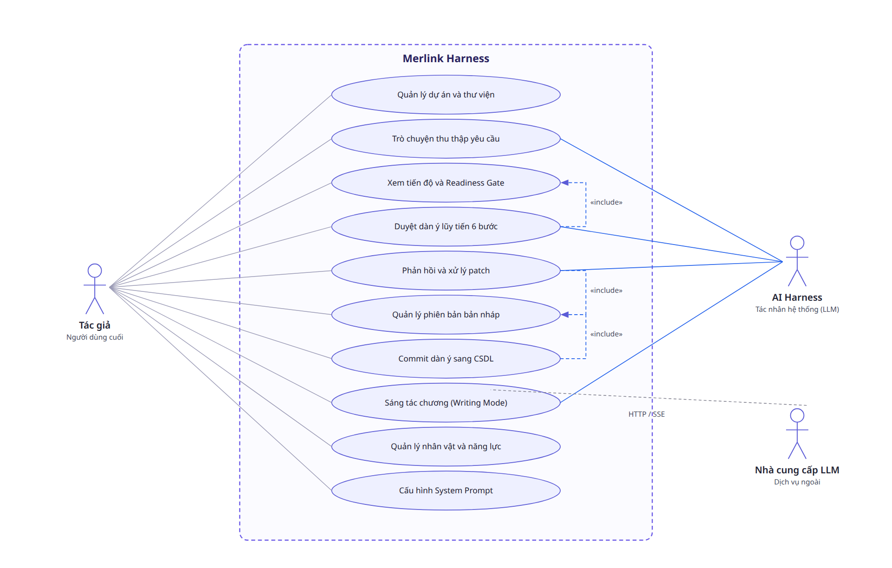
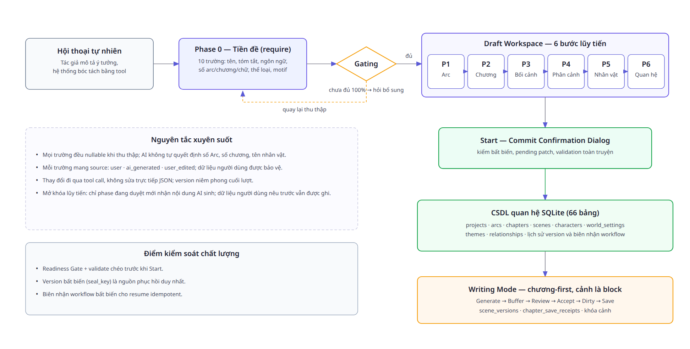
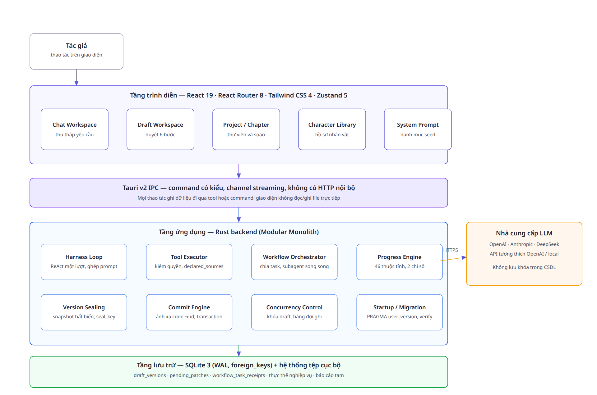
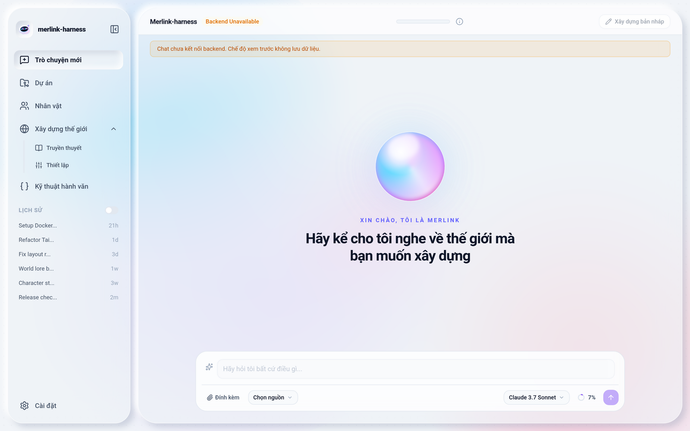
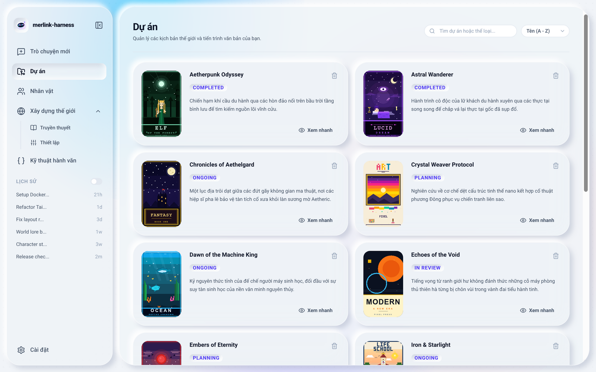
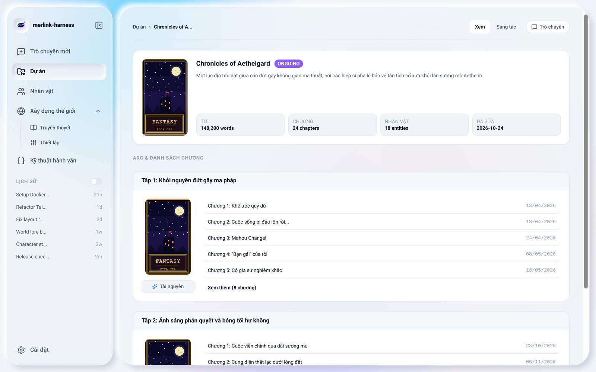
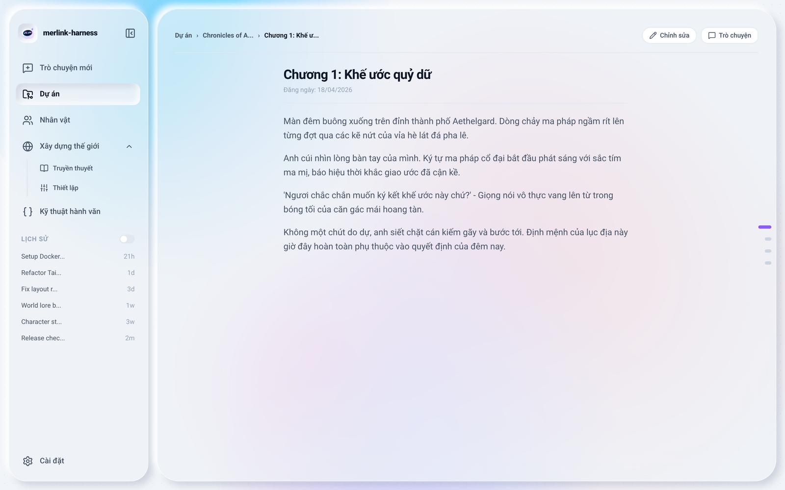
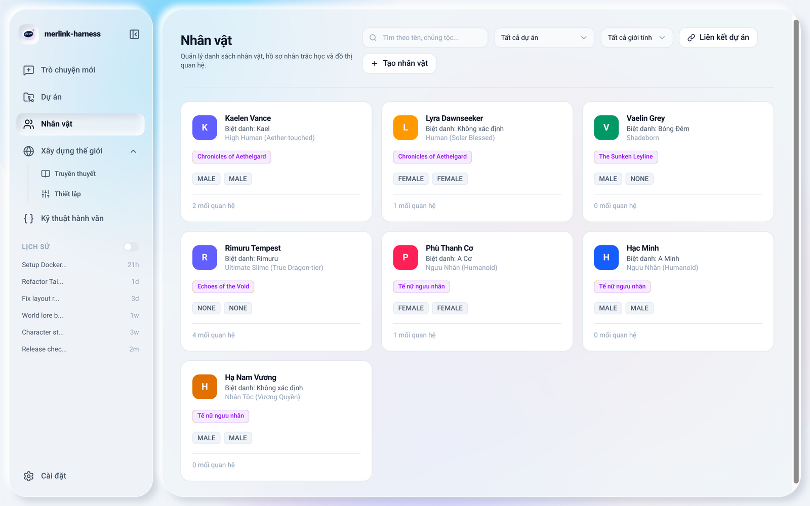
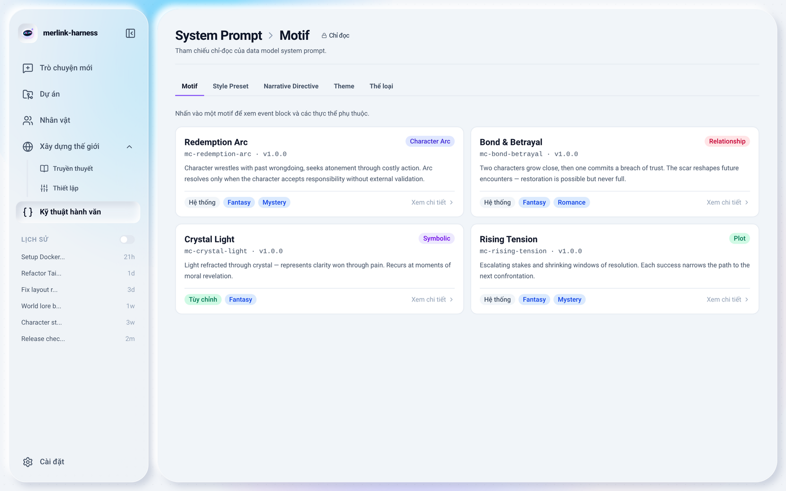
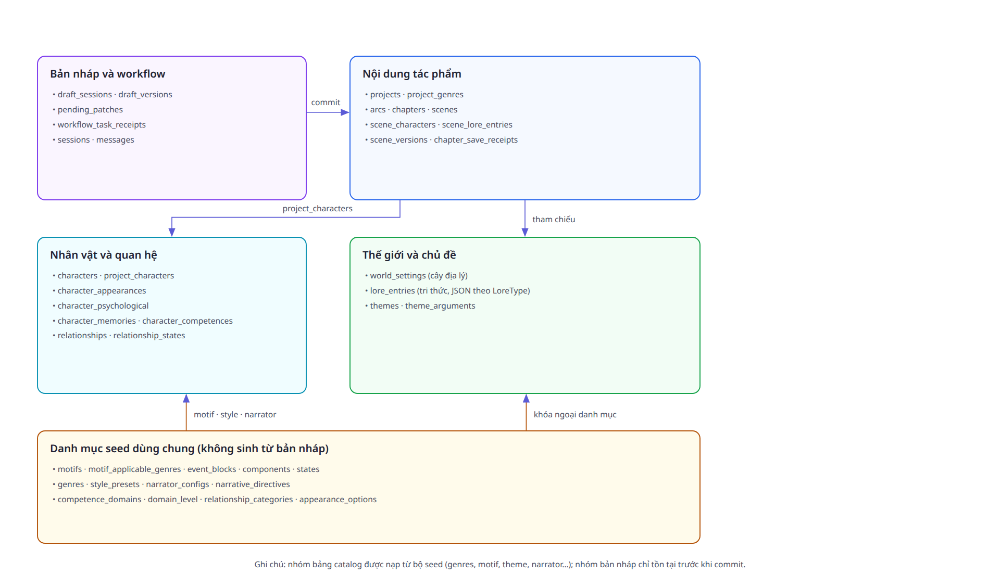

<div align="center">

# BÁO CÁO PHÂN TÍCH VÀ THIẾT KẾ HỆ THỐNG

### MERLINK HARNESS — HARNESS HỖ TRỢ SÁNG TÁC TRUYỆN DÀI BẰNG AI THEO PHƯƠNG PHÁP CẤU TRÚC TỪ TRÊN XUỐNG

**Nhóm thực hiện: Merlink Harness**

*Tháng 11 năm 2026*

</div>


---


## MỤC LỤC

- PHẦN MỞ ĐẦU
  - 1. LÝ DO CHỌN ĐỀ TÀI
  - 2. MỤC TIÊU NGHIÊN CỨU
  - 3. ĐỐI TƯỢNG NGHIÊN CỨU
  - 4. PHẠM VI NGHIÊN CỨU
  - 5. PHƯƠNG PHÁP NGHIÊN CỨU
  - 6. KẾT CẤU ĐỀ TÀI
- CHƯƠNG 1: TRÌNH BÀY KHẢO SÁT HIỆN TRẠNG, MÔ TẢ HỆ THỐNG VÀ CÁC QUY TRÌNH NGHIỆP VỤ LIÊN QUAN
  - 1.1 PHÂN TÍCH HIỆN TRẠNG
    - 1.1.1 Thực trạng ứng dụng AI trong sáng tác văn học hiện nay
    - 1.1.2 Những khó khăn và hạn chế trong quá trình viết truyện
    - 1.1.3 Sự cần thiết của việc xây dựng hệ thống Merlink Harness
  - 1.2 MÔ TẢ HỆ THỐNG
  - 1.3 CÁC QUY TRÌNH NGHIỆP VỤ CỐT LÕI
    - 1.3.1 Quy trình thu thập yêu cầu và cổng sẵn sàng (Readiness Gate)
    - 1.3.2 Quy trình dựng dàn ý lũy tiến sáu bước
    - 1.3.3 Quy trình phản hồi, patch và quản lý phiên bản
    - 1.3.4 Quy trình workflow phân đoạn cho truyện dài
    - 1.3.5 Quy trình cam kết dữ liệu (Commit)
    - 1.3.6 Quy trình sáng tác chương (Writing Mode)
  - 1.4 YÊU CẦU HỆ THỐNG
    - 1.4.1 Yêu cầu chức năng
    - 1.4.2 Yêu cầu phi chức năng
- CHƯƠNG 2: GIỚI THIỆU CÁC CÔNG NGHỆ ĐƯỢC SỬ DỤNG TRONG QUÁ TRÌNH PHÂN TÍCH VÀ THIẾT KẾ HỆ THỐNG
  - 2.1 NGÔN NGỮ MÔ HÌNH HÓA (Lược bỏ)
  - 2.2 CÔNG CỤ THIẾT KẾ SƠ ĐỒ
  - 2.3 HỆ QUẢN TRỊ CƠ SỞ DỮ LIỆU
  - 2.4 NGÔN NGỮ TRUY VẤN SQL
  - 2.5 PHƯƠNG PHÁP PHÁT TRIỂN HỆ THỐNG
  - 2.6 CÔNG CỤ SOẠN THẢO VÀ TRÌNH BÀY BÁO CÁO
  - 2.7 NHẬN XÉT VỀ VIỆC LỰA CHỌN CÔNG NGHỆ
- CHƯƠNG 3: PHÂN TÍCH HỆ THỐNG VÀ ĐẶC TẢ USE CASE
  - 3.1 XÁC ĐỊNH CÁC TÁC NHÂN (ACTORS) TRONG HỆ THỐNG
  - 3.2 SƠ ĐỒ USE CASE TỔNG QUÁT
  - 3.3 ĐẶC TẢ CHI TIẾT CÁC USE CASE CHÍNH
    - 3.3.1 UC_PROJ_01 — Quản lý dự án và thư viện
    - 3.3.2 UC_CHAT_01 — Trò chuyện thu thập yêu cầu
    - 3.3.3 UC_GATE_01 — Xem tiến độ và kiểm duyệt sẵn sàng
    - 3.3.4 UC_DRAFT_01 — Duyệt dàn ý lũy tiến
    - 3.3.5 UC_FEED_01 — Phản hồi và xử lý patch
    - 3.3.6 UC_VER_01 — Quản lý phiên bản bản nháp
    - 3.3.7 UC_COMMIT_01 — Cam kết dàn ý sang cơ sở dữ liệu
    - 3.3.8 UC_WRITE_01 — Sáng tác chương
    - 3.3.9 Bảng tổng hợp các use case còn lại
- CHƯƠNG 4: ĐỀ XUẤT GIẢI PHÁP VÀ THIẾT KẾ HỆ THỐNG
  - 4.1 TỔNG QUAN GIẢI PHÁP HỆ THỐNG
  - 4.2 KIẾN TRÚC HỆ THỐNG ĐỀ XUẤT
    - 4.2.1 Kiến trúc modular monolith trên Tauri v2
    - 4.2.2 Mô hình đồng thời
    - 4.2.3 Lưu trữ và khôi phục
    - 4.2.4 Bảo mật và phân quyền
  - 4.3 THIẾT KẾ GIAO DIỆN
  - 4.4 THIẾT KẾ DỮ LIỆU VÀ TÍCH HỢP
    - 4.4.1 Mô hình dữ liệu quan hệ
    - 4.4.2 Ánh xạ từ bản nháp sang cơ sở dữ liệu
    - 4.4.3 Hợp đồng tích hợp
    - 4.4.4 Dữ liệu danh mục ban đầu
- KẾT LUẬN
- HƯỚNG PHÁT TRIỂN TƯƠNG LAI
- TÀI LIỆU THAM KHẢO
  - A. Tài liệu công nghệ và công cụ
  - B. Kỹ thuật AI harness và công trình nghiên cứu
  - C. Bối cảnh thị trường AI sáng tác văn học
  - D. Nguồn dữ liệu nghiên cứu của bộ dữ liệu seed


---


# PHẦN MỞ ĐẦU

## 1. LÝ DO CHỌN ĐỀ TÀI

Trong khoảng năm năm trở lại đây, các mô hình ngôn ngữ lớn (Large Language Model — LLM) đã trở thành công cụ quen thuộc của người viết: từ gợi ý tên nhân vật, mở rộng một đoạn văn, đến viết trọn một chương truyện. Các sản phẩm thương mại như NovelAI, Sudowrite hay Novelcrafter đã chứng minh nhu cầu thực tế của thị trường: người viết sẵn sàng trả phí cho một trợ lý AI hiểu được "story bible" của họ [C1][C3][C4]. Tuy nhiên, phần lớn công cụ hiện nay tối ưu cho việc *sinh văn bản ngắn* hoặc *gợi ý cục bộ*; khi độ dài tác phẩm tăng lên hàng trăm chương, chất lượng đầu ra suy giảm rõ rệt vì ba lý do kỹ thuật đã được ghi nhận trong nghiên cứu: hiện tượng "lost in the middle" khi thông tin nằm giữa ngữ cảnh dài [B8], hiện tượng "context rot" khi số token đầu vào tăng [C6], và độ phức tạp tự sự của truyện dài vượt quá khả năng giữ mạch của một lần sinh [C5].

Hệ quả là người viết phải tự đóng vai "người quản lý dự án" cho câu chuyện của mình: ghi chú nhân vật trong một tệp, dàn ý trong một tệp khác, dán lại ngữ cảnh mỗi lần trò chuyện với AI. Cách làm thủ công này không chỉ tốn thời gian mà còn tạo ra ba loại lỗi hệ thống: dữ liệu phân mảnh (mỗi công cụ giữ một bản khác nhau), mâu thuẫn nhân vật (tính cách, ngoại hình thay đổi giữa các chương), và mất phương hướng cốt truyện (tuyến phụ lấn át tuyến chính). Đây chính là khoảng trống mà một **harness** — lớp điều phối chặt chẽ giữa AI và dữ liệu có cấu trúc — có thể lấp đầy.

Merlink Harness được chọn làm đối tượng nghiên cứu vì hệ thống này đặt vấn đề ngược với số đông: thay vì để AI tự do sinh văn bản, hệ thống **bắt buộc AI làm việc qua tool call** trên một mô hình dữ liệu quan hệ, chia quá trình sáng tác thành bảy giai đoạn, và chỉ cho phép chuyển dữ liệu sang cơ sở dữ liệu khi người dùng đã duyệt xong dàn ý. Cách tiếp cận "sáng tác có cấu trúc từ trên xuống" (Top-down Architect Method) này biến những yêu cầu về tính nhất quán thành ràng buộc kỹ thuật, thay vì phó mặc cho chất lượng prompt.

## 2. MỤC TIÊU NGHIÊN CỨU

Đề tài hướng tới năm mục tiêu cụ thể:

1. Hệ thống hóa hiện trạng ứng dụng AI trong sáng tác văn học và các hạn chế của cách làm hiện nay, làm cơ sở lý luận cho việc thiết kế hệ thống.
2. Mô hình hóa quy trình nghiệp vụ cốt lõi của Merlink Harness thành bảy giai đoạn (Phase 0 đến Phase 6), mô tả rõ dữ liệu vào, dữ liệu ra, điều kiện chuyển bước và các bất biến cần bảo toàn.
3. Xác định tác nhân, đặc tả các use case chính bằng bảng đặc tả theo mẫu thống nhất, làm cơ sở cho thiết kế và kiểm thử.
4. Đề xuất kiến trúc hệ thống dựa trên Tauri v2, Rust và SQLite, kèm cơ chế kiểm soát đồng thời, lưu trữ phiên bản và duy trì tính toàn vẹn dữ liệu.
5. Thiết kế mô hình dữ liệu quan hệ (66 bảng), cơ chế ánh xạ từ bản nháp sang cơ sở dữ liệu, và bộ dữ liệu danh mục ban đầu (thể loại, motif, chủ đề, cấu hình kể chuyện) phục vụ quá trình sáng tác.

## 3. ĐỐI TƯỢNG NGHIÊN CỨU

Đối tượng nghiên cứu gồm hai phần gắn bó với nhau:

- **Quy trình nghiệp vụ sáng tác có cấu trúc**: cách một tác phẩm được hình thành qua chuỗi giai đoạn thu thập — kiểm duyệt — dựng dàn ý — kiểm chứng — cam kết dữ liệu, cùng các quy tắc bảo vệ dữ liệu người dùng.
- **Hệ thống Merlink Harness**: tập tài liệu đặc tả (Business Core, Backend Core, Frontend Core, danh mục tool, schema DBML) và mã nguồn hiện có của dự án.

Bên cạnh đó, đề tài khảo sát một số sản phẩm cùng loại trên thị trường để làm nền so sánh.

## 4. PHẠM VI NGHIÊN CỨU

- **Phạm vi chức năng**: bảy giai đoạn của Planning Mode (thu thập yêu cầu đến commit dàn ý), luồng phản hồi và quản lý phiên bản bản nháp, luồng workflow phân đoạn cho truyện dài, và giai đoạn đầu của Writing Mode (sinh nội dung cảnh theo mô hình chương-first).
- **Phạm vi kỹ thuật**: giai đoạn phân tích và thiết kế — đặc tả nghiệp vụ, use case, kiến trúc, mô hình dữ liệu; giao diện được kiểm chứng ở mức web preview (chưa có backend Rust chạy thực tế trong môi trường nghiên cứu).
- **Ngoài phạm vi**: huấn luyện hoặc tinh chỉnh mô hình ngôn ngữ; đánh giá định lượng chất lượng văn bản do AI sinh; hạ tầng triển khai nhiều người dùng, đồng bộ đám mây và thanh toán.

## 5. PHƯƠNG PHÁP NGHIÊN CỨU

Đề tài sử dụng kết hợp bốn phương pháp:

1. **Nghiên cứu tài liệu**: đọc và đối chiếu hệ thống tài liệu đặc tả của dự án, trong đó Business Core là nguồn sự thật cao nhất về nghiệp vụ, DBML là nguồn sự thật về schema vật lý.
2. **Phân tích và thiết kế hướng chức năng**: phân rã hệ thống thành phân hệ, chức năng, tác nhân; mô hình hóa bằng sơ đồ use case và bảng đặc tả.
3. **Thực nghiệm giao diện**: chạy giao diện ở chế độ web preview với dữ liệu mẫu, quan sát hành vi từng màn hình, chụp ảnh minh họa và đối chiếu với đặc tả.
4. **Đối chiếu mã nguồn**: kiểm tra sự tương thích giữa tài liệu và mã nguồn (đường dẫn tính năng, route, thành phần giao diện) để bảo đảm báo cáo phản ánh đúng hiện trạng.

## 6. KẾT CẤU ĐỀ TÀI

Ngoài phần mở đầu, kết luận, hướng phát triển và tài liệu tham khảo, báo cáo gồm bốn chương:

- **Chương 1** trình bày khảo sát hiện trạng, mô tả hệ thống, các quy trình nghiệp vụ cốt lõi và yêu cầu hệ thống.
- **Chương 2** giới thiệu các công nghệ, công cụ và phương pháp được sử dụng trong phân tích và thiết kế.
- **Chương 3** phân tích hệ thống: xác định tác nhân, sơ đồ use case tổng quát và đặc tả chi tiết các use case chính.
- **Chương 4** đề xuất giải pháp và thiết kế hệ thống: kiến trúc, giao diện, dữ liệu và tích hợp.


# CHƯƠNG 1: TRÌNH BÀY KHẢO SÁT HIỆN TRẠNG, MÔ TẢ HỆ THỐNG VÀ CÁC QUY TRÌNH NGHIỆP VỤ LIÊN QUAN

## 1.1 PHÂN TÍCH HIỆN TRẠNG

### 1.1.1 Thực trạng ứng dụng AI trong sáng tác văn học hiện nay

Sự xuất hiện của các mô hình ngôn ngữ lớn đã thay đổi cách người viết tương tác với công cụ. Ba nhóm sản phẩm đang tồn tại song song:

**Nhóm thứ nhất — công cụ sinh văn bản chuyên biệt cho hư cấu.** NovelAI hướng tới người viết nghiệp dư với tính năng "Storyteller", cho phép gợi ý tiếp nối đoạn văn, kiểm soát phong cách bằng "memory" và "lorebook" [C1][C2]. Sudowrite tập trung vào quy trình hậu kỳ: viết lại đoạn văn, mở rộng mô tả, gợi ý ý tưởng theo "Story Bible" [C3]. Novelcrafter đẩy cấu trúc hóa xa hơn với "Codex" — một wiki nhân vật, bối cảnh và mối quan hệ mà AI có thể tra cứu trong lúc sinh [C4].

Điểm chung của nhóm này là lấy *chất lượng câu chữ của từng đoạn* làm trung tâm. Người viết mô tả bối cảnh trong vài đoạn ghi chú, AI đọc chúng như ngữ cảnh bổ sung rồi sinh tiếp. Cách tiếp cận này hiệu quả với truyện ngắn, truyện một chương, hoặc khi tác giả viết tuần tự và tự kiểm soát nhất quán.

**Nhóm thứ hai — trợ lý đa dụng.** ChatGPT, Claude, Gemini với khả năng đọc tệp và ghi nhớ dài. Người viết có thể dán hàng chục trang dàn ý và yêu cầu mô hình viết chương. Linh hoạt nhưng không có cơ chế bảo đảm: mỗi phiên chat là một "thế giới" riêng, không có nguồn sự thật duy nhất, không có kiểm tra ràng buộc giữa các chương [B2][B10].

**Nhóm thứ ba — khung phát triển agent (agent framework).** LangChain, LlamaIndex, Semantic Kernel hoặc các "harness" tự phát triển. Đây là nơi các kỹ thuật như ReAct [B1], tool calling [B2], RAG [B5] được áp dụng. Tuy nhiên phần lớn khung này phục vụ bài toán tri thức (hỏi đáp, tra cứu) chứ không phục vụ bài toán *sáng tác dài hơi*: dữ liệu là văn bản phi cấu trúc, không có ràng buộc nghiệp vụ, không có khái niệm "bản nháp chờ duyệt".

Ba nhóm sản phẩm trên cho thấy thị trường đã có đủ "nguyên liệu" (mô hình tốt, kỹ thuật gọi tool, hạ tầng desktop), nhưng còn thiếu một lớp trung gian biến ý tưởng sáng tác thành **dữ liệu có cấu trúc được kiểm chứng** trước khi AI viết.

### 1.1.2 Những khó khăn và hạn chế trong quá trình viết truyện

Qua khảo sát tài liệu và phân tích các sản phẩm hiện có, có sáu nhóm khó khăn lặp lại:

| Vấn đề | Biểu hiện thực tế | Hệ quả |
| --- | --- | --- |
| Trôi ngữ cảnh (context drift) | Càng về sau, AI càng quên hoặc hiểu sai thiết lập ban đầu | Nhân vật, thế giới mâu thuẫn; phải viết lại chương |
| Mất nhất quán nhân vật | Tính cách, ngoại hình, năng lực thay đổi không có chủ đích | Người đọc mất niềm tin vào nhân vật |
| Quá tải ngữ cảnh | Dán quá nhiều ghi chú khiến chi phí tăng, chất lượng giảm [B8][C5] | Tốn token, đầu ra loãng |
| Thiếu kiểm soát cấu trúc | AI viết lan man, tuyến phụ lấn át tuyến chính | Dàn ý bị phá vỡ sau vài chương |
| Dữ liệu phân mảnh | Ghi chú nằm ở nhiều tệp, nhiều ứng dụng | Khó tra cứu, dễ mất dữ liệu |
| Không có lịch sử thay đổi | Sửa xong không biết bản nào là bản chuẩn | Không thể quay lui khi AI sửa sai |

Trong sáu vấn đề trên, ba vấn đề đầu mang tính *kỹ thuật của mô hình* và đã có hướng giảm thiểu (cửa sổ ngữ cảnh lớn hơn, RAG, tóm tắt phân tầng). Ba vấn đề sau mang tính *tổ chức quy trình* và chỉ giải quyết được nếu hệ thống có mô hình dữ liệu và luật nghiệp vụ chặt chẽ.

### 1.1.3 Sự cần thiết của việc xây dựng hệ thống Merlink Harness

Từ phân tích trên, có bốn lý do khiến một harness chuyên biệt cho sáng tác dài hơi là cần thiết:

1. **Biến sáng tác thành quy trình có trạng thái.** Thay vì một cuộc trò chuyện không có điểm dừng, hệ thống chia thành bảy giai đoạn, mỗi giai đoạn có dữ liệu vào/ra rõ ràng và điều kiện chuyển bước. Trạng thái nghiệp vụ tồn tại độc lập với lịch sử chat.
2. **Bắt AI làm việc qua giao diện có kiểu.** Mọi thay đổi dữ liệu đi qua tool call có tham số xác định; AI không được sửa trực tiếp tệp JSON hay cơ sở dữ liệu. Cách làm này cho phép kiểm tra tham số, gán nguồn dữ liệu và từ chối thao tác sai.
3. **Bảo vệ dữ liệu do con người tạo.** Mỗi trường mang nhãn nguồn (`user`, `ai_generated`, `user_edited`). Dữ liệu người dùng chỉ bị thay đổi khi có xác nhận. Đây là cơ chế mà các công cụ hiện có chưa thực hiện được ở mức trường dữ liệu.
4. **Có nguồn sự thật duy nhất.** Sau khi người dùng bấm "Bắt đầu viết", toàn bộ dàn nháp được chuyển thành dữ liệu quan hệ trong SQLite với khóa ngoại, chỉ mục và lịch sử phiên bản. Không còn tình trạng "ba bản dữ liệu ở ba nơi".

## 1.2 MÔ TẢ HỆ THỐNG

Merlink Harness là ứng dụng desktop hỗ trợ sáng tác truyện dài, được tổ chức thành bốn phân hệ chức năng và một tầng dữ liệu dùng chung:

**Phân hệ 1 — Chat & Planning Harness.** Người dùng trò chuyện bằng ngôn ngữ tự nhiên để mô tả tác phẩm. Một vòng lặp AI dạng ReAct (suy luận — hành động) chuyển từng thông tin người dùng nêu thành tool call ghi vào bản nháp cấu trúc. Giao diện hiển thị hai chỉ số tiến độ trên 46 thuộc tính chuẩn: phần trăm dữ liệu do AI đề xuất và phần trăm dữ liệu đã được người dùng xác nhận.

**Phân hệ 2 — Draft Workspace (không gian dàn ý).** Là bảng điều khiển chia đôi màn hình, mở khóa dần sáu bước dàn ý: Arc vĩ mô, chương và cảnh thô, bối cảnh thế giới, cấu hình phân cảnh, hồ sơ nhân vật (ba nấc), và động lực quan hệ. Mỗi bước phải được người dùng xác nhận trước khi bước sau mở ra.

**Phân hệ 3 — Writing Mode.** Sau khi dàn ý được cam kết vào cơ sở dữ liệu, người dùng chuyển sang chế độ viết: chọn chương, sinh nội dung cảnh theo các khối, duyệt, sửa, lưu. Cơ chế khóa cảnh và lịch sử phiên bản cảnh bảo đảm không ghi đè nội dung đã duyệt.

**Phân hệ 4 — Thư viện và danh mục.** Gồm thư viện dự án, thư viện nhân vật, bối cảnh thế giới và khu vực cấu hình System Prompt. Đây là nơi tra cứu các bộ dữ liệu nền: thể loại, motif, chủ đề, phong cách diễn đạt, cấu hình người kể chuyện và chỉ dẫn tự sự.

**Tầng dữ liệu.** Schema quan hệ gồm 66 bảng, chia thành tám nhóm: danh mục (motif, thể loại, phong cách, người kể), dự án và phiên, nội dung (arc, chương, cảnh, phiên bản cảnh), nhân vật, thế giới và tri thức, chủ đề và luận điểm, quan hệ, và nhóm bản nháp/workflow (phiên bản draft, patch chờ duyệt, biên nhận workflow).

Về tác nhân, hệ thống có ba bên tương tác: **tác giả** (người dùng cuối), **AI Harness** (vòng lặp agent do backend điều khiển) và **nhà cung cấp LLM** (dịch vụ ngoài, giao tiếp qua HTTPS/SSE).

## 1.3 CÁC QUY TRÌNH NGHIỆP VỤ CỐT LÕI

Hệ thống có sáu quy trình nghiệp vụ cốt lõi. Mỗi quy trình được mô tả bằng mục tiêu, các bước chính và điểm kiểm soát.

Sơ đồ dòng chảy tổng thể của bảy giai đoạn được trình bày ở Chương 4 (Hình 2) cùng các điểm kiểm soát tương ứng.

### 1.3.1 Quy trình thu thập yêu cầu và cổng sẵn sàng (Readiness Gate)

**Mục tiêu:** chuyển ý tưởng tự do thành bộ mười trường tiền đề đủ để định danh tác phẩm.

| Bước | Nội dung | Kết quả |
| --- | --- | --- |
| 1 | Người dùng mô tả ý tưởng, có thể kèm lộ trình chi tiết ngay từ đầu | Lịch sử chat |
| 2 | Harness bóc tách thông tin trong từng lượt, gọi tool ghi vào bản nháp | Các trường `require` và `optional` được điền dần |
| 3 | Hệ thống đánh giá 46 thuộc tính, hiển thị hai chỉ số tiến độ | Người dùng thấy phần đã xác nhận và phần AI đề xuất |
| 4 | Khi mười trường tiền đề đầy đủ, cổng sẵn sàng mở | Nút "Xây dựng bản nháp" được kích hoạt |

Mười trường tiền đề gồm: tên tác phẩm, tóm tắt tiền đề, ngôn ngữ sáng tác, số Arc, số chương, định mức số chữ mỗi chương, danh sách thể loại, và với mỗi nhân vật khởi tạo là tên hiển thị/biệt danh, giới tính sinh học và mã motif.

**Điểm kiểm soát:** AI không tự quyết định các giá trị định lượng hoặc định danh (số Arc, số chương, tên nhân vật, thể loại). Nếu thiếu, AI phải hỏi hoặc đề xuất kèm lý do và chờ người dùng chấp thuận.

### 1.3.2 Quy trình dựng dàn ý lũy tiến sáu bước

**Mục tiêu:** đi từ dàn ý vĩ mô đến hồ sơ nhân vật chi tiết mà không làm người dùng quá tải.

| Bước | Tên bước | Dữ liệu sinh ra | Điều kiện mở |
| --- | --- | --- | --- |
| 1 | Arc Overview | Danh sách Arc, motif xung đột, khối biến cố, chủ đề và luận điểm | Cổng sẵn sàng đã mở |
| 2 | Chapter / Scene | Chương trong từng Arc, cảnh thô với tóm tắt và địa điểm dự kiến | Bước 1 đã xác nhận |
| 3 | World Building | Cây bối cảnh phân cấp và các mục tri thức (lore) | Bước 2 đã xác nhận |
| 4 | Scene Config | Góc nhìn, phong cách, địa điểm chính thức của từng cảnh | Bước 3 đã xác nhận |
| 5 | Character | Ngoại hình (5.1), tâm lý chiều sâu (5.2), ký ức và năng lực (5.3) | Bước 4 đã xác nhận |
| 6 | Relationship | Ma trận cảm xúc theo cảnh, vai trò quan hệ | Bước 5 đã xác nhận |

**Điểm kiểm soát:** mỗi lần chuyển bước phải qua hộp thoại xác nhận; AI chỉ sinh nội dung phái sinh cho bước hiện tại, không sinh trước các bước sau. Dữ liệu người dùng đã nêu trước vẫn được ghi nhận và tính vào tiến độ dù giao diện chưa mở.

### 1.3.3 Quy trình phản hồi, patch và quản lý phiên bản

**Mục tiêu:** cho phép người dùng sửa bất kỳ phần nào của dàn ý mà không phá vỡ dữ liệu đã có.

- Người dùng bật **Feedback Mode**, trỏ vào một phần tử (Arc, cảnh, nhân vật); phần tử được gắn ngữ cảnh và đưa vào ô nhập chat.
- Yêu cầu sửa được chuyển thành **patch**. Nếu trường đích là `ai_generated`, patch áp dụng ngay; nếu là `user` hoặc `user_edited`, patch chờ xác nhận.
- Cuối mỗi lượt có thay đổi được áp dụng, hệ thống **niêm phong một phiên bản** (snapshot bất biến của toàn bộ bản nháp) với khóa niêm phong duy nhất theo phiên và lượt.
- Người dùng có thể khôi phục phiên bản cũ; thao tác khôi phục đồng thời trả dữ liệu, giai đoạn và bước phụ về đúng thời điểm, đồng thời vô hiệu hóa các patch đang chờ.

**Điểm kiểm soát:** không tạo phiên bản cho lượt không ghi dữ liệu; phiên bản là nguồn phục hồi duy nhất; trạng thái làm việc trong bộ nhớ không được coi là đã lưu bền.

### 1.3.4 Quy trình workflow phân đoạn cho truyện dài

Với tác phẩm hàng trăm chương, không thể nhồi toàn bộ dàn ý vào một lượt gọi mô hình. Hệ thống chia việc thành các **lần chạy** (với Phase 1–2) và **vòng** (với Phase 3–6):

| Tham số | Mặc định | Ý nghĩa |
| --- | ---: | --- |
| `OUTLINE_CAP` | 50 | Số chương tối đa trong một lần chạy dàn ý |
| `OUTLINE_LOOKBACK` | 10 | Số chương đọc lùi từ lần chạy trước |
| `OUTLINE_PAGE` | 50 | Số chương mỗi trang tra cứu mục lục |
| `UNIT_CHAPTER` | 30 | Số chương tối đa cho một subagent |
| `CONTEXT_MARGIN` | 5 | Số chương đọc thêm mỗi bên khi chia theo chương |
| `MAX_PARALLEL` | 6 | Số subagent song song trong một vòng |
| `DRAFT_LOCK_TIMEOUT` | 30 giây | Thời gian chờ khóa ghi bản nháp |

**Ví dụ kiểm chứng:** một Arc 145 chương được chia thành bốn lần chạy: ghi 1–50; đọc lùi 41–50 và ghi 51–90; đọc lùi 81–90 và ghi 91–130; đọc lùi 121–130 và ghi 131–145. Mọi khoảng ghi phủ kín dải chương, không trùng và không hở.

**Điểm kiểm soát:** mỗi vòng có biên nhận hoàn tất bất biến (insert-once) gắn với định danh kế hoạch; nếu vòng có thay đổi dữ liệu thì việc niêm phong phiên bản và ghi biên nhận nằm trong cùng một giao dịch; hủy workflow là dừng có kiểm soát, không ngắt giữa một thao tác ghi.

### 1.3.5 Quy trình cam kết dữ liệu (Commit)

**Mục tiêu:** chuyển bản nháp JSON sang cơ sở dữ liệu quan hệ một cách nguyên tử.

- Nút "Bắt đầu viết" chỉ xuất hiện ở cuối bước 6 và mở hộp thoại xác nhận kiêm bản tóm tắt kế hoạch ghi.
- Hệ thống kiểm tra toàn bộ bất biến: tổng số chương bằng mục tiêu, số Arc bằng mục tiêu, thứ tự chương duy nhất toàn truyện, mỗi cảnh có địa điểm hợp lệ, quy tắc góc nhìn phù hợp cấu hình người kể, năng lực nhân vật gắn với cảnh.
- Nếu còn patch chờ duyệt hoặc vi phạm bất biến, commit bị chặn và lỗi được hiển thị ngay trong hộp thoại.
- Khi xác nhận, toàn bộ cây dữ liệu được ghi trong một giao dịch: sinh mã `code` cho từng thực thể, ánh xạ sang khóa `id` UUIDv7, kiểm tra trùng mã giữa các bảng, cập nhật trạng thái phiên bản nháp thành `committed`.

### 1.3.6 Quy trình sáng tác chương (Writing Mode)

Sau commit, người dùng chọn chương và từng cảnh để sinh nội dung. Nội dung đi qua chuỗi trạng thái: **sinh** (generate) → **vùng đệm** (buffer) → **duyệt** (review) → **chấp nhận** (accept) → **đánh dấu sửa** (dirty) → **lưu cấp chương** (save). Mỗi cảnh có thể khóa để tránh ghi đè; lịch sử nội dung cảnh được lưu theo từng phiên bản; biên nhận lưu chương bảo đảm thao tác lưu là idempotent.

## 1.4 YÊU CẦU HỆ THỐNG

### 1.4.1 Yêu cầu chức năng

| Mã | Nhóm chức năng | Yêu cầu |
| --- | --- | --- |
| FR-01 | Quản lý dự án | Tạo, mở, tìm kiếm, sắp xếp, xóa dự án; hiển thị thống kê số chữ, chương, nhân vật, bối cảnh |
| FR-02 | Thu thập yêu cầu | Trò chuyện tự nhiên; bóc tách thông tin thành tool call; hiển thị tiến độ hai chỉ số |
| FR-03 | Kiểm duyệt sẵn sàng | Đánh giá mười trường tiền đề; chặn mở dàn ý khi chưa đủ |
| FR-04 | Dàn ý lũy tiến | Sinh dàn ý theo sáu bước; xác nhận từng bước; mở khóa tuần tự |
| FR-05 | Phản hồi | Gắn ngữ cảnh phần tử; tạo patch; xem trước và xác nhận patch |
| FR-06 | Phiên bản | Niêm phong phiên bản cuối lượt; liệt kê, xem, khôi phục phiên bản |
| FR-07 | Workflow | Chia việc thành lần chạy/vòng; hiển thị tiến độ; hủy và tiếp tục |
| FR-08 | Commit | Kiểm tra bất biến; ghi nguyên tử; báo lỗi có cấu trúc |
| FR-09 | Nhân vật | Quản lý hồ sơ ngoại hình, tâm lý, ký ức, năng lực, quan hệ |
| FR-10 | Bối cảnh | Cây địa lý, tri thức theo loại, liên kết với cảnh |
| FR-11 | Danh mục | Tra cứu thể loại, motif, chủ đề, phong cách, người kể |
| FR-12 | Writing Mode | Sinh, duyệt, sửa, khóa cảnh; lưu cấp chương; lịch sử cảnh |

### 1.4.2 Yêu cầu phi chức năng

| Mã | Thuộc tính | Yêu cầu |
| --- | --- | --- |
| NFR-01 | Toàn vẹn dữ liệu | Giao dịch nguyên tử; khóa ngoại bật; kiểm tra schema khi khởi động |
| NFR-02 | Đồng thời | Một khóa ghi theo bản nháp; thao tác ghi tuần tự hóa; đọc từ ảnh chụp nhất quán |
| NFR-03 | Độ bền | Chế độ WAL, đồng bộ theo cấu hình; niêm phong phiên bản có khóa duy nhất |
| NFR-04 | Khả năng phục hồi | Khôi phục từ phiên bản đã niêm phong; phát hiện lượt bị gián đoạn |
| NFR-05 | Hiệu năng | Giao diện phản hồi dưới 100 ms với thao tác cục bộ; không giữ khóa khi chờ mạng |
| NFR-06 | Bảo mật | AI không đọc/ghi tệp trực tiếp; khóa API không lưu trong cơ sở dữ liệu nghiệp vụ |
| NFR-07 | Khả dụng | Giao diện tiếng Việt/tiếng Anh; hỗ trợ bàn phím; độ tương phản đạt chuẩn |
| NFR-08 | Bảo trì | Kiến trúc module rõ ràng; tài liệu là nguồn sự thật; kiểm thử tự động theo hợp đồng |
| NFR-09 | Tương thích | Chạy trên Windows, macOS, Linux thông qua Tauri; dữ liệu cục bộ, không phụ thuộc máy chủ |


# CHƯƠNG 2: GIỚI THIỆU CÁC CÔNG NGHỆ ĐƯỢC SỬ DỤNG TRONG QUÁ TRÌNH PHÂN TÍCH VÀ THIẾT KẾ HỆ THỐNG

## 2.1 NGÔN NGỮ MÔ HÌNH HÓA (Lược bỏ)

Mục này được lược bỏ theo yêu cầu của đề tài. Phần mô hình hóa trong báo cáo sử dụng sơ đồ use case, sơ đồ kiến trúc và sơ đồ nhóm bảng dữ liệu trình bày trực tiếp bằng hình vẽ (xem Chương 3 và Chương 4), không gắn với một ngôn ngữ mô hình hóa hình thức cụ thể.

## 2.2 CÔNG CỤ THIẾT KẾ SƠ ĐỒ

Ba công cụ được sử dụng ở các mức khác nhau:

**DBML trên dbdiagram.io.** Toàn bộ schema quan hệ của dự án được đặc tả bằng DBML — một ngôn ngữ mô tả lược đồ dạng văn bản, có cú pháp cho bảng, cột, kiểu dữ liệu, chỉ mục, khóa ngoại và ghi chú [A10]. Ưu điểm của DBML là *lược đồ nằm trong kho mã nguồn* (`docs/db.dbml`), cho phép so sánh phiên bản (diff), rà soát trong pull request và sinh sơ đồ trực quan khi cần. Báo cáo dùng DBML làm nguồn sự thật cho phần thiết kế dữ liệu; các sơ đồ trong báo cáo được dựng lại từ tệp này.

**Mermaid.** Với các sơ đồ luồng và sơ đồ tuần tự có tính thay đổi cao, Mermaid cho phép viết sơ đồ bằng cú pháp văn bản, dễ lưu trong tài liệu và dễ cập nhật [A14]. Mermaid phù hợp với các sơ đồ nhỏ, ít yêu cầu bố cục chính xác.

**Sinh sơ đồ trực tiếp bằng SVG.** Với ba sơ đồ lớn trong báo cáo — use case tổng quát, kiến trúc hệ thống, dòng chảy nghiệp vụ — nhóm thực hiện dùng một script Python sinh SVG với bố cục xác định, sau đó raster hóa bằng trình duyệt Chromium ở hệ số phóng 1,2 để bảo đảm độ nét khi in. Cách này cho phép kiểm soát hoàn toàn vị trí, nhãn tiếng Việt có dấu và kích thước chữ, đồng thời tái tạo được sơ đồ khi nội dung thay đổi.

| Công cụ | Ưu điểm | Hạn chế | Dùng cho |
| --- | --- | --- | --- |
| DBML / dbdiagram.io | Lược đồ dạng văn bản, diff được, sinh SQL | Không trực quan bằng công cụ kéo thả | Thiết kế cơ sở dữ liệu |
| Mermaid | Nhanh, nhúng được vào Markdown | Khó canh bố cục phức tạp | Sơ đồ nhỏ, luồng đơn giản |
| Script sinh SVG | Kiểm soát chính xác, chữ Việt rõ | Cần viết mã cho từng sơ đồ | Ba sơ đồ lớn của báo cáo |

## 2.3 HỆ QUẢN TRỊ CƠ SỞ DỮ LIỆU

Merlink Harness là ứng dụng **một người dùng, chạy cục bộ**, nên tiêu chí chọn hệ quản trị khác với ứng dụng web nhiều người dùng. Nhóm thực hiện so sánh ba phương án:

| Tiêu chí | SQLite | PostgreSQL | MySQL/MariaDB |
| --- | --- | --- | --- |
| Mô hình triển khai | Thư viện nhúng trong tiến trình | Máy chủ riêng | Máy chủ riêng |
| Cài đặt cho người dùng cuối | Không cần | Cần | Cần |
| Kích thước | Dưới 1 MB | Hàng trăm MB | Hàng trăm MB |
| Ghi đồng thời | Một writer, WAL cho phép đọc song song | Đa writer | Đa writer |
| Giao dịch ACID | Có | Có | Có |
| Ràng buộc, khóa ngoại | Có (bật bằng PRAGMA) | Có | Có |
| JSON | Hàm JSON1 | JSONB mạnh | JSON |
| Phù hợp desktop offline | Rất phù hợp | Không | Không |

Hệ thống chọn **SQLite** vì bốn lý do: (1) không yêu cầu cài đặt hay vận hành máy chủ, phù hợp ứng dụng desktop đóng gói bằng Tauri; (2) toàn bộ dữ liệu nằm trong một tệp, dễ sao lưu và di chuyển; (3) chế độ WAL cho phép đọc trong khi ghi, đủ cho mô hình một người dùng với nhiều tác vụ nền [A7]; (4) hỗ trợ đầy đủ giao dịch, khóa ngoại và chỉ mục cần cho nghiệp vụ.

Hạn chế cố hữu của SQLite là **chỉ một writer tại một thời điểm**. Hệ thống biến hạn chế này thành giả định thiết kế: mọi ghi dữ liệu đi qua backend Rust và được tuần tự hóa theo khóa của từng bản nháp; giao dịch dùng `BEGIN IMMEDIATE` để giành quyền ghi sớm. Cách làm này được trình bày chi tiết ở Chương 4.

## 2.4 NGÔN NGỮ TRUY VẤN SQL

Hệ thống dùng **dialect SQLite**, với các đặc điểm cần lưu ý khi thiết kế câu lệnh:

- **Kiểu dữ liệu động nhưng có khai báo**: cột khai báo kiểu để tài liệu hóa và kiểm tra ở tầng ứng dụng; SQLite áp dụng quy tắc chuyển đổi lỏng. Vì vậy backend phải kiểm tra kiểu trước khi ghi, không dựa hoàn toàn vào cơ sở dữ liệu.
- **Khóa ngoại phải bật tường minh** bằng `PRAGMA foreign_keys = ON` cho từng kết nối; nếu không, ràng buộc tham chiếu sẽ không được thực thi.
- **Chế độ WAL và đồng bộ**: `PRAGMA journal_mode = WAL` cho phép đọc song song với ghi; `PRAGMA synchronous` được chọn theo mức đánh đổi giữa độ bền và tốc độ [A7].
- **Quản lý phiên bản schema** qua `PRAGMA user_version`: mỗi lần khởi động, backend so sánh số phiên bản trong tệp với phiên bản mã nguồn và chạy migration theo thứ tự.
- **Giao dịch ngắn, không chờ mạng**: không giữ giao dịch hay khóa cơ sở dữ liệu trong lúc chờ phản hồi LLM — đây là nguyên tắc bắt buộc để tránh khóa dây chuyền.
- **Truy vấn có tham số** (prepared statement) cho mọi dữ liệu đến từ người dùng hoặc mô hình.

Một số câu lệnh tiêu biểu của hệ thống:

```sql
-- Bật ràng buộc và chế độ ghi an toàn
PRAGMA foreign_keys = ON;
PRAGMA journal_mode = WAL;
PRAGMA synchronous = NORMAL;

-- Niêm phong phiên bản: chỉ chèn nếu chưa có khóa niêm phong
INSERT INTO draft_versions (id, draft_session_id, seq, data_hash, seal_key, data_json, phase, subphase)
VALUES (?, ?, ?, ?, ?, ?, ?, ?)
ON CONFLICT (draft_session_id, seal_key) DO NOTHING;

-- Tra cứu cảnh kèm địa điểm và số nhân vật xuất hiện
SELECT s.code, s.position, ws.display_name AS location, COUNT(sc.character_id) AS cast
FROM scenes s
LEFT JOIN world_settings ws ON ws.id = s.world_setting_id
LEFT JOIN scene_characters sc ON sc.scene_id = s.id
WHERE s.chapter_id = ?
GROUP BY s.id
ORDER BY s.position;
```

Với dữ liệu bán cấu trúc (payload tri thức theo loại, tham số tool), hệ thống dùng cột `TEXT` chứa JSON và kiểm tra cấu trúc ở backend thay vì dựa vào cơ sở dữ liệu.

## 2.5 PHƯƠNG PHÁP PHÁT TRIỂN HỆ THỐNG

Dự án áp dụng hai nguyên tắc song song:

**Thứ nhất — phát triển hợp đồng trước (contract-first).** Tài liệu được xếp theo thứ tự thẩm quyền: quyết định của chủ dự án > Business Core > DBML > Frontend Core > Backend Core > hợp đồng tool/prompt. Mọi thay đổi hành vi phải bắt đầu từ tài liệu có thẩm quyền cao hơn; mã nguồn không được tự định nghĩa lại nghiệp vụ. Cách làm này giúp đội phát triển và các agent tự động có cùng "nguồn sự thật", tránh tình trạng giao diện và backend hiểu khác nhau.

**Thứ hai — triển khai theo pha kỹ thuật có cổng kiểm soát.** Kế hoạch triển khai chia thành sáu pha kỹ thuật (khác với bảy giai đoạn nghiệp vụ), mỗi pha gồm các sprint có phụ thuộc rõ ràng và điều kiện nghiệm thu riêng:

| Pha kỹ thuật | Nội dung | Số sprint |
| --- | --- | ---: |
| 1 | Kiểm chứng hợp đồng, kiểm kê hiện trạng | 3 |
| 2 | Nền tảng và giao diện đóng băng (IPC, schema, migration) | 6 |
| 3 | Miền bản nháp và workflow bền vững | 10 |
| 4 | Dịch vụ backend và Writing Mode | 5 |
| 5 | Danh mục, hồ sơ nhân vật, bối cảnh | 6 |
| 6 | Đóng gói, kiểm thử tích hợp, phát hành | 3 |

Mỗi sprint chỉ được đánh dấu hoàn tất khi vượt cổng kiểm thử tương ứng; sprint kiểm chứng hợp đồng có thể kết thúc ở trạng thái "bị chặn hợp đồng" thay vì tự sửa tài liệu nguồn. Cách tổ chức này phù hợp với dự án có nhiều tác nhân thực thi (người và agent) cùng làm việc trên một kho mã.

**Công cụ hỗ trợ:** Git cho quản lý phiên bản; CI kiểm tra kiểu TypeScript, lint, kiểm thử Rust và kiểm thử Node; các script xác minh hợp đồng chạy trong CI (kiểm tra Dockerfile, workflow, biến môi trường, đường dẫn dữ liệu thử nghiệm).

## 2.6 CÔNG CỤ SOẠN THẢO VÀ TRÌNH BÀY BÁO CÁO

Báo cáo được viết bằng **Markdown** — định dạng văn bản thuần, dễ so sánh phiên bản, dễ chuyển đổi. Chuỗi công cụ xuất bản gồm:

1. **Markdown** cho nội dung, với bảng, danh sách, hình và công thức đơn giản.
2. **Pandoc** chuyển Markdown sang LaTeX và gọi **XeLaTeX** biên dịch PDF [A11]. XeLaTeX được chọn vì hỗ trợ Unicode đầy đủ, cần thiết cho tiếng Việt có dấu; bộ font Noto Serif (nội dung) và Noto Sans (tiêu đề) cho kết quả ổn định trên Linux.
3. **Một tệp header LaTeX** tùy biến: đổi nhãn "Figure"/"Table" sang "Hình"/"Bảng", định dạng chú thích, thụt đầu dòng, bổ sung font dự phòng cho các ký tự mũi tên.
4. **Chromium** raster hóa sơ đồ SVG và chụp ảnh giao diện; **ImageMagick** chuyển định dạng và thu nhỏ ảnh trước khi nhúng.
5. **Script Python** sinh sơ đồ và tổng hợp danh mục tài liệu tham khảo.

Toàn bộ quy trình được đóng gói trong một script build, cho phép tái tạo PDF từ nguồn Markdown bất kỳ lúc nào. Cách làm này cũng bảo đảm báo cáo luôn đồng bộ với kho tài liệu của dự án: khi đặc tả thay đổi, chỉ cần sửa Markdown và chạy lại build.

## 2.7 NHẬN XÉT VỀ VIỆC LỰA CHỌN CÔNG NGHỆ

**Điểm mạnh.** Bộ công nghệ được chọn có tính nhất quán cao: TypeScript ở giao diện, Rust ở backend, SQLite ở tầng lưu trữ, Markdown–Pandoc–XeLaTeX ở tầng tài liệu. Mọi thành phần đều là mã nguồn mở, chạy cục bộ, không phụ thuộc dịch vụ đám mây, phù hợp với yêu cầu bảo mật dữ liệu sáng tác của người dùng. Tauri cho phép đóng gói ứng dụng nhỏ gọn (không kèm trình duyệt nhúng đầy đủ như Electron), trong khi vẫn dùng được hệ sinh thái web.

**Điểm hạn chế.** Thứ nhất, SQLite chỉ cho một writer, nên thiết kế phải tuân thủ kỷ luật khóa rất chặt; mọi sai sót về thứ tự lấy khóa có thể gây nghẽn. Thứ hai, việc phụ thuộc WebKit trên Linux khiến hành vi giao diện có thể khác nhau giữa các nền tảng, cần kiểm thử trên từng hệ điều hành. Thứ ba, chuỗi Pandoc–XeLaTeX đòi hỏi cài đặt TeX Live đầy đủ (khoảng vài trăm MB) và có thể lỗi font với một số ký tự đặc biệt; nhóm thực hiện đã khắc phục bằng font dự phòng và kiểm tra danh sách ký tự thiếu.

**Kết luận lựa chọn.** Với mục tiêu là ứng dụng desktop một người dùng, ưu tiên tính toàn vẹn dữ liệu và khả năng tái tạo tài liệu, bộ công nghệ trên là phù hợp. Các hạn chế đã được nhận diện và có phương án giảm thiểu cụ thể, được trình bày trong Chương 4.


# CHƯƠNG 3: PHÂN TÍCH HỆ THỐNG VÀ ĐẶC TẢ USE CASE

## 3.1 XÁC ĐỊNH CÁC TÁC NHÂN (ACTORS) TRONG HỆ THỐNG

| Tác nhân | Loại | Vai trò | Quyền tương tác |
| --- | --- | --- | --- |
| Tác giả (người dùng) | Chính | Người sáng tác, chủ sở hữu dữ liệu truyện | Tạo dự án, trò chuyện, duyệt dàn ý, phản hồi, xác nhận patch, khôi phục phiên bản, commit, viết chương |
| AI Harness (agent) | Phụ (tác nhân hệ thống) | Vòng lặp suy luận — hành động do backend điều khiển | Chỉ đọc/ghi dữ liệu thông qua tool call được cấp; không truy cập tệp hay cơ sở dữ liệu trực tiếp |
| Tool Executor (backend) | Phụ (nội bộ) | Kiểm tra quyền gọi, kiểm tra tham số, áp dụng thay đổi vào trạng thái làm việc | Thực thi tool, cấp mã định danh, ghi nhật ký, trả kết quả có cấu trúc |
| Nhà cung cấp LLM | Phụ (dịch vụ ngoài) | Sinh phản hồi ngôn ngữ và quyết định gọi tool | Nhận prompt qua HTTPS, trả về luồng sự kiện (SSE) |
| Hệ điều hành / hệ thống tệp | Phụ (hạ tầng) | Lưu tệp cơ sở dữ liệu, báo cáo trung gian, ảnh bìa dự án | Được backend gọi qua API hệ thống, không lộ cho AI |

**Ghi chú về phạm vi quyền của AI Harness.** Đây là điểm khác biệt cốt lõi so với các trợ lý viết văn thông thường: AI không có kênh nào để ghi dữ liệu ngoài danh mục tool được cấp. Mỗi tool có một bộ tham số có kiểu, một tham số bắt buộc khai báo nguồn dữ liệu (`declared_sources` hoặc `declared_source`), và một bộ luật kiểm tra ở backend. Nếu AI bỏ trống hoặc khai báo sai nguồn, chỉ trường đó bị từ chối `rejected`; toàn bộ lượt không bị hủy để tránh mất các phần đúng.

## 3.2 SƠ ĐỒ USE CASE TỔNG QUÁT

<figure>
  
  <figcaption><em>Hình 1. Sơ đồ use case tổng quát của hệ thống Merlink Harness</em></figcaption>
</figure>

Sơ đồ thể hiện mười use case nghiệp vụ chính trong ranh giới hệ thống. Tác giả kết nối với toàn bộ các use case vì đây là tác nhân duy nhất khởi tạo luồng nghiệp vụ. AI Harness kết nối với bốn use case có sinh nội dung: trò chuyện, duyệt dàn ý, phản hồi và sáng tác chương. Ba quan hệ `«include»` thể hiện ràng buộc bắt buộc: duyệt dàn ý luôn kiểm tra cổng sẵn sàng; phản hồi luôn tạo phiên bản khi có thay đổi; commit luôn niêm phong phiên bản cuối trước khi chuyển dữ liệu. Nhà cung cấp LLM kết nối với use case sáng tác và trò chuyện qua kênh HTTPS/SSE.

## 3.3 ĐẶC TẢ CHI TIẾT CÁC USE CASE CHÍNH

Các bảng dưới đây theo mẫu đặc tả use case thống nhất của dự án, gồm mười lăm trường: mã, tên, module, tác nhân, mô tả, trigger, tiền điều kiện, hậu điều kiện, luồng chính, luồng rẽ nhánh, luồng ngoại lệ, quy tắc nghiệp vụ, độ ưu tiên và ghi chú.

### 3.3.1 UC_PROJ_01 — Quản lý dự án và thư viện

| Trường | Nội dung |
| --- | -------- |
| **Mã UC** | UC_PROJ_01 |
| **Tên Use Case** | Quản lý dự án và thư viện |
| **Module/Phân hệ** | Thư viện dự án |
| **Actor chính** | Tác giả |
| **Actor phụ** | Backend Rust, SQLite |
| **Mô tả ngắn** | Tác giả tạo, tìm kiếm, mở và xóa dự án; xem thống kê tổng quan của từng dự án. |
| **Trigger** | Tác giả chọn mục "Dự án" trên thanh điều hướng hoặc bấm "Xem nhanh" trên một thẻ dự án. |
| **Precondition** | Ứng dụng đã khởi động; cơ sở dữ liệu đã được kiểm tra schema và mở thành công. |
| **Postcondition** | Danh sách dự án phản ánh trạng thái mới nhất; dự án được chọn mở ở chế độ xem tương ứng. |
| **Main Flow** | 1. Hệ thống nạp danh sách dự án kèm ảnh bìa, trạng thái, mô tả, số chữ, số chương.<br>2. Tác giả lọc theo từ khóa hoặc sắp xếp theo tên/ngày sửa.<br>3. Tác giả chọn một dự án.<br>4. Hệ thống mở trang chi tiết, hiển thị danh sách Arc và chương.<br>5. Tác giả chuyển giữa chế độ Xem và chế độ Sáng tác. |
| **Alternative Flow** | 2a. Không có dự án nào khớp từ khóa → hiển thị trạng thái rỗng kèm gợi ý tạo mới.<br>5a. Dự án chưa có Arc → chế độ Sáng tác chuyển sang luồng tạo dàn ý mới. |
| **Exception Flow** | E1. Cơ sở dữ liệu không mở được → hiển thị lỗi khởi động, chặn thao tác ghi.<br>E2. Xóa dự án thất bại do ràng buộc → hiển thị lỗi, giữ nguyên dự án. |
| **Business Rules** | BR1: Xóa dự án là xóa mềm, dữ liệu liên quan giữ lại theo ma trận cascade.<br>BR2: Thứ tự chương là duy nhất trên toàn truyện, không theo từng Arc.<br>BR3: Trạng thái dự án thuộc tập `PLANNING`, `ONGOING`, `IN REVIEW`, `COMPLETED`. |
| **Priority** | High |
| **Ghi chú** | Phụ thuộc UC_COMMIT_01 để có dự án sau khi cam kết dàn ý. |

### 3.3.2 UC_CHAT_01 — Trò chuyện thu thập yêu cầu

| Trường | Nội dung |
| --- | -------- |
| **Mã UC** | UC_CHAT_01 |
| **Tên Use Case** | Trò chuyện thu thập yêu cầu |
| **Module/Phân hệ** | Chat & Planning Harness |
| **Actor chính** | Tác giả |
| **Actor phụ** | AI Harness, Tool Executor, Nhà cung cấp LLM |
| **Mô tả ngắn** | Tác giả mô tả ý tưởng bằng ngôn ngữ tự nhiên; AI bóc tách và ghi thông tin vào bản nháp cấu trúc bằng tool call. |
| **Trigger** | Tác giả gửi tin nhắn trong khung chat. |
| **Precondition** | Có phiên chat và bản nháp đang ở trạng thái `editing`. |
| **Postcondition** | Bản nháp được cập nhật; hai chỉ số tiến độ được tính lại; nếu có thay đổi ghi thì một phiên bản mới được niêm phong. |
| **Main Flow** | 1. Tác giả nhập nội dung.<br>2. Hệ thống ghép prompt gồm System Prompt, danh mục tool, trạng thái bản nháp hiện tại.<br>3. Gọi mô hình qua HTTPS/SSE, nhận chuỗi sự kiện.<br>4. Với mỗi tool call, backend kiểm tra quyền, tham số và nguồn dữ liệu.<br>5. Áp dụng thay đổi vào trạng thái làm việc; trả kết quả từng trường.<br>6. Cuối lượt, niêm phong một phiên bản nếu có trường `applied`.<br>7. Giao diện cập nhật tin nhắn, thẻ trạng thái và thanh tiến độ. |
| **Alternative Flow** | 4a. AI gọi tool đọc (tra cứu thể loại, motif, nhân vật) → trả dữ liệu, không tạo phiên bản.<br>5a. Trường đích thuộc dữ liệu người dùng → tạo patch chờ xác nhận thay vì ghi đè. |
| **Exception Flow** | E1. Mô hình trả lỗi hoặc quá thời gian → hiển thị lỗi, giữ nguyên bản nháp.<br>E2. Tool call sai định dạng → từ chối riêng trường đó, ghi nhật ký.<br>E3. Số lần từ chối liên tiếp vượt ngưỡng → dừng lượt, niêm phong phần đã ghi.<br>E4. Không có khóa API hợp lệ → chặn gọi, hướng dẫn cấu hình. |
| **Business Rules** | BR1: AI không tự quyết định số Arc, số chương, tên nhân vật, thể loại.<br>BR2: Mọi thông tin người dùng nêu được ghi nhận ngay, không phụ thuộc giai đoạn đang mở.<br>BR3: Mỗi trường mang nhãn `user`/`ai_generated`/`user_edited`; thiếu nhãn thì bị từ chối. |
| **Priority** | High |
| **Ghi chú** | Phụ thuộc UC_GATE_01 để phản ánh mức sẵn sàng. |

### 3.3.3 UC_GATE_01 — Xem tiến độ và kiểm duyệt sẵn sàng

| Trường | Nội dung |
| --- | -------- |
| **Mã UC** | UC_GATE_01 |
| **Tên Use Case** | Xem tiến độ và kiểm duyệt sẵn sàng |
| **Module/Phân hệ** | Chat & Planning Harness |
| **Actor chính** | Tác giả |
| **Actor phụ** | Tool Executor, Progress Engine |
| **Mô tả ngắn** | Hệ thống đánh giá 46 thuộc tính chuẩn và hiển thị hai chỉ số: dữ liệu đã xác nhận và dữ liệu AI đề xuất. |
| **Trigger** | Mỗi khi bản nháp thay đổi, hoặc khi tác giả mở chi tiết tiến trình. |
| **Precondition** | Có bản nháp đang làm việc. |
| **Postcondition** | Chỉ số tiến độ và danh sách trường còn thiếu được cập nhật; trạng thái nút "Xây dựng bản nháp" được xác định. |
| **Main Flow** | 1. Engine duyệt 46 thuộc tính.<br>2. Mỗi thuộc tính đạt 1 điểm nếu có ít nhất một giá trị hợp lệ, và được phân loại theo nguồn.<br>3. Hiển thị phần trăm đã xác nhận và phần trăm AI đề xuất.<br>4. Tác giả mở chi tiết để xem trường nào còn thiếu và câu hỏi gợi ý.<br>5. Khi đủ mười trường tiền đề, hệ thống mở khóa nút "Xây dựng bản nháp". |
| **Alternative Flow** | 3a. Dữ liệu thuộc giai đoạn chưa mở vẫn được tính → chỉ số tăng nhưng giao diện chưa hiển thị chi tiết. |
| **Exception Flow** | E1. Bản nháp không đọc được do lỗi lưu trữ → hiển thị lỗi, giữ chỉ số lần trước. |
| **Business Rules** | BR1: Tổng điểm luôn chia cho 46, không đổi theo số giai đoạn đã mở.<br>BR2: Một thuộc tính dạng mảng chỉ đạt 1 điểm khi có ít nhất một phần tử hợp lệ.<br>BR3: Không gộp hai chỉ số thành một phần trăm duy nhất. |
| **Priority** | High |
| **Ghi chú** | Là điều kiện của UC_DRAFT_01. |

### 3.3.4 UC_DRAFT_01 — Duyệt dàn ý lũy tiến

| Trường | Nội dung |
| --- | -------- |
| **Mã UC** | UC_DRAFT_01 |
| **Tên Use Case** | Duyệt dàn ý lũy tiến sáu bước |
| **Module/Phân hệ** | Draft Workspace |
| **Actor chính** | Tác giả |
| **Actor phụ** | AI Harness, Workflow Orchestrator, Tool Executor |
| **Mô tả ngắn** | Tác giả duyệt dàn ý từ vĩ mô đến vi mô; mỗi bước phải xác nhận trước khi bước sau mở khóa. |
| **Trigger** | Tác giả bấm "Xây dựng bản nháp" khi cổng sẵn sàng đã mở. |
| **Precondition** | Mười trường tiền đề đã đầy đủ; không có patch chờ duyệt ở bước hiện tại. |
| **Postcondition** | Bước được xác nhận, một phiên bản `phase_confirm` được niêm phong, bước kế tiếp mở khóa. |
| **Main Flow** | 1. Mở bảng điều khiển chia đôi: chat bên trái, không gian dàn ý bên phải.<br>2. Hiển thị bước 1 (Arc Overview) với các Arc, motif, chủ đề.<br>3. Tác giả trao đổi để chỉnh sửa; AI cập nhật qua tool call.<br>4. Tác giả bấm "Tiếp tục"; hệ thống mở hộp thoại xác nhận.<br>5. Xác nhận → niêm phong phiên bản, mở khóa bước 2.<br>6. Lặp lại cho các bước 2 đến 6. |
| **Alternative Flow** | 3a. Tác giả yêu cầu tạo lại (regenerate) → chỉ các trường AI sinh bị thay, dữ liệu người dùng giữ nguyên.<br>4a. Tác giả hủy hộp thoại → ở lại bước hiện tại. |
| **Exception Flow** | E1. Bước trước chưa xác nhận → nút chuyển bước bị vô hiệu.<br>E2. Thiếu dữ liệu bắt buộc của bước → chặn xác nhận, chỉ rõ trường thiếu.<br>E3. Workflow đang chạy chiếm khóa ghi → hiển thị "bản nháp đang bận". |
| **Business Rules** | BR1: Mở khóa tuần tự, không nhảy bước.<br>BR2: Mỗi bước chỉ nhận nội dung phái sinh cho chính bước đó.<br>BR3: Xác nhận bước là phiên bản `phase_confirm`, không ghi sang cơ sở dữ liệu quan hệ. |
| **Priority** | High |
| **Ghi chú** | Sáu bước tương ứng Phase 1 đến Phase 6 trong mô hình nghiệp vụ. |

### 3.3.5 UC_FEED_01 — Phản hồi và xử lý patch

| Trường | Nội dung |
| --- | -------- |
| **Mã UC** | UC_FEED_01 |
| **Tên Use Case** | Phản hồi và xử lý patch |
| **Module/Phân hệ** | Chat & Draft Workspace |
| **Actor chính** | Tác giả |
| **Actor phụ** | AI Harness, Tool Executor |
| **Mô tả ngắn** | Tác giả trỏ vào một phần tử dàn ý, yêu cầu chỉnh sửa; hệ thống tạo patch và xử lý theo nguồn dữ liệu. |
| **Trigger** | Tác giả bật Feedback Mode và bấm vào phần tử, hoặc gõ yêu cầu sửa trong chat. |
| **Precondition** | Bản nháp đang mở; phần tử đích tồn tại. |
| **Postcondition** | Patch được áp dụng (dữ liệu AI) hoặc chờ xác nhận (dữ liệu người dùng); phiên bản được niêm phong nếu có thay đổi. |
| **Main Flow** | 1. Tác giả bật Feedback Mode; con trỏ đổi thành biểu tượng trích dẫn.<br>2. Bấm vào Arc/cảnh/nhân vật → gắn ngữ cảnh vào ô nhập.<br>3. Tác giả mô tả thay đổi mong muốn.<br>4. AI sinh patch có phạm vi theo mã định danh ổn định.<br>5. Hệ thống phân loại: dữ liệu AI → áp dụng ngay; dữ liệu người dùng → chờ xác nhận.<br>6. Tác giả xem trước, xác nhận hoặc từ chối.<br>7. Niêm phong phiên bản nếu có ít nhất một patch được áp dụng. |
| **Alternative Flow** | 6a. Tác giả chọn "Áp dụng tất cả" → các patch được duyệt theo thứ tự tạo, patch lỗi bị bỏ qua.<br>6b. Tác giả từ chối → patch bị loại, không tạo phiên bản. |
| **Exception Flow** | E1. Phần tử đích bị xóa trước khi xác nhận → patch chuyển `expired`.<br>E2. Giá trị hiện tại khác giá trị lúc đề xuất → patch hết hiệu lực, yêu cầu tạo lại.<br>E3. Ghi đồng thời với workflow → xếp hàng chờ khóa. |
| **Business Rules** | BR1: Mỗi thời điểm chỉ một patch chờ cho mỗi cặp (đích, trường).<br>BR2: Patch mới cùng đích và trường sẽ vô hiệu patch cũ.<br>BR3: Xóa phần tử là xóa vật lý trong bản nháp; lịch sử vẫn phục hồi được từ phiên bản. |
| **Priority** | High |
| **Ghi chú** | Liên kết với UC_VER_01 qua quan hệ `«include»`. |

### 3.3.6 UC_VER_01 — Quản lý phiên bản bản nháp

| Trường | Nội dung |
| --- | -------- |
| **Mã UC** | UC_VER_01 |
| **Tên Use Case** | Xem và khôi phục phiên bản bản nháp |
| **Module/Phân hệ** | Draft Workspace |
| **Actor chính** | Tác giả |
| **Actor phụ** | Backend Rust, SQLite |
| **Mô tả ngắn** | Hệ thống niêm phong phiên bản bất biến theo lượt; tác giả có thể xem lịch sử và khôi phục. |
| **Trigger** | Kết thúc một lượt có thay đổi dữ liệu, hoặc tác giả mở hộp thoại lịch sử phiên bản. |
| **Precondition** | Có bản nháp; cơ sở dữ liệu ở trạng thái ghi được. |
| **Postcondition** | Phiên bản mới được ghi (khi niêm phong) hoặc dữ liệu, giai đoạn và bước phụ được khôi phục (khi restore). |
| **Main Flow** | 1. Cuối lượt có trường `applied`, hệ thống tạo khóa niêm phong duy nhất.<br>2. Ghi snapshot toàn bộ bản nháp kèm giai đoạn, bước phụ, băm dữ liệu.<br>3. Cập nhật con trỏ phiên bản đầu (head).<br>4. Tác giả mở danh sách phiên bản, xem nhãn thời gian và lý do.<br>5. Tác giả chọn một phiên bản để khôi phục.<br>6. Hệ thống xác nhận, khôi phục dữ liệu và đặt lại vị trí giai đoạn. |
| **Alternative Flow** | 1a. Lượt không có thay đổi hoặc dữ liệu trùng băm → không tạo phiên bản.<br>5a. Tác giả chỉ xem chi tiết mà không khôi phục. |
| **Exception Flow** | E1. Ghi phiên bản thất bại → thử lại một lần; vẫn lỗi thì trả lỗi niêm phong và không báo thành công.<br>E2. Phiên bản bị hỏng hoặc thiếu → từ chối khôi phục, giữ trạng thái hiện tại. |
| **Business Rules** | BR1: Mỗi lượt chỉ một phiên bản cho cùng khóa niêm phong.<br>BR2: Phiên bản là nguồn phục hồi duy nhất; trạng thái trong bộ nhớ không thay thế được.<br>BR3: Khôi phục làm mọi patch đang chờ chuyển sang `expired`. |
| **Priority** | High |
| **Ghi chú** | Không áp dụng cho nội dung chương; lịch sử cảnh dùng bảng phiên bản cảnh riêng. |

### 3.3.7 UC_COMMIT_01 — Cam kết dàn ý sang cơ sở dữ liệu

| Trường | Nội dung |
| --- | -------- |
| **Mã UC** | UC_COMMIT_01 |
| **Tên Use Case** | Commit dàn ý sang cơ sở dữ liệu quan hệ |
| **Module/Phân hệ** | Draft Workspace → Cơ sở dữ liệu |
| **Actor chính** | Tác giả |
| **Actor phụ** | Commit Engine, SQLite |
| **Mô tả ngắn** | Chuyển toàn bộ bản nháp đã duyệt thành dữ liệu quan hệ bền vững, trong một giao dịch nguyên tử. |
| **Trigger** | Tác giả bấm "Bắt đầu viết" ở bước cuối và xác nhận trong hộp thoại. |
| **Precondition** | Sáu bước đã xác nhận; không còn patch chờ; toàn bộ bất biến vượt kiểm tra. |
| **Postcondition** | Dự án và các thực thể được tạo trong cơ sở dữ liệu; phiên bản nháp chuyển `committed`; người dùng được điều hướng sang Writing Mode. |
| **Main Flow** | 1. Hệ thống dựng kế hoạch ghi: đếm thực thể, kiểm tra trùng mã.<br>2. Hiển thị hộp thoại xác nhận kèm tóm tắt và trạng thái kiểm tra.<br>3. Tác giả xác nhận.<br>4. Mở giao dịch `BEGIN IMMEDIATE`.<br>5. Ghi dự án, Arc, chương, cảnh theo thứ tự phụ thuộc.<br>6. Ghi nhân vật, bối cảnh, tri thức, chủ đề, quan hệ.<br>7. Cập nhật trạng thái phiên bản nháp và phiên chat.<br>8. Commit giao dịch, trả kết quả. |
| **Alternative Flow** | 3a. Tác giả quay lại chỉnh dàn ý → đóng hộp thoại, giữ nguyên bản nháp. |
| **Exception Flow** | E1. Thiếu trường bắt buộc hoặc vi phạm bất biến → chặn commit, liệt kê lỗi.<br>E2. Còn patch chờ → chặn commit, hướng dẫn xử lý patch.<br>E3. Trùng mã giữa hai bản nháp đã commit trước → rollback, trả lỗi có cấu trúc.<br>E4. Lỗi ghi giữa chừng → rollback toàn bộ, bản nháp giữ nguyên. |
| **Business Rules** | BR1: Commit là nguyên tử: hoặc toàn bộ, hoặc không gì cả.<br>BR2: Tổng chương trong các Arc phải bằng mục tiêu; mỗi cảnh phải có địa điểm hợp lệ.<br>BR3: Mã thực thể sinh từ bộ đếm theo cha, không dùng chỉ số mảng. |
| **Priority** | High |
| **Ghi chú** | Phụ thuộc UC_VER_01 và UC_GATE_01. |

### 3.3.8 UC_WRITE_01 — Sáng tác chương

| Trường | Nội dung |
| --- | -------- |
| **Mã UC** | UC_WRITE_01 |
| **Tên Use Case** | Sáng tác chương và quản lý nội dung cảnh |
| **Module/Phân hệ** | Writing Mode |
| **Actor chính** | Tác giả |
| **Actor phụ** | AI Harness, Nhà cung cấp LLM, Backend Rust |
| **Mô tả ngắn** | Tác giả chọn chương, sinh nội dung từng cảnh theo khối, duyệt, sửa, khóa và lưu. |
| **Trigger** | Tác giả mở một chương ở chế độ sáng tác và bấm "Sinh nội dung". |
| **Precondition** | Dự án đã commit; chương và cảnh tồn tại; cảnh chưa bị khóa. |
| **Postcondition** | Nội dung cảnh được cập nhật hoặc lưu thành phiên bản; biên nhận lưu chương được ghi. |
| **Main Flow** | 1. Hiển thị chương dưới dạng các khối cảnh.<br>2. Tác giả chọn cảnh, xem cấu hình góc nhìn, phong cách, địa điểm.<br>3. Hệ thống ghép ngữ cảnh: tóm tắt chương, hồ sơ nhân vật, tri thức, cảnh trước.<br>4. Gọi mô hình, hiển thị nội dung vào vùng đệm.<br>5. Tác giả duyệt, sửa trực tiếp nếu cần.<br>6. Tác giả chấp nhận → cảnh chuyển trạng thái đã sửa, có thể khóa.<br>7. Tác giả lưu chương → ghi nội dung và biên nhận. |
| **Alternative Flow** | 4a. Sinh lại với hướng dẫn khác → tạo vùng đệm mới, giữ bản trước.<br>6a. Bỏ qua chấp nhận → quay lại nội dung đã lưu gần nhất. |
| **Exception Flow** | E1. Cảnh bị khóa → chặn sửa, hiển thị trạng thái khóa.<br>E2. Lỗi gọi mô hình → giữ vùng đệm, cho thử lại.<br>E3. Lưu thất bại → giữ trạng thái đã sửa, đánh dấu chưa lưu, cho thử lại. |
| **Business Rules** | BR1: AI không có tool đổi trạng thái khóa cảnh.<br>BR2: Chỉ người dùng được chấp nhận và lưu nội dung.<br>BR3: Nội dung chương đọc từ các cảnh theo thứ tự; không có bảng phiên bản chương. |
| **Priority** | Medium |
| **Ghi chú** | Thuộc giai đoạn sau commit; chưa triển khai đầy đủ backend tại thời điểm báo cáo. |

### 3.3.9 Bảng tổng hợp các use case còn lại

| Mã UC | Tên use case | Tác nhân chính | Ưu tiên | Trạng thái |
| --- | --- | --- | --- | --- |
| UC_CHAR_01 | Quản lý thư viện nhân vật | Tác giả | High | Giao diện hiện có, dữ liệu mẫu |
| UC_CHAR_02 | Tra cứu hồ sơ nhân vật theo dự án, giới tính | Tác giả | Medium | Giao diện hiện có |
| UC_WORLD_01 | Quản lý cây bối cảnh và tri thức | Tác giả | Medium | Đang xây dựng |
| UC_CFG_01 | Cấu hình System Prompt và danh mục | Tác giả | Medium | Giao diện đọc danh mục |
| UC_PROV_01 | Cấu hình nhà cung cấp và khóa API | Tác giả | High | Một phần (chọn mô hình trong chat) |
| UC_HIST_01 | Xem lịch sử phiên trò chuyện | Tác giả | Low | Giao diện hiện có |
| UC_EXP_01 | Xuất bản thảo ra định dạng ngoài | Tác giả | Low | Chưa triển khai |


# CHƯƠNG 4: ĐỀ XUẤT GIẢI PHÁP VÀ THIẾT KẾ HỆ THỐNG

## 4.1 TỔNG QUAN GIẢI PHÁP HỆ THỐNG

Giải pháp đề xuất gồm năm thành phần phối hợp theo một chiều duy nhất: giao diện **không bao giờ** đọc hoặc ghi dữ liệu nghiệp vụ trực tiếp, mà luôn gửi yêu cầu qua lớp IPC của Tauri tới backend Rust; backend là bên duy nhất thực thi tool, thay đổi trạng thái và ghi cơ sở dữ liệu.

1. **Lớp trình diễn (React 19 + React Router 8 + Tailwind CSS 4 + Zustand 5).** Chịu trách nhiệm hiển thị và thu nhận tương tác. Giao diện giữ trạng thái cục bộ cho các thành phần tạm thời (nội dung đang gõ, chế độ xem), nhưng mọi dữ liệu nghiệp vụ đều lấy từ backend.
2. **Lớp cầu nối IPC (Tauri v2).** Cung cấp các lệnh có kiểu (command) và kênh truyền sự kiện (channel) để giao diện nhận phản hồi theo luồng. Không có HTTP server nội bộ, giảm bề mặt tấn công và tránh xung đột cổng.
3. **Lớp ứng dụng (Rust).** Chứa toàn bộ logic: vòng lặp harness, thực thi tool, điều phối workflow, đo tiến độ, niêm phong phiên bản, commit, kiểm soát đồng thời, khởi động và migration.
4. **Lớp lưu trữ (SQLite + hệ thống tệp).** Cơ sở dữ liệu quan hệ cho dữ liệu nghiệp vụ và dữ liệu điều phối; hệ thống tệp cho báo cáo trung gian của workflow, ảnh bìa dự án và tệp xuất bản.
5. **Dịch vụ ngoài (nhà cung cấp LLM).** Giao tiếp HTTPS/SSE, cấu hình theo từng nhà cung cấp; khóa API không nằm trong cơ sở dữ liệu nghiệp vụ.

<figure>
  
  <figcaption><em>Hình 2. Dòng chảy nghiệp vụ bảy giai đoạn và các điểm kiểm soát</em></figcaption>
</figure>

Luồng end-to-end điển hình: tác giả gửi tin nhắn → giao diện gọi lệnh IPC → backend ghép prompt và gọi mô hình → mô hình trả về các tool call → backend kiểm tra và áp dụng vào trạng thái làm việc → cuối lượt niêm phong phiên bản → giao diện nhận sự kiện, cập nhật tiến độ và thẻ dữ liệu.

## 4.2 KIẾN TRÚC HỆ THỐNG ĐỀ XUẤT

<figure>
  
  <figcaption><em>Hình 3. Kiến trúc tổng thể của Merlink Harness</em></figcaption>
</figure>

### 4.2.1 Kiến trúc modular monolith trên Tauri v2

Backend tổ chức thành các module Rust độc lập về trách nhiệm, nhưng biên dịch thành một tiến trình duy nhất — lựa chọn "modular monolith" thay vì microservice vì ứng dụng chạy trên máy cá nhân, không cần ranh giới mạng. Các module chính:

| Module | Trách nhiệm | Không được làm |
| --- | --- | --- |
| `harness` | Vòng lặp suy luận một lượt, ghép prompt, phân tách ngôn ngữ | Không truy cập cơ sở dữ liệu trực tiếp |
| `tools` | Đăng ký tool, kiểm tra quyền gọi, kiểm tra tham số, thực thi | Không tự quyết định nguồn dữ liệu thay AI |
| `workflow` | Chia kế hoạch thành lần chạy/vòng, điều phối subagent | Không giữ khóa khi chờ mạng |
| `draft` | Trạng thái làm việc, patch, phiên bản, bộ đếm mã | Không ghi trực tiếp khi chưa qua tool |
| `commit` | Ánh xạ bản nháp sang bảng quan hệ, kiểm tra bất biến | Không bỏ qua kiểm tra bất biến |
| `db` | Kết nối, migration, kiểm tra schema, giao dịch | Không chứa luật nghiệp vụ |
| `progress` | Đánh giá 46 thuộc tính, tính hai chỉ số | Không sửa dữ liệu bản nháp |
| `projection` | Đọc dữ liệu cho giao diện, phân trang, tìm kiếm | Không ghi dữ liệu |

**Chiều phụ thuộc một chiều:** giao diện → IPC → module ứng dụng → module lưu trữ. Không có phụ thuộc ngược từ tầng lưu trữ lên tầng ứng dụng. Nhờ vậy có thể kiểm thử từng module bằng dữ liệu giả, không cần chạy toàn bộ ứng dụng.

### 4.2.2 Mô hình đồng thời

Đây là phần phức tạp nhất của hệ thống vì phải phối hợp bốn nguồn thay đổi: lượt chat của AI, thao tác ghi của người dùng, vòng workflow chạy nền và thao tác commit. Hệ thống áp dụng ba nguyên tắc:

1. **Không giữ giao dịch hoặc khóa cơ sở dữ liệu trong lúc chờ mạng.** Mọi lời gọi mô hình diễn ra ngoài giao dịch; chỉ khi có kết quả mới mở giao dịch ngắn để ghi.
2. **Tuần tự hóa ghi theo bản nháp.** Mỗi bản nháp có một khóa ghi (mutex) theo `draft_session_id`. Chỉ một trong các bên — một lượt AI, một thao tác ghi của giao diện/CLI, một vòng workflow hoặc một lần commit — được ghi tại một thời điểm. Bên đến sau xếp hàng chờ; quá thời gian chờ (`DRAFT_LOCK_TIMEOUT`, mặc định 30 giây) thì nhận lỗi "bản nháp đang bận".
3. **Thứ tự áp dụng tất định.** Các subagent trong một vòng được phép tính toán và gọi mô hình song song, nhưng mọi thay đổi vào trạng thái dùng chung được áp dụng theo thứ tự chỉ mục kế hoạch, không theo thứ tự trả kết quả mạng. Cách làm này loại bỏ tranh chấp mà không cần khóa trong lúc chờ.

Hủy workflow cũng là dừng có kiểm soát: đánh dấu yêu cầu hủy, không khởi chạy tác vụ mới, không ngắt giữa một thao tác ghi, chờ thao tác đang chạy kết thúc, niêm phong phiên bản nếu vòng đã có thay đổi, rồi mới giải phóng khóa.

### 4.2.3 Lưu trữ và khôi phục

- **Cấu hình kết nối:** `foreign_keys = ON`, `journal_mode = WAL`, `synchronous` theo cấu hình, thời gian chờ khóa hợp lý.
- **Migration:** mỗi lần khởi động so sánh `PRAGMA user_version` với phiên bản mã nguồn; chạy tuần tự các bước migration chưa áp dụng; ghi lại phiên bản sau khi thành công.
- **Kiểm tra toàn vẹn:** xác minh sự tồn tại của bảng, cột, chỉ mục thiết yếu; nếu thiếu thì chặn khởi động và báo lỗi rõ ràng thay vì chạy với schema sai.
- **Phiên bản bất biến:** mỗi phiên bản là ảnh chụp toàn bộ bản nháp kèm giai đoạn, bước phụ và băm dữ liệu. Khóa niêm phong gồm mã phiên và mã lượt, kèm chỉ mục duy nhất để bảo đảm idempotent.
- **Phục hồi sau sự cố:** khi mở lại ứng dụng, backend đối chiếu nhật ký tin nhắn với danh sách phiên bản; lượt có bằng chứng ghi nhưng không có phiên bản được đánh dấu "gián đoạn" và thông báo cho người dùng, không tự ý dựng lại dữ liệu.

### 4.2.4 Bảo mật và phân quyền

- AI Harness chỉ tương tác qua tool; không có đường dẫn tệp, không có kết nối cơ sở dữ liệu.
- Mỗi tool có cổng kiểm tra người gọi (AI hay giao diện/CLI) và danh sách tham số cho phép.
- Khóa API và cấu hình nhà cung cấp lưu ngoài cơ sở dữ liệu nghiệp vụ, không ghi vào tệp log.
- Nhật ký thực thi tool ghi lại tên tool, tham số đã lọc, kết quả và mã lỗi; không ghi nội dung nhạy cảm.

## 4.3 THIẾT KẾ GIAO DIỆN

Giao diện được xây dựng theo một design system riêng với hai tầng bề mặt: **tầng vỏ (shell)** dùng hiệu ứng neumorphic nhẹ cho thanh điều hướng, thanh tiêu đề và các vùng chứa; **tầng nội dung** dùng phẳng, viền mảnh để bảo đảm độ tương phản cho văn bản dài. Hệ thống dùng chung bộ token về màu, khoảng cách, bo góc, đổ bóng; typography hỗ trợ tiếng Việt và tiếng Anh với cùng hệ đo; mọi thành phần tương tác có trạng thái focus rõ ràng và nhãn trợ năng.

Sáu màn hình dưới đây được chụp từ bản chạy web preview với dữ liệu mẫu của dự án. Ở chế độ preview, giao diện hiển thị nhãn "Backend Unavailable" và dải thông báo không lưu dữ liệu — đây là hành vi đúng thiết kế khi backend Rust chưa chạy, không phải lỗi của giao diện.

<figure>
  
  <figcaption><em>Hình 4. Màn hình Chat Workspace với thanh điều hướng, vùng hội thoại và ô nhập liệu</em></figcaption>
</figure>

**Chat Workspace (Hình 4).** Bố cục hai vùng: thanh điều hướng bên trái và vùng hội thoại chiếm phần còn lại. Cụm tiêu đề hiển thị tên dự án, thanh tiến độ hai chỉ số và nút "Xây dựng bản nháp". Ô nhập liệu tích hợp nút đính kèm, chọn nguồn ngữ cảnh, chọn mô hình và chỉ báo mức sử dụng ngữ cảnh. Đây là bề mặt chính của giai đoạn thu thập yêu cầu.

<figure>
  
  <figcaption><em>Hình 5. Thư viện dự án với thẻ dự án, ảnh bìa, trạng thái và thống kê</em></figcaption>
</figure>

**Thư viện dự án (Hình 5).** Mỗi dự án là một thẻ gồm ảnh bìa, tên, nhãn trạng thái, mô tả ngắn và liên kết xem nhanh. Thanh công cụ phía trên hỗ trợ tìm kiếm và sắp xếp; thẻ có thao tác xóa với xác nhận. Cách trình bày này giúp người dùng nắm nhanh tiến độ nhiều tác phẩm song song.

<figure>
  
  <figcaption><em>Hình 6. Trang chi tiết dự án với thống kê và danh sách Arc, chương</em></figcaption>
</figure>

**Chi tiết dự án (Hình 6).** Phần đầu là thông tin dự án và bốn chỉ số: số chữ, số chương, số nhân vật, ngày sửa. Phần dưới nhóm chương theo Arc, mỗi Arc có ảnh đại diện riêng và danh sách chương kèm ngày. Đây là nơi người dùng chuyển giữa chế độ Xem và chế độ Sáng tác.

<figure>
  
  <figcaption><em>Hình 7. Trình soạn chương với các khối nội dung và thanh điều hướng chương</em></figcaption>
</figure>

**Trình soạn chương (Hình 7).** Nội dung chương hiển thị theo khối, mỗi khối là một đơn vị cảnh có thể chỉnh sửa, khóa hoặc sinh lại. Thanh bên phải cho phép nhảy nhanh giữa các khối; nút "Chỉnh sửa" chuyển sang chế độ soạn thảo. Đây là bề mặt của Writing Mode.

<figure>
  
  <figcaption><em>Hình 8. Thư viện nhân vật với bộ lọc và thẻ hồ sơ nhân vật</em></figcaption>
</figure>

**Thư viện nhân vật (Hình 8).** Mỗi thẻ nhân vật hiển thị chữ cái đại diện, tên, biệt danh, chủng tộc, dự án trực thuộc, giới tính sinh học và giới tính thể hiện, cùng số mối quan hệ. Bộ lọc theo dự án và giới tính giúp tra cứu nhanh khi dàn nhân vật lớn.

<figure>
  
  <figcaption><em>Hình 9. Khu vực cấu hình System Prompt với các tab danh mục Motif, Style Preset, Narrative Directive, Theme, Thể loại</em></figcaption>
</figure>

**Khu vực System Prompt (Hình 9).** Giao diện đọc danh mục nền gồm năm tab: Motif, Style Preset, Narrative Directive, Theme và Thể loại. Mỗi thẻ danh mục cho biết mã, phiên bản, mô tả, nguồn gốc (hệ thống hay tùy chỉnh) và các thể loại áp dụng. Đây là nơi kiểm tra tính nhất quán của bộ dữ liệu seed trước khi dùng cho sáng tác.

## 4.4 THIẾT KẾ DỮ LIỆU VÀ TÍCH HỢP

### 4.4.1 Mô hình dữ liệu quan hệ

<figure>
  
  <figcaption><em>Hình 10. Bản đồ nhóm bảng dữ liệu và quan hệ chính</em></figcaption>
</figure>

Schema gồm 66 bảng (Hình 10), chia thành năm nhóm theo vòng đời dữ liệu:

| Nhóm | Bảng tiêu biểu | Vai trò |
| --- | --- | --- |
| Bản nháp và workflow | `draft_sessions`, `draft_versions`, `pending_patches`, `workflow_task_receipts` | Dữ liệu tồn tại trước commit: trạng thái làm việc, phiên bản, patch, biên nhận |
| Nội dung tác phẩm | `projects`, `arcs`, `chapters`, `scenes`, `scene_versions`, `chapter_save_receipts` | Dữ liệu sau commit và nội dung chương đã viết |
| Nhân vật và quan hệ | `characters`, `project_characters`, `character_appearances`, `character_psychological`, `character_memories`, `character_competences`, `relationships`, `relationship_states` | Hồ sơ nhân vật nhiều tầng và trạng thái quan hệ theo cảnh |
| Thế giới và chủ đề | `world_settings`, `lore_entries`, `themes`, `theme_arguments` | Cây bối cảnh, tri thức theo loại, chủ đề và luận điểm |
| Danh mục seed | `motifs`, `genres`, `style_presets`, `narrator_configs`, `narrative_directives`, `competence_domains`, `relationship_categories`, `appearance_options` | Dữ liệu tra cứu, không sinh từ bản nháp |

Ba đặc điểm thiết kế đáng chú ý:

**Thứ nhất — tách bạch vòng đời.** Nhóm bản nháp và nhóm nội dung có vòng đời khác nhau: bản nháp chỉ tồn tại trước commit và được dọn sau khi hoàn tất; dữ liệu nội dung tồn tại lâu dài. Việc tách bảng giúp tránh nhầm lẫn giữa "trạng thái đang duyệt" và "dữ liệu đã chốt".

**Thứ hai — lưu trạng thái quan hệ theo cảnh ở dạng thưa.** Bảng `relationship_states` chỉ ghi tại cảnh có thay đổi hoặc mốc then chốt, thay vì lặp giá trị ở mọi cảnh. Các chiều trạng thái dùng enum bậc (`NONE`, `LOW`, `MODERATE`, `HIGH`, `ABSOLUTE`) thay cho thang số, tránh tranh luận về giá trị trung gian và dễ kiểm tra hơn.

**Thứ ba — dữ liệu bán cấu trúc có kiểm soát.** `lore_entries.data` là JSON nhưng phải tuân theo hình dạng tương ứng với `type` (văn hóa, lịch sử, tổ chức, vật phẩm). Backend kiểm tra cấu trúc và giữ nguyên các khóa chưa biết khi ghi lại, tránh mất dữ liệu khi mở rộng.

### 4.4.2 Ánh xạ từ bản nháp sang cơ sở dữ liệu

Điểm khó của thiết kế là hai tầng định danh: bản nháp dùng **mã slug** (`code`) ổn định trong khi người dùng đang chỉnh sửa; cơ sở dữ liệu dùng **khóa UUIDv7** sinh khi commit. Bảng ánh xạ dưới đây tóm tắt quan hệ giữa hai tầng:

| Khối dữ liệu bản nháp | Bảng đích | Ghi chú chuyển đổi |
| --- | --- | --- |
| `require.project` | `projects`, `project_genres` | Thể loại chính/phụ; mục tiêu số chữ là tham số runtime, không lưu thành cột |
| `require.character` | `characters`, `project_characters`, `character_motifs` | Quan hệ nhiều-nhiều với dự án qua bảng nối |
| `overview_phase.arcs` | `arcs`, `arc_motifs`, `arc_event_blocks`, `themes`, `theme_arguments` | Arc, motif, khối biến cố, chủ đề |
| `chapter_phase` | `chapters`, `scenes` | Thứ tự chương duy nhất toàn truyện, backend kiểm tra |
| `world_building_phase` | `world_settings`, `lore_entries` | Cây phân cấp; tri thức theo loại |
| `scene_config_phase` | `scenes`, `scene_characters`, `scene_lore_entries` | Góc nhìn, phong cách, địa điểm, liên kết tri thức |
| `character_appearance_phase` | `character_appearances`, `character_distinguishing_marks` | Quan hệ một-một với nhân vật |
| `character_psychological_phase` | `character_psychological` | Mười lăm cột văn bản, không dùng blob JSON |
| `character_life_experience_phase` | `character_memories`, `character_competences`, `competence_capabilities`, `competence_limitations` | Năng lực bắt buộc gắn cảnh; ký ức được phép không có cảnh nguồn |
| `relationship_phase` | `relationships`, `relationship_states`, `relationship_roles` | Trạng thái thưa theo cảnh, enum bậc |

Quy tắc chuyển đổi cốt lõi: handler cấp `code` cho thực thể mới và trả trong kết quả; khi commit, backend dựng bảng ánh xạ `code → id` trong bộ nhớ, kiểm tra trùng mã trong giao dịch, sinh UUIDv7 cho từng thực thể và ghi theo thứ tự phụ thuộc (dự án → Arc → chương → cảnh → nhân vật → bối cảnh → quan hệ). Nếu phát hiện trùng mã giữa hai bản nháp đã commit, toàn bộ giao dịch rollback và trả lỗi có cấu trúc; bản nháp được giữ nguyên để người dùng xử lý.

### 4.4.3 Hợp đồng tích hợp

Hệ thống tích hợp với ba bên: giao diện, nhà cung cấp LLM và hệ thống tệp. Mỗi tích hợp có hợp đồng rõ ràng:

| Kênh tích hợp | Hình thức | Hợp đồng chính |
| --- | --- | --- |
| Giao diện ↔ Backend | Lệnh IPC có kiểu, kênh sự kiện | Tham số theo DTO; lỗi có mã; luồng sự kiện cho sinh nội dung |
| Backend ↔ Nhà cung cấp LLM | HTTPS, phản hồi dạng luồng | Cấu hình theo nhà cung cấp; ánh xạ tool call; giới hạn token; thời gian chờ |
| AI ↔ Tool | Gọi hàm có schema | Bắt buộc khai báo nguồn dữ liệu; kết quả từng trường; lỗi phân loại |
| Backend ↔ Hệ thống tệp | API hệ thống | Báo cáo trung gian theo mã phiên; xóa khi hoàn tất; ảnh bìa theo dự án |

Nguyên tắc "everything is a tool call" được thể hiện ngay trong hợp đồng tích hợp: mười hai lệnh IPC chính đều là các thao tác nghiệp vụ có kiểm tra quyền, không có lệnh nào cho phép giao diện ghi trực tiếp tệp JSON. Cách làm này bảo đảm dù giao diện có lỗi, dữ liệu vẫn không thể hỏng ngoài các luật nghiệp vụ.

### 4.4.4 Dữ liệu danh mục ban đầu

Hệ thống đi kèm bộ dữ liệu seed đã được chuẩn hóa, nạp một lần khi khởi tạo cơ sở dữ liệu:

| Bộ dữ liệu | Số lượng | Nội dung |
| --- | ---: | --- |
| Thể loại (`genres`) | 50 | Thể loại, bối cảnh, sắc thái, nhóm độc giả, mỗi nhãn có mô tả xác định phạm vi |
| Motif (`motifs`) | 19 | Mẫu cốt truyện kèm trạng thái, thành phần, khối biến cố và ràng buộc |
| Chủ đề (`themes`) | 85 | 12 chủ đề mẹ và 73 chủ đề gắn tác phẩm, kèm lập trường nhân vật mẫu |
| Cấu hình người kể | Theo ngôi kể | Ngôi thứ nhất, ngôi thứ ba giới hạn, ngôi thứ ba toàn tri; quy tắc góc nhìn |
| Chỉ dẫn tự sự | Theo phong cách | Chỉ dẫn viết, phong cách diễn đạt, từ vựng và trọng tâm |

Bộ dữ liệu này được xây dựng từ nghiên cứu thị trường và lý luận văn học (xem Tài liệu tham khảo, nhóm D), sau đó chắt lọc để bảo đảm mỗi nhãn có phạm vi rõ ràng, không chồng lấn và có thể tra cứu bằng mã ổn định. Cách tổ chức danh mục theo mã giúp AI có thể tham chiếu nhất quán qua nhiều dự án mà không phụ thuộc tên hiển thị.


# KẾT LUẬN

Đề tài đã hoàn thành việc khảo sát, phân tích và thiết kế hệ thống Merlink Harness — một harness hỗ trợ sáng tác truyện dài bằng AI theo phương pháp cấu trúc từ trên xuống. Các kết quả chính gồm:

**Thứ nhất, hệ thống hóa được vấn đề nghiệp vụ.** Báo cáo đã chỉ ra sáu nhóm khó khăn khi dùng AI để viết truyện dài, phân loại chúng thành vấn đề kỹ thuật của mô hình (trôi ngữ cảnh, mất nhất quán, quá tải context) và vấn đề tổ chức quy trình (thiếu kiểm soát cấu trúc, dữ liệu phân mảnh, không có lịch sử). Việc phân loại này là cơ sở để thiết kế đúng: các vấn đề loại một được giảm thiểu bằng tóm tắt phân tầng và cửa sổ ngữ cảnh có kiểm soát; các vấn đề loại hai được giải quyết bằng mô hình dữ liệu và luật nghiệp vụ.

**Thứ hai, mô hình hóa được quy trình nghiệp vụ.** Bảy giai đoạn sáng tác được mô tả đầy đủ với dữ liệu vào, dữ liệu ra, điều kiện chuyển bước và bất biến. Sáu quy trình cốt lõi — thu thập và cổng sẵn sàng, dựng dàn ý lũy tiến, phản hồi và patch, workflow phân đoạn, cam kết dữ liệu, sáng tác chương — được trình bày kèm bảng tham số và ví dụ kiểm chứng, đủ chi tiết để đội phát triển triển khai mà không cần diễn giải thêm.

**Thứ ba, đặc tả được hệ thống ở mức use case.** Năm tác nhân được xác định với ranh giới quyền rõ ràng; mười use case nghiệp vụ được mô hình hóa trong sơ đồ tổng quát; tám use case chính được đặc tả theo mẫu thống nhất mười lăm trường, kèm luồng chính, luồng rẽ nhánh, luồng ngoại lệ và quy tắc nghiệp vụ. Đây là nền tảng cho việc kiểm thử chấp nhận và cho việc viết tài liệu hướng dẫn sử dụng.

**Thứ tư, đề xuất được kiến trúc khả thi.** Kiến trúc modular monolith trên Tauri v2 với backend Rust và SQLite đáp ứng đồng thời ba yêu cầu: chạy cục bộ không phụ thuộc máy chủ, kiểm soát chặt dữ liệu của AI, và duy trì tính toàn vẹn khi có nhiều nguồn thay đổi. Các cơ chế khóa ghi theo bản nháp, tuần tự hóa theo thứ tự kế hoạch, niêm phong phiên bản bất biến và biên nhận workflow là những đóng góp kỹ thuật quan trọng, giải quyết trực tiếp bài toán đồng thời của ứng dụng một người dùng có tác vụ nền.

**Thứ năm, thiết kế được mô hình dữ liệu và bộ dữ liệu nền.** Schema 66 bảng được chia thành năm nhóm theo vòng đời; cơ chế ánh xạ hai tầng định danh (mã slug khi làm việc, UUID khi cam kết) được mô tả tường minh; bộ dữ liệu danh mục gồm 50 thể loại, 19 motif và 85 chủ đề được chuẩn hóa với mã ổn định, đủ dùng cho giai đoạn đầu.

Bên cạnh kết quả, báo cáo cũng chỉ ra các giới hạn: giao diện mới được kiểm chứng ở mức web preview; backend chưa chạy đầy đủ trong môi trường nghiên cứu; chưa có đánh giá định lượng về chất lượng văn bản do AI sinh; một số luồng (Writing Mode, xuất bản) mới ở mức thiết kế.

# HƯỚNG PHÁT TRIỂN TƯƠNG LAI

1. **Hoàn thiện backend theo kế hoạch sáu pha.** Ưu tiên các sprint thuộc pha 2–3 (IPC, schema, miền bản nháp) vì đây là nền tảng cho mọi tính năng sau. Mỗi sprint cần vượt cổng kiểm thử tương ứng trước khi chuyển sang pha kế tiếp.
2. **Đánh giá định lượng chất lượng văn bản.** Xây dựng bộ tiêu chí (tính nhất quán nhân vật, mạch truyện, độ giàu chi tiết, mức độ bám dàn ý) và so sánh giữa ba cấu hình: không dùng harness, harness chỉ dùng prompt, harness đầy đủ với tool và dữ liệu cấu trúc. Kết quả sẽ là bằng chứng thuyết phục cho giá trị của phương pháp.
3. **Mở rộng khả năng cộng tác.** Hiện tại hệ thống là ứng dụng một người dùng. Hướng phát triển là xuất/nhập gói dự án có chữ ký, cho phép nhiều tác giả cùng làm việc thông qua một kho lưu trữ trung gian, kèm cơ chế giải quyết xung đột dựa trên mã thực thể thay vì văn bản.
4. **Bổ sung trợ lý biên tập.** Sau khi có nội dung chương, hệ thống có thể thêm luồng phân tích: phát hiện mâu thuẫn thiết lập, gợi ý nhịp điệu, đối chiếu với dàn ý. Đây là hướng mở rộng tự nhiên của Writing Mode.
5. **Cải thiện trải nghiệm desktop.** Kiểm thử trên cả ba hệ điều hành, tối ưu thời gian khởi động, bổ sung chế độ đọc tập trung và phím tắt cho người viết chuyên nghiệp.
6. **Tăng cường khả năng tùy biến danh mục.** Cho phép người dùng tự định nghĩa motif, chủ đề và phong cách riêng, kèm cơ chế nhập/xuất và chia sẻ bộ danh mục giữa các dự án.
7. **Mở rộng đa ngôn ngữ.** Hiện hệ thống hỗ trợ tiếng Việt và tiếng Anh ở giao diện; hướng phát triển là cho phép sáng tác bằng nhiều ngôn ngữ hơn, với bộ dữ liệu danh mục dịch tương ứng.


# TÀI LIỆU THAM KHẢO

Ghi chú về phương pháp: các đường dẫn thuộc nhóm A, B và C được tìm và xác minh trong quá trình thực hiện đề tài; mỗi đường dẫn đều trả về HTTP 200 và có nội dung thực tế. Các đường dẫn nhóm D được trích từ những báo cáo nghiên cứu thị trường của dự án (thư mục `docs/temp_seed/report`) và được kiểm tra lại khả năng truy cập trước khi đưa vào danh mục.

## A. Tài liệu công nghệ và công cụ

- [A1] React Team. *React v19*. <https://react.dev/blog/2024/12/05/react-19>
- [A2] Remix Software. *React Router — Home*. <https://reactrouter.com/home>
- [A3] Tailwind Labs. *Tailwind CSS v4.0*. <https://tailwindcss.com/blog/tailwindcss-v4>
- [A4] pmndrs. *Zustand — Introduction*. <https://zustand.docs.pmnd.rs/learn/getting-started/introduction>
- [A5] Tauri Working Group. *What is Tauri?* <https://v2.tauri.app/start/>
- [A6] Klabnik S., Nichols C., Krycho C. *The Rust Programming Language*. <https://doc.rust-lang.org/book/>
- [A7] SQLite. *Write-Ahead Logging*. <https://www.sqlite.org/wal.html>
- [A8] SQLite. *Pragma statements supported by SQLite*. <https://www.sqlite.org/pragma.html>
- [A9] Vite. *Getting Started*. <https://vite.dev/guide/>
- [A10] Holistics. *DBML Syntax — Core Database Markup*. <https://dbml.dbdiagram.io/docs/>
- [A11] MacFarlane J. *Pandoc — a universal document converter*. <https://pandoc.org/>
- [A12] WorkOS. *Radix Primitives — Introduction*. <https://www.radix-ui.com/primitives/docs/overview/introduction>
- [A13] Webscope. *React Flow — Quick Start*. <https://reactflow.dev/learn>
- [A14] Mermaid. *About Mermaid*. <https://mermaid.js.org/intro/>
- [A15] Microsoft. *The TypeScript Handbook*. <https://www.typescriptlang.org/docs/handbook/intro.html>

## B. Kỹ thuật AI harness và công trình nghiên cứu

- [B1] Yao S. và cộng sự. *ReAct: Synergizing Reasoning and Acting in Language Models*. ICLR 2023. <https://arxiv.org/abs/2210.03629>
- [B2] Anthropic. *Tool use with Claude*. <https://platform.claude.com/docs/en/agents-and-tools/tool-use/overview>
- [B3] Wei J. và cộng sự. *Chain-of-Thought Prompting Elicits Reasoning in Large Language Models*. NeurIPS 2022. <https://arxiv.org/abs/2201.11903>
- [B4] Yao S. và cộng sự. *Tree of Thoughts: Deliberate Problem Solving with Large Language Models*. NeurIPS 2023. <https://arxiv.org/abs/2305.10601>
- [B5] Lewis P. và cộng sự. *Retrieval-Augmented Generation for Knowledge-Intensive NLP Tasks*. NeurIPS 2020. <https://arxiv.org/abs/2005.11401>
- [B6] Anthropic. *What is the Model Context Protocol (MCP)?* <https://modelcontextprotocol.io/>
- [B7] JSON Schema. *JSON Schema Reference*. <https://json-schema.org/understanding-json-schema/reference>
- [B8] Liu N. F. và cộng sự. *Lost in the Middle: How Language Models Use Long Contexts*. TACL 2024. <https://arxiv.org/abs/2307.03172>
- [B9] DAIR.AI. *Prompt Engineering Guide*. <https://www.promptingguide.ai/>
- [B10] Anthropic. *Building effective AI agents*. <https://www.anthropic.com/research/building-effective-agents>

## C. Bối cảnh thị trường AI sáng tác văn học

- [C1] NovelAI. *AI Anime Image Generator & Storyteller*. <https://novelai.net>
- [C2] NovelAI. *NovelAI Documentation*. <https://docs.novelai.net/en>
- [C3] Sudowrite. *AI Writing Partner for Fiction*. <https://sudowrite.com/>
- [C4] Novelcrafter. *Your Novel Writing Software*. <https://www.novelcrafter.com/>
- [C5] Wu S. và cộng sự. *StoryWriter: A Multi-Agent Framework for Long Story Generation*. arXiv. <https://arxiv.org/abs/2506.16445>
- [C6] Hong A. và cộng sự. *Context Rot: How Increasing Input Tokens Impacts LLM Performance*. Chroma Research. <https://www.trychroma.com/research/context-rot>

## D. Nguồn dữ liệu nghiên cứu của bộ dữ liệu seed

**A. Nguồn khảo sát về thể loại và cấu trúc trần thuật (`subagent_a.md`)**

- [D1] Introduction to Chinese webnovel genres – Xuanhuan. <https://www.wuxiaworld.com/page/introduction-to-chinese-webnovel-genres-xuanhuan>
- [D2] wuxia-vs-xianxia-vs-xuanhuan. <https://read.teanovel.com/blog/wuxia-vs-xianxia-vs-xuanhuan>
- [D3] Jinjiang Literature City - Wikipedia. <https://en.wikipedia.org/wiki/Jinjiang_Literature_City>
- [D4] Shōsetsuka ni Narō - Wikipedia. <https://en.wikipedia.org/wiki/Sh%C5%8Dsetsuka_ni_Nar%C5%8D>
- [D5] The Ultimate Guide to Writing Novels: All the Steps to Create Your Story in the 'Shosetsuka ni Naro' Style｜ゆう. <https://note.com/yufidi88/n/n8caa44812464?hl=en>
- [D6] Korean Novel Sites: Where to Read Korean Web Novel Raws. <https://www.opennovel.co/blog/posts/korean-novel-sites>
- [D7] TOP TEN POPULAR WATTPAD GENRES MOST PEOPLE READ IN 2020. – The Chronicalist. <https://thechronicalist.wordpress.com/2020/05/23/top-ten-popular-wattpad-genres-most-people-read-in-2020/>
- [D8] The Ultimate List of Book Genres: 35 Popular Genres. <https://reedsy.com/blog/book-genres/>
- [D9] Fiction Books. <https://www.goodreads.com/genres/fiction>
- [D10] Fiction - Book Industry Study Group. <https://www.bisg.org/fiction>
- [D11] How to Choose KDP Categories in 2026 (And Actually Rank #1). <https://manuscriptreport.com/blog/kdp-category-selection-guide>

**B. Nguồn khảo sát về motif và mẫu cốt truyện (`subagent_b.md`)**

- [D12] How to Master the 'Show, Don't Tell' Rule (Free Course) • Reedsy. <https://reedsy.com/learning/courses/writing/show-dont-tell>
- [D13] Write Powerfully in Deep Third POV | Jane Friedman. <https://janefriedman.com/write-powerfully-in-deep-third-pov/>
- [D14] 9 Tips For Writing Perfect Prose – Jericho Writers. <https://jerichowriters.com/prose-style/>
- [D15] What Is Purple Prose? Everything You Need To Know – Jericho Writers. <https://jerichowriters.com/what-is-purple-prose/>
- [D16] Stephen King on Writing, Fear, and the Atrocity of Adverbs – The Marginalian. <https://www.themarginalian.org/2013/03/13/stephen-king-on-adverbs/>
- [D17] George Orwell's Six Rules for Writing Clear and Tight Prose | Open Culture. <https://www.openculture.com/2025/12/george-orwells-six-rules-for-writing.html>
- [D18] Brandon Sanderson Writing Style: A Deep Analysis of Prose, Plot, Worldbuilding, and Payoff – Storyloft. <https://storyloft.app/brandon-sanderson-writing-style/>
- [D19] Brandon Sanderson's 2025 Guide to Plot (Lecture #2). <https://www.brandonsanderson.com/blogs/blog/brandon-sandersons-2025-guide-to-plot-lecture-2>
- [D20] 4 Pacing Tricks to Keep Readers' Attention - Helping Writers Become Authors. <https://www.helpingwritersbecomeauthors.com/4-pacing-tricks/>
- [D21] What Is Dramatic Irony: And How to Use It to Create Page-Turning Fiction. <https://www.writersdigest.com/write-better-fiction/what-is-dramatic-irony-and-how-to-use-it-to-create-page-turning-fiction>
- [D22] 8 Tips to Writing Unreliable Narrators - Writer's Digest. <https://www.writersdigest.com/write-better-fiction/8-tips-to-writing-unreliable-narrators>
- [D23] Storyville: Pacing and Depth in Short Fiction vs. Novels | LitReactor. <https://litreactor.com/columns/storyville-pacing-and-depth-in-short-fiction-vs-novels/>

**C. Nguồn khảo sát về phong cách và kỹ thuật hành văn (`subagent_c.md`)**

- [D24] Hero's Journey: Get a Strong Story Structure in 12 Steps. <https://reedsy.com/blog/guide/story-structure/heros-journey/>
- [D25] What Is the Save the Cat Method? 15 Beat Sheet Guide. <https://savethecat.com/get-started>
- [D26] Dan Harmon Story Circle: The 8-Step Storytelling Shortcut. <https://reedsy.com/blog/guide/story-structure/dan-harmon-story-circle/>
- [D27] Kishōtenketsu Story Structure: What It Is, How It Works, and How It Compares to Western Plotting - Helping Writers Become Authors. <https://www.helpingwritersbecomeauthors.com/kishotenketsu-story-structure/>
- [D28] What is Freytag's Pyramid — 5 Steps of Story Structure. <https://www.studiobinder.com/blog/what-is-freytags-pyramid-definition/>
- [D29] The Five Commandments of Storytelling | Story Grid. <https://storygrid.com/articles/five-commandments-of-storytelling>
- [D30] How to Write Character Arcs - Helping Writers Become Authors. <https://www.helpingwritersbecomeauthors.com/write-character-arcs/>
- [D31] How to Write a Negative Character Arc, Pt. 1: The First Act - Helping Writers Become Authors. <https://www.helpingwritersbecomeauthors.com/negative-character-arc-1/>
- [D32] Enemies to Lovers: Beat Sheet, Examples, and AI Help | AIWriteBook. <https://aiwritebook.com/en/blog/enemies-to-lovers-guide/>
- [D33] Hollywood Symbolism - Meanings in Literature and Culture - Literary Devices. <https://literarydevices.net/hollywood-symbolism/>
- [D34] Bird Symbolism - Meanings in Literature and Culture - Literary Devices. <https://literarydevices.net/bird-symbolism/>

**D. Nguồn khảo sát chủ đề tác phẩm kinh điển và lý luận (`subagent_d.md`)**

- [D35] Abuse of Power and Corruption Theme in The House of the Scorpion | LitCharts. <https://www.litcharts.com/lit/the-house-of-the-scorpion/themes/abuse-of-power-and-corruption>
- [D36] Survival vs. Morality Theme in The Dark Forest | LitCharts. <https://www.litcharts.com/lit/the-dark-forest/themes/survival-vs-morality>
- [D37] Sanity vs. Madness Theme in Saint Joan | LitCharts. <https://www.litcharts.com/lit/saint-joan/themes/sanity-vs-madness>
- [D38] Social Class and Hierarchy Theme in Heart of a Dog | LitCharts. <https://www.litcharts.com/lit/heart-of-a-dog/themes/social-class-and-hierarchy>
- [D39] Metafiction Explained: How Stories Talk About Themselves - Literary Devices. <https://literarydevices.net/metafiction-explained-how-stories-talk-about-themselves/>
- [D40] Reddit. <https://www.reddit.com/r/JuJutsuKaisen/comments/o05xa4/jujutsu_kaisen_thematic_analysis_order_disorder/>
- [D41] Reddit. <https://www.reddit.com/r/magi/comments/lrjpiq/character_point_about_sinbad_that_left_a_bad/>
- [D42] 4125. <https://iopn.library.illinois.edu/journals/jams/article/download/922/927/4125>
- [D43] 6-serena-martin.pdf. <https://publications.lycoming.edu/mid-atlantic-humanities-review/volume-3/6-serena-martin.pdf>
- [D44] Fullmetal Alchemist and the Exaltation of Humanity - The Fandomentals. <https://www.thefandomentals.com/fullmetal-alchemist-humanity/>
- [D45] Client Challenge. <https://www.scribd.com/document/487255213/HxH>
- [D46] “Thiếu niên ca hành” – Chu Mộc Nam – 花になれ. <https://hananinareweb.wordpress.com/2019/07/09/thieu-nien-ca-hanh-chu-moc-nam/>
- [D47] Kết cục thảm hại của “Khói Lửa Nhân Gian Của Tôi” khi đi ngược nguyên tác - Tạp chí Đẹp. <https://dep.com.vn/ket-cuc-tham-hai-cua-khoi-lua-nhan-gian-cua-toi-khi-di-nguoc-nguyen-tac/>
- [D48] Master the Beyonder Pathways: A Complete Guide to Acting, Sequences, and Surviving Madness in Lord of the Mysteries. <https://world.taobao.com/lang/en-us/shopping-guide/2023949543007059968.htm>
- [D49] For The Sake Of Glory: The King’s Avatar Review | Kvasir 369's Anime, Manga, and Game Blog. <https://kvasir369.wordpress.com/2020/12/27/for-the-sake-of-glory-the-kings-avatar-review/>
- [D50] Ye Qingmei（A character in the novel Joy of Life）_Baiduwiki. <https://baike.baidu.com/en/item/Ye%20Qingmei/16820>
- [D51] 30IJELS-101202541-Surveillance.pdf. <https://ijels.com/upload_document/issue_files/30IJELS-101202541-Surveillance.pdf>

**E. Nguồn khảo sát chủ đề game và văn học mở rộng (`subagent_e.md`)**

- [D52] Existentialist Philosophical Analysis of Dark Souls - The Gemsbok. <https://thegemsbok.com/art-reviews-and-articles/dark-souls-from-software-existentialism-philosophy/>
- [D53] Red Dead Redemption 2, the ruins of a world. <https://www.pointnthink.fr/en/red-dead-redemption-2-the-ruins-of-a-world/>
- [D54] Story Structure: "The Lesser Evil". <https://www.how-to-write-a-book-now.com/the-lesser-evil.html>
- [D55] [Review] Thế Giới Hoàn Mỹ - Tóm tắt sơ lược và đánh giá. <https://thuvienanime.net/the-gioi-hoan-my/>
- [D56] Reverend Insanity | Nischal Dawadi. <https://nischaldawadi.com.np/books/reverend_insanity/>
- [D57] [Review] Nhất Niệm Vĩnh Hằng | Tóm tắt sơ lược và đánh giá. <https://thuvienanime.net/nhat-niem-vinh-hang/>
- [D58] Đại Phụng Đả Canh Nhân | Nhân vật, Thiết lập, Đánh giá. <https://thuvienanime.net/dai-phung-da-canh-nhan/>
- [D59] Death Note | The moral dilemma of justice - Hypercritic. <https://hypercritic.org/collection/death-note-manga-review-analysis-2003>
- [D60] Exploring the Philosophical Depths of Monster: Are Human Lives Truly Equal? | Magica. <https://magica.com/youtube-summarizer/exploring-the-philosophical-depths-of-monster-are-human-lives-truly-equal-KYYVMWDVXA4>
- [D61] Re:Zero and Self Acceptance - by John Wintroub. <https://rockymountaincentral.substack.com/p/rezero-and-self-acceptance>
- [D62] 『STEINS;GATE』解剖――日常の安寧を絶望に変える、完璧なる「物語制御技術」｜文沢アキラ｜ヒット作の構造解剖. <https://note.com/akira_fumizawa/n/n7e2a2cdb08da?hl=en>
- [D63] ‘Brave New World’ at 75. <https://www.thenewatlantis.com/publications/brave-new-world-at-75>

**F. Nguồn khảo sát chủ đề lãng mạn, hài, mecha, học viện, đời thường (`subagent_f.md`)**

- [D64] Nana and Vivienne Westwood: An Ode to Punk Style — sabukaru. <https://sabukaru.online/articles/nana-and-vivienne-westwood-a-mangas-ode-to-punk-style>
- [D65] Gone with the Wind Study Guide | Literature Guide | LitCharts. <https://www.litcharts.com/lit/gone-with-the-wind>
- [D66] Về Tát Dã | devonille. <https://devonille.wordpress.com/2021/04/22/ve-tat-da/>
- [D67] Hideaki Sorachi Quotes (Author of Gin Tama, Vol. 1). <https://www.goodreads.com/author/quotes/700231.Hideaki_Sorachi>
- [D68] KonoSuba: God’s Blessing on This Wonderful World!. <https://www.animeascension.com/post/konosuba-god-s-blessing-on-this-wonderful-world>
- [D69] Don Quixote Study Guide | Literature Guide | LitCharts. <https://www.litcharts.com/lit/don-quixote>
- [D70] watch?v=ZDn0YVzN9ac. <https://www.youtube.com/watch?v=ZDn0YVzN9ac>
- [D71] Meaninglessness and Happiness Theme in The Hitchhiker’s Guide to the Galaxy | LitCharts. <https://www.litcharts.com/lit/the-hitchhiker-s-guide-to-the-galaxy/themes/meaninglessness-and-happiness>
- [D72] Client Challenge. <https://www.scribd.com/document/1032951216/Code-Geass-Character-Analysis-Research>
- [D73] Dead Poets Society Themes | LitCharts. <https://www.litcharts.com/lit/dead-poets-society/themes>
- [D74] Kakegurui - Compulsive Gambler Vol. 1 Review • AIPT. <https://aiptcomics.com/2018/03/09/kakegurui-compulsive-gambler-vol-1-review/>
- [D75] Requiem for a Pork Bowl: Sentimental Pragmatism in Silver Spoon – Anime Monographia. <https://animemonographia.wordpress.com/2013/12/22/requiem-for-a-pork-bowl-sentimental-pragmatism-in-silver-spoon/>
- [D76] Instagram. <https://www.instagram.com/popular/best-cozy-anime/>
