# Dependency DAG and concurrency proof

Baseline `57a462efb953a665e3673b15e6cc33622a4f2d39`. An engineering phase is NOT a user-facing business-flow phase. Depth is computed from in-phase predecessors only; cross-phase edges remain explicit in `manifest.json`.

## Phase overview
- Phase 1: Contract validation. deep0: phase1_sprint1_deep0, phase1_sprint3_deep0; deep1: phase1_sprint2_deep1
- Phase 2: Foundation and frozen interfaces. deep0: phase2_sprint1_deep0; deep1: phase2_sprint2_deep1, phase2_sprint3_deep1; deep2: phase2_sprint5_deep2, phase2_sprint6_deep2; deep3: phase2_sprint4_deep3
- Phase 3: Draft domain and durable workflow. deep0: phase3_sprint1_deep0, phase3_sprint2_deep0, phase3_sprint3_deep0; deep1: phase3_sprint4_deep1, phase3_sprint8_deep1; deep2: phase3_sprint5_deep2, phase3_sprint9_deep2; deep3: phase3_sprint6_deep3; deep4: phase3_sprint7_deep4, phase3_sprint10_deep4
- Phase 4: Backend services and Writing Mode. deep0: phase4_sprint1_deep0, phase4_sprint2_deep0; deep1: phase4_sprint3_deep1, phase4_sprint4_deep1; deep2: phase4_sprint5_deep2
- Phase 5: Frontend integration. deep0: phase5_sprint1_deep0; deep1: phase5_sprint2_deep1, phase5_sprint4_deep1, phase5_sprint6_deep1; deep2: phase5_sprint3_deep2; deep3: phase5_sprint5_deep3
- Phase 6: Application assurance. deep0: phase6_sprint1_deep0, phase6_sprint2_deep0; deep1: phase6_sprint3_deep1

## High-level graph

The arrows above are orientation only: actual executable prerequisites are the following edges, including cross-phase parallelism; no implicit all-of-previous-phase barrier.

## Exact sprint edges

```mermaid
flowchart LR
  phase1_sprint1_deep0["phase1_sprint1_deep0"]
  phase1_sprint2_deep1["phase1_sprint2_deep1"]
  phase1_sprint1_deep0 --> phase1_sprint2_deep1
  phase1_sprint3_deep0["phase1_sprint3_deep0"]
  phase2_sprint1_deep0["phase2_sprint1_deep0"]
  phase2_sprint2_deep1["phase2_sprint2_deep1"]
  phase2_sprint1_deep0 --> phase2_sprint2_deep1
  phase2_sprint3_deep1["phase2_sprint3_deep1"]
  phase2_sprint1_deep0 --> phase2_sprint3_deep1
  phase1_sprint2_deep1 --> phase2_sprint3_deep1
  phase2_sprint4_deep3["phase2_sprint4_deep3"]
  phase2_sprint1_deep0 --> phase2_sprint4_deep3
  phase2_sprint5_deep2 --> phase2_sprint4_deep3
  phase1_sprint1_deep0 --> phase2_sprint4_deep3
  phase2_sprint5_deep2["phase2_sprint5_deep2"]
  phase2_sprint2_deep1 --> phase2_sprint5_deep2
  phase1_sprint1_deep0 --> phase2_sprint5_deep2
  phase2_sprint6_deep2["phase2_sprint6_deep2"]
  phase2_sprint2_deep1 --> phase2_sprint6_deep2
  phase2_sprint3_deep1 --> phase2_sprint6_deep2
  phase3_sprint1_deep0["phase3_sprint1_deep0"]
  phase2_sprint2_deep1 --> phase3_sprint1_deep0
  phase3_sprint2_deep0["phase3_sprint2_deep0"]
  phase2_sprint5_deep2 --> phase3_sprint2_deep0
  phase2_sprint6_deep2 --> phase3_sprint2_deep0
  phase1_sprint1_deep0 --> phase3_sprint2_deep0
  phase3_sprint3_deep0["phase3_sprint3_deep0"]
  phase1_sprint3_deep0 --> phase3_sprint3_deep0
  phase2_sprint2_deep1 --> phase3_sprint3_deep0
  phase3_sprint4_deep1["phase3_sprint4_deep1"]
  phase3_sprint1_deep0 --> phase3_sprint4_deep1
  phase2_sprint6_deep2 --> phase3_sprint4_deep1
  phase3_sprint5_deep2["phase3_sprint5_deep2"]
  phase3_sprint4_deep1 --> phase3_sprint5_deep2
  phase3_sprint1_deep0 --> phase3_sprint5_deep2
  phase3_sprint6_deep3["phase3_sprint6_deep3"]
  phase3_sprint2_deep0 --> phase3_sprint6_deep3
  phase3_sprint5_deep2 --> phase3_sprint6_deep3
  phase3_sprint7_deep4["phase3_sprint7_deep4"]
  phase3_sprint6_deep3 --> phase3_sprint7_deep4
  phase2_sprint4_deep3 --> phase3_sprint7_deep4
  phase3_sprint2_deep0 --> phase3_sprint7_deep4
  phase3_sprint8_deep1["phase3_sprint8_deep1"]
  phase3_sprint1_deep0 --> phase3_sprint8_deep1
  phase3_sprint3_deep0 --> phase3_sprint8_deep1
  phase3_sprint9_deep2["phase3_sprint9_deep2"]
  phase3_sprint8_deep1 --> phase3_sprint9_deep2
  phase3_sprint2_deep0 --> phase3_sprint9_deep2
  phase3_sprint3_deep0 --> phase3_sprint9_deep2
  phase3_sprint10_deep4["phase3_sprint10_deep4"]
  phase3_sprint6_deep3 --> phase3_sprint10_deep4
  phase3_sprint9_deep2 --> phase3_sprint10_deep4
  phase3_sprint2_deep0 --> phase3_sprint10_deep4
  phase3_sprint3_deep0 --> phase3_sprint10_deep4
  phase4_sprint1_deep0["phase4_sprint1_deep0"]
  phase3_sprint7_deep4 --> phase4_sprint1_deep0
  phase3_sprint10_deep4 --> phase4_sprint1_deep0
  phase3_sprint1_deep0 --> phase4_sprint1_deep0
  phase4_sprint2_deep0["phase4_sprint2_deep0"]
  phase3_sprint2_deep0 --> phase4_sprint2_deep0
  phase3_sprint5_deep2 --> phase4_sprint2_deep0
  phase3_sprint6_deep3 --> phase4_sprint2_deep0
  phase2_sprint6_deep2 --> phase4_sprint2_deep0
  phase1_sprint1_deep0 --> phase4_sprint2_deep0
  phase4_sprint3_deep1["phase4_sprint3_deep1"]
  phase4_sprint2_deep0 --> phase4_sprint3_deep1
  phase3_sprint2_deep0 --> phase4_sprint3_deep1
  phase4_sprint4_deep1["phase4_sprint4_deep1"]
  phase4_sprint2_deep0 --> phase4_sprint4_deep1
  phase2_sprint5_deep2 --> phase4_sprint4_deep1
  phase4_sprint5_deep2["phase4_sprint5_deep2"]
  phase4_sprint4_deep1 --> phase4_sprint5_deep2
  phase4_sprint3_deep1 --> phase4_sprint5_deep2
  phase2_sprint4_deep3 --> phase4_sprint5_deep2
  phase5_sprint1_deep0["phase5_sprint1_deep0"]
  phase2_sprint5_deep2 --> phase5_sprint1_deep0
  phase5_sprint2_deep1["phase5_sprint2_deep1"]
  phase5_sprint1_deep0 --> phase5_sprint2_deep1
  phase3_sprint7_deep4 --> phase5_sprint2_deep1
  phase3_sprint2_deep0 --> phase5_sprint2_deep1
  phase1_sprint1_deep0 --> phase5_sprint2_deep1
  phase5_sprint3_deep2["phase5_sprint3_deep2"]
  phase5_sprint2_deep1 --> phase5_sprint3_deep2
  phase4_sprint1_deep0 --> phase5_sprint3_deep2
  phase4_sprint2_deep0 --> phase5_sprint3_deep2
  phase5_sprint1_deep0 --> phase5_sprint3_deep2
  phase5_sprint4_deep1["phase5_sprint4_deep1"]
  phase5_sprint1_deep0 --> phase5_sprint4_deep1
  phase4_sprint3_deep1 --> phase5_sprint4_deep1
  phase5_sprint5_deep3["phase5_sprint5_deep3"]
  phase5_sprint3_deep2 --> phase5_sprint5_deep3
  phase5_sprint4_deep1 --> phase5_sprint5_deep3
  phase4_sprint4_deep1 --> phase5_sprint5_deep3
  phase4_sprint5_deep2 --> phase5_sprint5_deep3
  phase5_sprint6_deep1["phase5_sprint6_deep1"]
  phase5_sprint1_deep0 --> phase5_sprint6_deep1
  phase2_sprint4_deep3 --> phase5_sprint6_deep1
  phase6_sprint1_deep0["phase6_sprint1_deep0"]
  phase2_sprint1_deep0 --> phase6_sprint1_deep0
  phase6_sprint2_deep0["phase6_sprint2_deep0"]
  phase4_sprint1_deep0 --> phase6_sprint2_deep0
  phase4_sprint2_deep0 --> phase6_sprint2_deep0
  phase4_sprint3_deep1 --> phase6_sprint2_deep0
  phase4_sprint4_deep1 --> phase6_sprint2_deep0
  phase4_sprint5_deep2 --> phase6_sprint2_deep0
  phase5_sprint2_deep1 --> phase6_sprint2_deep0
  phase5_sprint3_deep2 --> phase6_sprint2_deep0
  phase5_sprint4_deep1 --> phase6_sprint2_deep0
  phase5_sprint5_deep3 --> phase6_sprint2_deep0
  phase5_sprint6_deep1 --> phase6_sprint2_deep0
  phase6_sprint3_deep1["phase6_sprint3_deep1"]
  phase6_sprint1_deep0 --> phase6_sprint3_deep1
  phase6_sprint2_deep0 --> phase6_sprint3_deep1
```

## Integration gates and READY rule
Each sprint has one explicit acceptance gate `gate_<sprint_id>`; this is an integration gate for its phase/depth. Independent siblings do not hold each other hostage. A successor requires only the accepted gates of its actual predecessors, not a blanket phase barrier. Each gate checks scope, artifacts, tests, ABI/schema, merged build, regressions, blockers and SHA.

## Same-phase / same-depth conflict matrix (ALL pairs)
| Pair | C1..C10 check | Status | Concrete reason |
|---|---|---|---|
| phase1_sprint1_deep0 ↔ phase1_sprint3_deep0 | NONE | CANDIDATE ONLY | Disjoint exact write paths; shared types frozen by predecessors; worktree-local test resources; C2/C3/C5/C6/C7/C9/C10 frozen predecessor ownership and gate review |
| phase2_sprint2_deep1 ↔ phase2_sprint3_deep1 | NONE | CANDIDATE ONLY | Disjoint exact write paths; shared types frozen by predecessors; worktree-local test resources; C2/C3/C5/C6/C7/C9/C10 frozen predecessor ownership and gate review |
| phase2_sprint5_deep2 ↔ phase2_sprint6_deep2 | NONE | CANDIDATE ONLY | Disjoint exact write paths; shared types frozen by predecessors; worktree-local test resources; C2/C3/C5/C6/C7/C9/C10 frozen predecessor ownership and gate review |
| phase3_sprint1_deep0 ↔ phase3_sprint2_deep0 | NONE | CANDIDATE ONLY | Disjoint exact write paths; shared types frozen by predecessors; worktree-local test resources; C2/C3/C5/C6/C7/C9/C10 frozen predecessor ownership and gate review |
| phase3_sprint1_deep0 ↔ phase3_sprint3_deep0 | NONE | CANDIDATE ONLY | Disjoint exact write paths; shared types frozen by predecessors; worktree-local test resources; C2/C3/C5/C6/C7/C9/C10 frozen predecessor ownership and gate review |
| phase3_sprint2_deep0 ↔ phase3_sprint3_deep0 | NONE | CANDIDATE ONLY | Disjoint exact write paths; shared types frozen by predecessors; worktree-local test resources; C2/C3/C5/C6/C7/C9/C10 frozen predecessor ownership and gate review |
| phase3_sprint4_deep1 ↔ phase3_sprint8_deep1 | NONE | CANDIDATE ONLY | Disjoint exact write paths; shared types frozen by predecessors; worktree-local test resources; C2/C3/C5/C6/C7/C9/C10 frozen predecessor ownership and gate review |
| phase3_sprint5_deep2 ↔ phase3_sprint9_deep2 | NONE | CANDIDATE ONLY | Disjoint exact write paths; shared types frozen by predecessors; worktree-local test resources; C2/C3/C5/C6/C7/C9/C10 frozen predecessor ownership and gate review |
| phase3_sprint7_deep4 ↔ phase3_sprint10_deep4 | NONE | CANDIDATE ONLY | Disjoint exact write paths; shared types frozen by predecessors; worktree-local test resources; C2/C3/C5/C6/C7/C9/C10 frozen predecessor ownership and gate review |
| phase4_sprint1_deep0 ↔ phase4_sprint2_deep0 | NONE | CANDIDATE ONLY | Disjoint exact write paths; shared types frozen by predecessors; worktree-local test resources; C2/C3/C5/C6/C7/C9/C10 frozen predecessor ownership and gate review |
| phase4_sprint3_deep1 ↔ phase4_sprint4_deep1 | NONE | CANDIDATE ONLY | Disjoint exact write paths; shared types frozen by predecessors; worktree-local test resources; C2/C3/C5/C6/C7/C9/C10 frozen predecessor ownership and gate review |
| phase5_sprint2_deep1 ↔ phase5_sprint4_deep1 | NONE | CANDIDATE ONLY | Disjoint exact write paths; shared types frozen by predecessors; worktree-local test resources; C2/C3/C5/C6/C7/C9/C10 frozen predecessor ownership and gate review |
| phase5_sprint2_deep1 ↔ phase5_sprint6_deep1 | NONE | CANDIDATE ONLY | Disjoint exact write paths; shared types frozen by predecessors; worktree-local test resources; C2/C3/C5/C6/C7/C9/C10 frozen predecessor ownership and gate review |
| phase5_sprint4_deep1 ↔ phase5_sprint6_deep1 | NONE | CANDIDATE ONLY | Disjoint exact write paths; shared types frozen by predecessors; worktree-local test resources; C2/C3/C5/C6/C7/C9/C10 frozen predecessor ownership and gate review |
| phase6_sprint1_deep0 ↔ phase6_sprint2_deep0 | NONE | CANDIDATE ONLY | Disjoint exact write paths; shared types frozen by predecessors; worktree-local test resources; C2/C3/C5/C6/C7/C9/C10 frozen predecessor ownership and gate review |

Same depth is insufficient: check active sprint paths/locks across **all** phases before dispatch. A test DB/port is worktree-unique. Shared Cargo/lockfile, module registration, global router and i18n have one owner at a time.

## Critical path (no duration estimate)
`phase1_sprint1_deep0` → `phase1_sprint2_deep1` → `phase2_sprint3_deep1` → `phase2_sprint6_deep2` → `phase3_sprint4_deep1` → `phase3_sprint5_deep2` → `phase3_sprint6_deep3` → `phase3_sprint7_deep4` → `phase5_sprint2_deep1` → `phase5_sprint3_deep2` → `phase5_sprint5_deep3` → `phase6_sprint2_deep0` → `phase6_sprint3_deep1`
Length: 13 sprint nodes. Contract blockers may halt this path; no ETA is inferred.

## Shared-contract ownership
- P2S1 owns Cargo/Tauri/module shells; P2S5 freezes DTO/TS generated binding; P6S2 alone composes global lib/ipc mod/router/i18n after acceptance.
- P2S3 owns all migrations/schema version; no parallel SQL writers. P3S2 owns draft repo service, P3S6 pending repo, P3S10 workflow seal repo, P4S2 commit repo, P4S4 writing repo.
- P5S5 alone owns ChapterDetailView and scenePreview; other FE sprints must not touch them.
- P1S1/P1S2/P1S3 own separate contract evidence files; unresolved decisions must be escalated, not silently selected.
